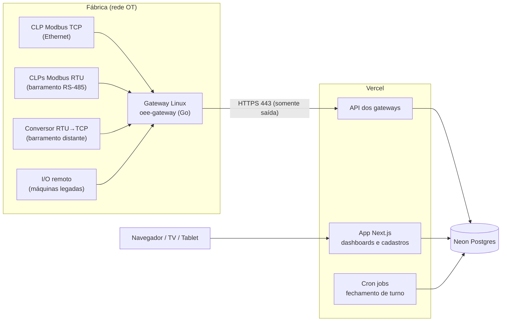

# Engemase OEE

Plataforma de monitoramento de **OEE (Overall Equipment Effectiveness)** para máquinas industriais, **independente da marca do CLP**.

> **Status:** planejamento concluído e **protótipo da interface** em andamento em [`apps/web`](apps/web/) (dados simulados, roda localmente). Arquitetura e plano em [`docs/`](docs/).

## Em uma frase

Um **gateway Linux** instalado na fábrica conversa com os CLPs por **Modbus TCP ou Modbus RTU (RS-485)**, calcula estados e contagens localmente e envia os dados por **HTTPS de saída** para uma **plataforma web em Next.js na Vercel**, com banco **Postgres na Neon**.



## Stack proposta

| Camada | Escolha |
|---|---|
| Gateway (borda) | Agente próprio em **Go** (binário único, roda em ARM64/x86), Debian, systemd. Hardware padrão: **Seeed reComputer R1000 sem rádio** (3× RS-485 isoladas, 2× Ethernet, trilho DIN, 24 VDC) |
| Protocolos | **Modbus TCP e Modbus RTU (RS-485)** no MVP. S7, EtherNet/IP, OPC UA e outros em fase futura |
| Buffer local | SQLite (store-and-forward: nenhum dado se perde se a internet cair) |
| Plataforma web | **Next.js** (App Router) + TypeScript na **Vercel** |
| Banco de dados | **Neon Postgres** (via integração nativa da Vercel) + **Drizzle ORM** |
| Autenticação | Better Auth (organizações multi-tenant e papéis) |
| UI | Tailwind CSS + shadcn/ui + Apache ECharts |
| Jobs | Vercel Cron |
| Monorepo | pnpm + Turborepo (TypeScript) e módulo Go em `gateway/` |

## Documentação

| # | Documento | Conteúdo |
|---|---|---|
| 01 | [Visão e requisitos](docs/01-visao-e-requisitos.md) | Objetivo, perfis, requisitos, premissas e **perguntas em aberto** |
| 02 | [Arquitetura geral](docs/02-arquitetura.md) | Componentes, fluxos, escalabilidade, estrutura do repositório |
| 03 | [Gateway (borda)](docs/03-gateway.md) | Hardware, agente Go, drivers por marca, buffer, OTA |
| 04 | [Protocolo gateway ↔ nuvem](docs/04-protocolo-gateway-nuvem.md) | Contrato da API, provisionamento, sincronização, comandos |
| 05 | [Plataforma web](docs/05-plataforma-web.md) | Módulos, telas, autogestão, tempo real, cron |
| 06 | [Banco de dados](docs/06-banco-de-dados.md) | **Neon vs Prisma Postgres**, modelo de dados, volume, retenção |
| 07 | [Cálculo de OEE](docs/07-calculo-oee.md) | Fórmulas, modelo de estados, borda vs nuvem, casos de borda |
| 08 | [Segurança e operação](docs/08-seguranca-e-operacao.md) | Segurança OT/IT, ambientes, CI/CD, observabilidade, custos |
| 09 | [Roadmap](docs/09-roadmap.md) | Fases, entregas e critérios de saída |
| 10 | [Decisões arquiteturais (ADRs)](docs/10-decisoes-arquiteturais.md) | Registro das decisões e alternativas avaliadas |
| 11 | [Integração Modbus](docs/11-integracao-modbus.md) | Suporte por CLP, **bloco OEE padrão Engemase**, RS-485, comissionamento |
| 12 | [Acesso remoto (VPN)](docs/12-acesso-remoto-vpn.md) | VPN de manutenção sob demanda, aprovada pelo cliente e auditada |
| 13 | [Notificações e alertas](docs/13-notificacoes-e-alertas.md) | Central no app, Web Push, e-mail/WhatsApp, regras e anti-spam |
| 14 | [Identidade visual e temas](docs/14-identidade-visual-e-temas.md) | Marca Engemase, cores por cliente, tema claro/escuro/automático |

## Estrutura planejada do repositório

```
engemase-oee/
├── apps/
│   └── web/                  # Next.js (dashboards, cadastros, API dos gateways, cron)
├── packages/
│   ├── db/                   # Schema Drizzle, migrações SQL, seeds
│   ├── contracts/            # Contrato gateway↔nuvem (Zod → JSON Schema)
│   ├── oee-core/             # Cálculo de OEE puro (TS), 100% testado
│   └── ui/                   # Componentes compartilhados (opcional)
├── gateway/                  # Agente de borda em Go (módulo próprio)
│   ├── cmd/oee-gateway/
│   └── internal/{config,drivers,engine,buffer,uplink,commands,updater}
├── tools/
│   └── plc-sim/              # Simulador de máquinas/CLPs (Modbus + OPC UA)
├── deploy/
│   └── gateway/              # systemd, pacote .deb, script de instalação, Dockerfile
└── docs/                     # Esta documentação
```
