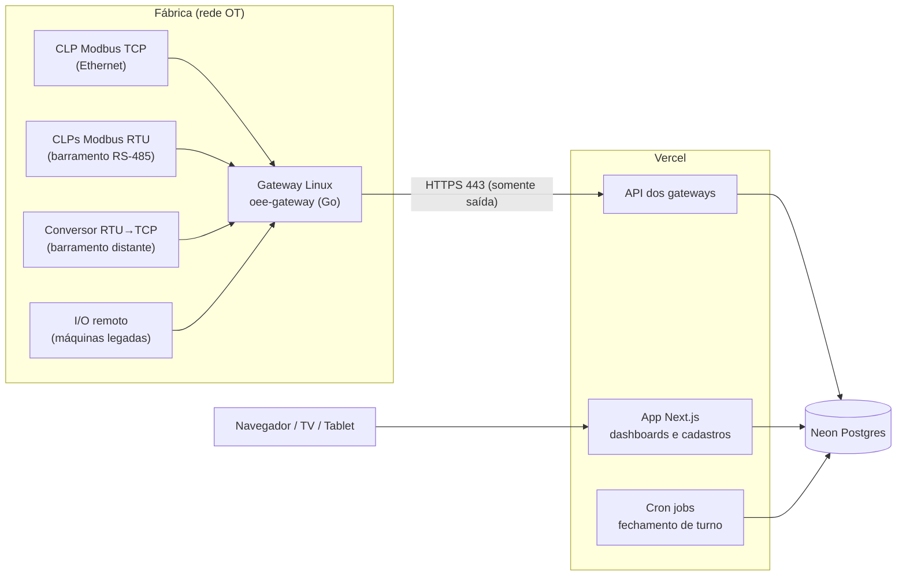

# Engemase OEE

Plataforma de monitoramento de **OEE (Overall Equipment Effectiveness)** para máquinas industriais, **independente da marca do CLP**.

> **Status:** planejamento em revisão final (ADRs aguardando aceite formal, ver [D37 em `docs/17`](docs/17-backlog-e-pendencias.md#3-decisões-pendentes-do-dono-do-produto)), **protótipo da interface** em andamento em [`apps/web`](apps/web/) (dados simulados, roda localmente) e **Fase 0 do sistema real** com código e testes: contrato gateway↔nuvem, cálculo de OEE, banco com RLS, simulador de CLP e esqueleto do agente do gateway (ver [`docs/00-status.md`](docs/00-status.md)). Arquitetura e plano em [`docs/`](docs/).

## Em uma frase

Um **gateway Linux** instalado na fábrica conversa com os CLPs por **Modbus TCP ou Modbus RTU (RS-485)**, calcula estados e contagens localmente e envia os dados por **HTTPS de saída** para uma **plataforma web em Next.js na Vercel**, com banco **Postgres na Neon**.



## Stack proposta

| Camada | Escolha |
|---|---|
| Gateway (borda) | Agente próprio em **Go** (binário único, roda em ARM64/x86), Debian, systemd. Hardware padrão: **Seeed reComputer R1000 sem rádio** (3× RS-485 isoladas, 2× Ethernet, trilho DIN, 24 VDC) |
| Protocolos | **Modbus TCP e Modbus RTU (RS-485)** no MVP. S7, EtherNet/IP, OPC UA e outros em fase futura |
| Buffer local | SQLite (store-and-forward: nenhum dado se perde se a internet cair) |
| Plataforma web | **Next.js** (App Router) + TypeScript na **Vercel** |
| Banco de dados | **Neon Postgres** (via integração nativa da Vercel) + **Drizzle ORM** |
| Autenticação | Better Auth (organizações multi-tenant e papéis) |
| UI | Tailwind CSS + shadcn/ui + Apache ECharts |
| Jobs | Vercel Cron |
| Monorepo | pnpm workspaces (TypeScript; Turborepo planejado) e módulos Go em `gateway/` e `tools/plc-sim/` |

## Documentação

| # | Documento | Conteúdo |
|---|---|---|
| 00 | [Status e próximos passos](docs/00-status.md) | O que está pronto, o que está em andamento e o que falta |
| 01 | [Visão e requisitos](docs/01-visao-e-requisitos.md) | Objetivo, perfis, requisitos, premissas e **perguntas em aberto** |
| 02 | [Arquitetura geral](docs/02-arquitetura.md) | Componentes, fluxos, escalabilidade, estrutura do repositório |
| 03 | [Gateway (borda)](docs/03-gateway.md) | Hardware, agente Go, drivers por marca, buffer, OTA |
| 04 | [Protocolo gateway ↔ nuvem](docs/04-protocolo-gateway-nuvem.md) | Contrato da API, provisionamento, sincronização, comandos |
| 05 | [Plataforma web](docs/05-plataforma-web.md) | Módulos, telas, autogestão, tempo real, cron |
| 06 | [Banco de dados](docs/06-banco-de-dados.md) | **Neon vs Prisma Postgres**, modelo de dados, volume, retenção |
| 07 | [Cálculo de OEE](docs/07-calculo-oee.md) | Fórmulas, modelo de estados, borda vs nuvem, casos de borda |
| 08 | [Segurança e operação](docs/08-seguranca-e-operacao.md) | Segurança OT/IT, ambientes, CI/CD, observabilidade, custos |
| 09 | [Roadmap](docs/09-roadmap.md) | Fases, entregas e critérios de saída |
| 10 | [Decisões arquiteturais (ADRs)](docs/10-decisoes-arquiteturais.md) | Registro das decisões e alternativas avaliadas |
| 11 | [Integração Modbus](docs/11-integracao-modbus.md) | Suporte por CLP, **bloco OEE padrão Engemase**, RS-485, comissionamento |
| 12 | [Acesso remoto (VPN)](docs/12-acesso-remoto-vpn.md) | VPN de manutenção sob demanda, aprovada pelo cliente e auditada |
| 13 | [Notificações e alertas](docs/13-notificacoes-e-alertas.md) | Central no app, Web Push, e-mail/WhatsApp, regras e anti-spam |
| 14 | [Identidade visual e temas](docs/14-identidade-visual-e-temas.md) | Marca Engemase, cores por cliente, tema claro/escuro/automático |
| 15 | [Plataforma multi-cliente](docs/15-multi-cliente-e-acesso.md) | Papéis e escopo por unidade, acesso da Engemase, isolamento, console, segurança |
| 16 | [Projeto do gateway](docs/16-projeto-do-gateway.md) | Funções, software, rede e instalação, comissionamento local, preparação e ciclo de vida (definições canônicas) |
| 17 | [Backlog e pendências](docs/17-backlog-e-pendencias.md) | O que falta, épicos até o piloto, decisões pendentes, próximos passos |

## Estrutura do repositório

```
engemase-oee/
├── apps/
│   └── web/                  # Next.js: protótipo da interface (dados simulados); depois API dos gateways e cron
├── packages/
│   ├── contracts/            # @engemase/contracts: contrato gateway↔nuvem v1 (Zod 4 → JSON Schema + fixtures)
│   ├── oee-core/             # @engemase/oee-core: cálculo de OEE puro (turnos, A, P, Q, agregação)
│   └── db/                   # @engemase/db: schema Drizzle (Postgres 18), migrações SQL e RLS por cliente
├── gateway/                  # Agente de borda oee-gateway em Go (módulo próprio)
│   ├── cmd/oee-gateway/
│   ├── internal/{app,cli,config,modbus,poller,engine,buffer,uplink,commands,contracts,ids}
│   └── test/integration/     # integração com o tools/plc-sim
├── tools/
│   └── plc-sim/              # Simulador de CLP Modbus TCP com o bloco OEE padrão (módulo Go próprio)
├── deploy/                   # Em andamento: gateway/ (systemd, nftables, pacote .deb) e image/ (imagem do sistema)
├── .github/workflows/ci.yml  # CI: jobs web, packages e go em paralelo
└── docs/                     # Esta documentação
```

Cada pacote tem um `README.md` com o que é, decisões e como testar: [contracts](packages/contracts/README.md), [oee-core](packages/oee-core/README.md), [db](packages/db/README.md), [gateway](gateway/README.md), [plc-sim](tools/plc-sim/README.md).

## Como rodar

Requisitos: **Node 22**, **pnpm 10** (a versão exata está em `packageManager`) e **Go 1.24**.

```bash
pnpm install
pnpm dev                   # protótipo em http://localhost:3000
```

Testes e verificações (os mesmos que o CI roda):

```bash
pnpm test                  # testes de todos os pacotes TS (packages/*), com Vitest
pnpm typecheck:packages    # tsc --noEmit nos pacotes
pnpm typecheck             # pacotes + apps/web
pnpm lint                  # ESLint do apps/web
pnpm test:go               # go test ./... no gateway/ e no tools/plc-sim/ (GOTOOLCHAIN=local)
pnpm test:go:integration   # gateway lendo o plc-sim de verdade (compila e sobe o simulador)
pnpm vet:go                # go vet nos dois módulos Go
```

Um pacote só: `pnpm --filter @engemase/oee-core test` (ou `@engemase/contracts`, `@engemase/db`). Os testes do `packages/db` usam **PGlite** (Postgres em WASM) e não precisam de servidor. Os testes do gateway leem as fixtures e o JSON Schema de `packages/contracts`, por isso rodam dentro do monorepo.

O CI ([`.github/workflows/ci.yml`](.github/workflows/ci.yml)) roda em todo push e pull request, em três jobs paralelos:
- **web:** typecheck, lint e build do `apps/web`;
- **packages:** typecheck e testes dos pacotes;
- **go:** gofmt, `go vet`, `go test -race`, integração com o simulador e compilação do agente para arm64.
