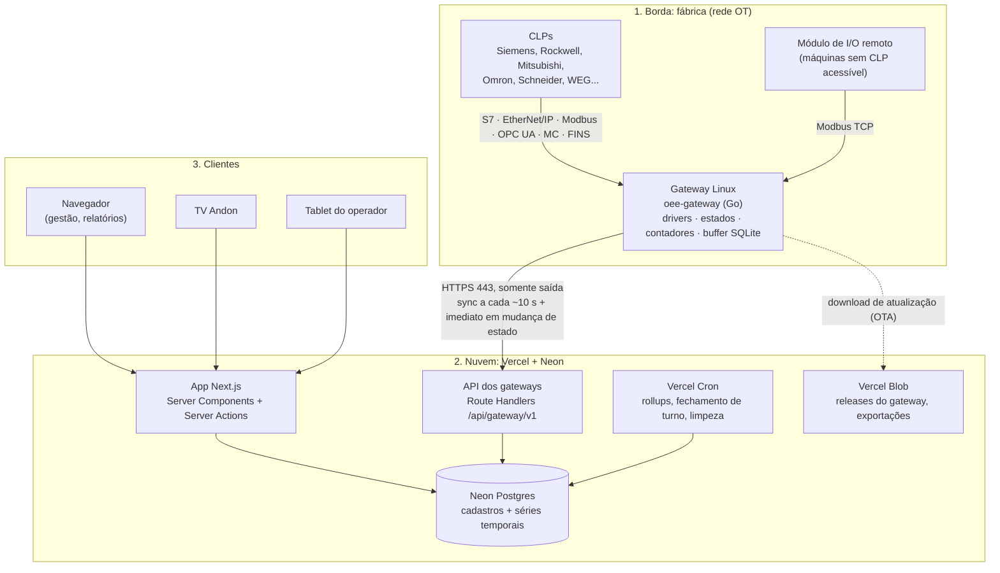
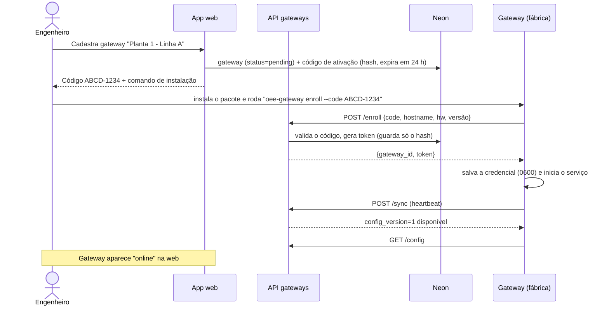
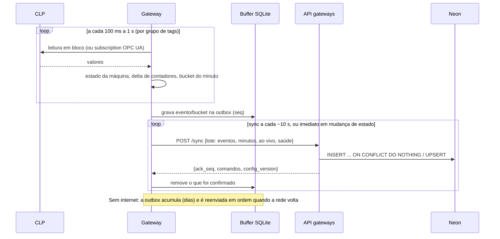

# 02 — Arquitetura geral

## Visão em camadas



## Princípios

1. **Borda inteligente, nuvem simples.** O gateway resolve tudo o que é específico do chão de fábrica: protocolos, leitura rápida (100 ms a 1 s), determinação de estado, contadores com overflow/reset e buffer offline. A nuvem recebe **eventos e agregados já normalizados**, independentes do CLP.
2. **Somente conexões de saída.** O gateway nunca recebe conexões. Configuração e comandos são *puxados* por ele. Isso evita abrir portas na rede da fábrica, algo que o TI industrial normalmente não aceita.
3. **Configuração centralizada.** Toda a configuração (CLPs, tags, máquinas) mora na nuvem, versionada. O gateway baixa, valida, aplica e guarda a última versão boa localmente.
4. **Idempotência ponta a ponta.** Todo dado enviado tem um identificador único gerado na borda. Reenvios (após queda de rede) nunca duplicam contagens.
5. **O tempo da borda manda.** Os timestamps são gerados no gateway (sincronizado por NTP), não na chegada à nuvem. Dados atrasados são encaixados no lugar certo e disparam recálculo.
6. **Leitura somente (v1).** O gateway não escreve no CLP. Isso reduz o risco e facilita a aprovação pelo cliente.
7. **Tudo versionado.** Contrato da API (`/v1`), configuração (`config_version`) e agente (semver).
8. **Postgres padrão.** Nada que prenda a um fornecedor: a mesma base roda na Neon, em RDS, no Supabase ou self-hosted.

## Componentes

| Componente | Onde roda | Responsabilidade | Detalhes |
|---|---|---|---|
| `oee-gateway` | Gateway Linux na fábrica | Ler CLPs, determinar estados, contar peças, agregar por minuto, guardar offline, sincronizar com a nuvem, executar comandos e se atualizar | [03](03-gateway.md) |
| API dos gateways | Vercel Functions (Next.js Route Handlers) | Provisionamento, ingestão em lote, entrega de configuração, fila de comandos | [04](04-protocolo-gateway-nuvem.md) |
| App web | Vercel (Next.js) | Dashboards, cadastros, autogestão, relatórios, tela do operador, TV | [05](05-plataforma-web.md) |
| Jobs agendados | Vercel Cron → Route Handlers | Fechar turnos, recalcular períodos com dados atrasados, detectar gateway offline, retenção | [05](05-plataforma-web.md) |
| Banco | Neon Postgres | Cadastros, eventos de estado, agregados por minuto, OEE consolidado, auditoria | [06](06-banco-de-dados.md) |
| Cálculo de OEE | Pacote TS `@engemase/oee-core` | Funções puras de cálculo, usadas pela API, pelo app e pelos jobs | [07](07-calculo-oee.md) |
| Armazenamento de arquivos | Vercel Blob | Binários assinados do gateway (OTA), exportações | [08](08-seguranca-e-operacao.md) |
| Simulador | `tools/plc-sim` (local e CI) | Máquinas virtuais via Modbus e OPC UA, para desenvolvimento, testes e demonstração | [03](03-gateway.md) |

## Fluxos principais

### A. Provisionamento de um gateway



### B. Coleta → nuvem



### C. Configuração remota e comandos

- O engenheiro altera tags na web → nova `config_version` (snapshot JSON imutável).
- Na próxima resposta do `/sync`, o gateway vê a versão nova, faz `GET /config`, valida e aplica sem reiniciar. Depois informa a versão aplicada (ou o erro).
- Comandos (ex.: **"testar leitura da tag"**) entram em uma fila no banco e vão na resposta do `/sync`. O gateway executa e devolve o resultado no `/sync` seguinte. A espera percebida é de 1 a 10 s. Para comandos interativos, o gateway entra temporariamente em modo de sync rápido (1 s).

### D. Visualização ao vivo

- A ingestão atualiza `machine_live` (uma linha por máquina, via upsert).
- As telas fazem *polling* leve a cada 3–5 s (TanStack Query), lendo só as máquinas visíveis.
- OEE do turno atual: calculado sob demanda a partir dos agregados por minuto (barato: ≤ 720 linhas por máquina em um turno de 12 h).
- Push em tempo real (WebSocket/serviço gerenciado) fica para a Fase 3, se for necessário. Ver [ADR-009](10-decisoes-arquiteturais.md#adr-009--tempo-real-por-polling-no-mvp).

### E. Fechamento de turno

- Um cron a cada minuto identifica turnos encerrados (no fuso de cada planta) e consolida `oee_shift`.
- Dados que chegam atrasados (gateway que ficou offline) marcam o turno como "sujo". Um cron a cada 5 min recalcula os turnos sujos.

## Escalabilidade

### Números de referência

Estimativas para **100 máquinas** em **20 gateways**:

| Fluxo | Taxa |
|---|---|
| Requisições `/sync` | 20 gateways × 6/min ≈ **2 req/s** (+ picos em mudanças de estado) |
| Linhas de agregado por minuto | 100 × 1.440/dia ≈ **144 mil/dia** (~52 milhões/ano, ~5 GB/ano) |
| Eventos de estado | ~10–50 mil/dia |
| Polling das telas | 50 telas × 1 req/4 s ≈ **12 req/s** (consultas pequenas) |

Esse volume é **baixo** para Postgres e para Vercel Functions. O gargalo real, se houver, será o custo por invocação e a quantidade de conexões. Ambos têm mitigação conhecida: lotes maiores e o pooler da Neon.

### Caminho de evolução

| Estágio | Gatilho | Mudança |
|---|---|---|
| **1 (MVP)** | — | HTTPS em lote → Vercel → Neon. Polling nas telas |
| **2** | Muitas telas abertas ou exigência de latência < 2 s | Push em tempo real: WebSockets da Vercel (suporte recente; a conexão encerra no limite de duração da função e o fan-out precisa de pub/sub) ou serviço gerenciado (Ably/Pusher) |
| **3** | > ~300 gateways, latência sub-segundo ou necessidade de MQTT/Sparkplug pelo cliente | Broker MQTT gerenciado (HiveMQ/EMQX Cloud) + worker consumidor. O worker roda fora das Functions: Vercel Daemons (beta hoje) ou Fly.io/Railway. O agente já nasce com a interface `Uplink`, e o MQTT é só outra implementação |
| **4** | Histórico bruto muito grande ou analytics pesado | Réplica de leitura na Neon para relatórios. Arquivar o histórico frio (Parquet no Blob/S3). Avaliar banco colunar para analytics |

## Estrutura do repositório (monorepo)

```
engemase-oee/
├── apps/
│   └── web/                      # Next.js na Vercel
│       ├── app/(app)/[org]/...   # telas por organização
│       ├── app/api/gateway/v1/   # API dos gateways
│       ├── app/api/cron/         # jobs agendados
│       └── server/               # camada de acesso a dados (sempre com escopo de tenant)
├── packages/
│   ├── db/                       # Drizzle: schema, migrações SQL, seeds
│   ├── contracts/                # Zod → JSON Schema do protocolo gateway↔nuvem
│   ├── oee-core/                 # Cálculo de OEE (puro, testado)
│   └── ui/                       # Componentes compartilhados (se necessário)
├── gateway/                      # Módulo Go independente (go.mod próprio)
│   ├── cmd/oee-gateway/          # main: run, enroll, version, diag
│   ├── internal/config/          # carga, validação e aplicação da config
│   ├── internal/drivers/         # modbus, opcua, s7, eip, mc, fins, sim
│   ├── internal/engine/          # scheduler, máquina de estados, contadores, buckets
│   ├── internal/buffer/          # outbox SQLite
│   ├── internal/uplink/          # https (MVP), mqtt (futuro)
│   ├── internal/commands/        # executor de comandos remotos
│   └── internal/updater/         # OTA com verificação de assinatura
├── tools/plc-sim/                # simulador de máquinas (Go): Modbus + OPC UA
├── deploy/gateway/               # unit systemd, .deb (nfpm), install.sh, Dockerfile
├── .github/workflows/            # CI: web, gateway, contratos, releases
├── turbo.json · pnpm-workspace.yaml
└── docs/
```

**Por que monorepo:** o contrato gateway↔nuvem, o schema do banco e o cálculo de OEE evoluem juntos. Uma mudança no protocolo vira **um único PR**, que altera o agente, a API e os testes de contrato ao mesmo tempo.
