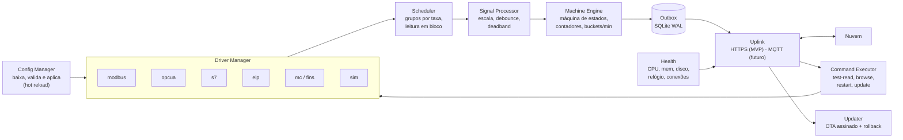

# 03 — Gateway (borda)

O gateway é o coração da "independência de marca". Ele traduz qualquer CLP para um modelo único de sinais de OEE e garante que nada se perca.

## Responsabilidades

1. Conectar-se aos CLPs pelos protocolos nativos, **somente leitura**.
2. Ler as tags no ritmo configurado (polling em bloco ou *subscription* OPC UA).
3. Normalizar: escala, tipo e *debounce*.
4. Determinar o **estado da máquina** (produzindo, parada, falha, sem comunicação...).
5. Calcular **deltas de contadores**, tratando overflow e reset.
6. Gerar **eventos de mudança de estado** e **agregados por minuto**.
7. Guardar tudo numa **outbox SQLite** e sincronizar com a nuvem, com confirmação.
8. Puxar **configuração** e **comandos** da nuvem, e aplicá-los.
9. Reportar a **saúde**: conexões, fila, CPU, memória, disco, relógio.
10. **Atualizar a si mesmo** (OTA), com rollback.

## Hardware recomendado

Requisitos mínimos:

| Item | Mínimo | Recomendado |
|---|---|---|
| CPU | ARM64 ou x86-64, 2 núcleos | 4 núcleos |
| RAM | 1 GB | 2–4 GB |
| Armazenamento | 8 GB eMMC/SSD **industrial** | 32 GB+. Evitar cartão SD: o buffer grava continuamente |
| Rede | **2 interfaces Ethernet** (OT e IT separadas) | + 4G opcional para fábricas sem rede IT |
| Serial | RS-485 se houver Modbus RTU | — |
| Ambiente | Trilho DIN, 24 VDC, sem ventoinha, 0–55 °C | Watchdog de hardware, RTC com bateria |

Opções de mercado a avaliar (todas com Linux baseado em Debian):

- **Siemens SIMATIC IOT2050**: forte em clientes Siemens.
- **Revolution Pi (Kunbus)**: baseado em Raspberry Pi Compute Module, bom custo e trilho DIN.
- **Moxa UC-8200 / UC-3100**: robusto, com Linux industrial da Moxa.
- **Advantech / OnLogic**: PCs industriais x86 fanless, quando houver muitos CLPs por gateway.

> **Decisão sugerida:** padronizar um modelo ARM64 (custo) e um x86 (alta carga). O agente compila para os dois.

**Capacidade por gateway (estimativa a validar na PoC):** de 30 a 50 CLPs com ~20 tags cada, a 500 ms, num ARM64 de 4 núcleos. O limite costuma estar no CLP e na rede, não no gateway.

## Sistema operacional e instalação

- **Debian 12/13** (ou o derivado do fabricante), com `chrony` (NTP), `unattended-upgrades` e `nftables`.
- O agente roda como **serviço systemd**, com usuário dedicado sem privilégios (`oee`).
- Distribuição: **pacote `.deb`** (gerado com nfpm/goreleaser) e script de instalação. Imagem **Docker** opcional, para quem já usa containers.
- Diretórios:
  - `/usr/bin/oee-gateway`: binário
  - `/etc/oee-gateway/credentials.json`: credencial (permissão 0600)
  - `/var/lib/oee-gateway/`: `buffer.db`, `config.json` (última config boa) e estado dos contadores
  - logs: journald

Fluxo de instalação no cliente:

```bash
sudo apt install ./oee-gateway_1.0.0_arm64.deb
```

```bash
sudo oee-gateway enroll --url https://oee.engemase.com.br --code ABCD-1234
```

```bash
sudo systemctl enable --now oee-gateway
```

## Por que Go

| Critério | Go | Node.js/TS | Python |
|---|---|---|---|
| Distribuição | **Binário único estático**, sem runtime | Precisa do Node e de `node_modules` | Precisa de Python e de dependências |
| Memória típica | **20–50 MB** | 80–200 MB | 60–150 MB |
| Cross-compile ARM/x86 | Trivial (`GOARCH`) | Depende de módulos nativos | Depende de wheels |
| Concorrência (N CLPs em paralelo) | Goroutines, natural | Event loop, bom | asyncio, mais trabalhoso |
| Robustez 24/7 | Excelente | Boa | Boa |
| Ecossistema industrial | Bom (ver tabela abaixo) | Bom | **O melhor** |

Go foi escolhido pela operação: um binário só, pouca RAM, atualização trivial e nenhum runtime para gerenciar em centenas de gateways remotos. O custo é ter uma segunda linguagem no monorepo, mitigado pelo contrato em JSON Schema (ver [04](04-protocolo-gateway-nuvem.md)). Ver [ADR-002](10-decisoes-arquiteturais.md#adr-002--agente-de-borda-próprio-em-go).

## Arquitetura interna do agente



### Interface de driver

Todo protocolo implementa a mesma interface. Adicionar uma marca nova significa escrever um driver novo, sem tocar no resto:

```go
type Driver interface {
    // Conecta usando os parâmetros da config (host, porta, rack/slot, unit id...).
    Connect(ctx context.Context) error
    Close() error

    // Lê um conjunto de endereços. O driver agrupa leituras contíguas em blocos.
    Read(ctx context.Context, reqs []ReadRequest) ([]ReadResult, error)

    // Opcional: só para protocolos que permitem descoberta (OPC UA, CIP com tags simbólicas).
    Browse(ctx context.Context, node string) ([]BrowseNode, error)

    Status() ConnStatus // conectado, último erro, latência média
}
```

Regras comuns a todos os drivers: reconexão com *backoff* exponencial, *timeout* por leitura, limite de requisições simultâneas por CLP (para não sobrecarregá-lo) e métricas de latência e erros.

## Cobertura de marcas e protocolos

| Fabricante / família | Protocolo preferido | Alternativa | Fase |
|---|---|---|---|
| **Siemens** S7-1200 / S7-1500 | **S7comm** (exige PUT/GET habilitado e acesso não otimizado aos DBs lidos) | OPC UA nativo (exige licença de runtime OPC UA da Siemens) | MVP |
| **Siemens** S7-300 / S7-400 | S7comm | — | MVP |
| **Rockwell / Allen-Bradley** ControlLogix, CompactLogix, Micro800 | **EtherNet/IP (CIP)**, tags simbólicas | OPC UA via servidor de terceiros | F2 |
| Rockwell MicroLogix / SLC 500 | EtherNet/IP (PCCC) | — | F2 |
| **Schneider** M221, M241, M340, M580 | **Modbus TCP** | OPC UA (M580/M262) | MVP |
| **WEG** (CLIC, TPW, PLC300...) | **Modbus TCP/RTU** | — | MVP |
| **Mitsubishi** FX5, iQ-R, Q, L | **MC protocol / SLMP** (3E) | OPC UA (módulo dedicado) | F2 |
| **Omron** CP1, CJ2 | **FINS** (UDP/TCP) | — | F2 |
| **Omron** NJ/NX | EtherNet/IP (CIP) | OPC UA nativo | F2 |
| **Beckhoff** | OPC UA | ADS (avaliar) | MVP (via OPC UA) |
| Altus, Delta, Unitronics, Eaton, outros | **Modbus TCP** ou **OPC UA** | — | MVP |
| **Qualquer servidor OPC UA** (Kepware, Ignition, SCADA existente) | OPC UA | — | MVP |
| **Máquina legada / sem acesso ao CLP** | **Módulo de I/O remoto Modbus TCP** (ex.: Moxa ioLogik, Advantech ADAM, WAGO) lendo sinais discretos: rodando, pulso de ciclo, refugo | — | MVP |

> **Ponto-chave:** Modbus TCP + OPC UA + S7 cobrem a maioria dos casos já no MVP. O módulo de I/O remoto garante que **qualquer máquina**, mesmo sem CLP acessível ou com CLP fechado pelo fabricante, possa ser monitorada. Pulsos de contagem devem usar o **contador de hardware do módulo de I/O**. Não se deve contar pulsos por polling, porque pulsos curtos se perdem.

### Bibliotecas Go candidatas (validar na Fase 0)

| Protocolo | Biblioteca | Observação |
|---|---|---|
| Modbus TCP/RTU | `github.com/simonvetter/modbus` | TCP, RTU, RTU-over-TCP |
| OPC UA | `github.com/gopcua/opcua` | Cliente, subscriptions, browse, segurança |
| Siemens S7 | `github.com/robinson/gos7` | S7comm, endereçamento absoluto |
| EtherNet/IP (Rockwell, Omron NJ/NX) | `libplctag` (C, via cgo) | Muito madura. Alternativa em Go puro: `gologix` |
| Mitsubishi MC/SLMP | `go-mcprotocol` ou implementação própria | Protocolo simples (frame 3E) |
| Omron FINS | Implementação própria ou lib comunitária | Protocolo simples |
| Vários (referência) | Apache PLC4X (`plc4go`) | Útil como referência ou plano B. A maturidade varia por driver |

Cada biblioteca passa por um teste de bancada contra um CLP real (ou um simulador confiável) antes de ser adotada. O que não passar vira implementação própria, já que esses protocolos são bem documentados.

### Alternativas avaliadas (e por que não como base)

| Opção | Por que não como base |
|---|---|
| **Node-RED** | Ótimo para protótipo, mas a configuração por fluxos não escala para centenas de gateways gerenciados remotamente e é difícil de versionar e validar |
| **EMQX Neuron** | A edição open source inclui só Modbus TCP e MQTT. S7, OPC UA e outros são comerciais (licença por gateway) |
| **Kepware / Ignition Edge** | Cobertura de drivers excelente, mas com licença por gateway (custo recorrente). **Continuam compatíveis:** se um cliente já tiver um, nosso gateway lê dele via OPC UA |
| **Telegraf** | Coleta métricas bem, mas não tem máquina de estados, contadores com reset nem config remota por tenant |

## Configuração de tags

As tags têm **papéis** (*roles*) que dizem ao motor de OEE o que cada sinal significa. É isso que torna a nuvem independente do CLP.

| Papel | Tipo | Significado |
|---|---|---|
| `state.running` | bool | Máquina produzindo |
| `state.fault` | bool | Máquina em falha |
| `state.code` | int | Código de estado do CLP (mapeado para estados OEE na config) |
| `fault.code` | int | Código do alarme ativo (para classificar paradas automaticamente) |
| `count.total` | contador | Peças produzidas (acumulado do CLP) |
| `count.good` | contador | Peças boas (se existir) |
| `count.reject` | contador | Refugo (se existir) |
| `product.code` | int/string | Produto ou receita atual |
| `speed.actual` | número | Velocidade (opcional, para gráficos) |
| `custom` | qualquer | Histórico livre (temperatura, pressão...), com deadband |

Exemplo de trecho da config recebida pelo gateway (JSON gerado pela nuvem):

```json
{
  "config_version": 42,
  "devices": [
    {
      "id": "dev_01JD3K",
      "name": "CLP Injetora 03",
      "protocol": "s7",
      "params": { "host": "192.168.10.21", "rack": 0, "slot": 1, "timeout_ms": 1000 },
      "tags": [
        { "id": "tag_a1", "address": { "area": "DB", "db": 100, "offset": 0, "bit": 0 }, "type": "bool",   "poll_ms": 250, "role": "state.running", "machine_id": "mch_inj03" },
        { "id": "tag_a2", "address": { "area": "DB", "db": 100, "offset": 2 },           "type": "uint32", "poll_ms": 500, "role": "count.total",   "machine_id": "mch_inj03" },
        { "id": "tag_a3", "address": { "area": "DB", "db": 100, "offset": 6 },           "type": "uint32", "poll_ms": 500, "role": "count.reject",  "machine_id": "mch_inj03" },
        { "id": "tag_a4", "address": { "area": "DB", "db": 100, "offset": 10 },          "type": "int16",  "poll_ms": 500, "role": "fault.code",    "machine_id": "mch_inj03" }
      ]
    }
  ],
  "machines": [
    {
      "id": "mch_inj03",
      "state_rules": { "mode": "signals", "comm_loss_after_s": 10 },
      "counters": { "total": { "max": 4294967295, "reset_detection": true } }
    }
  ],
  "uplink": { "sync_interval_s": 10, "max_batch_items": 2000 }
}
```

O endereço (`address`) é **estruturado por protocolo**, não uma string livre. A web valida cada campo antes de gerar a config: unit id e registrador no Modbus, nodeId no OPC UA, área/DB/offset no S7, nome simbólico no CIP.

## Motor de máquina (Machine Engine)

### Determinação do estado

Três modos, configuráveis por máquina:

1. **`signals`**: usa `state.running` e `state.fault`. Falha tem prioridade sobre rodando; nenhum dos dois significa parada.
2. **`state_code`**: mapeia o `state.code` do CLP (ex.: 1 = auto, 2 = manual, 5 = alarme) para estados OEE.
3. **`count_derived`**: para máquinas só com contador (típico em retrofit com I/O). A máquina está **produzindo** se houve peça nos últimos *N × tempo de ciclo ideal*; senão, está **parada**.

Em todos os modos, se o driver não conseguir ler por mais de `comm_loss_after_s`, o estado vira **`NO_COMM`**.

Toda mudança de estado gera um **evento** (UUIDv7, timestamp, estado, código de falha). Um *debounce* configurável (ex.: 2 s) evita eventos espúrios.

### Contadores

O CLP fornece contadores **acumulados**. O gateway calcula os deltas:

- **Overflow:** se o valor caiu e o anterior estava perto do máximo do tipo (ex.: uint16 = 65535), então `delta = (max − anterior) + atual + 1`.
- **Reset:** se o valor caiu sem estar perto do máximo (o operador zerou o contador), então `delta = atual` e um evento `counter_reset` é registrado.
- **Persistência:** o último valor lido é salvo no SQLite. Após reiniciar o gateway, o delta continua correto, sem perder peças.
- **Sanidade:** saltos absurdos (ex.: +1 milhão em 1 s) são descartados e geram um alerta.

### Agregados por minuto

A cada minuto fechado, por máquina:

```json
{ "machine_id": "mch_inj03", "t": "2026-11-11T13:02:00Z",
  "run_s": 38, "stop_s": 0, "fault_s": 22, "no_comm_s": 0,
  "total": 12, "reject": 1, "product": "PRD-001" }
```

Por que minuto: é compacto, cobre qualquer janela de análise (hora, turno, dia) e as fronteiras de turno caem em minutos inteiros. A precisão de segundos fica nos **eventos de estado**, usados na linha do tempo e no cálculo de disponibilidade. Ver [07](07-calculo-oee.md).

## Buffer offline (store-and-forward)

- SQLite em modo WAL. Tabela `outbox` com `seq` monotônico, tipo e payload.
- Ordem de envio: **eventos e minutos primeiro**, amostras `custom` depois (são descartáveis se o buffer encher).
- Capacidade: 30 dias de eventos e minutos ocupam poucos MB por máquina. O limite padrão é de 1 GB ou 30 dias, com alarme a 80%.
- Na volta da internet, o reenvio é **em ordem e com limite de taxa** (ex.: lotes de 2.000 itens), para não sobrecarregar a nuvem quando vários gateways voltam juntos.
- Só remove da outbox o que a nuvem confirmou (`ack_seq`).

## Relógio

- `chrony` sincroniza com NTP público ou com o servidor NTP da fábrica.
- Toda resposta do `/sync` traz `server_time`. O agente calcula a diferença e a reporta. Acima de 2 s, a web exibe um alerta de relógio.
- Os intervalos internos usam relógio monotônico, para que ajustes de NTP não distorçam as durações.

## Atualização remota (OTA), Fase 2

1. O CI (GitHub Actions + goreleaser) gera binários para `linux/arm64`, `linux/amd64` e `linux/arm` (v7), **assinados** (chave Ed25519; a pública vai embutida no agente), e publica no Vercel Blob.
2. Na web, o admin define o canal (`stable`/`beta`) e a versão-alvo por gateway ou grupo (rollout gradual).
3. O agente baixa o binário, verifica hash e assinatura, troca o executável, reinicia via systemd e reporta a versão.
4. **Rollback automático:** se o novo binário não fizer um `/sync` bem-sucedido em até 5 min, um watchdog restaura o anterior.

## Página local de diagnóstico (Fase 2)

Uma página HTTP simples, **só na interface OT ou em localhost**, para o comissionamento em campo sem internet: status das conexões, últimas leituras, fila pendente e conectividade com a nuvem. Também haverá `oee-gateway diag` na linha de comando.

## Segurança no gateway

Ver [08](08-seguranca-e-operacao.md#gateway). Resumo: usuário sem privilégios, hardening do systemd, credencial com permissão 0600, `ip_forward=0` (o gateway **não roteia** entre OT e IT), firewall somente de saída, SSH desabilitado ou só com chave, atualizações de segurança automáticas do SO.

## Simulador (`tools/plc-sim`)

Ferramenta em Go que sobe servidores **Modbus TCP** e **OPC UA** simulando máquinas: ciclos, paradas aleatórias, falhas com códigos, refugo e reset de contador. Serve para:

- desenvolver a plataforma sem CLP físico;
- testes automatizados do agente no CI (cenários determinísticos com *seed*);
- demonstrações comerciais.
