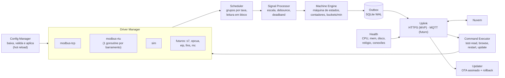

# 03 — Gateway (borda)

O gateway é o coração da "independência de marca". Ele traduz qualquer CLP para um modelo único de sinais de OEE e garante que nada se perca.

## Responsabilidades

1. Conectar-se aos CLPs pelos protocolos nativos, **somente leitura**.
2. Ler as tags no ritmo configurado (polling em bloco no Modbus; *subscription* só com protocolos futuros, como OPC UA).
3. Normalizar: escala, tipo e *debounce*.
4. Determinar o **estado da máquina** (produzindo, parada, falha, sem comunicação...).
5. Calcular **deltas de contadores**, tratando overflow e reset.
6. Gerar **eventos de mudança de estado** e **agregados por minuto**.
7. Guardar tudo numa **outbox SQLite** e sincronizar com a nuvem, com confirmação.
8. Puxar **configuração** e **comandos** da nuvem, e aplicá-los.
9. Reportar a **saúde**: conexões, fila, CPU, memória, disco, relógio.
10. **Atualizar a si mesmo** (OTA), com rollback.

## Hardware recomendado

Requisitos (todos obrigatórios, exceto onde indicado):

| Item | Requisito |
|---|---|
| CPU / RAM | ARM64 ou x86-64; **2 GB de RAM** sobram (o agente usa 20–50 MB) |
| Armazenamento | **eMMC ou SSD** (nada de cartão SD: o buffer SQLite grava continuamente) |
| Rede | **2 Ethernet** (OT e IT separadas; 10/100 basta na OT) |
| Serial | **≥ 1 RS-485 isolada**, com controle de direção por hardware ou pelo driver do kernel |
| Alimentação | Faixa que cubra o **24 VDC industrial** (IEC 61131-2: ~20,4–28,8 V, com folga para transientes) |
| Montagem e ambiente | Trilho DIN, sem ventoinha, faixa industrial de temperatura |
| Software | Linux Debian (ou derivado) com acesso root para instalar nosso binário e serviço systemd |
| Desejável | Watchdog de hardware, RTC com bateria, UPS/supercapacitor contra queda de energia, **sem rádio** (evita homologação ANATEL, ver abaixo) |

### Recomendação: Seeed reComputer R1000, versão sem rádio (R10xx-00)

Gateway industrial em trilho DIN baseado no Raspberry Pi **Compute Module 4**. Pela ficha oficial da Seeed:

| Item | reComputer R1000 |
|---|---|
| RS-485 | **3 portas isoladas** (sinal e alimentação), já em modo RS-485 no boot (`/dev/ttyAMA2`, `ttyAMA3`, `ttyAMA5`) |
| Ethernet | 1× 10/100/1000 (PoE opcional) + 1× 10/100 |
| RAM / eMMC | 1, 2, 4 ou 8 GB / 8, 16 ou 32 GB (+ slot M.2 NVMe) |
| Alimentação | **9–36 VDC** ou 12–24 VAC; consumo de ~3 a 5,5 W em 24 V |
| Outros | RTC, TPM, trilho DIN ou parede; UPS/supercapacitor opcional |
| Ciclo de vida | Produção declarada até pelo menos **dez/2030** |
| SO | Raspberry Pi OS (Debian) 64 bits, root |

**Configuração a padronizar:** **R10xx-00 (sem Wi-Fi/BLE), 2 GB de RAM, 16 GB de eMMC**, com o **módulo de UPS/supercapacitor** quando a planta tiver quedas de energia frequentes.

Por que este modelo:
- **3 RS-485 isoladas e 2 Ethernet** no mesmo equipamento, que é exatamente o que a decisão por Modbus TCP/RTU pede.
- Preço de equipamento "maker industrial" (lista na faixa de **US$ 230–310** em 2026), com fabricante e ciclo de vida declarados.
- Base Raspberry Pi: ecossistema enorme, kernel mantido, mesmo binário `linux/arm64`.

Cuidados confirmados na pesquisa:
- **Comprar a série `-00` (sem rádio).** A série `-10` traz Wi-Fi/BLE no CM4 e, para revenda ou instalação em cliente, cai na exigência de homologação ANATEL do produto final (o certificado do módulo não cobre o equipamento).
- O **resistor de terminação de 120 Ω não vem montado**: usar resistor externo no borne quando o gateway for ponta do barramento. O comum do RS-485 vai no `GND_ISO`.
- Watchdog: o SoC tem watchdog interno, usado pelo systemd (`RuntimeWatchdogSec` + `WatchdogSec` no serviço). O R1100 (abaixo) acrescenta um watchdog externo.
- A versão **v1.1** da placa ligou o pino DE das RS-485 a pinos com RTS; pedir confirmação por escrito à Seeed de que o lote é v1.1.

### Alternativas avaliadas

| Opção | Quando usar | Observações |
|---|---|---|
| **Seeed reComputer R1100** (R11xx-00) | Quando watchdog externo, TPM e E/S digital pesarem mais que a 3ª RS-485 | 2× RS-485 + 2× RS-232 isoladas, 2 DI/2 DO, mesma Ethernet do R1000; preço próximo |
| **Revolution Pi Connect 4 / 5** (Kunbus) | Cliente que exige marca europeia ou **compra com nota fiscal no Brasil** | Distribuidor nacional (Omega7, São José dos Campos-SP). Preço de lista ~€420–580 (≈ 1,8–2,5× o Seeed). Quantidade/isolação da RS-485 a confirmar |
| **Siemens SIMATIC IOT2050** | Clientes "Siemens", suporte local | Imagem Debian 13 com root; 2 Ethernet; serial RS-232/422/485. Preços no Brasil muito dispersos (R$ 3,5 mil a R$ 10 mil): cotar |
| **Moxa UC-1222A** | Ambiente severo (-40 °C), marca forte | Debian (MIL3) com suporte até 2031; ~US$ 410–600 nos EUA; isolação das seriais a confirmar |
| **Advantech ECU-150** | Seriais isoladas (2.500 VDC) | O SKU barato vem com Yocto; Ubuntu só nos SKUs mais caros |
| **EDATEC ED-IPC2110** | Segundo fornecedor de CM4 | 2× RS-485 + 2× RS-232 isoladas; -25 a 60 °C; ~US$ 280 |
| **Montagem própria** (Raspberry Pi 5 + SSD NVMe + placa RS-485 isolada 7–36 V + caixa DIN) | **Bancada e laboratório**, não frota | Com as altas de memória de 2026, o custo fica parecido com o do R1000, sem certificação, garantia nem trilho DIN de fábrica |

**Descartados:** Teltonika TRB245/246 (processador MIPS com pouca RAM e flash; o SQLite em Go puro não tem port para MIPS), InHand IG502 (só SDK Python), Industrial Shields Raspberry PLC (Pi 4 com cartão SD), EMQX Neuron como base (só Modbus/MQTT no open source).

### Arquitetura alternativa: só Ethernet no gateway

Quando o barramento RS-485 estiver longe do painel do gateway, ou para aceitar hardware sem RS-485: um **conversor Modbus RTU→TCP em trilho DIN** ao lado do CLP. O gateway passa a falar só Modbus TCP (ou **RTU sobre TCP**, que a biblioteca escolhida suporta). Isso não resolve o problema de **mestre único** (ver [11](11-integracao-modbus.md#5-um-mestre-por-barramento)).

### Compra, impostos e ANATEL

- Não há distribuidor nacional confirmado da Seeed. A compra é direta, via DigiKey/Mouser ou por parceiro. Para **piloto**, courier; para **frota**, **importação formal por CNPJ** (DI) via trading, com NCM definida por despachante. A classificação (ex.: 8471.50 vs. 8517.62) muda o imposto de importação e pode exigir anuência da ANATEL.
- Ordem de grandeza: **o custo nacionalizado por courier fica acima de 2× o preço em dólar**. Para o R1000 de ~US$ 230–250, isso dá **cerca de R$ 2.400–2.700 por unidade** (estimativa de nov/2026; **pedir cotação formal**).
- **ANATEL:** preferir **versões sem rádio**. Se o cliente precisar de 4G, usar módulo/roteador já homologado e **confirmar com um OCD** se o produto final precisa de homologação própria. Confirmar também a situação de equipamentos só com Ethernet e RS-485.

**Capacidade por gateway (a validar na PoC):** um R1000 atende com folga dezenas de CLPs Modbus TCP e até 3 barramentos RS-485 com ~10 escravos cada a 19200 bps. O limite costuma estar no CLP e no barramento, não no gateway (ver [11](11-integracao-modbus.md#quanto-cabe-num-barramento)).

## Sistema operacional e instalação

- **Debian 12/13** ou o derivado do fabricante (no reComputer R1000, Raspberry Pi OS 64 bits, baseado em Debian), com `chrony` (NTP), `unattended-upgrades` e `nftables`. Os overlays de device tree do fabricante já deixam as portas RS-485 em modo RS-485.
- O agente roda como **serviço systemd**, com usuário dedicado sem privilégios (`oee`).
- Distribuição: **pacote `.deb`** (gerado com nfpm/goreleaser) e script de instalação. Imagem **Docker** opcional, para quem já usa containers.
- Diretórios:
  - `/usr/bin/oee-gateway`: binário
  - `/etc/oee-gateway/credentials.json`: credencial (permissão 0600)
  - `/var/lib/oee-gateway/`: `buffer.db`, `config.json` (última config boa) e estado dos contadores
  - logs: journald

Fluxo de instalação no cliente:

```bash
sudo apt install ./oee-gateway_1.0.0_arm64.deb
```

```bash
sudo oee-gateway enroll --url https://oee.engemase.com.br --code ABCD-1234
```

```bash
sudo systemctl enable --now oee-gateway
```

## Por que Go

| Critério | Go | Node.js/TS | Python |
|---|---|---|---|
| Distribuição | **Binário único estático**, sem runtime | Precisa do Node e de `node_modules` | Precisa de Python e de dependências |
| Memória típica | **20–50 MB** | 80–200 MB | 60–150 MB |
| Cross-compile ARM/x86 | Trivial (`GOARCH`) | Depende de módulos nativos | Depende de wheels |
| Concorrência (N CLPs em paralelo) | Goroutines, natural | Event loop, bom | asyncio, mais trabalhoso |
| Robustez 24/7 | Excelente | Boa | Boa |
| Ecossistema industrial | Bom (ver tabela abaixo) | Bom | **O melhor** |

Go foi escolhido pela operação: um binário só, pouca RAM, atualização trivial e nenhum runtime para gerenciar em centenas de gateways remotos. O custo é ter uma segunda linguagem no monorepo, mitigado pelo contrato em JSON Schema (ver [04](04-protocolo-gateway-nuvem.md)). Ver [ADR-002](10-decisoes-arquiteturais.md#adr-002--agente-de-borda-próprio-em-go).

## Arquitetura interna do agente



### Interface de driver

Todo protocolo implementa a mesma interface. Adicionar uma marca nova significa escrever um driver novo, sem tocar no resto:

```go
type Driver interface {
    // Conecta usando os parâmetros da config (host, porta, rack/slot, unit id...).
    Connect(ctx context.Context) error
    Close() error

    // Lê um conjunto de endereços. O driver agrupa leituras contíguas em blocos.
    Read(ctx context.Context, reqs []ReadRequest) ([]ReadResult, error)

    // Opcional: só para protocolos que permitem descoberta (OPC UA, CIP com tags simbólicas).
    Browse(ctx context.Context, node string) ([]BrowseNode, error)

    Status() ConnStatus // conectado, último erro, latência média
}
```

Regras comuns a todos os drivers: reconexão com *backoff* exponencial, *timeout* por leitura, limite de requisições simultâneas por CLP (para não sobrecarregá-lo) e métricas de latência e erros.

## Protocolos: Modbus TCP e RTU no MVP

Decisão: na versão 1, o gateway fala **somente Modbus**, em dois transportes ([ADR-011](10-decisoes-arquiteturais.md#adr-011--modbus-tcp-e-rtu-como-únicos-protocolos-do-mvp)):

| Transporte | Parâmetros | Uso |
|---|---|---|
| **Modbus TCP** | IP, porta (502), unit id, timeout | CLPs com Ethernet; módulos de I/O remoto; conversores RTU→TCP |
| **Modbus RTU (RS-485)** | Porta serial do gateway, velocidade, paridade, data bits, stop bits, unit id, timeout | CLPs com porta serial; vários escravos por barramento (um unit id cada) |
| RTU sobre TCP | IP, porta, unit id | Conversores serial-Ethernet transparentes |

O guia [11 — Integração Modbus](11-integracao-modbus.md) traz o suporte por marca de CLP, o **bloco OEE padrão Engemase**, as regras de RS-485 e o checklist de comissionamento.

**Ponto-chave:** em vários CLPs (Siemens S7-1200/1500, Rockwell Logix, Omron) o Modbus exige bloco no programa ou módulo extra. Quando não for possível alterar o CLP, há duas saídas: o **módulo de I/O remoto** lendo sinais da máquina (MVP) ou os **protocolos nativos** (S7comm, EtherNet/IP, FINS, OPC UA) numa fase futura. A interface de driver abaixo já prevê isso.

### Bibliotecas Go

| Uso | Biblioteca | Motivo |
|---|---|---|
| **Cliente Modbus de produção** | `github.com/grid-x/modbus` (v1.5.1, set/2026, BSD) | TCP, RTU, ASCII, RTU sobre TCP/UDP; configura o **modo RS-485 do kernel**; API com `context` e timeouts de recuperação de link. Reduzir o timeout padrão (10 s) para 200–500 ms |
| **Simulador e testes** | `github.com/simonvetter/modbus` (v1.6.4, MIT) | Tem **servidor** Modbus TCP, ideal para o `plc-sim` |
| **Buffer SQLite** | `modernc.org/sqlite` | Go puro (sem cgo): o binário continua estático para arm64/amd64 |
| Descartadas | `goburrow/modbus` (parada desde 2018), `go.bug.st/serial` (sem RS-485) | — |

A decodificação de 32 bits e float com as quatro ordens de bytes (ABCD/CDAB/BADC/DCBA) é nossa (umas 50 linhas, com testes).

### Futuro: outros protocolos

| Fabricante | Protocolo nativo (fase futura) |
|---|---|
| Siemens S7-1200/1500/300/400 | S7comm (PUT/GET, DBs não otimizados) ou OPC UA (licença de runtime) |
| Rockwell CompactLogix/ControlLogix | EtherNet/IP (CIP) — `libplctag` |
| Mitsubishi | MC protocol / SLMP |
| Omron | FINS; EtherNet/IP nos NJ/NX |
| Qualquer servidor OPC UA | OPC UA — `gopcua/opcua` |

### Alternativas avaliadas (e por que não como base)

| Opção | Por que não como base |
|---|---|
| **Node-RED** | Ótimo para protótipo, mas a configuração por fluxos não escala para centenas de gateways gerenciados remotamente e é difícil de versionar e validar |
| **EMQX Neuron** | A edição open source inclui só Modbus TCP e MQTT; o resto é comercial (licença por gateway) |
| **Kepware / Ignition Edge** | Cobertura de drivers excelente, mas com licença por gateway. **Continuam compatíveis** no futuro via OPC UA |
| **Telegraf** | Coleta métricas bem, mas não tem máquina de estados, contadores com reset nem config remota por tenant |

## Configuração de tags

As tags têm **papéis** (*roles*) que dizem ao motor de OEE o que cada sinal significa. É isso que torna a nuvem independente do CLP.

| Papel | Tipo | Significado |
|---|---|---|
| `state.running` | bool | Máquina produzindo |
| `state.fault` | bool | Máquina em falha |
| `state.code` | int | Código de estado do CLP (mapeado para estados OEE na config) |
| `fault.code` | int | Código do alarme ativo (para classificar paradas automaticamente) |
| `count.total` | contador | Peças produzidas (acumulado do CLP) |
| `count.good` | contador | Peças boas (se existir) |
| `count.reject` | contador | Refugo (se existir) |
| `product.code` | int/string | Produto ou receita atual |
| `speed.actual` | número | Velocidade (opcional, para gráficos) |
| `custom` | qualquer | Histórico livre (temperatura, pressão...), com deadband |

Exemplo de trecho da config recebida pelo gateway (JSON gerado pela nuvem), com um CLP em Modbus TCP e dois escravos num barramento RS-485:

```json
{
  "config_version": 42,
  "serial_buses": [
    { "id": "bus_1", "port": "/dev/ttyAMA2", "baud": 19200, "parity": "E", "data_bits": 8, "stop_bits": 1 }
  ],
  "devices": [
    {
      "id": "dev_inj03", "name": "CLP Injetora 03", "protocol": "modbus-tcp",
      "params": { "host": "192.168.10.23", "port": 502, "unit_id": 1, "timeout_ms": 500 },
      "blocks": [
        { "area": "holding_register", "start": 1000, "count": 14, "poll_ms": 500 }
      ],
      "tags": [
        { "id": "tag_a2", "address": { "area": "holding_register", "offset": 1002 }, "type": "uint16", "role": "state.code", "machine_id": "mch_inj03" },
        { "id": "tag_a3", "address": { "area": "holding_register", "offset": 1003 }, "type": "uint16", "role": "fault.code", "machine_id": "mch_inj03" },
        { "id": "tag_a4", "address": { "area": "holding_register", "offset": 1004 }, "type": "uint32", "word_order": "CDAB", "role": "count.total", "machine_id": "mch_inj03" },
        { "id": "tag_a5", "address": { "area": "holding_register", "offset": 1006 }, "type": "uint32", "word_order": "CDAB", "role": "count.reject", "machine_id": "mch_inj03" }
      ]
    },
    {
      "id": "dev_sop01", "name": "CLP Sopradora 01", "protocol": "modbus-rtu",
      "params": { "bus": "bus_1", "unit_id": 1, "timeout_ms": 300 },
      "tags": [
        { "id": "tag_s1", "address": { "area": "coil", "offset": 0 }, "type": "bool", "poll_ms": 250, "role": "state.running", "machine_id": "mch_sop01" },
        { "id": "tag_s2", "address": { "area": "holding_register", "offset": 100 }, "type": "uint32", "word_order": "CDAB", "poll_ms": 500, "role": "count.total", "machine_id": "mch_sop01" }
      ]
    },
    {
      "id": "dev_sop02", "name": "Módulo I/O Sopradora 02", "protocol": "modbus-rtu",
      "params": { "bus": "bus_1", "unit_id": 2, "timeout_ms": 300 },
      "tags": [
        { "id": "tag_p1", "address": { "area": "input_register", "offset": 16 }, "type": "uint32", "word_order": "CDAB", "poll_ms": 500, "role": "count.total", "machine_id": "mch_sop02" }
      ]
    }
  ],
  "machines": [
    { "id": "mch_inj03", "state_rules": { "mode": "state_code", "map": { "0": "STOPPED", "1": "RUNNING", "2": "FAULT", "3": "SETUP" }, "comm_loss_after_s": 10 } },
    { "id": "mch_sop01", "state_rules": { "mode": "signals", "comm_loss_after_s": 10 } },
    { "id": "mch_sop02", "state_rules": { "mode": "count_derived", "ideal_cycle_s": 6, "idle_after_cycles": 3 } }
  ],
  "uplink": { "sync_interval_s": 10, "max_batch_items": 2000 }
}
```

Regras do agente para RS-485: **uma goroutine por barramento**, com requisições estritamente serializadas (escravos lidos um após o outro). Dispositivos TCP têm **uma conexão persistente cada**, lidos em paralelo. Os `blocks` agrupam registradores contíguos numa só leitura (no máximo 125 registradores por leitura).

O endereço (`address`) é **estruturado** (área Modbus + offset base 0), não uma string livre. A web valida cada campo antes de gerar a config e mostra a convenção 0xxxx/1xxxx/3xxxx/4xxxx ao lado, para evitar o erro clássico de deslocamento de 1.

## Motor de máquina (Machine Engine)

### Determinação do estado

Três modos, configuráveis por máquina:

1. **`signals`**: usa `state.running` e `state.fault`. Falha tem prioridade sobre rodando; nenhum dos dois significa parada.
2. **`state_code`**: mapeia o `state.code` do CLP (ex.: 1 = auto, 2 = manual, 5 = alarme) para estados OEE.
3. **`count_derived`**: para máquinas só com contador (típico em retrofit com I/O). A máquina está **produzindo** se houve peça nos últimos *N × tempo de ciclo ideal*; senão, está **parada**.

Em todos os modos, se o driver não conseguir ler por mais de `comm_loss_after_s`, o estado vira **`NO_COMM`**.

Toda mudança de estado gera um **evento** (UUIDv7, timestamp, estado, código de falha). Um *debounce* configurável (padrão de **1 s**) evita eventos espúrios. O padrão é curto por causa do RNF02 (estado visível na web em ≤ 5 s; ver a conta do pior caso em [02](02-arquitetura.md#d-visualização-ao-vivo)).

### Contadores

O CLP fornece contadores **acumulados**. O gateway calcula os deltas:

- **Overflow:** se o valor caiu e o anterior estava perto do máximo do tipo (ex.: uint16 = 65535), então `delta = (max − anterior) + atual + 1`.
- **Reset:** se o valor caiu sem estar perto do máximo (o operador zerou o contador), então `delta = atual` e um evento `counter_reset` é registrado.
- **Persistência:** o último valor lido é salvo no SQLite. Após reiniciar o gateway, o delta continua correto, sem perder peças.
- **Sanidade:** saltos absurdos (ex.: +1 milhão em 1 s) são descartados e geram um alerta.

### Agregados por minuto

A cada minuto fechado, por máquina:

```json
{ "machine_id": "mch_inj03", "t": "2026-11-11T13:02:00Z",
  "run_s": 38, "stop_s": 0, "fault_s": 22, "setup_s": 0, "no_comm_s": 0,
  "total": 12, "reject": 1, "product": "PRD-001" }
```

Por que minuto: é compacto, cobre qualquer janela de análise (hora, turno, dia) e as fronteiras de turno caem em minutos inteiros. A precisão de segundos fica nos **eventos de estado**, usados na linha do tempo e no cálculo de disponibilidade. Ver [07](07-calculo-oee.md).

## Buffer offline (store-and-forward)

- SQLite em modo WAL. Tabela `outbox` com `seq` monotônico, tipo e payload.
- Ordem de envio: **eventos e minutos primeiro**, amostras `custom` depois (são descartáveis se o buffer encher).
- Capacidade: 30 dias de eventos e minutos ocupam poucos MB por máquina. O limite padrão é de 1 GB ou 30 dias, com alarme a 80%.
- Na volta da internet, o reenvio é **em ordem e com limite de taxa** (ex.: lotes de 2.000 itens), para não sobrecarregar a nuvem quando vários gateways voltam juntos.
- Só remove da outbox o que a nuvem confirmou (`ack_seq`).

## Relógio

- `chrony` sincroniza com NTP público ou com o servidor NTP da fábrica.
- Toda resposta do `/sync` traz `server_time`. O agente calcula a diferença e a reporta. Acima de 2 s, a web exibe um alerta de relógio.
- Os intervalos internos usam relógio monotônico, para que ajustes de NTP não distorçam as durações.

## Atualização remota (OTA), Fase 2

1. O CI (GitHub Actions + goreleaser) gera binários para `linux/arm64`, `linux/amd64` e `linux/arm` (v7), **assinados** (chave Ed25519; a pública vai embutida no agente), e publica no Vercel Blob.
2. Na web, o admin define o canal (`stable`/`beta`) e a versão-alvo por gateway ou grupo (rollout gradual).
3. O agente baixa o binário, verifica hash e assinatura, troca o executável, reinicia via systemd e reporta a versão.
4. **Rollback automático:** se o novo binário não fizer um `/sync` bem-sucedido em até 5 min, um watchdog restaura o anterior.

## Página local de diagnóstico (Fase 2)

Uma página HTTP simples, **só na interface OT ou em localhost**, para o comissionamento em campo sem internet: status das conexões, últimas leituras, fila pendente e conectividade com a nuvem. Também haverá `oee-gateway diag` na linha de comando.

## Segurança no gateway

Ver [08](08-seguranca-e-operacao.md#gateway). Resumo: usuário sem privilégios, hardening do systemd, credencial com permissão 0600, `ip_forward=0` (o gateway **não roteia** entre OT e IT), firewall somente de saída, OpenSSH escutando **só em 127.0.0.1** (alcançável apenas por uma sessão de acesso remoto aprovada, com certificados SSH de curta duração; ver [12](12-acesso-remoto-vpn.md)), atualizações de segurança automáticas do SO.

## Simulador (`tools/plc-sim`)

Ferramenta em Go que sobe servidores **Modbus TCP** simulando máquinas: ciclos, paradas aleatórias, falhas com códigos, refugo e reset de contador. Serve para:

- desenvolver a plataforma sem CLP físico;
- testes automatizados do agente no CI (cenários determinísticos com *seed*);
- demonstrações comerciais.
