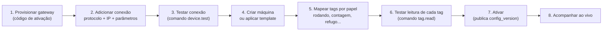
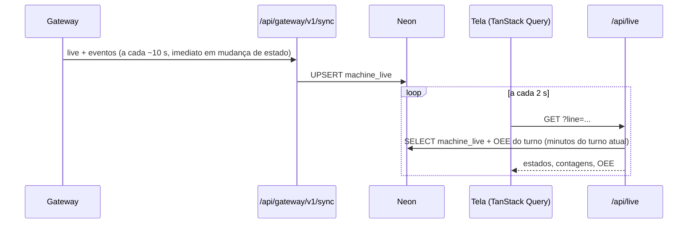

# 05 — Plataforma web

## Stack

| Item | Escolha | Motivo |
|---|---|---|
| Framework | **Next.js** (versão estável atual, App Router) + TypeScript | Nativo da Vercel. Server Components reduzem JS no cliente e Route Handlers servem a API dos gateways no mesmo projeto |
| Hospedagem | **Vercel** (plano Pro) | Deploy por Git, previews por PR, Functions, Cron, Blob, Firewall |
| UI | **Tailwind CSS + shadcn/ui** | Componentes acessíveis e customizáveis, sem dependência pesada |
| Gráficos | **Apache ECharts** | Lida bem com séries longas, timeline de estados (série custom), gauges e Pareto |
| Dados no cliente | **TanStack Query** | Polling ao vivo, cache e revalidação |
| Formulários e validação | React Hook Form + **Zod** | O Zod é compartilhado com `packages/contracts` |
| Autenticação | **Better Auth** | Self-hosted no nosso Postgres, com plugin de **organizações** (multi-tenant) e 2FA. A entrada de usuários é nossa, com token próprio para definir senha; o fluxo de convites do Better Auth **não** é usado ([15](15-multi-cliente-e-acesso.md#5-better-auth-o-que-usamos-e-o-que-fica-fechado)) |
| ORM | **Drizzle** | Ver [06](06-banco-de-dados.md#orm-drizzle) |
| Jobs | **Vercel Cron** | Precisão de 1 minuto no Pro, até 100 jobs por projeto |
| Arquivos | **Vercel Blob** | Exportações e binários do gateway |
| E-mail | **Resend** (MVP) | E-mail transacional: definir senha, redefinição, avisos de acesso Engemase e de suspensão ([15](15-multi-cliente-e-acesso.md#5-better-auth-o-que-usamos-e-o-que-fica-fechado)). Alertas e resumos por e-mail na F2 |
| Erros | Sentry + Vercel Observability | |
| Testes | Vitest (unidade), Playwright (e2e) | |

## Mapa de telas e rotas

Rotas do protótipo em `apps/web/app` (grupos `(auth)`, `(shell)`, `(kiosk)` e `(admin)`). As marcadas com "(prevista)" ainda não existem no protótipo.

```
/login                                   Entrada (e-mail + senha; 2FA quando exigido)
/definir-senha                           (prevista) Definir senha pelo link do e-mail (token próprio no fragmento #, ver 15 §5)
/                                        Escolha do cliente (quem tem vínculo com mais de um)
/conta                                   Perfil, senha, 2FA, sessões, tema, dispositivos com push

/[cliente]                               Visão geral (cards por unidade/linha: estado + OEE do turno)
/[cliente]/linhas/[linhaId]              Linha: máquinas, OEE da linha (soma das bases), máquina que mais perde
/[cliente]/maquinas                      Lista de máquinas com estado ao vivo
/[cliente]/maquinas/[maquinaId]          Máquina: estado ao vivo, timeline, OEE (A/P/Q), paradas, produção
/[cliente]/relatorios/oee                OEE por período / turno / máquina / produto
/[cliente]/relatorios/paradas            Pareto de motivos, MTBF/MTTR (F2)
/[cliente]/notificacoes                  Central de notificações (alertas) e preferências
/[cliente]/ajuda                         Central de ajuda: guias, perguntas frequentes, chamado
/[cliente]/acesso-remoto                 Pedidos e histórico de acesso remoto (VPN) aos gateways

/[cliente]/config/unidades               Unidades, áreas (opcionais) e linhas
/[cliente]/config/maquinas               Cadastro de máquinas
/[cliente]/config/maquinas/nova          Assistente de nova máquina (conexão Modbus, tags por papel, teste de leitura)
/[cliente]/config/produtos               Produtos e tempo de ciclo ideal por máquina
/[cliente]/config/turnos                 Calendário de turnos e paradas planejadas
/[cliente]/config/motivos                Árvore de motivos de parada + mapa código de falha → motivo
/[cliente]/config/gateways               Lista, status, provisionamento (código de ativação)
/[cliente]/config/gateways/[gatewayId]   Conexões de CLP, tags, teste de leitura, comandos, versão
/[cliente]/config/templates              (prevista) Templates de máquina (F2)
/[cliente]/config/usuarios               Usuários, papéis e escopo de unidades
/[cliente]/config/terminais              TVs e tablets pareados
/[cliente]/config/aparencia              Cores e logotipos do cliente (F2)
/[cliente]/config/auditoria              Log de alterações

/terminal/parear                         Pareamento de TV/tablet por código (terminal = dispositivo, não pessoa)
/terminal                                Andon (TV) ou tela do operador (tablet), conforme o token do aparelho
/terminal/[terminalId][/[maquinaId]]     Só no protótipo: simula o aparelho aberto (na versão real, o id vem do token)

/admin                                   Console Engemase: visão geral da plataforma (clientes, gateways, alertas)
/admin/clientes                          Clientes: status, plano, uso × limites, gateways com problema
/admin/clientes/novo                     Assistente "Novo cliente" (3 passos)
/admin/clientes/[clienteId]              Detalhe do cliente: unidades, máquinas, gateways, usuários, concessões, ciclo de vida
/admin/gateways                          Frota de gateways de todos os clientes
/admin/usuarios                          Equipe Engemase
/admin/acesso-remoto                     Sessões e pedidos de acesso remoto (VPN) de todos os clientes
/admin/auditoria                         Auditoria global

/api/gateway/v1/*                        API dos gateways (token do gateway)
/api/cron/*                              Jobs (protegidos por CRON_SECRET)
/api/v1/*                                API pública para integrações (F3)
```

- **Terminais:** o aparelho pareado usa o caminho próprio `/terminal` (pareamento em `/terminal/parear`), nunca combinado com a sessão de uma pessoa. As rotas `/[cliente]/andon/[linhaId]` e `/[cliente]/operador/[maquinaId]` continuam para **pessoas com login** (ex.: supervisor que abre o Andon no próprio computador) ([15](15-multi-cliente-e-acesso.md#8-requisitos-de-segurança-da-revisão-adversarial), item 12).
- As rotas `/api/*` só existem na implementação real; o protótipo usa dados simulados.

## Autogestão: o que o cliente faz sozinho

O objetivo é colocar uma máquina nova no ar **sem desenvolvedor e sem SSH**:



Recursos que sustentam isso:

- **Assistente de cadastro de máquina** com validação por transporte: o formulário muda conforme Modbus TCP ou RTU.
- **Teste de leitura** em cada tag antes de ativar.
- **Templates de máquina** (F2): "Injetora modelo X" com tags e regras prontas. Aplicar o template a 20 máquinas iguais muda só o IP.
- **Importação de tags por CSV** (F2) e **browse OPC UA** (F2).
- **Versionamento da config:** cada "Ativar" gera uma `config_version` imutável, com diff legível e botão de **reverter**.
- **Usuários e papéis:** o admin do cliente gerencia a própria equipe (entrada pelo e-mail "definir senha", ver [15](15-multi-cliente-e-acesso.md#5-better-auth-o-que-usamos-e-o-que-fica-fechado)).
- **Auditoria:** toda alteração fica registrada (quem, quando, antes/depois).

## Papéis e permissões (RBAC)

O modelo completo (papéis do cliente com escopo por unidade, papéis da equipe Engemase com concessão de acesso, terminais pareados, ciclo de vida do cliente e requisitos de segurança) está em **[15 — Plataforma multi-cliente](15-multi-cliente-e-acesso.md)**. Resumo:

| Ação | Admin do cliente | Engenheiro | Supervisor | Operador | Visualizador |
|---|:-:|:-:|:-:|:-:|:-:|
| Ver dashboards e relatórios (no seu escopo) | ✓ | ✓ | ✓ | ✓ | ✓ |
| Classificar paradas, lançar refugo e produto | ✓ | ✓ | ✓ | ✓ | — |
| Turnos, produtos, motivos | ✓ | — | ✓ | — | — |
| Gateways, conexões, tags (se o cliente não for "gerenciado pela Engemase") | ✓ | ✓ | — | — | — |
| Unidades, linhas, máquinas | ✓ | ✓* | — | — | — |
| Usuários e escopos | ✓ | — | — | — | — |
| Política de suporte e de acesso remoto; aprovar acesso remoto | ✓ | — | — | — | — |

\* Engenheiro cria máquinas nas unidades do seu escopo; unidades e linhas são do admin.

O admin do cliente tem sempre o cliente inteiro; os demais papéis têm escopo "todas as unidades" ou uma lista de unidades. A equipe Engemase acessa os dados de um cliente por papel de plataforma, concessão de suporte ou atribuição, sempre com faixa na tela e registro visível ao cliente.

## Isolamento multi-tenant no código

Defesa em camadas, detalhada em [15](15-multi-cliente-e-acesso.md#4-isolamento-de-dados-defesa-em-camadas): cliente resolvido pela URL, `requireTenant()` em toda página/Server Action/route handler, camada de acesso a dados obrigatória, **RLS no nível do cliente já no MVP**, chaves estrangeiras compostas, nenhum dado de cliente em shell estático do Next.js, e testes automáticos de isolamento no CI.

## Dados ao vivo



- Intervalo de **2 s** nas telas ao vivo e na TV, para cumprir o RNF02 (≤ 5 s; conta do pior caso em [02](02-arquitetura.md#d-visualização-ao-vivo)).
- Payload pequeno: só as máquinas visíveis na tela.
- O OEE do turno corrente é calculado sob demanda pelo `@engemase/oee-core`.
- O polling para quando a aba está oculta (`refetchIntervalInBackground: false`). Na TV, continua.
- Indicador visual de **"dados atrasados"** quando o último `live` da máquina passa de 30 s, ou quando o gateway está offline.

## Jobs agendados (Vercel Cron)

| Job | Frequência | O que faz |
|---|---|---|
| `close-shifts` | 1 min | Encontra turnos encerrados (fuso de cada unidade) e consolida `oee_shift` |
| `recompute-dirty` | 5 min | Recalcula turnos e horas marcados como sujos por dados atrasados ou reclassificação |
| `gateway-watchdog` | 1 min | Marca gateways sem `/sync` há mais de 60 s como offline e gera o alerta na central do app (canais externos na F2) |
| `expire-commands` | 5 min | Expira comandos não executados |
| `retention` | diário | Remove partições antigas de `tag_sample` e limpa sessões expiradas |
| `daily-report` | diário (F2) | E-mail com o resumo de OEE do dia anterior |

Os jobs são **idempotentes e reexecutáveis**. Cada um processa em lotes e registra o progresso, para não estourar o tempo máximo da função. Se o volume crescer, o processamento pesado pode migrar para Vercel Queues (hoje em beta).

## Tela do operador

Pensada para tablet, uso com luva e pouco tempo de atenção:

- Lista de **paradas não classificadas** acima do limite de micro-parada, com botões grandes de motivo (árvore de dois níveis no máximo).
- Lançamento de **refugo** manual e **troca de produto**, quando não vierem do CLP.
- Login rápido por **PIN** ou crachá, num dispositivo fixo da máquina (F2).
- Funciona com conexão instável: as ações vão para uma fila local e são reenviadas.
