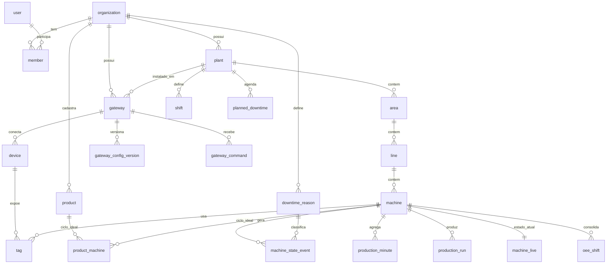

# 06 — Banco de dados

## Escolha do provedor: Neon vs Prisma Postgres

As duas opções estão no Marketplace da Vercel, com integração nativa (cobrança pela Vercel e variáveis de ambiente injetadas). O antigo "Vercel Postgres" já foi migrado para a Neon.

O ponto decisivo é o **perfil de carga do OEE**: escrita contínua 24/7 (os gateways sincronizam a cada poucos segundos), séries temporais que crescem sem parar, consultas analíticas por janela de tempo e necessidade de particionamento e retenção.

| Critério | **Neon** | **Prisma Postgres** |
|---|---|---|
| Modelo de cobrança | **Compute por hora (CU-hora) + armazenamento.** Escala a zero quando ocioso | **Por operação** (cada query do Prisma ORM ou cada statement SQL numa conexão direta) + armazenamento |
| Encaixe com ingestão 24/7 | Em produção o compute fica sempre ligado. O custo é **previsível e não cresce com o número de escritas**. Escalar a zero ajuda em dev e preview | **Toda escrita é uma operação cobrada.** O custo cresce linearmente com máquinas × frequência de sync, além das consultas das telas ao vivo |
| Extensões | Catálogo amplo: **pg_partman** (com worker de manutenção próprio), pg_stat_statements, timescaledb (só os recursos de licença Apache), pg_cron (só roda com o compute ativo) e outras | Conjunto menor (ex.: pgvector). Confirmar a lista atual antes de depender de uma |
| Branching | **Branch copy-on-write do banco.** A integração com a Vercel pode criar um branch por preview deployment, com dados reais anonimizáveis | Sem branching copy-on-write equivalente (até onde verificamos) |
| Conexões | Postgres padrão (TCP) com **pooler** (PgBouncer) + driver serverless (HTTP/WebSocket) | Postgres padrão via conexões diretas (GA desde out/2025), com limite por plano (ex.: 10 diretas no Free/Starter) |
| ORM | Qualquer (Drizzle, Prisma, Kysely, SQL puro) | Qualquer via conexão direta. Melhor experiência com Prisma ORM |
| Recursos operacionais | Autoscaling de compute, réplicas de leitura, restauração point-in-time, Postgres 18 | Mais novo. O Prisma Accelerate (cache e conexões hospedadas) tem aposentadoria anunciada para 01/12/2026 |
| Portabilidade | Postgres padrão, sai fácil | Postgres padrão, sai fácil |

### Recomendação: **Neon**

1. **O custo acompanha o tamanho da carga, não a quantidade de escritas.** Ingestão constante é justamente o pior caso para cobrança por operação.
2. **pg_partman** resolve particionamento e retenção das séries temporais dentro do próprio banco.
3. **Branch por preview** permite testar migrações e features contra uma cópia do banco a cada PR.
4. **Réplica de leitura** está disponível quando os relatórios pesarem.
5. É a opção mais madura e mais usada com Vercel.

**Quando o Prisma Postgres faria sentido:** num app CRUD de baixo volume, com o time 100% em Prisma ORM, onde o modelo por operação sai mais barato. Não é o nosso caso.

### Custo de referência (estimativa de nov/2026, confirmar na página de preços)

- Com ingestão contínua, o compute de produção **não vai escalar a zero**. Orçar de **0,25 a 1 CU 24/7**, ou seja, **~180 a 730 CU-hora/mês**.
- Preços publicados pela Neon em fontes recentes: ~US$ 0,11/CU-h (Launch) e ~US$ 0,22/CU-h (Scale), mais ~US$ 0,35/GB-mês de armazenamento. Isso dá **algo entre US$ 20 e 160/mês** de compute no início, conforme o plano e o tamanho.
- Previews e dev escalam a zero e custam quase nada.

### Por que não depender de TimescaleDB

Na Neon, o TimescaleDB só oferece os recursos de licença Apache: hypertables e `time_bucket` funcionam, mas **compressão não**, e *continuous aggregates* não estão confirmados. Além disso, as agregações de OEE dependem de **calendário de turnos, paradas planejadas e motivos classificados depois do fato**, coisas que continuous aggregates não modelam bem.

Por isso optamos por **tabelas de agregado próprias** (minuto → turno), calculadas pela borda e pelos cron jobs, mais **particionamento nativo** com pg_partman. Isso mantém o schema 100% Postgres padrão e portável (Neon, RDS, Supabase, on-premises). Ver [ADR-004](10-decisoes-arquiteturais.md#adr-004--neon-como-banco-postgres-padrão-sem-timescaledb).

## ORM: Drizzle

- **SQL-first.** As consultas de OEE usam janelas de tempo, `generate_series`, funções de janela e CTEs. O Drizzle deixa escrever isso com tipagem, sem brigar com o ORM.
- **Migrações em SQL**, geradas pelo `drizzle-kit` e **commitadas e revisadas no PR**.
- Leve (sem engine binária), bom para Functions.
- Funciona com o driver serverless da Neon ou com `pg` + pool. A escolha final sai da PoC da Fase 0. Com Fluid compute, conexão TCP com pool tende a ser a melhor opção.
- O schema fica em `packages/db` e é compartilhado entre o app, os cron jobs e os scripts.

## Modelo de dados

### Diagrama (entidades principais)

### Tabelas por domínio

**1. Organização e usuários** (gerenciadas pelo Better Auth, estendidas por nós)

| Tabela | Campos principais |
|---|---|
| `organization` | id, slug, nome, plano, limites (máquinas, gateways), criado_em |
| `user` | id, nome, e-mail, 2FA... |
| `member` | organization_id, user_id, papel |
| `invitation` | organization_id, e-mail, papel, expira_em |

**2. Ativos**

| Tabela | Campos principais |
|---|---|
| `plant` | id, organization_id, nome, **timezone** (ex.: `America/Sao_Paulo`) |
| `area` / `line` | id, organization_id, parent_id, nome |
| `machine` | id, organization_id, line_id, nome, código, `ideal_cycle_s` padrão, `micro_stop_threshold_s`, `state_mode`, template_id, ativo |
| `machine_template` (F2) | id, organization_id, nome, definição de tags e regras (jsonb) |

**3. Conectividade**

| Tabela | Campos principais |
|---|---|
| `gateway` | id, organization_id, plant_id, nome, `token_hash`, status, `last_seen_at`, versão, `config_version_applied`, info de hardware (jsonb), métricas de saúde |
| `gateway_enrollment` | gateway_id, `code_hash`, expira_em, usado_em |
| `device` | id, gateway_id, nome, protocolo, `params` (jsonb validado por protocolo) |
| `tag` | id, device_id, machine_id, nome, `address` (jsonb), tipo, escala, `poll_ms`, **role**, deadband |
| `gateway_config_version` | gateway_id, versão, snapshot (jsonb imutável), criado_por, criado_em |
| `gateway_command` | id, gateway_id, tipo, payload, status (pending/sent/ok/error/expired), resultado, expira_em |
| `gateway_device_status` | gateway_id, device_id, status, latência, erros, atualizado_em |

**4. Cadastros de produção**

| Tabela | Campos principais |
|---|---|
| `product` | id, organization_id, código, nome |
| `product_machine` | product_id, machine_id, `ideal_cycle_s` |
| `shift` | id, plant_id, nome, hora_inicio, hora_fim, dias_semana, vigência |
| `planned_downtime` | id, plant_id/line_id/machine_id, início, fim, recorrência, motivo |
| `downtime_reason` | id, organization_id, parent_id, nome, **categoria** (não planejada / planejada / setup), cor |
| `fault_code_map` (F2) | machine_id ou template_id, código de falha → reason_id |

**5. Dados de produção (séries temporais)**

| Tabela | Chave | Campos principais |
|---|---|---|
| `machine_state_event` | id (UUIDv7 da borda) | machine_id, state, `started_at`, `ended_at` (null = em aberto), fault_code, reason_id, classificado_por, classificado_em, origem |
| `production_minute` | (machine_id, bucket_start) | run_s, stop_s, fault_s, no_comm_s, total, reject, product_code — **particionada por mês** |
| `production_run` | id | machine_id, product_id, order_code, início, fim (troca de produto vinda do CLP ou do operador) |
| `quality_entry` | id | machine_id, timestamp, quantidade, motivo de refugo, usuário (lançamento manual) |
| `machine_live` | machine_id | state, state_since, fault_code, counter_total, product, atualizado_em |
| `tag_sample` | (tag_id, at) | valor numérico e/ou texto — **particionada por dia/semana**, retenção curta |

**6. Consolidados**

| Tabela | Chave | Campos principais |
|---|---|---|
| `oee_shift` | (machine_id, shift_date, shift_id) | planned_s, run_s, downtime_s, total, good, reject, ideal_time_s, availability, performance, quality, oee, **dirty**, calculado_em |
| `oee_hour` (opcional) | (machine_id, hour) | Mesmos campos, para gráficos de tendência rápidos |

**7. Auditoria**

| Tabela | Campos principais |
|---|---|
| `audit_log` | organization_id, user_id, ação, entidade, entity_id, antes (jsonb), depois (jsonb), ip, quando |

### Convenções

- **IDs:** UUIDv7 (ordenáveis no tempo; `uuidv7()` é nativo no Postgres 18). Nos eventos da borda, o ID vem do gateway, o que garante idempotência.
- **Tempo:** sempre `timestamptz`, em UTC. O fuso fica na planta.
- **Exclusão lógica** (`deleted_at`) em cadastros. Dados de produção nunca são apagados por usuário.
- **Índices:** séries temporais com índice `(machine_id, tempo)`. Eventos em aberto com índice parcial `WHERE ended_at IS NULL`.

## Multi-tenancy

- Modelo **"banco compartilhado, schema compartilhado"**, com `organization_id` em todas as tabelas de cadastro.
- As tabelas de série temporal são acessadas **sempre via `machine_id`**, já filtrado pelas máquinas da organização na camada de acesso a dados (ver [05](05-plataforma-web.md#isolamento-multi-tenant-no-código)).
- **RLS** do Postgres como segunda camada: avaliar na Fase 2. Exige `SET LOCAL app.org_id` por transação, o que é compatível com o pooler em modo transação.
- Clientes grandes que exijam isolamento físico podem ganhar um **projeto Neon dedicado** no futuro, com o mesmo schema e uma string de conexão por organização.

## Volume, particionamento e retenção

Estimativa para **100 máquinas**:

| Tabela | Volume | Partição | Retenção sugerida |
|---|---|---|---|
| `production_minute` | ~144 mil linhas/dia, ~52 milhões/ano, **~5 GB/ano** | Mensal (pg_partman) | 2 anos no detalhe por minuto. Depois disso, manter só `oee_hour`/`oee_shift` (ou arquivar em Parquet) |
| `machine_state_event` | ~10–50 mil/dia | Mensal | Indefinida (pequena) |
| `tag_sample` | Depende da config (deadband) | Diária ou semanal | 30–90 dias |
| `oee_shift` | ~300/dia | — | Indefinida |
| `audit_log` | Baixo | Anual | 5 anos |

A retenção é configurável por organização e pode virar diferencial de plano.

## Ambientes e migrações

| Ambiente | Banco |
|---|---|
| Local | Postgres em Docker **ou** branch `dev` da Neon |
| Preview (PR) | Branch Neon `preview/<branch>` criado automaticamente pela integração da Vercel |
| Produção | Branch `main` da Neon |

- Migrações geradas pelo `drizzle-kit generate`, em **SQL versionado no repositório**.
- O CI aplica as migrações no branch de preview a cada PR. No merge para `main`, o pipeline aplica em produção **antes** de promover o deploy.
- Migrações precisam ser **compatíveis com a versão anterior do app** (expand → migrate → contract), porque a Vercel faz deploys sem downtime.
- Branches de preview antigos são removidos automaticamente para não acumular custo de armazenamento.

## Backup e recuperação

- **Point-in-time restore** da Neon, com janela conforme o plano contratado.
- Exportação lógica periódica (ex.: semanal) para armazenamento externo, como seguro contra erro humano grave ou troca de fornecedor.
- O gateway é, ele mesmo, um backup de curto prazo: a outbox guarda dias de dados.
