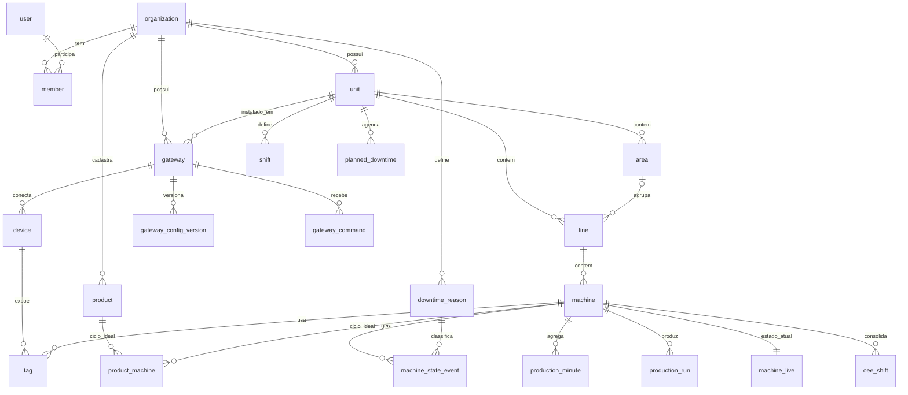

# 06 — Banco de dados

## Escolha do provedor: Neon vs Prisma Postgres

As duas opções estão no Marketplace da Vercel, com integração nativa (cobrança pela Vercel e variáveis de ambiente injetadas). O antigo "Vercel Postgres" já foi migrado para a Neon.

O ponto decisivo é o **perfil de carga do OEE**: escrita contínua 24/7 (os gateways sincronizam a cada poucos segundos), séries temporais que crescem sem parar, consultas analíticas por janela de tempo e necessidade de particionamento e retenção.

| Critério | **Neon** | **Prisma Postgres** |
|---|---|---|
| Modelo de cobrança | **Compute por hora (CU-hora) + armazenamento.** Escala a zero quando ocioso | **Por operação** (cada query do Prisma ORM ou cada statement SQL numa conexão direta) + armazenamento |
| Encaixe com ingestão 24/7 | Em produção o compute fica sempre ligado. O custo é **previsível e não cresce com o número de escritas**. Escalar a zero ajuda em dev e preview | **Toda escrita é uma operação cobrada.** O custo cresce linearmente com máquinas × frequência de sync, além das consultas das telas ao vivo |
| Extensões | Catálogo amplo: **pg_partman** (com worker de manutenção próprio), pg_stat_statements, timescaledb (só os recursos de licença Apache), pg_cron (só roda com o compute ativo) e outras | Conjunto menor (ex.: pgvector). Confirmar a lista atual antes de depender de uma |
| Branching | **Branch copy-on-write do banco.** A integração com a Vercel pode criar um branch por preview deployment (a partir de um **branch-semente com dados sintéticos**, nunca de produção; ver [15](15-multi-cliente-e-acesso.md#8-requisitos-de-segurança-da-revisão-adversarial)) | Sem branching copy-on-write equivalente (até onde verificamos) |
| Conexões | Postgres padrão (TCP) com **pooler** (PgBouncer) + driver serverless (HTTP/WebSocket) | Postgres padrão via conexões diretas (GA desde out/2025), com limite por plano (ex.: 10 diretas no Free/Starter) |
| ORM | Qualquer (Drizzle, Prisma, Kysely, SQL puro) | Qualquer via conexão direta. Melhor experiência com Prisma ORM |
| Recursos operacionais | Autoscaling de compute, réplicas de leitura, restauração point-in-time, Postgres 18 | Mais novo. O Prisma Accelerate (cache e conexões hospedadas) tem aposentadoria anunciada para 01/12/2026 |
| Portabilidade | Postgres padrão, sai fácil | Postgres padrão, sai fácil |

### Recomendação: **Neon**

1. **O custo acompanha o tamanho da carga, não a quantidade de escritas.** Ingestão constante é justamente o pior caso para cobrança por operação.
2. **pg_partman** resolve particionamento e retenção das séries temporais dentro do próprio banco.
3. **Branch por preview** permite testar migrações e features contra uma cópia do banco a cada PR.
4. **Réplica de leitura** está disponível quando os relatórios pesarem.
5. É a opção mais madura e mais usada com Vercel.

**Quando o Prisma Postgres faria sentido:** num app CRUD de baixo volume, com o time 100% em Prisma ORM, onde o modelo por operação sai mais barato. Não é o nosso caso.

### Custo de referência (estimativa de nov/2026, confirmar na página de preços)

- Com ingestão contínua, o compute de produção **não vai escalar a zero**. Orçar de **0,25 a 1 CU 24/7**, ou seja, **~180 a 730 CU-hora/mês**.
- Preços publicados pela Neon em fontes recentes: ~US$ 0,11/CU-h (Launch) e ~US$ 0,22/CU-h (Scale), mais ~US$ 0,35/GB-mês de armazenamento. Isso dá **algo entre US$ 20 e 160/mês** de compute no início, conforme o plano e o tamanho.
- Previews e dev escalam a zero e custam quase nada.

### Por que não depender de TimescaleDB

Na Neon, o TimescaleDB só oferece os recursos de licença Apache: hypertables e `time_bucket` funcionam, mas **compressão não**, e *continuous aggregates* não estão confirmados. Além disso, as agregações de OEE dependem de **calendário de turnos, paradas planejadas e motivos classificados depois do fato**, coisas que continuous aggregates não modelam bem.

Por isso optamos por **tabelas de agregado próprias** (minuto → turno), calculadas pela borda e pelos cron jobs, mais **particionamento nativo** com pg_partman. Isso mantém o schema 100% Postgres padrão e portável (Neon, RDS, Supabase, on-premises). Ver [ADR-004](10-decisoes-arquiteturais.md#adr-004--neon-como-banco-postgres-padrão-sem-timescaledb).

## ORM: Drizzle

- **SQL-first.** As consultas de OEE usam janelas de tempo, `generate_series`, funções de janela e CTEs. O Drizzle deixa escrever isso com tipagem, sem brigar com o ORM.
- **Migrações em SQL**, geradas pelo `drizzle-kit` e **commitadas e revisadas no PR**.
- Leve (sem engine binária), bom para Functions.
- Funciona com o driver serverless da Neon ou com `pg` + pool. A escolha final sai da PoC da Fase 0. Com Fluid compute, conexão TCP com pool tende a ser a melhor opção.
- O schema fica em `packages/db` e é compartilhado entre o app, os cron jobs e os scripts.

## Modelo de dados

### Diagrama (entidades principais)

### Tabelas por domínio

**1. Organização e usuários** (gerenciadas pelo Better Auth, estendidas por nós)

| Tabela | Campos principais |
|---|---|
| `organization` | id, slug, nome, criado_em (tabela do Better Auth) |
| `client_account` | organização (1:1), status, plano, limites, `managed_by_engemase` — só a plataforma grava ([15](15-multi-cliente-e-acesso.md#9-modelo-de-dados-acréscimos)) |
| `user` | id, nome, e-mail, 2FA... |
| `session` · `account` · `verification` | Tabelas padrão do Better Auth: sessões, credenciais (hash da senha) e verificações |
| `member` | organization_id, user_id (tabela do Better Auth) |
| `member_access` / `member_unit` | papel e escopo de unidades do vínculo (fail-closed) |
| `account_token` | tokens próprios de uso único (definir senha, verificar e-mail, pareamento), só hash |
| `platform_assignment` / `platform_assignment_unit` | pessoa da Engemase designada a um cliente (motivo, validade, revogação) e as unidades do escopo ([15](15-multi-cliente-e-acesso.md)) |
| `support_access_grant` | concessão temporária de acesso de suporte: motivo, chamado, início/fim, aprovado por |

**2. Ativos**

| Tabela | Campos principais |
|---|---|
| `unit` | id, organization_id, nome, **timezone** (ex.: `America/Sao_Paulo`). "Unidade" é o termo único no produto e no código (`unit`) |
| `area` | id, organization_id, unit_id, nome. **Opcional**, só agrupador |
| `line` | id, organization_id, unit_id, area_id (nulo = linha ligada direto à unidade), nome |
| `machine` | id, organization_id, line_id, nome, código, `ideal_cycle_s` padrão, `micro_stop_threshold_s`, `state_mode`, template_id, ativo |
| `machine_template` (F2) | id, organization_id, nome, definição de tags e regras (jsonb) |

**3. Conectividade**

| Tabela | Campos principais |
|---|---|
| `gateway` | id, organization_id, unit_id, nome, `token_hash`, status, `last_seen_at`, versão, `config_version_applied`, info de hardware (jsonb), métricas de saúde |
| `gateway_enrollment` | gateway_id, `code_hash`, expira_em, usado_em |
| `serial_bus` | id, gateway_id, nome, porta lógica (`rs485-1..3`), baud, paridade, `data_bits` (sempre 8), stop bits. Escravos RTU da mesma porta compartilham o barramento |
| `device` | id, gateway_id, `serial_bus_id` (só em `modbus-rtu`), nome, protocolo (`modbus-tcp`, `modbus-rtu`, `modbus-rtu-over-tcp`), `params` (jsonb validado por protocolo), `blocks` (leituras em bloco) |
| `tag` | id, device_id, machine_id, nome, `address` (jsonb), tipo, escala, `poll_ms`, **role**, deadband |
| `gateway_config_version` | gateway_id, versão, snapshot (jsonb imutável), criado_por, criado_em |
| `gateway_command` | id, gateway_id, tipo, payload, status (pending/sent/ok/error/expired), resultado, expira_em |
| `gateway_device_status` | gateway_id, device_id, status, latência, erros, atualizado_em |

**4. Cadastros de produção**

| Tabela | Campos principais |
|---|---|
| `product` | id, organization_id, código, nome |
| `product_machine` | product_id, machine_id, `ideal_cycle_s` |
| `shift` | id, unit_id, nome, hora_inicio, hora_fim, dias_semana, vigência |
| `planned_downtime` | id, unit_id/line_id/machine_id, início, fim, recorrência, motivo |
| `downtime_reason` | id, organization_id, parent_id, nome, **categoria** (não planejada / planejada / setup), cor |
| `fault_code_map` (F2) | machine_id ou template_id, código de falha → reason_id |

**5. Dados de produção (séries temporais)**

| Tabela | Chave | Campos principais |
|---|---|---|
| `machine_state_event` | id (UUIDv7 da borda) | machine_id, state, `started_at`, `ended_at` (null = em aberto), fault_code, reason_id, classificado_por, classificado_em, origem |
| `production_minute` | (machine_id, bucket_start) | run_s, stop_s, fault_s, setup_s, no_comm_s (somam 60 s), total, reject, product_code — **particionada por mês** |
| `production_run` | id | machine_id, product_id, order_code, início, fim (troca de produto vinda do CLP ou do operador) |
| `quality_entry` | id | machine_id, timestamp, quantidade, motivo de refugo, usuário (lançamento manual) |
| `machine_live` | machine_id | state, state_since, fault_code, counter_total, product, atualizado_em |
| `tag_sample` | (tag_id, at) | valor numérico e/ou texto — **particionada por dia/semana**, retenção curta |

**6. Consolidados**

| Tabela | Chave | Campos principais |
|---|---|---|
| `oee_shift` | (machine_id, shift_date, shift_id) | planned_s, run_s, downtime_s, total, good, reject, ideal_time_s, availability, performance, quality, oee, **dirty**, calculado_em |
| `oee_hour` (opcional) | (machine_id, hour) | Mesmos campos, para gráficos de tendência rápidos |

**7. Terminais, alertas e notificações** ([13](13-notificacoes-e-alertas.md))

| Tabela | Campos principais |
|---|---|
| `terminal` | id, unit_id, nome, tipo (TV/tablet), `line_ids`/`machine_ids` do escopo, `token_hash`, pareado por/em, validade, revogação, último contato |
| `alert_rule` | tipo, alvo (unidade/linha/máquina), parâmetros, severidade, destinatários, escalonamento |
| `alert_event` | regra, máquina ou gateway, `dedup_key`, estado (aberto/reconhecido/resolvido), severidade, nível de escalonamento |
| `notification` | pessoa, alerta de origem, título, texto, link, lida em. É a fonte da verdade da central; o push é só um canal |
| `notification_delivery` | canal, assinatura de push, status, tentativas, próximo envio |
| `notification_preference` | tipos de alerta, escopo, canais, horário de silêncio |
| `push_subscription` | pessoa ou terminal, endpoint e chaves do Web Push, aparelho, último sucesso |

**8. Acesso remoto** ([12](12-acesso-remoto-vpn.md))

| Tabela | Campos principais |
|---|---|
| `remote_access_policy` | unidade ou gateway, modo, aprovadores, duração máxima, inatividade, encaminhamento OT permitido, janelas |
| `remote_access_session` | gateway, solicitante, motivo, chamado, duração pedida/aprovada, decisão, IP e nó da VPN, certificado SSH, fim e motivo, bytes |
| `remote_access_forward` | sessão, dispositivo, host e porta de destino, contato no local, decisão, validade, conexões |
| `remote_access_event` | trilha da sessão e dos encaminhamentos: tipo, ator, dados, instante |

**9. Auditoria**

| Tabela | Campos principais |
|---|---|
| `audit_log` | organization_id, user_id, ação, entidade, entity_id, antes (jsonb), depois (jsonb), ip, quando |

### Convenções

- **IDs:** UUIDv7 em todo o banco e em toda a API (ordenáveis no tempo; `uuidv7()` é nativo no Postgres 18). Nos eventos da borda, o ID vem do gateway, o que garante idempotência. Não há IDs com prefixo: os exemplos com prefixo (`mch_...`, `dev_...`, `tag_...`) em outros documentos são ilustrativos ([04](04-protocolo-gateway-nuvem.md#princípios)).
- **Tempo:** sempre `timestamptz`, em UTC. O fuso fica na unidade.
- **Exclusão lógica** (`deleted_at`) em cadastros. Dados de produção nunca são apagados por usuário.
- **Índices:** séries temporais com índice `(machine_id, tempo)`. Eventos em aberto com índice parcial `WHERE ended_at IS NULL`.

## Multi-tenancy

- Modelo **"banco compartilhado, schema compartilhado"**, com `organization_id` em **todas** as tabelas de cliente, **inclusive as séries temporais** (desnormalizado a partir da máquina).
- **RLS já no MVP, no nível do cliente:** `FORCE ROW LEVEL SECURITY` e política restritiva por `current_setting('app.org_id')`, definido com `set_config(..., true)` no início de cada transação; papel de banco da aplicação sem `BYPASSRLS`. Exige driver com transação interativa (`pg` com pool ou driver serverless via WebSocket).
  - **Limite:** a RLS protege contra **bug do app** (consulta sem filtro, contexto de cliente esquecido), **não contra SQL arbitrário rodando com o papel da aplicação** (injeção de SQL): `app.org_id` é um parâmetro de sessão comum, que qualquer papel troca com `set_config`. Por isso todo SQL do app é parametrizado (Drizzle). Isolamento mais forte, se for preciso: cliente amarrado a um valor que o papel da aplicação não forja (assinado pelo servidor) ou papéis por cliente. Detalhes no README de `packages/db`.
- **Chaves estrangeiras compostas** `(id, organization_id)` entre tabelas filhas e vínculo explícito `gateway_machine`.
- O escopo por unidade é aplicado na camada de acesso a dados (RLS por unidade avaliada depois).
- Clientes grandes que exijam isolamento físico podem ganhar um **projeto Neon dedicado** no futuro, com o mesmo schema.
- Detalhes e testes de isolamento: [15](15-multi-cliente-e-acesso.md#4-isolamento-de-dados-defesa-em-camadas).

## Volume, particionamento e retenção

Estimativa para **100 máquinas**:

| Tabela | Volume | Partição | Retenção sugerida |
|---|---|---|---|
| `production_minute` | ~144 mil linhas/dia, ~52 milhões/ano, **~5 GB/ano** | Mensal (pg_partman) | 2 anos no detalhe por minuto. Depois disso, manter só `oee_hour`/`oee_shift` (ou arquivar em Parquet) |
| `machine_state_event` | ~10–50 mil/dia | Mensal | Indefinida (pequena) |
| `tag_sample` | Depende da config (deadband) | Diária ou semanal | 30–90 dias |
| `oee_shift` | ~300/dia | — | Indefinida |
| `audit_log` | Baixo | Anual | 5 anos |

A retenção é configurável por organização e pode virar diferencial de plano.

## Ambientes e migrações

| Ambiente | Banco |
|---|---|
| Local | Postgres em Docker **ou** branch `dev` da Neon |
| Preview (PR) | Branch Neon `preview/<branch>` criado automaticamente pela integração da Vercel, **a partir de um branch-semente com dados sintéticos** (nunca cópia da produção) |
| Produção | Branch `main` da Neon |

- Migrações geradas pelo `drizzle-kit generate`, em **SQL versionado no repositório**.
- O CI aplica as migrações no branch de preview a cada PR. No merge para `main`, o pipeline aplica em produção **antes** de promover o deploy.
- Migrações precisam ser **compatíveis com a versão anterior do app** (expand → migrate → contract), porque a Vercel faz deploys sem downtime.
- Branches de preview antigos são removidos automaticamente para não acumular custo de armazenamento.

## Backup e recuperação

- **Point-in-time restore** da Neon, com janela conforme o plano contratado.
- Exportação lógica periódica (ex.: semanal) para armazenamento externo, como seguro contra erro humano grave ou troca de fornecedor.
- O gateway é, ele mesmo, um backup de curto prazo: a outbox guarda dias de dados.
