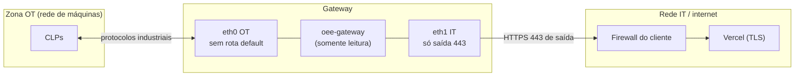
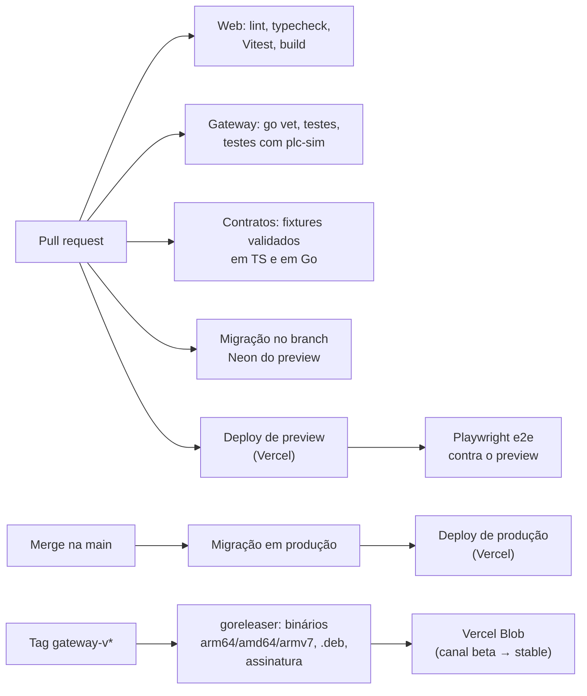

# 08 — Segurança e operação

## Segurança

O sistema atravessa a fronteira entre a **rede industrial (OT)** e a **internet**, que é o ponto mais sensível para o cliente. A arquitetura segue a lógica de *zonas e condutos* da IEC 62443: o gateway é o único conduto, e somente de saída.

### Gateway

| Controle | Como |
|---|---|
| Separação OT/IT | Duas interfaces de rede, `net.ipv4.ip_forward=0`. O gateway **não roteia** entre as redes |
| Firewall local | nftables: entrada bloqueada (exceto SSH opcional pela OT), saída permitida só para 443 e para as portas industriais da sub-rede OT |
| Somente leitura | O v1 não implementa escrita em nenhum driver. A futura escrita (F3+) exigirá allowlist por tag, papel específico, confirmação e auditoria |
| Processo | Usuário `oee` sem privilégios. Hardening do systemd (`NoNewPrivileges`, `ProtectSystem=strict`, `ProtectHome`, `PrivateTmp`, `ReadWritePaths=/var/lib/oee-gateway`) |
| Credencial | Arquivo 0600, de propriedade do `oee`. Token revogável pela web |
| TLS | TLS 1.2+ com validação de certificado. Suporte a CA corporativa e `HTTPS_PROXY` |
| Atualizações | Agente com binário assinado (Ed25519) e rollback. SO com `unattended-upgrades` para correções de segurança |
| Acesso remoto de suporte | Nenhuma porta aberta. **VPN de manutenção sob demanda** (saída 443), desligada por padrão, ativada só com **aprovação do cliente**, com prazo, sem roteamento para a rede OT e auditada. Ver [12](12-acesso-remoto-vpn.md) |
| Página local (F2) | Escuta só na interface OT ou localhost, com senha |

### Plataforma web

| Controle | Como |
|---|---|
| Autenticação | Better Auth com `/api/auth/*` fechado por lista de permissão; tokens próprios de uso único para definir/redefinir senha (no fragmento da URL, fora de logs). **2FA obrigatório para a equipe Engemase no MVP**; para o cliente, conforme política. Ver [15](15-multi-cliente-e-acesso.md) |
| Autorização | Papel × escopo de unidades × estado do cliente, calculado a cada requisição (`requireTenant`). RLS no nível do cliente. Equipe Engemase só com papel de plataforma, concessão de suporte ou atribuição, sempre visível ao cliente ([15](15-multi-cliente-e-acesso.md)) |
| API dos gateways | Token por gateway, guardado como hash. Validação de que cada máquina e tag pertence ao gateway. Schemas Zod. Limite de payload |
| Rate limiting | Vercel Firewall (regras de taxa por IP/rota) + limite por gateway na aplicação |
| Cron | `CRON_SECRET` validado em `/api/cron/*` |
| Segredos | Variáveis de ambiente da Vercel (com a integração Neon injetando as credenciais do banco). Nada de segredo no repositório |
| Auditoria | `audit_log` para toda alteração de configuração, comando enviado e mudança de usuário ou papel |
| Cabeçalhos | CSP, HSTS, `X-Frame-Options` (exceto no modo TV, se for embutido) |
| LGPD | Dados pessoais mínimos (nome e e-mail do usuário, operador que apontou). Política de retenção. Exportação e exclusão a pedido |

## Ambientes

| Ambiente | Web | Banco | Gateways |
|---|---|---|---|
| **Local** | `pnpm dev` | Postgres em Docker ou branch `dev` da Neon | Agente local + `plc-sim` |
| **Preview** (por PR) | Deploy de preview da Vercel (com Deployment Protection) | Branch Neon automático por preview, a partir de **branch-semente sintético** (nunca dados de produção) | Gateway de bancada (opcional), com o header de bypass da Deployment Protection |
| **Produção** | Domínio próprio (ex.: `oee.engemase.com.br`) | Branch `main` da Neon | Gateways dos clientes |

Um **gateway de bancada** na Engemase (com CLPs reais de cada marca suportada) roda contra produção numa organização interna "Engemase Lab". Ele funciona como teste de fumaça contínuo e como demonstração.

## CI/CD (GitHub Actions + Vercel)

- **Turborepo** com cache: cada PR só executa o que mudou.
- O agente tem um **ciclo de release separado** do app web (tags `gateway-v1.2.0`). A API mantém compatibilidade com pelo menos as duas versões menores anteriores do agente.

## Observabilidade

| O quê | Onde |
|---|---|
| Logs e métricas das funções | Vercel Observability / logs (com Log Drain para retenção maior, se necessário) |
| Erros do app | Sentry |
| Saúde dos gateways | No próprio produto: online/offline, versão, fila pendente, latência por CLP, relógio, disco (enviados no `/sync`) |
| Logs do gateway | journald local. Envio sob demanda com o comando `logs.upload` (F2) |
| Banco | Métricas da Neon + `pg_stat_statements` para consultas lentas |
| Alertas operacionais | Gateway offline, buffer acima de 80%, erro de ingestão, cron falhando (F2: e-mail/Slack) |

## Custos de referência (ordem de grandeza, nov/2026)

> Valores aproximados, só para planejamento. Confirmar nas páginas de preço antes de orçar.

| Item | Base | Observação |
|---|---|---|
| Vercel Pro | US$ 20 por membro/mês + uso | Functions, Cron, Blob e Firewall entram no uso. Na escala de 100 gateways sincronizando a cada 10 s, são ~26 milhões de invocações/mês, na casa de dezenas de US$ |
| Neon (produção) | ~US$ 20–160/mês | Compute 24/7 (0,25–1 CU) + armazenamento (~5 GB/ano para 100 máquinas). Ver [06](06-banco-de-dados.md#custo-de-referência-estimativa-de-nov2026-confirmar-na-página-de-preços) |
| Neon (previews/dev) | Quase zero | Escala a zero |
| Sentry | Plano gratuito ou Team | |
| Hardware de gateway | Investimento por planta | Custo único, normalmente repassado ao cliente |

**Alavancas de custo:** intervalo de sync (10 s → 30 s reduz as invocações em 3×, mantendo o envio imediato nas mudanças de estado), lotes maiores e retenção de `tag_sample`.

## Operação e suporte (runbooks a escrever)

- Gateway offline: checklist de energia, rede, DNS, proxy, relógio e token.
- CLP sem comunicação: IP, rack/slot, PUT/GET (Siemens), permissões OPC UA, firewall OT.
- Contagem divergente do CLP: conferir tag, tipo, byte order e eventos de reset.
- Restaurar banco (PITR) e reprocessar turnos.
- Rotacionar token de um gateway comprometido.
- Trocar o hardware de um gateway (re-enroll mantendo a mesma configuração).
