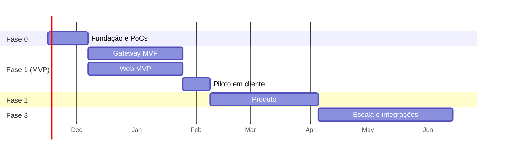

# 09 — Roadmap

As estimativas consideram um time de **2 desenvolvedores** (um focado no gateway, outro na web, revezando). São para planejamento e devem ser revisadas ao fim da Fase 0.

## Fase 0: fundação e provas de conceito (~3 semanas)

**Objetivo:** eliminar os maiores riscos técnicos antes de escrever o produto.

- [ ] Monorepo: pnpm + Turborepo, módulo Go, lint/format, CI básico.
- [ ] Projeto na Vercel + **Neon via integração nativa**, com branch por preview ativado.
- [ ] Next.js com Better Auth (organizações), layout base, tela de login.
- [ ] `packages/db`: schema inicial (organização, ativos, gateway, device, tag, eventos, minutos) e primeira migração.
- [ ] `packages/contracts`: schemas Zod do `/enroll` e do `/sync`, exportação para JSON Schema e fixtures.
- [ ] **Comprar 2 gateways reComputer R1000 sem rádio (R10xx-00, 2 GB/16 GB)** para bancada, com cotação formal (ver [ADR-012](10-decisoes-arquiteturais.md#adr-012--hardware-padrão-do-gateway-seeed-recomputer-r1000-sem-rádio)).
- [ ] **PoC Modbus** com `grid-x/modbus` contra CLPs reais e simulador:
  - [ ] Modbus TCP: um CLP com servidor nativo (ex.: Schneider M221 ou Delta) e um módulo de I/O remoto
  - [ ] Modbus RTU: barramento RS-485 com 2–3 escravos a 19200 8E1, usando o modo RS-485 do kernel no R1000
  - [ ] Ordem de words em 32 bits, timeouts curtos e recuperação de escravo offline
- [ ] Especificar o **bloco OEE padrão Engemase** (v1) e implementá-lo em pelo menos uma marca de CLP ([11](11-integracao-modbus.md#3-bloco-oee-padrão-engemase)).
- [ ] `tools/plc-sim`: máquinas simuladas via Modbus TCP (`simonvetter/modbus`, que tem servidor), com o bloco OEE padrão, ciclos, paradas e falhas.
- [ ] Teste do driver de banco (serverless HTTP vs `pg` + pool) com carga simulada de 100 gateways.
- [ ] Confirmar com despachante/OCD a NCM e a necessidade de anuência ANATEL do gateway sem rádio.

**Critério de saída:** um reComputer R1000 de bancada lê o simulador e CLPs reais por Modbus TCP e RTU, envia `/sync` e os dados aparecem gravados na Neon. Hardware e biblioteca aprovados (ou substituídos).

## Fase 1: MVP (~7 semanas + 2 de piloto)

**Gateway**
- [ ] Drivers **Modbus TCP, Modbus RTU (RS-485) e RTU sobre TCP**, com leitura em blocos e uma goroutine por barramento serial.
- [ ] Scheduler com leitura em bloco, máquina de estados (modos `signals`, `state_code` e `count_derived`), contadores com overflow/reset, agregados por minuto.
- [ ] Outbox SQLite com reenvio ordenado e limite de taxa.
- [ ] Uplink HTTPS (`/enroll`, `/sync`, `/config`) com retentativas.
- [ ] Comandos: `tag.read`, `device.test`, `config.reload`, `agent.restart`.
- [ ] Pacote `.deb`, unit systemd e script de instalação.

**Web**
- [ ] Cadastros: plantas, áreas, linhas, máquinas, produtos e ciclo ideal, turnos, paradas planejadas, motivos.
- [ ] Gateways: provisionamento por código, status, conexões de CLP, tags por papel, **teste de leitura**, publicação de config versionada.
- [ ] API dos gateways com validação, idempotência e escopo por tenant.
- [ ] Dashboard ao vivo (visão geral + linha + máquina) com polling.
- [ ] Linha do tempo de estados (ECharts).
- [ ] `@engemase/oee-core` com testes golden. OEE do turno ao vivo.
- [ ] Tela do operador: classificar paradas.
- [ ] Identidade visual Engemase e seletor de tema Claro/Escuro/Automático (padrão Automático).
- [ ] Central de notificações (sino) com alertas avaliados pelo cron e preferências básicas.
- [ ] Central de ajuda: guias, perguntas frequentes, abertura de chamado e ajuda contextual.
- [ ] Relatório de OEE por período, turno, máquina e produto.
- [ ] Cron: `close-shifts`, `recompute-dirty`, `gateway-watchdog`, `expire-commands`.
- [ ] Usuários, convites, papéis e auditoria básica.

**Critério de saída (piloto):** uma linha real de um cliente rodando **2 semanas** com:
- zero perda de contagem comparando com o contador do CLP, inclusive após derrubar a internet propositalmente por algumas horas;
- máquina colocada no ar pela equipe de campo **sem ajuda do desenvolvimento**;
- OEE batendo com o cálculo manual de pelo menos 3 turnos.

## Fase 2: produto (~8 semanas)

- Primeiros **protocolos nativos**, conforme as marcas mais frequentes nos clientes: **S7comm** (Siemens), **EtherNet/IP** (Rockwell, Omron NJ/NX), **OPC UA**.
- **OTA** com assinatura, canais e rollback. Página local de diagnóstico. `logs.upload`.
- **Templates de máquina** (incluindo o do bloco OEE padrão), importação de tags por CSV, **varredura Modbus** (unit ids e registradores).
- Classificação automática por código de falha.
- Relatórios: Pareto, MTBF/MTTR, tendências, exportação CSV/Excel. **Modo TV/Andon**.
- **Alertas** (e-mail; avaliar WhatsApp/Telegram): máquina parada > X min, gateway offline, OEE abaixo da meta.
- 2FA obrigatório para perfis administrativos. Avaliar RLS.
- **Acesso remoto (VPN) aos gateways** sob demanda, com aprovação do cliente e auditoria ([12](12-acesso-remoto-vpn.md)), depois da PoC com o Tailscale.
- **Web Push** e escalonamento por e-mail ([13](13-notificacoes-e-alertas.md)); app instalável (PWA).
- **Cores e logotipos por cliente** com editor e prévia ([14](14-identidade-visual-e-temas.md)).
- Painel de super admin: frota de gateways de todos os clientes.

## Fase 3: escala e integrações (~10 semanas)

- API pública REST + webhooks (ERP/MES), **ordens de produção**.
- Push em tempo real (WebSockets da Vercel ou serviço gerenciado), se o polling não bastar.
- Uplink **MQTT / Sparkplug B** + worker consumidor, para frotas grandes ou clientes que já têm broker.
- Billing por máquina ou por planta, com limites por plano.
- Retenção por plano e arquivamento frio (Parquet).
- Módulos adicionais candidatos: manutenção (ordens de serviço a partir de paradas), qualidade/SPC, metas e gamificação por turno.
- Escrita controlada no CLP, só com allowlist, papel específico, confirmação e auditoria.

## Primeiros passos práticos (próxima semana)

1. Responder as **perguntas em aberto** ([01](01-visao-e-requisitos.md#perguntas-em-aberto)), principalmente Q1 (marcas de CLP), Q2 (hardware) e Q3 (escala).
2. Criar o projeto na Vercel e instalar a integração **Neon** pelo Marketplace.
3. Montar a bancada: 2 reComputer R1000, um CLP com Modbus TCP nativo, um barramento RS-485 com 2–3 escravos (CLP + módulo de I/O) e cabos/terminações conforme o [guia Modbus](11-integracao-modbus.md#4-rs-485-boas-práticas-de-instalação).
4. Abrir as issues da Fase 0 a partir do checklist acima.
