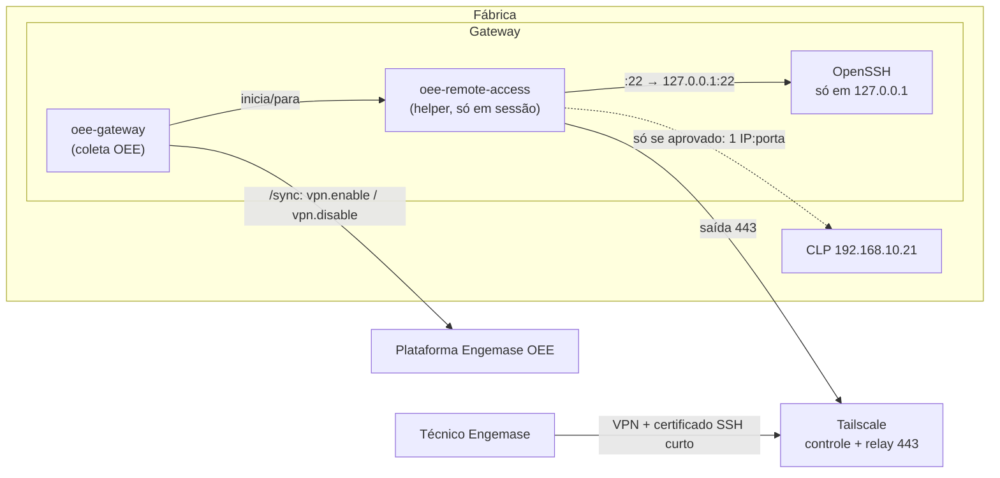
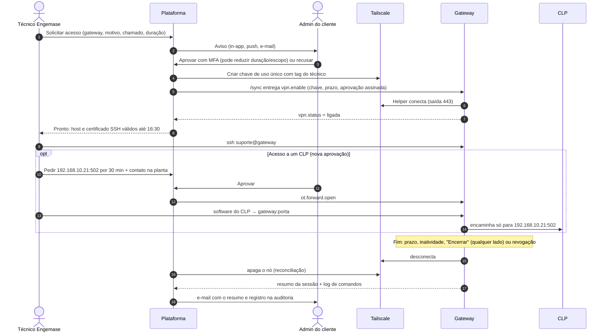

# 12 — Acesso remoto aos gateways (VPN de manutenção)

A Engemase precisa de **acesso remoto aos gateways** para manutenção e suporte: SSH, diagnóstico, atualização e, às vezes, acesso pontual a um CLP ou IHM para ajudar o cliente. Este documento define como fazer isso **sem abrir portas na fábrica e sem transformar o gateway numa porta de entrada para a rede industrial**. Ver [ADR-013](10-decisoes-arquiteturais.md#adr-013--vpn-de-manutenção-sob-demanda-tailscale-com-helper-separado).

> **Status:** desenho recomendado após pesquisa. Preços e alguns comportamentos (proxy corporativo, cobrança de nós) estão marcados para confirmar com o fornecedor e na prova de conceito.

## Princípios

1. **Desligada por padrão.** A VPN **só existe durante uma sessão aprovada**. Fora disso, o gateway não aparece em nenhuma rede.
2. **Aprovada pelo cliente.** Um técnico da Engemase **pede** acesso (motivo, chamado, duração). O **admin do cliente aprova** (com MFA). Quem pede nunca aprova.
3. **Somente conexões de saída** (TCP 443), como o resto do sistema. Nenhuma porta aberta no firewall do cliente.
4. **O gateway não roteia.** Continua com `ip_forward=0`. Acesso a um CLP é um **encaminhamento de um único IP:porta**, com aprovação própria e prazo curto. Nada de "acesso à rede OT inteira".
5. **Expira sozinha.** O próprio gateway derruba a sessão por prazo, por inatividade ou por um teto local, mesmo sem falar com a nuvem.
6. **O cliente tem a palavra final no local.** Um "kill switch" local (comando ou arquivo de política, opcionalmente uma chave física numa entrada digital) **prevalece sobre a nuvem**.
7. **Tudo auditado.** Pedido, aprovação, conexões, bytes, encaminhamentos e encerramento ficam registrados e visíveis para o cliente.

## Arquitetura recomendada

**Tailscale (plano Standard)** como "cano" de rede: plano de controle e relay (DERP) em HTTPS 443, que atravessa firewalls que bloqueiam UDP. **Toda a governança fica na nossa plataforma** (pedido, aprovação, janela, encerramento, auditoria).

Detalhes:
- **Helper separado** (`oee-remote-access`): um processo próprio, iniciado sob demanda por uma unidade systemd com limites de memória e CPU. Usa a biblioteca `tsnet` (rede em espaço de usuário, sem mexer no roteamento do sistema). Assim, uma falha na VPN **não derruba a coleta de OEE** e o binário principal não cresce.
- **Nós "tagged" não efêmeros, apagados pela API no fim da sessão.** É o que mantém o custo baixo (nós efêmeros consomem um pool de minutos que estoura rápido). Uma reconciliação a cada minuto apaga nós órfãos.
- **SSH:** o OpenSSH do gateway escuta **só em 127.0.0.1**. O helper encaminha `VPN:22 → 127.0.0.1:22`. A autenticação usa **certificados SSH de curta duração** (válidos só durante a janela), emitidos por uma **CA guardada em KMS**, nunca em variável de ambiente simples.
- **Aprovação assinada:** o gateway só ativa a VPN se o comando trouxer a **aprovação assinada** pelo fluxo do cliente. Isso limita o estrago de um eventual comprometimento da plataforma: sem a aprovação válida, nenhum gateway abre.
- **Encaminhamento para CLP:** o alvo **precisa** ser um dispositivo cadastrado na configuração do gateway, numa porta da lista permitida para o protocolo (ex.: 502 Modbus, 102 S7, 44818 EtherNet/IP), com prazo e número de conexões limitados.
- **Plano B:** **NetBird** (cloud ou self-hosted no Brasil, com relay por WebSocket em 443). Mesmo desenho; exige revogar a chave e apagar o peer pela API.
- **Plano de saída:** **Headscale** (servidor de controle self-hosted compatível). O cliente `tsnet` é o mesmo; muda só a URL de controle.

### Por que não as outras opções

| Opção | Motivo |
|---|---|
| WireGuard puro | Só UDP: não atravessa firewall que só libera TCP 443 |
| Cloudflare Zero Trust | O túnel exige saída na **porta 7844**, que TI restritivo bloqueia |
| OpenVPN Access Server | Licença por conexão simultânea, PKI própria, servidor nosso |
| ZeroTier | Fallback TCP é "último recurso", lento; rede L2 aumenta a superfície em OT |
| Túnel SSH reverso próprio | Tudo seria construído e operado por nós; ruim em escala |
| Soluções de fabricante (Teltonika RMS, Ewon Talk2M, Moxa) | Presas ao hardware deles. Confirmam o padrão de mercado (saída, sob demanda, por usuário) |
| Teleport Community | **Bom candidato para gravação de sessão** (grava nativamente, túnel de saída em 443). Gratuito só para empresas com < 100 funcionários e < US$ 10 mi de receita. Avaliar se a gravação virar requisito |

## Fluxo de uma sessão

**Estados:** `solicitada → aprovada → ativando → ativa → encerrando → encerrada`, com saídas `recusada`, `cancelada`, `expirada sem aprovação`, `falhou` e `revogada`.

**Políticas por cliente (ou unidade/gateway, vale a mais restritiva):** desativado · **com aprovação** (padrão) · janela pré-aprovada (ex.: sábado 8h–12h) · emergência com aviso posterior (só se o contrato prever).

## No gateway

| Comando (via `/sync`) | O que faz |
|---|---|
| `vpn.enable` | Valida política local, chave física e aprovação assinada; inicia o helper; abre só `:22` |
| `vpn.disable` | Fecha encaminhamentos, desconecta, apaga o estado e devolve o resumo |
| `vpn.status` | Estado, sessão, IP, tipo de conexão (direta/relay), conexões ativas, prazo |
| `ot.forward.open` / `ot.forward.close` | Abre/fecha o encaminhamento de um IP:porta aprovado |
| `logs.upload` (estendido) | Envia o log de comandos da sessão (I/O log do `sudo`) |

Proteções locais:
- prazo e **inatividade** (ex.: 15 min sem SSH) e **teto local** (ex.: 8 h), contados com relógio monotônico;
- **nunca religa após reboot**;
- token do gateway revogado (`401`) derruba a VPN na hora;
- `sudo oee-gateway remote-access off --lock` e `/etc/oee-gateway/remote-access.json` (`allowed`, `allow_ot_forward`) prevalecem sobre a nuvem;
- os eventos da sessão entram na **outbox**, para a auditoria sobreviver a quedas de internet;
- validação do certificado SSH também com a **hora vinda do `/sync`**, caso o NTP esteja bloqueado na fábrica.

O pacote `.deb` passa a incluir: usuário `suporte` sem senha, configuração do OpenSSH (só localhost, só certificados da CA Engemase), regra de `sudo` com registro de I/O e o helper com sua unidade systemd.

## Na plataforma

**Banco** (UUIDv7, `organization_id` em tudo):
- `remote_access_policy` — modo, aprovadores, duração máxima, inatividade, permitir CLP, contato na planta obrigatório, chave física, janelas.
- `remote_access_session` — pedido, decisão, execução (prazo, nó, IP, certificado), encerramento e bytes. Uma sessão ativa por gateway e técnico.
- `remote_access_forward` — encaminhamentos para CLP com aprovação própria.
- `remote_access_event` — eventos só de inserção (retenção de 5 anos).
- `remote_access_recording` — gravações/logs no Blob, com hash.
- Segredos: a chave de entrada na VPN **nunca é persistida** (vai só no comando); a CA SSH fica em **KMS**.

**Telas:**
- aba **"Acesso remoto"** no detalhe do gateway: status, "Solicitar acesso", contagem regressiva, "Encerrar agora", "Estender" (nova aprovação), "Liberar CLP", linha do tempo;
- **tela de aprovação** para o admin do cliente: quem pede, motivo, escopo, duração, histórico do técnico; aprovar (MFA), aprovar com alterações ou recusar;
- **histórico** filtrável e exportável (CSV/PDF) para auditoria do cliente;
- **política** do cliente em Configurações;
- no console Engemase: sessões ativas de todos os clientes, pedidos pendentes e **kill switch global**.

**Permissões:** solicitar = papéis de plataforma (super admin, suporte, engenheiro de campo) · aprovar e configurar política = admin do cliente · ver histórico = admin e engenheiro do cliente.

## Auditoria e gravação

- **Fase A (com a VPN):** trilha completa na plataforma + identificação do certificado no `auth.log` + I/O log do `sudo` enviado ao Blob no fim da sessão. Limite: um root mal-intencionado consegue apagar o log local antes do envio.
- **Fase C (se o cliente ou o contrato exigir gravação à prova de adulteração, comum em OT/IEC 62443):** terminar o SSH no próprio helper e gravar o terminal, ou usar um bastion com gravação (Warpgate, Teleport). Decidir cedo se for requisito de venda.

## Custo de referência (nov/2026, confirmar com o fornecedor)

| Modelo | 50 gateways | 200 gateways | 1.000 gateways |
|---|---|---|---|
| **Tailscale Standard, sob demanda** (10 técnicos) | ~US$ 80/mês | ~US$ 80/mês | ~US$ 80/mês |
| Tailscale Standard, gateways sempre na VPN | ~US$ 80 | ~US$ 230 | ~US$ 1.030 |
| NetBird Cloud Team | ~US$ 50 | ~US$ 55 | ~US$ 455 |

O valor "sob demanda" só se sustenta com **nós tagged não efêmeros apagados no fim da sessão** e se a cobrança for por quantidade simultânea: **confirmar por escrito com a Tailscale**. O plano gratuito pessoal não pode ser usado (não é para uso comercial).

## Ficha técnica para o TI do cliente

- Saída **TCP 443** para os domínios do plano de controle e relay da Tailscale (lista oficial no anexo da proposta). UDP 41641 de saída é opcional (conexão direta, mais rápida).
- **Inspeção SSL/DPI precisa de exceção** para esses domínios. Em particular, **FortiGate com deep packet inspection impede a conexão** segundo a própria Tailscale. Sem a exceção, o acesso remoto não funciona naquele cliente (a coleta de OEE não é afetada).
- O gateway **não roteia** entre as redes; acesso a CLP é por IP:porta, aprovado caso a caso pelo cliente.
- Desligada por padrão, aprovada pelo cliente, com histórico e kill switch local.
- LGPD: só identificação dos técnicos e logs técnicos; metadados de controle da Tailscale ficam fora do Brasil (EUA/Europa). Se o cliente exigir residência no Brasil, usar o plano B (NetBird self-hosted) ou o Headscale.

## Itens para a prova de conceito

1. `tsnet` através de proxy corporativo (`HTTPS_PROXY`) e com CA corporativa.
2. Memória e CPU do helper no reComputer R1000.
3. Latência e vazão via relay (inclusive para baixar programa de CLP).
4. Cobrança de nós tagged (resposta escrita da Tailscale).
5. Reaproveitamento seguro de "vagas" de tag por técnico (trocar ou apagar nós antes de reatribuir).
6. Testes negativos automatizados: porta fora da lista, alvo que não é dispositivo, sessão expirada, aprovação sem assinatura.
