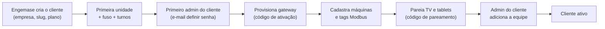

# 15 — Plataforma multi-cliente: acesso, isolamento e administração

**Requisito do dono do produto:** "Todos os clientes vão acessar a partir desta plataforma, mas cada um terá o seu acesso e verá apenas suas máquinas. A plataforma deve ser gerenciável por dentro dela mesma: criação de clientes, unidades, máquinas, usuários."

Este documento consolida o desenho (modelo de acesso, Better Auth, isolamento de dados, console) e as correções de uma revisão de segurança adversarial. Ver [ADR-016](10-decisoes-arquiteturais.md#adr-016--multi-cliente-com-isolamento-em-camadas-e-acesso-engemase-por-concessão). Ele **substitui** as seções de papéis de [05](05-plataforma-web.md) e de multi-tenancy de [06](06-banco-de-dados.md) onde houver conflito.

## 1. Hierarquia e identidades

```
Plataforma (Engemase)
 └─ Cliente (empresa / tenant)
     └─ Unidade (planta)
         └─ [Área] (opcional, só agrupador)
             └─ Linha
                 └─ Máquina ← alimentada por um Gateway (da mesma unidade)
```

| Identidade | Exemplo | Autenticação | Alcance |
|---|---|---|---|
| **Usuário de plataforma** | Equipe Engemase | E-mail + senha + **2FA obrigatório** | Ver seção 3 |
| **Usuário do cliente** | Gerente, engenheiro, supervisor | E-mail + senha (2FA conforme papel/política) | Um cliente; cliente inteiro ou algumas unidades |
| **Terminal** | TV Andon, tablet da máquina | Token de dispositivo obtido por **código de pareamento** | Uma unidade; linhas/máquinas fixas |
| **Operador** | Operador de injetora | Identificado **dentro do terminal** (lista no MVP; PIN/crachá na F2) — não é conta de login | Máquinas do terminal |
| **Gateway** | Gateway Linux | Token próprio ([04](04-protocolo-gateway-nuvem.md)) | Máquinas do próprio gateway |
| **Integração** (F3) | ERP/MES | Chave de API por cliente | Escopos de leitura/escrita |

**Sem contas compartilhadas.** Nada de `tv@cliente.com.br`: TV e tablet são **terminais pareados**.

Uma pessoa pode ter **vínculos com mais de um cliente** (ex.: consultor); o cliente é escolhido depois do login.

## 2. Papéis do cliente e escopo

| Papel | Escopo | O que faz |
|---|---|---|
| **Admin do cliente** (`client_admin`) | **Sempre o cliente inteiro** (MVP) | Unidades, linhas, máquinas, usuários, turnos, produtos, motivos, política de acesso remoto e de suporte |
| **Engenheiro** (`engineer`) | Todas ou algumas unidades | Gateways, conexões Modbus, tags, máquinas (se o cliente não for "gerenciado pela Engemase") |
| **Supervisor** (`supervisor`) | Todas ou algumas unidades | Dashboards, relatórios, turnos, produtos, motivos, classificação de paradas |
| **Operador** (`operator`) | Algumas unidades | Classificar paradas, refugo e troca de produto (normalmente pelo terminal) |
| **Visualizador** (`viewer`) | Todas ou algumas unidades | Somente leitura |

Regras:
- **Escopo explícito e "fail-closed":** todo vínculo tem escopo obrigatório (`all` ou lista de unidades). **Nenhuma unidade listada = nenhum acesso**. Vínculo sem registro de escopo = vínculo inativo.
- Só o **admin do cliente** concede papéis de cliente. Ninguém concede papel acima do próprio. Não é possível remover ou rebaixar o **último admin** do cliente.
- Agregados (OEE da planta, relatórios, auditoria, exportações) **respeitam o escopo**: quem vê só a Unidade A nunca vê números que incluam a Unidade B.
- Escopo por **linha ou máquina** para pessoas fica para a F2, se o dono do produto pedir (pergunta P1).

**Modo de gestão do cliente** (`client_account.managed_by_engemase`): quando ligado, gateways, conexões, tags e publicação de configuração ficam **só leitura** para os papéis do cliente (a Engemase configura como serviço). Os pedidos vão pelo canal de suporte.

## 3. Equipe Engemase: acesso controlado e visível ao cliente

| Papel | Quem | Como acessa dados de um cliente |
|---|---|---|
| **Super admin** (`super_admin`) | 2–3 pessoas da direção técnica | Acesso a todos os clientes, sempre auditado; ações destrutivas com reautenticação e motivo; ninguém altera o próprio papel; existe proteção do "último super admin" |
| **Suporte** (`support`) | Suporte técnico | **Somente com concessão de suporte ativa** (cliente, motivo, chamado, prazo de até 4 h). Leitura de cadastros, configs, saúde e dashboards + comandos de diagnóstico. Não mexe em usuários nem papéis |
| **Engenheiro de campo** (`field_engineer`) | Comissionamento | **Somente nos clientes atribuídos** (atribuição com validade, criada pelo super admin). Configura unidades, linhas, máquinas, gateways e tags. Não mexe em usuários |

- A equipe Engemase **não vira membro** dos clientes (exceto a organização interna "Engemase Lab").
- Toda entrada da Engemase num cliente aparece com **faixa na tela** e fica na **auditoria visível ao cliente** ("Carlos Mendes (suporte Engemase), chamado #1042, 25 min").
- O cliente pode definir a **política de suporte**: liberado com registro (padrão) ou mediante aprovação.
- **"Ver como usuário" (impersonação)** fica para a F2 e será **somente leitura**, com prazo curto, motivo e aviso ao admin do cliente.

## 4. Isolamento de dados (defesa em camadas)

1. **O cliente vem da URL** (`/[cliente]/...`). O "cliente ativo" da sessão do Better Auth **não é usado para autorizar**; serve só para lembrar o último acesso (num cookie nosso).
2. **`requireTenant()` em toda entrada do servidor** (páginas, Server Actions, route handlers): resolve cliente, vínculo, papel, escopo, estado do cliente e concessão Engemase num `TenantContext`. Sem acesso → **404** (não revela que o cliente existe).
3. **Camada de acesso a dados obrigatória:** toda consulta recebe o `TenantContext`; não existe consulta "solta" a tabela de cliente.
4. **Row-Level Security (RLS) já no MVP, no nível do cliente:** `organization_id` em **todas** as tabelas de cliente (inclusive séries temporais), `FORCE ROW LEVEL SECURITY` com política restritiva `organization_id = current_setting('app.org_id')`, definida por transação; a aplicação roda com um papel de banco **sem `BYPASSRLS`**. O escopo por unidade fica na camada de acesso a dados (RLS por unidade avaliada depois).
   - Exige driver com **transação interativa** (`pg` com pool, ou o driver serverless da Neon via WebSocket), não o driver HTTP.
5. **Chaves estrangeiras compostas** `(id, organization_id)` entre tabelas filhas (tag→máquina, tag→dispositivo, dispositivo→gateway, máquina→linha, produto×máquina...) e vínculo explícito **gateway ↔ máquina**: impossível, no banco, ligar o gateway de A a uma máquina de B.
6. **Cache do Next.js:** nenhum dado de cliente em shell estático. Leituras de cliente dentro de `<Suspense>`, depois de `requireTenant()`; caches (`use cache`) sempre com o id do cliente na chave e na tag; respostas `Cache-Control: private, no-store`.
   - O **protótipo** gera páginas estáticas por cliente (`generateStaticParams`) só porque os dados são fictícios. **Na implementação real isso é proibido.**
7. **Testes automáticos de isolamento** no CI: (1) catálogo do banco (toda tabela de cliente com RLS forçada); (2) RLS direto no banco; (3) cada rota e Server Action com usuário do cliente A tentando IDs do cliente B (incluindo `/api/auth/*`); (4) exportações e relatórios.

## 5. Better Auth: o que usamos e o que fica fechado

- **Motor de identidade:** senha, sessões, 2FA, banimento, organizações, membros. **A autorização é nossa.**
- **`/api/auth/*` fechado por padrão (lista de permissão),** não por lista de bloqueio: só `sign-in/email`, `sign-out`, `get-session`, `request-password-reset`, `reset-password` e `two-factor/*`. Todo o resto (criar organização, adicionar membro, mudar papel, admin) passa por **Server Actions nossas**, que fazem as checagens e chamam `auth.api.*` no servidor **sempre com o `organizationId` do contexto**, conferindo o resultado. Isso fecha, por exemplo, a enumeração de clientes por `check-slug`/`get-organization`.
- Papéis de plataforma em `user.role` (plugin admin), **todos** em `adminRoles` (impede impersonar alguém da Engemase). Plugin `nextCookies()` habilitado para Server Actions. `membershipLimit` configurado (o padrão de 100 bloquearia clientes grandes).
- **Entrada de usuário (um único fluxo):** a Server Action cria a conta sem senha (se não existir), adiciona o membro e grava o escopo **na mesma transação**, registra na auditoria e envia o e-mail "definir senha". O link usa um **token próprio de uso único** (curto, no fragmento `#` da URL, fora de logs), que também comprova o e-mail. **Não usamos o fluxo de convites do Better Auth.**
- **E-mail transacional (Resend) entra no MVP** (definir senha, redefinição, avisos de acesso Engemase e de suspensão), com domínio remetente configurado (SPF/DKIM).

## 6. Ciclo de vida do cliente

| Estado | Efeito |
|---|---|
| **Implantação** | Cliente criado, sem uso produtivo. Engemase configura; o admin do cliente já pode entrar |
| **Ativo** | Normal |
| **Suspenso** | Usuários do cliente não acessam (mensagem clara). **Os gateways continuam enviando dados** (nada se perde). A Engemase continua acessando com registro. Nunca se revoga token de gateway para suspender |
| **Encerrado** | Exportação completa entregue, prazo de carência, revogação de gateways e terminais, exclusão definitiva e termo de eliminação (runbook manual no MVP) |

**Identificador da URL (slug):** gerado do nome, editável na criação, **nunca reaproveitado**; nomes reservados (`admin`, `login`, `terminal`, `api`, `ajuda`...).

## 7. Console Engemase e autogestão

**Console `/admin` (MVP):**
- lista de clientes (status, plano, uso × limites, gateways com problema);
- **assistente "Novo cliente"** em 3 passos: empresa + slug, primeira unidade + fuso, primeiro admin (envia o e-mail de acesso);
- detalhe do cliente: unidades, máquinas, gateways, usuários, concessões e atribuições da Engemase, ciclo de vida;
- frota de gateways de todos os clientes; equipe Engemase; auditoria global.

**Autogestão pelo admin do cliente** (`/[cliente]/config`): unidades, linhas, máquinas, usuários e escopos, turnos, produtos, motivos, política de suporte e de acesso remoto; gateways e tags se o cliente não for "gerenciado".

**Fluxo de implantação:**



**Inicialização da plataforma:** o primeiro super admin e a organização interna "Engemase Lab" nascem por um **script operacional auditado** (seed), em produção, preview e local.

## 8. Requisitos de segurança (da revisão adversarial)

| # | Risco encontrado | Correção adotada |
|---|---|---|
| 1 | **Crítico:** link de convite usado como prova de posse do e-mail permitiria registrar antes a conta de outra pessoa | Token próprio de uso único para definir senha e verificar e-mail (seção 5); sem fluxo de convite do Better Auth |
| 2 | **Crítico:** roubo de token de redefinição via `redirectTo`/origens confiáveis com curinga | `trustedOrigins` sem curinga e sem domínios de clientes; redirecionamento só para caminhos relativos de uma lista fixa; links sempre no domínio canônico |
| 3 | Suporte e campo lendo qualquer cliente sem rastro | Concessão de suporte e atribuição com prazo (seção 3) |
| 4 | Escopo de unidade que "falha aberto" | Escopo obrigatório e fail-closed (seção 2) |
| 5 | Chamadas `auth.api.*` caindo no cliente ativo errado | Sempre passar e conferir `organizationId` (seção 5) |
| 6 | Impersonação "somente leitura" escrevendo pelas rotas do Better Auth | Impersonação só na F2, com bloqueio global de escrita em `/api/auth/*` para sessões impersonadas |
| 7 | Gateway de A escrevendo em máquina de B | FKs compostas e vínculo gateway↔máquina (seção 4) |
| 8 | **Branches de preview copiando produção** (sessões e dados de todos os clientes) | Preview a partir de **branch-semente sintético/anonimizado**, tabelas de auth truncadas, segredos distintos, Deployment Protection |
| 9 | Tokens de redefinição/convite em logs (Vercel, Sentry) | Token no fragmento da URL, `Referrer-Policy: no-referrer`, limpeza de logs |
| 10 | Rotas do Better Auth esquecidas abertas | Lista de permissão + teste de CI que falha se surgir rota não classificada |
| 11 | Terminais continuam ativos após quem pareou sair | Registro de quem pareou, revogação em um clique, prazo absoluto do token |
| 12 | Cookie de terminal e sessão de pessoa no mesmo tablet | Terminal em caminho próprio (`/terminal`), nunca combinado com sessão de pessoa |
| 13 | Comandos de diagnóstico usados para varrer a rede OT | Alvo só entre dispositivos cadastrados; limite de taxa; auditoria com payload |
| 14 | Auditoria e exportações vazando outras unidades | Filtro por escopo; job de exportação guarda o escopo de quem pediu; download por rota autenticada |
| 15 | Força bruta em senha, 2FA e códigos | Rate limit por conta e IP; 2FA da equipe Engemase cadastrado via link de e-mail |
| 16 | Admin do cliente alterando o próprio plano/estado | Plano, limites e estado em `client_account`, gravável só pela plataforma |
| 17 | Gateway reescrevendo histórico | Timestamps limitados ao horário do servidor + tolerância; reescrita de minuto gera alerta e versão |

## 9. Modelo de dados (acréscimos)

| Tabela | Conteúdo |
|---|---|
| `client_account` | organização (1:1), status, plano, limites, `managed_by_engemase`, slug histórico — **só a plataforma grava** |
| `member_access` | vínculo, papel, escopo (`all`/`units`), ativo |
| `member_unit` | vínculo × unidade (quando o escopo é por unidades) |
| `platform_assignment` | engenheiro de campo × cliente (e unidades opcionais), validade, motivo |
| `support_access_grant` | usuário de plataforma × cliente, motivo, chamado, início/fim, encerrado por |
| `terminal` | cliente, unidade, nome, tipo (TV/tablet), escopo (linhas/máquinas), token (hash), pareado por, validade |
| `gateway_machine` | vínculo explícito gateway ↔ máquina (com `organization_id`) |
| `account_token` | tokens próprios de uso único (definir senha, verificar e-mail, pareamento), só hash |
| `audit_log` | único, com `organization_id` nulo para eventos de plataforma; tipo de ator (pessoa, Engemase, terminal, gateway, sistema) |

## 10. Perguntas para o dono do produto

| # | Pergunta | Padrão adotado até a resposta |
|---|---|---|
| P1 | "Verá apenas suas máquinas" é por cliente e unidade, ou também por linha/máquina para pessoas? | Cliente + unidade |
| P2 | No MVP, o admin do cliente já adiciona a própria equipe, ou só a Engemase? | Os dois |
| P3 | O cliente configura gateways/tags sozinho, a Engemase faz como serviço, ou os dois? | Os dois, por cliente (`managed_by_engemase`) |
| P4 | A Engemase pode ver dados de produção dos clientes sem autorização caso a caso? O que o contrato vai dizer? | Liberado com registro e faixa visível; o cliente pode exigir aprovação |
| P5 | Haverá limites por plano no MVP? Bloqueio ou aviso? | Limites numéricos editados pelo super admin, com bloqueio na criação |
| P6 | Inadimplência: perde acesso, fica só leitura ou continua? Gateways continuam enviando? | Perde acesso; gateways continuam enviando |
| P7 | Encerramento: prazos e formato de entrega dos dados; quem recolhe os gateways? | 30 dias para exportar + 30 para excluir; CSV/Parquet |
| P8 | 2FA obrigatório para admins do cliente no MVP? | Obrigatório para a Engemase; opcional para o cliente |
| P9 | "Área" é nível obrigatório? | Opcional |
| P10 | Um grupo com vários CNPJs é um cliente com várias unidades? | Sim |
| P11 | Quem serão os super admins iniciais e quantas pessoas da Engemase usarão a plataforma? | — |
