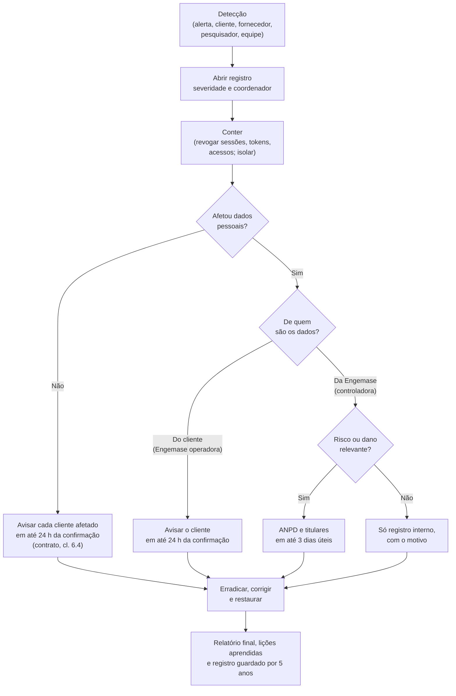

# Plano de resposta a incidentes de segurança

> **Minuta para revisão por advogado; não usar sem revisão.**
>
> Versão 0.1 · 12/11/2026 · Marcações e o que falta: [README desta pasta](README.md). Os runbooks técnicos ficam em [`docs/operacao/`](../../operacao/README.md).

**Para quem.** Equipe Engemase (direção técnica, suporte, engenharia), encarregado e assessoria jurídica.

## 1. Objetivo e alcance

1.1. Organizar a resposta a **incidentes de segurança** na plataforma Engemase OEE, nos gateways e nos fornecedores.

1.2. **Incidente de segurança com dados pessoais:** evento adverso **confirmado** que comprometa a confidencialidade, a integridade, a disponibilidade ou a autenticidade de dados pessoais (Resolução CD/ANPD nº 15/2024).

1.3. Este plano também cobre incidentes **sem dados pessoais** que afetem clientes (ex.: dados de produção expostos, gateway comprometido, chave de assinatura vazada), porque o contrato obriga a Engemase a avisar o cliente **em até 24 horas da confirmação**, pessoais ou não os dados ([contrato, cl. 6.4](01-contrato-de-assinatura.md#6-obrigações-da-engemase)).

## 2. Quem comunica o quê

| Dados afetados | Papel da Engemase | A Engemase comunica | Quem comunica a ANPD e os titulares |
|---|---|---|---|
| Dados do cliente na plataforma (vínculos, papéis e escopos dos usuários, operadores de chão, apontamentos, auditoria, notificações) | **Operadora** | **O cliente**, em até 24 horas da confirmação ([DPA](02-acordo-de-tratamento-de-dados.md), cláusula 11) | **O cliente** (controlador) |
| Dados da Engemase: **contas de acesso** (nome, e-mail, hash de senha, 2FA, sessões), registros de acesso, segurança, cobrança, contatos, equipe Engemase | **Controladora** | **A ANPD e os titulares**, se houver risco ou dano relevante (seção 6). E avisa os clientes cujos usuários foram afetados | **A Engemase** |
| Os dois ao mesmo tempo (ex.: banco inteiro exposto) | Operadora e controladora | Clientes **e** ANPD e titulares, cada um na sua parte | Cada controlador na sua parte |
| Dados do cliente **não pessoais** (dados de produção, configuração, credenciais de gateway) | Prestadora do serviço | **O cliente**, em até 24 horas da confirmação ([contrato, cl. 6.4](01-contrato-de-assinatura.md#6-obrigações-da-engemase)), com o mesmo roteiro de atualizações e relatório final do DPA, no que couber | Ninguém: não é incidente da LGPD. O cliente decide se avisa alguém |

A LGPD (art. 48) e a Resolução 15/2024 põem a comunicação à ANPD no **controlador**. O dever da Engemase como operadora de avisar o cliente vem do contrato e do dever de segurança (LGPD, arts. 39 e 46).

## 3. Papéis

| Papel | Quem | O que faz |
|---|---|---|
| **Coordenador do incidente** | Super admin de plantão [PREENCHER: nome e substituto] | Abre o registro, define a severidade, chama as pessoas, decide a contenção e aprova as comunicações |
| **Responsável técnico** | Engenharia web ou gateway, conforme o caso [PREENCHER] | Investiga, contém, preserva evidências, corrige e restaura |
| **Encarregado (DPO)** ou canal de privacidade | [PREENCHER: a nomear] | Avalia o risco aos titulares, redige e envia as comunicações à ANPD e aos titulares (quando a Engemase for controladora), apoia os clientes |
| **Contato com clientes** | Suporte ou responsável pela conta [PREENCHER] | Avisa cada cliente afetado, envia as atualizações e responde às dúvidas |
| **Assessoria jurídica** | [PREENCHER: escritório externo] | Revisa comunicações, orienta sobre prazos, contratos e preservação de provas |
| **Direção** | [PREENCHER] | Decide em casos críticos (ex.: tirar a plataforma do ar) e aprova comunicação pública |

Cada papel tem um **substituto** formalmente indicado. Contatos 24 horas: [PREENCHER: lista com telefone, fora do sistema afetado].

## 4. Severidade

| Nível | Exemplos | Acionamento |
|---|---|---|
| **S1 Crítico** | Usuário de um cliente vendo dados de outro (falha de isolamento); conta de super admin comprometida; banco ou cópia de segurança exposta; chave de assinatura das atualizações ou CA SSH vazada; vários gateways comprometidos | Imediato, 24 horas por dia |
| **S2 Alto** | Dados pessoais de um cliente expostos (ex.: exportação enviada à pessoa errada); conta de admin do cliente comprometida; token de gateway roubado; incidente informado por um fornecedor | Em até 1 hora, 24 horas por dia |
| **S3 Médio** | Suspeita sem confirmação; indisponibilidade longa sem perda de dados; vulnerabilidade reportada sem exploração conhecida | Horário comercial |
| **S4 Baixo** | Tentativa bloqueada (força bruta contida pelo limite de tentativas) | Registro e acompanhamento |

## 5. Prazos

**T0** = momento em que alguém da Engemase toma conhecimento do possível incidente.

| Etapa | Prazo interno | Base |
|---|---|---|
| Abrir o registro do incidente e definir a severidade | Até 1 hora de T0 (S1 e S2) | Plano |
| Primeira contenção (revogar sessões, tokens, acessos) | Até 4 horas de T0 (S1 e S2) | Plano |
| Confirmar ou descartar que é incidente com dados pessoais | Até 24 horas de T0 | Plano |
| **Avisar cada cliente afetado** (com ou sem dados pessoais) | **Até 24 horas da confirmação** | DPA, cláusula 11; contrato, cl. 6.4 **[PROPOSTA]** |
| Atualizações ao cliente | A cada 24 horas, enquanto aberto | DPA |
| Avaliar risco ou dano relevante (Engemase controladora) | Até 2 dias úteis do conhecimento | Plano |
| **Comunicar a ANPD** (Engemase controladora, com risco relevante) | **Até 3 dias úteis** do conhecimento de que o incidente afetou dados pessoais | Resolução CD/ANPD nº 15/2024 |
| **Comunicar os titulares** (idem) | **Até 3 dias úteis** do mesmo marco | Resolução CD/ANPD nº 15/2024 |
| Complementar a comunicação à ANPD | Até 20 dias úteis da comunicação | Resolução CD/ANPD nº 15/2024 |
| Relatório final ao cliente (incidente de segurança) | Até 10 dias úteis do encerramento | DPA, cláusula 11.3 |
| Relatório pós-incidente de **indisponibilidade** sem dados pessoais | Até 5 dias úteis da resolução (Pro e Enterprise) | [SLA, seção 6.8](../sla-e-suporte.md) |
| Revisão pós-incidente (lições aprendidas) | Até 10 dias úteis do encerramento | Plano |
| Guardar o registro do incidente (inclusive os não comunicados) | Pelo menos 5 anos | Resolução CD/ANPD nº 15/2024 |

**Agente de pequeno porte:** se a Engemase se enquadrar (Resolução CD/ANPD nº 2/2022), os prazos de comunicação à ANPD e aos titulares contam **em dobro** (6 dias úteis). **Mesmo assim, a meta interna continua de 3 dias úteis.** [CONFIRMAR o enquadramento: README, seção 6.]

**Dias úteis:** segunda a sexta-feira, exceto feriados nacionais. O prazo conta do **conhecimento** pelo controlador, não da data do ataque.

## 6. Risco ou dano relevante (quando comunicar a ANPD)

A Resolução CD/ANPD nº 15/2024 exige a comunicação quando o incidente **puder afetar significativamente interesses e direitos fundamentais** dos titulares **e** envolver pelo menos um destes: dados sensíveis; dados de crianças, adolescentes ou idosos; dados financeiros; **dados de autenticação em sistemas**; dados protegidos por sigilo; ou dados em larga escala. [CONFIRMAR a redação exata do art. 5º no Diário Oficial.]

**No nosso produto:**
- **senhas (mesmo em hash), segredos de 2FA, tokens de sessão, de gateway ou de terminal** são dados de autenticação: incidente que os exponha tende a ser relevante;
- nome, e-mail e IP de usuários, sozinhos, em geral não são, salvo larga escala ou uso para golpes;
- se houver dúvida, **comunicar** e registrar o motivo.

Incidente **não** comunicado à ANPD também fica no registro interno, com o motivo da decisão.

## 7. Fluxo

## 8. Roteiros por tipo de incidente

| Tipo | Primeiros passos | Referência |
|---|---|---|
| **Falha de isolamento entre clientes** (S1) | Desligar a rota ou a função afetada; descobrir desde quando; listar, pela auditoria e pelos logs, quem viu o quê; avisar **todos** os clientes envolvidos | [docs/15 §4](../../15-multi-cliente-e-acesso.md#4-isolamento-de-dados-defesa-em-camadas); limite conhecido da RLS (D38) |
| **Conta da equipe Engemase comprometida** | Bloquear a conta e as sessões; reiniciar o 2FA; listar pela auditoria todos os clientes acessados no período; avisar esses clientes | Auditoria global no console |
| **Conta de admin do cliente comprometida** | Avisar o cliente; bloquear sessões a pedido dele; revisar usuários e escopos alterados | Cliente é o controlador |
| **Token de gateway roubado** | Revogar o token pela plataforma (o gateway para de enviar e a VPN cai); reativar com novo código | [RB-09 — Rotação do token do gateway](../../operacao/runbooks/09-rotacao-token-gateway.md) |
| **Chave de assinatura das atualizações ou CA SSH vazada** (S1) | Suspender publicação de atualizações; trocar a chave; publicar versão assinada com a chave nova; desligar o acesso remoto (kill switch global) | [docs/12](../../12-acesso-remoto-vpn.md); cofre de chaves (L14) |
| **Incidente num fornecedor** (Vercel, Neon, Sentry, Resend, Tailscale, ferramenta de chamados, Better Stack) | Obter do fornecedor o alcance e o período; avaliar quais dados de quais clientes; seguir a seção 2 | [DPA, Apêndice 3](02-acordo-de-tratamento-de-dados.md#apêndice-3--suboperadores) |
| **E-mail ou exportação para a pessoa errada** | Pedir ao destinatário que apague e confirme; invalidar o link; avisar o cliente | — |
| **Perda ou corrupção de dados** (integridade ou disponibilidade) | Restaurar a um ponto no tempo (PITR); reprocessar turnos; apagar de novo os dados de clientes já eliminados ([contrato, cl. 16.1](01-contrato-de-assinatura.md#16-encerramento-exportação-e-eliminação-dos-dados-padrão-proposto--d4-em-aberto)). **Depois de restaurar o banco, os dados já confirmados não voltam dos gateways** | [RB-08 — Restauração do banco (PITR)](../../operacao/runbooks/08-restauracao-banco-pitr.md); L14 |
| **Gateway furtado ou perdido** | Bloquear o token; pedir boletim de ocorrência ao cliente; avaliar dados no equipamento (até 30 dias de produção, configuração de rede do cliente); instalar a unidade nova | [RB-09](../../operacao/runbooks/09-rotacao-token-gateway.md); [RB-10 — Troca do hardware](../../operacao/runbooks/10-troca-hardware-gateway.md); [Anexo H](01-anexo-h-hardware.md), cláusula H.6 |

## 9. Preservação de evidências

- **Exportar na hora** os logs que expiram rápido: logs da Vercel e eventos do Sentry têm retenção curta **[CONFIRMAR prazos do plano]**.
- Guardar: `audit_log`, eventos de acesso remoto, logs do gateway (quando houver envio), comunicações recebidas e enviadas.
- Anotar cada passo no registro com data, hora (com fuso) e autor.
- Guardar cópias num local de acesso restrito, com hash dos arquivos.
- Não apagar contas, tokens ou registros envolvidos antes de copiar as evidências: **revogar** em vez de apagar.

## 10. Modelos de comunicação

### A. Aviso ao cliente controlador (e-mail ao admin e ao contato de privacidade)

> **Assunto:** [Engemase OEE] Incidente de segurança — aviso inicial — [referência]
>
> Prezados,
>
> Informamos que, em **[data e hora]**, confirmamos um incidente de segurança que afeta dados de **[nome do cliente]** na plataforma Engemase OEE. Este é o aviso inicial; enviaremos atualizações a cada 24 horas.
>
> **O que aconteceu:** [descrição curta e objetiva].
> **Quando:** ocorreu em [data, ou "em apuração"]; tomamos conhecimento em [data e hora].
> **Dados afetados:** [categorias: ex., nome e e-mail de usuários; apontamentos de operadores] de cerca de [número] pessoas. [Se for o caso: não há indício de acesso a senhas ou dados de produção.]
> **Riscos prováveis:** [ex.: e-mails falsos usando o nome da plataforma].
> **O que já fizemos:** [ex.: revogamos as sessões; corrigimos a falha].
> **O que recomendamos:** [ex.: avisar os usuários para desconfiar de e-mails pedindo senha].
>
> Como controladora dos dados, cabe a **[nome do cliente]** avaliar a comunicação à ANPD e aos titulares. O prazo da Resolução CD/ANPD nº 15/2024 é de 3 dias úteis do conhecimento. Estamos à disposição para fornecer as informações técnicas necessárias.
>
> Contato para este incidente: **[nome, e-mail, telefone 24 h]**.
>
> [Assinatura do coordenador do incidente]

### B. Atualização ao cliente

> **Assunto:** [Engemase OEE] Incidente [referência] — atualização [n]
>
> Novidades desde a última mensagem: [fatos novos]. Situação atual: [aberto / contido / encerrado]. Próxima atualização: [data e hora].

### C. Comunicação à ANPD (Engemase controladora)

Enviar pelo canal oficial da ANPD **[CONFIRMAR: formulário de comunicação de incidente no site da ANPD]**. Ter em mãos:

| Campo | Conteúdo |
|---|---|
| Controlador | Razão social e CNPJ da Engemase |
| Encarregado ou representante | Nome e contato (representante com procuração, se não houver encarregado) |
| Operadores envolvidos | Fornecedor afetado, se houver |
| Descrição do incidente | Natureza, causa principal (se conhecida) e como foi descoberto |
| Datas | Data da ocorrência (se conhecida) e data do conhecimento |
| Dados afetados | Categorias e natureza dos dados (destacar dados de autenticação, se houver) |
| Titulares afetados | Número (ou estimativa); se há crianças, adolescentes ou idosos; total de titulares na atividade afetada |
| Medidas de segurança anteriores | Ex.: senhas em hash, 2FA, criptografia em trânsito |
| Riscos e consequências prováveis | Para os titulares |
| Medidas tomadas e planejadas | Para reverter ou mitigar |
| Comunicação aos titulares | Se foi feita, quando e como |
| Motivo da demora | Se passou do prazo |

[CONFIRMAR a lista de campos no formulário vigente e no art. 6º da Resolução 15/2024.]

### D. Comunicação aos titulares (Engemase controladora)

Linguagem simples, por e-mail ou na própria plataforma, de forma individual quando possível.

> **Assunto:** Aviso de segurança sobre seus dados na plataforma Engemase OEE
>
> Olá, [nome].
>
> Em **[data]**, identificamos um problema de segurança que pode ter exposto **[quais dados: ex., seu nome, e-mail e o código de verificação em duas etapas]**.
>
> **O que aconteceu:** [descrição curta].
> **O que isso pode causar:** [riscos].
> **O que já fizemos:** [medidas].
> **O que recomendamos a você:** [ex.: trocar a senha; refazer o 2FA; desconfiar de e-mails pedindo senha].
>
> Dúvidas: **[canal do encarregado]**.
>
> Engemase

### E. Registro interno do incidente

Campos mínimos (guardar por pelo menos 5 anos, mesmo se não houve comunicação):

| Campo | |
|---|---|
| Referência e severidade | |
| Data e hora: ocorrência, conhecimento, contenção, encerramento | |
| Descrição e causa | |
| Dados e titulares afetados (categorias e número) | |
| Clientes afetados e data de cada aviso | |
| Avaliação de risco ou dano relevante e motivo da decisão | |
| Comunicações à ANPD e aos titulares (datas, protocolo) | |
| Medidas tomadas | |
| Evidências guardadas (local e hash) | |
| Lições aprendidas e ações de melhoria | |

## 11. Treinamento e testes

- Todo integrante da equipe Engemase lê este plano ao entrar e a cada nova versão.
- **Exercício simulado** (em mesa) a cada 6 meses **[PROPOSTA]**. O primeiro antes do piloto, com o cenário "falha de isolamento entre clientes".
- Revisar este plano depois de cada incidente S1 ou S2 e, no mínimo, uma vez por ano.

## Fontes

- LGPD (Lei 13.709/2018), arts. 39, 46 a 48: <https://www.planalto.gov.br/ccivil_03/_ato2015-2018/2018/lei/l13709.htm>
- Resolução CD/ANPD nº 15/2024 (prazo de 3 dias úteis, complemento em 20 dias úteis, registro por 5 anos, critérios de risco ou dano relevante) e Resolução CD/ANPD nº 2/2022 (prazos em dobro para agentes de pequeno porte): ver [README](README.md#fontes).
