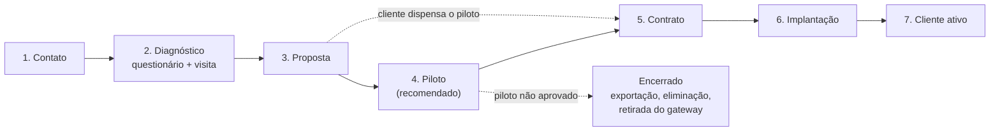

# Onboarding comercial

> Versão 0.1 · 12/11/2026 · Lacuna **L10** ([docs/17 §4](../17-backlog-e-pendencias.md#4-lacunas-de-especificação)).
>
> Prazos, valores e critérios marcados **[PROPOSTA]** dependem do dono do produto. Preços: [planos e preços](planos-e-precos.md). Suporte: [SLA](sla-e-suporte.md).

**Para quem:** comercial, engenharia de campo e suporte da Engemase. Partes deste documento vão para o cliente: o questionário (seção 3), a proposta (seção 5) e o termo de piloto (seção 6).

**Decisões que mudam o onboarding:**
- **D12:** o admin do cliente cuida dos **usuários**; **todo o resto** da configuração é da Engemase.
- **D13:** só a Engemase configura gateways; o engenheiro do cliente tem leitura técnica.
- **D26:** marcas de CLP prioritárias: Siemens, Schneider, Rockwell e ABB.
- **D5:** a Engemase sempre acessa os dados do cliente, com registro e faixa na tela. O cliente precisa saber disso **antes** de assinar.
- **D28:** endereço `engemase-oee.vercel.app`, que vai mudar quando houver domínio próprio.

## 1. Funil

| Etapa | Objetivo | Quem conduz | Sai da etapa quando | Documentos | Prazo típico **[PROPOSTA]** | Estado no console |
|---|---|---|---|---|---|---|
| **1. Contato** | Entender o problema e qualificar | Comercial | Qualificado (seção 2) | Apresentação, matriz de planos sem preço | 1 semana | — |
| **2. Diagnóstico** | Levantar máquinas, CLPs, rede, turnos e metas | Comercial + engenharia de campo | Questionário completo, visita feita, ficha de TI enviada | [Questionário](#3-questionário-de-pré-venda), [checklist da visita](#4-visita-técnica), [ficha de TI](../operacao/ficha-tecnica-ti-cliente.md) | 1 a 2 semanas | — |
| **3. Proposta** | Escopo, preço, cronograma, riscos | Comercial | Proposta aceita | [Modelo de proposta](#5-modelo-de-proposta) | 1 semana | — |
| **4. Piloto** | Provar dado confiável e valor numa linha | Engenharia de campo | Termo de aceite assinado (seção 6.5) | Termo de piloto, DPA, Termos de Uso | **6 a 8 semanas** | **Implantação** |
| **5. Contrato** | Formalizar | Comercial + direção | Contrato, DPA e Anexo H assinados; Pedido emitido | [Minutas jurídicas](juridico/README.md) | 1 a 2 semanas | Implantação (plano e limites atualizados) |
| **6. Implantação** | Colocar todas as máquinas contratadas no ar | Engenharia de campo | Critérios de Ativo (seção 8) | Cronograma, relatório de conferência | **2 a 6 semanas** (conforme máquinas e CLPs) | Implantação |
| **7. Cliente ativo** | Operação, suporte, expansão | Suporte + comercial | — | [SLA](sla-e-suporte.md) | — | **Ativo** |

**Prazo de hardware:** sem gateways em estoque, a importação do R1000 pode levar semanas ([docs/03](../03-gateway.md#compra-impostos-e-anatel)). Manter estoque para pelo menos **2 pilotos** antes de começar a vender.

## 2. Contato e qualificação

Seguir para o diagnóstico quando **todas** as respostas forem "sim" ou tiverem saída conhecida **[PROPOSTA]**:

| Pergunta | Por que importa | Se a resposta for "não" |
|---|---|---|
| Tem pelo menos **5 máquinas** para medir? | Mínimo do plano Starter ([planos, §2.1](planos-e-precos.md#21-para-quem-é-cada-plano-proposta)) | Não vale a implantação; registrar para o futuro |
| A planta tem **internet de saída** (mesmo com proxy)? | A plataforma é só nuvem (D8) | Roteador 4G homologado ([ficha de TI, §4](../operacao/ficha-tecnica-ti-cliente.md#4-tráfego-de-saída-necessário-porta-it)) |
| Os CLPs são acessíveis (programa, senha, porta livre) **ou** dá para pôr um módulo de I/O? | Sem sinal não há OEE (premissa 4 do [docs/01](../01-visao-e-requisitos.md#premissas-adotadas-validar)) | Módulo de I/O remoto (serviço) |
| O cliente aceita que **a Engemase configura** tudo e que o admin dele cuida só dos usuários (D12)? | É o modelo do produto | Explicar; sem acordo, não seguir |
| O cliente aceita que **a Engemase acessa os dados com registro** (D5)? | Não existe opção de aprovação caso a caso | Explicar a auditoria visível e a faixa na tela; sem acordo, não seguir |
| Existe um **decisor** e um orçamento ou prazo? | Evita diagnóstico sem fim | Agendar com o decisor |

## 3. Questionário de pré-venda

Enviar antes da visita. O cliente devolve preenchido; a engenharia de campo confere na visita.

### 3.1 Empresa e contatos

| Item | Resposta |
|---|---|
| Razão social, CNPJ de cobrança e nome fantasia | |
| Unidades (plantas): cidade, UF e CNPJ de cada uma, se for diferente (D16) | |
| Decisor e patrocinador do projeto | |
| Futuro **admin do cliente** na plataforma (nome, e-mail, celular) | |
| Contato de **TI** (recebe a [ficha técnica](../operacao/ficha-tecnica-ti-cliente.md)) | |
| Contato de **manutenção/automação** (acompanha o técnico) | |
| Contato de **privacidade** (LGPD) e de **cobrança** | |

### 3.2 Máquinas e CLPs (D26)

Uma linha por máquina. Foto da etiqueta do CLP ajuda.

| Unidade / linha | Máquina (nome e tipo) | Fabricante e ano da máquina | **CLP: marca, família, modelo, firmware** | Porta livre (Ethernet ou serial) | Quem tem o programa e a senha | Em garantia do fabricante? | Sinais disponíveis | Ciclo ideal conhecido? |
|---|---|---|---|---|---|---|---|---|
| | | | | | Cliente / integrador / fabricante | Sim / não | Rodando, contagem, refugo, falha, produto | |

**Famílias de CLP mais comuns** (marcar na coluna do CLP; classe de integração em [planos, §6.1](planos-e-precos.md#61-classe-de-integração-por-máquina-d26)):

| Marca | Famílias |
|---|---|
| Siemens | S7-1200, S7-1500, S7-300, S7-400 |
| Schneider Electric | M221, M241, M251, M262, M340, M580 |
| Rockwell Automation | Micro820/850/870, CompactLogix, ControlLogix |
| ABB | AC500 V2, AC500 V3, AC500-eCo V2/V3 |
| Outras | Delta, WEG, Mitsubishi, Omron e demais: atendidas sob demanda ([guia por fabricante, §11](../operacao/adaptacoes-por-fabricante.md)) |

**Perguntas sobre os CLPs:**
- Algum CLP já fala **Modbus TCP ou RTU** com outro equipamento (IHM, supervisório)? Em RS-485, só pode haver **um mestre por barramento** ([docs/11 §5](../11-integracao-modbus.md#5-um-mestre-por-barramento)).
- Alterar o programa do CLP exige **autorização do fabricante da máquina**? A garantia é afetada?
- O cliente tem a licença do software do CLP (TIA Portal, Studio 5000, Control Expert, Automation Builder)?

### 3.3 Rede (OT e IT)

O contato de TI recebe a [ficha técnica](../operacao/ficha-tecnica-ti-cliente.md) e devolve a seção 9 dela preenchida. Aqui, só o essencial para a proposta:

| Item | Resposta |
|---|---|
| A rede das máquinas (OT) é separada da rede da empresa (IT)? | |
| Há switch na rede OT com porta livre perto dos painéis? | |
| Há ponto de rede IT perto do painel onde ficará o gateway? | |
| Internet de saída: direta, proxy (qual autenticação), inspeção SSL? | |
| O firewall libera saída **por nome** (FQDN)? | |
| Restrições de segurança da informação (normas internas, aprovação formal)? | |
| Aceita o **acesso remoto de manutenção** sob demanda, com aprovação de cada sessão (F2, D20)? | |

### 3.4 Turnos, produtos e paradas

| Item | Resposta |
|---|---|
| Turnos por unidade: horários, dias da semana, revezamento | |
| Paradas planejadas: refeição, ginástica, limpeza, manutenção preventiva | |
| Feriados e paradas coletivas | |
| Quantos produtos (SKUs) por máquina; quantos novos por mês | |
| Ciclo ideal por produto e máquina: existe tabela? | |
| Motivos de parada usados hoje (lista ou planilha) | |
| Setup é considerado parada planejada? (padrão do produto: perda de disponibilidade, D22) | |

### 3.5 Metas e situação atual

| Item | Resposta |
|---|---|
| Como medem hoje (planilha, apontamento em papel, MES, nada)? | |
| OEE atual estimado, por linha | |
| Meta de OEE (as faixas da plataforma são fixas: verde ≥ 85%, amarelo 60–85%, vermelho < 60%, D25) | |
| Principais perdas percebidas | |
| O que seria sucesso em 3 meses? | |

### 3.6 Pessoas e terminais

| Item | Resposta |
|---|---|
| Quantas pessoas por papel: admin, engenheiro, supervisor, operador com login, visualizador ([papéis](../15-multi-cliente-e-acesso.md#2-papéis-do-cliente-e-escopo)) | |
| Alguém verá só algumas unidades ou máquinas (escopo, D11)? | |
| TV Andon por linha? Quantas e onde? | |
| Tablet por máquina ou por linha para o operador (Android, D18)? | |
| Lista de operadores de chão: quantos por turno? Há jovens aprendizes (identificar só pela matrícula, [nota do operador](juridico/05-operador-de-chao.md))? | |

## 4. Visita técnica

Uma visita está incluída na taxa de implantação ([planos, §5](planos-e-precos.md#5-taxa-de-implantação-proposta)). No piloto, ela acontece antes da proposta.

### 4.1 Antes

- [ ] Questionário recebido (seção 3).
- [ ] Ficha de TI enviada ao contato de TI.
- [ ] Agenda com manutenção e TI; acompanhante da manutenção definido.
- [ ] Integração de segurança da planta, EPI e **permissão de trabalho**. Abrir painel exige técnico com **NR-10**; trabalho junto à máquina segue a **NR-12** e as regras da planta.
- [ ] Kit: notebook com cliente Modbus, cabo de rede, conversor USB–RS-485, resistor de 120 Ω, multímetro, câmera.

### 4.2 Durante: por máquina

- [ ] Foto da etiqueta do CLP (modelo e firmware) e da IHM.
- [ ] Porta livre: Ethernet (switch OT) ou serial; RS-485 já usada por outro mestre?
- [ ] Sinais: rodando, contador de peças, refugo, código de falha, código de produto.
- [ ] Ciclo observado × ciclo informado.
- [ ] Classe de integração (I0 a I3) e horas estimadas ([planos, §6.1](planos-e-precos.md#61-classe-de-integração-por-máquina-d26)).
- [ ] Quem programa o CLP e se há bloqueio do fabricante.

### 4.3 Durante: por painel e rede

- [ ] Espaço no trilho DIN para o gateway e a fonte.
- [ ] 24 VDC disponível com folga (~5,5 W), disjuntor e DPS ([ficha de TI, §2](../operacao/ficha-tecnica-ti-cliente.md#2-alimentação-e-montagem)).
- [ ] Temperatura dentro do painel (até 50 °C).
- [ ] Distância até o switch OT e até o ponto de rede IT.
- [ ] **Teste de saída** no local, da VLAN do gateway: `Test-NetConnection engemase-oee.vercel.app -Port 443` ([ficha de TI, §8](../operacao/ficha-tecnica-ti-cliente.md#8-teste-de-liberação-antes-da-visita)).
- [ ] Locais das TVs e tablets: tomada, rede ou Wi-Fi, suporte de parede.

### 4.4 Depois

**Relatório de visita** (até 3 dias úteis), que alimenta a proposta:
- lista final de máquinas, com a classe de integração de cada uma;
- quantidade e local dos gateways (um gateway por painel ou grupo de painéis);
- materiais: switch OT, módulo de I/O, cabos, roteador 4G;
- **riscos:** CLP sem servidor Modbus (ex.: Rockwell Logix), máquina em garantia, rede sem saída, proxy NTLM, inspeção SSL;
- fotos.

## 5. Modelo de proposta

| # | Seção | Conteúdo |
|---|---|---|
| 1 | Resumo | Problema, objetivo e números principais (máquinas, plano, mensalidade, prazo) em meia página |
| 2 | Diagnóstico | O que vimos: máquinas, CLPs, rede, como medem hoje, perdas percebidas |
| 3 | Escopo | Unidades, linhas e **lista de máquinas** com a forma de integração de cada uma (bloco OEE, sinais, módulo de I/O); gateways (quantidade e local); terminais |
| 4 | Quem faz o quê | **Engemase:** configuração completa (D12, D13), instalação, treinamento. **Cliente:** usuários (admin), rede conforme a ficha de TI, acesso à planta, programa dos CLPs, lista de operadores |
| 5 | Plano e preço | Plano; máquinas contratadas; mensalidade por máquina; taxa de implantação; serviços (bloco OEE por classe); **hardware conforme a D2**; terminais e usuários extras; descontos; reajuste (IPCA); impostos; validade da proposta (**[PREENCHER: 30] dias**) |
| 6 | Cronograma | Piloto (se houver) e implantação por semana (seção 7) |
| 7 | Piloto | Escopo, duração, preço, abatimento, critérios de aceite (seção 6) |
| 8 | Suporte e SLA | Resumo do plano (horários, prazos, disponibilidade) e o [SLA](sla-e-suporte.md) como anexo |
| 9 | Segurança e dados | Gateway só de saída e só leitura; dados em São Paulo (D7); **acesso da Engemase sempre registrado e visível (D5)**; retenção (D6); LGPD (DPA) |
| 10 | Premissas e exclusões | O que o preço supõe (ex.: CLPs acessíveis, rede liberada no prazo) e o que não inclui ([planos, §5](planos-e-precos.md#5-taxa-de-implantação-proposta)) |
| 11 | Próximos passos | Aceite, termo de piloto ou contrato, data da instalação |
| Anexos | | Ficha de TI, questionário preenchido, relatório de visita, minutas (contrato, DPA, Anexo H, Termos) |

**Endereço:** citar `engemase-oee.vercel.app` uma vez, na seção 9, avisando que vai mudar para o domínio próprio com aviso prévio (D28).

## 6. Piloto

Recomendado para todo primeiro cliente e para clientes com CLPs de classe I3.

### 6.1 Escopo e condições **[PROPOSTA]**

| Item | Proposta |
|---|---|
| Escopo | **1 linha, 3 a 5 máquinas**, 1 gateway, 1 TV; tablet se houver |
| Duração | **6 a 8 semanas:** 2 semanas de estabilização (critérios técnicos do [docs/09](../09-roadmap.md#fase-1-mvp-7-semanas--2-de-piloto)) + 4 a 6 semanas de uso |
| Plano | Recursos do **Pro** que já existirem |
| Preço | R$ ___ fixo (hipótese: R$ 5.000–12.000), **abatido da taxa de implantação** se o contrato for assinado em até 30 dias do aceite |
| Hardware | Em comodato durante o piloto, qualquer que seja a D2 |
| Bloco OEE no CLP | Cobrado à parte, conforme a classe; também abatido se houver contrato **[DECIDIR]** |
| Documentos | **Termo de piloto**, **DPA** e Termos de Uso. O DPA é necessário porque o piloto já trata dados reais (usuários e operadores) |

### 6.2 Termo de piloto: conteúdo mínimo

O jurídico ainda não tem este termo ([README do jurídico, §6, item 9](juridico/README.md#6-o-que-falta)).

**Duração no termo:** a do piloto inteiro, **6 a 8 semanas** (seção 6.1). As "2 semanas" do [docs/09](../09-roadmap.md#fase-1-mvp-7-semanas--2-de-piloto), citadas no README do jurídico, são **só a estabilização técnica**, a primeira parte do piloto.

Conteúdo mínimo:
1. Escopo (linha, máquinas, gateway, terminais) e duração total (estabilização + uso).
2. Preço, abatimento e condições de pagamento.
3. Critérios de aceite (seção 6.4) e prazo para o aceite.
4. Obrigações do cliente: ficha de TI, acesso, programa dos CLPs, lista de operadores.
5. Dados: DPA vale desde o primeiro dia; acesso da Engemase com registro (D5).
6. Hardware em comodato e devolução.
7. Fim sem contrato: o que acontece com dados e gateway (seção 6.6).
8. Sem SLA com crédito no piloto; atendimento no horário do Pro.

### 6.3 No console

- O super admin cria o cliente pelo assistente "Novo cliente" (empresa e slug, primeira unidade e fuso, primeiro admin), com o estado **Implantação** e os limites do piloto (máquinas = as do piloto).
- O slug **nunca é reaproveitado** ([docs/15 §6](../15-multi-cliente-e-acesso.md#6-ciclo-de-vida-do-cliente)): escolher já o nome definitivo.
- Com o contrato, o super admin atualiza plano e limites; o cliente continua o mesmo, com todo o histórico do piloto.

### 6.4 Critérios de aceite

**Técnicos** (do [docs/09](../09-roadmap.md#fase-1-mvp-7-semanas--2-de-piloto) e da [L12](../17-backlog-e-pendencias.md#4-lacunas-de-especificação)):

| # | Critério | Como conferir |
|---|---|---|
| T1 | **Zero perda de contagem** em relação ao contador do CLP, inclusive depois de derrubar a internet de propósito por algumas horas | Comparar o total por turno com o contador do CLP; registrar a queda e o reenvio |
| T2 | Peças por turno iguais ao contador do CLP, salvo período "sem comunicação" registrado | Relatório de 2 semanas |
| T3 | OEE da plataforma igual ao da planilha de referência, com diferença de até **0,5 ponto percentual** por turno, em pelo menos **3 turnos** | Planilha de referência assinada pelo cliente |
| T4 | Máquina colocada no ar pela equipe de campo, **sem ajuda do desenvolvimento** | Registro da implantação |
| T5 | Estados (produzindo, parada, falha) batendo com o observado em campo | Amostra de 1 h por máquina, com o supervisor |

**De uso** (combinados na proposta) **[PROPOSTA]**:

| # | Critério |
|---|---|
| U1 | Pelo menos **80%** das paradas acima do limite de micro-parada classificadas com motivo nas últimas 2 semanas |
| U2 | Supervisores e gestor entrando na plataforma pelo menos uma vez por semana |
| U3 | Linha de base de OEE medida e as **3 maiores perdas** da linha identificadas e apresentadas ao cliente |

### 6.5 Aceite

- A Engemase entrega o **relatório do piloto** (critérios, números, 3 maiores perdas, próximos passos) na última semana.
- O cliente assina o **termo de aceite** em até **5 dias úteis**. **[ADVOGADO]:** definir se o silêncio vale como aceite.
- **Critério técnico não cumprido:** a Engemase corrige em até 10 dias úteis e repete a conferência. **Critério de uso não cumprido:** reunião para decidir entre estender o piloto (até 4 semanas) ou encerrar.

### 6.6 Piloto encerrado sem contrato

Segue o padrão provisório da D4 ([contrato, cl. 16](juridico/01-contrato-de-assinatura.md)): cliente passa a **Encerrado**; exportação em CSV disponível por 30 dias; eliminação no dia 60, com termo de eliminação; o gateway volta para a Engemase e tem os dados apagados (Anexo H, H.6).

## 7. Contrato e implantação

**Para assinar:** contrato, **DPA**, **Anexo H** (uma alternativa da D2), Pedido (Anexo A) com plano, máquinas contratadas e preços, e SLA (Anexo B). Termos de Uso e Política de Privacidade são aceitos no primeiro login.

**Cronograma típico [PROPOSTA]** (com piloto feito e gateways em estoque):

| Semana | Engemase | Cliente | Passo do [docs/15 §7](../15-multi-cliente-e-acesso.md#7-console-engemase-e-autogestão) |
|---|---|---|---|
| 0 | Reunião de início; atualiza plano e limites no console; turnos, feriados, produtos, motivos e metas | Ficha de TI devolvida e **teste de liberação** feito; lista final de máquinas; lista de operadores | A, B |
| 0 | Envia o e-mail "definir senha" ao **admin do cliente**; ele ativa o 2FA | Admin entra | C |
| 1–2 | Bancada: gateways testados e **registrados no cliente**, com a rede do cliente gravada ([docs/16 §5](../16-projeto-do-gateway.md#5-rede-e-instalação)); bloco OEE nos CLPs (serviço) | Libera acesso aos CLPs e à planta | D |
| 2–4 | Instala gateways; cadastra máquinas e tags; testa leituras; confere contagens em 3 turnos | Acompanha; supervisores conferem o OEE | E |
| 3–4 | Pareia TVs e tablets; treina por papel (seção 9) | Admin convida a equipe (papéis e escopos) | F, G |
| 4–6 | Confere os critérios de Ativo (seção 8); muda o estado para **Ativo** | Assina o aceite da implantação | H |

Mais máquinas ou CLPs de classe I3 aumentam as semanas 1 a 4. Para mais de uma unidade, repetir as semanas 1 a 4 por unidade.

## 8. Critérios para o cliente passar a Ativo

O estado **Ativo** ([docs/15 §6](../15-multi-cliente-e-acesso.md#6-ciclo-de-vida-do-cliente)) é mudado pelo **super admin**, depois de todos os itens abaixo. O [contrato, cl. 4.5](juridico/01-contrato-de-assinatura.md) remete a esta seção.

| # | Critério | Quem confere | Evidência |
|---|---|---|---|
| A1 | **Todas as máquinas contratadas** cadastradas, coletando e com tags testadas | Engenharia de campo | Lista no console |
| A2 | Contagem de cada máquina igual ao contador do CLP em pelo menos **3 turnos** (T2 da seção 6.4) | Engenharia de campo + supervisor | Relatório de conferência |
| A3 | OEE de cada linha conferido com a planilha de referência (T3) | Engenharia de campo + supervisor | Planilha assinada |
| A4 | Gateways **online há 72 h seguidas**, relógio certo, fila zerada | Suporte | Tela de gateways |
| A5 | Turnos, feriados, produtos com ciclo ideal, motivos de parada e metas de OEE cadastrados | Engenharia de campo | Console |
| A6 | Terminais contratados pareados e testados | Engenharia de campo | Lista de terminais |
| A7 | **Admin do cliente** ativo, **com 2FA** (D14 provisória), e pelo menos um usuário de cada papel combinado | Suporte | Lista de usuários |
| A8 | Alerta de "gateway offline" testado e chegando à engenharia do cliente e ao suporte Engemase | Suporte | Teste registrado |
| A9 | Treinamento por papel feito (seção 9) | Engenharia de campo | Lista de presença |
| A10 | Contatos de TI, manutenção, cobrança e privacidade cadastrados; ficha de TI assinada | Comercial | Cadastro |
| A11 | Contrato, DPA, Anexo H e Pedido assinados | Comercial | Documentos |
| A12 | Termo de aceite da implantação assinado pelo cliente | Comercial | Documento |

**Cobrança:** a mensalidade começa no Ativo ou **30 dias depois do marco de início**, o que vier antes ([planos, §3.2](planos-e-precos.md#32-início-aumento-redução-e-troca-de-plano)). O marco é a instalação do primeiro gateway **feita depois da assinatura do Pedido**; se o cliente veio do piloto e não há gateway novo a instalar, é a assinatura do Pedido. **O tempo do piloto não entra:** ele é pago só pelo preço do piloto (seção 6.1). Se um item depender só do cliente (ex.: ficha de TI atrasada), a cobrança começa no prazo mesmo assim (conta a data combinada para a instalação).

## 9. Treinamento por papel

**Princípio (D12):** o admin do cliente aprende a cuidar dos **usuários** e a **pedir** mudanças de configuração. Ninguém do cliente aprende a configurar gateways, máquinas ou tags: isso é da Engemase.

| Público | Papel | Conteúdo | Duração | Formato |
|---|---|---|---|---|
| **Admin do cliente** | `client_admin` | Convidar usuários (e-mail "definir senha"); papéis; escopos (cliente inteiro, unidades ou máquinas; **nada listado = nenhum acesso**; **máquina nova não entra sozinha** no escopo por máquinas); desativar quem sai; 2FA e reinício do 2FA de um usuário; aprovar ou recusar sessão de acesso remoto (F2); ler a **auditoria**, inclusive os acessos da Engemase e a faixa na tela (D5); como **pedir mudança de configuração** por chamado | 1 h 30 | Remoto, antes do go-live |
| **Supervisor e gestor** | `supervisor` | Visão geral, linha, máquina e linha do tempo; OEE = disponibilidade × performance × qualidade e as faixas fixas (D25); relatórios por turno e produto; classificar paradas, lançar refugo e trocar produto; central de notificações e push (no iPhone, instalar o app na Tela de Início) | 2 h | Presencial |
| **Engenheiro e manutenção** | `engineer` | **Leitura técnica** (D13): saúde dos gateways, conexões e tags, sem editar; "dados atrasados" e "sem comunicação"; LEDs do gateway; o que **não** fazer (desligar, mudar de lugar, mexer na rede); bloqueio local do acesso remoto (F2); quando e como abrir chamado | 1 h 30 | Presencial, no painel |
| **Líder de linha** (operador com login) | `operator` | Tela do operador: classificar paradas, refugo, troca de produto, fila sem rede | 30 min | No posto |
| **Operador de chão** (sem login) | Terminal | Escolher o próprio nome na lista; classificar parada; lançar refugo; aviso de privacidade ([nota do operador](juridico/05-operador-de-chao.md)) | 15–20 min | No posto, **em cada turno** |
| **TI do cliente** | — | Ficha técnica, teste de liberação, avisar antes de mudar a rede, mudança futura do endereço (D28) | 1 h | Remoto, antes da visita |
| **Diretoria** | `viewer` | Leitura do OEE, metas e relatório mensal | 30 min | Remoto, 30 dias depois do Ativo |

- **Operadores de chão: multiplicadores.** A Engemase treina os líderes de cada turno, e eles treinam os operadores. A Engemase acompanha o primeiro turno de cada equipe. Três turnos com a Engemase presente em todos encarecem a implantação.
- **Material:** artigos da central de ajuda (`/[cliente]/ajuda`), guia rápido de uma página por papel para deixar no posto e vídeos curtos. Os guias por papel ainda faltam ([docs/17, L15](../17-backlog-e-pendencias.md#4-lacunas-de-especificação)).
- **Registro:** lista de presença por turma (critério A9).
- **Reciclagem:** Pro, 1 por ano; Enterprise, 2 por ano ([planos, §2.2](planos-e-precos.md#22-matriz-de-recursos-proposta)). Pessoa nova no cliente: o admin pede material ou turma extra.

## 10. Passagem para o suporte e primeiros 30 dias

**Ficha do cliente para o suporte** (entregue pela engenharia de campo no Ativo):
- contatos e horários da planta;
- unidades, linhas e máquinas, com a classe de integração e as particularidades de cada CLP;
- gateways: número de série (`EGW-NNNNN`), local, rede (IPs OT e IT, proxy), portas RS-485 usadas;
- riscos conhecidos (ex.: proxy que muda, rede OT instável);
- região para troca de hardware ([SLA, §11](sla-e-suporte.md#11-troca-de-hardware-em-campo)) e, por gateway, se a unidade de troca pode sair **registrada da bancada** (rede IT em DHCP, sem proxy) ou se o registro precisa ser no local, com técnico da Engemase ([RB-10 §5.1](../operacao/runbooks/10-troca-hardware-gateway.md#51-na-bancada-antes-da-visita)). Isso muda o prazo de troca em R2 e R3.

**Acompanhamento de 30 dias** (incluído na implantação):
- reunião semanal curta com o admin e um supervisor: dúvidas, paradas sem motivo, pedidos de configuração;
- revisão dos alertas (excesso ou falta);
- no fim: primeira **reunião de resultados** (OEE por linha, 3 maiores perdas, metas). Depois, trimestral no Pro e mensal no Enterprise.

## 11. Pendências do dono do produto

| # | Escolha | Proposta |
|---|---|---|
| 1 | Piloto pago: preço e regra de abatimento | Seção 6.1 |
| 2 | Duração do piloto | 6 a 8 semanas no termo (as 2 semanas do docs/09 são só a estabilização, seção 6.2) |
| 3 | Critérios de uso no aceite (U1 a U3) | Seção 6.4 |
| 4 | Silêncio vale como aceite? | [ADVOGADO] |
| 5 | Início da cobrança | Ativo ou 30 dias depois do marco (primeiro gateway instalado depois do Pedido, ou o Pedido, se vier do piloto), o que vier antes (seção 8) |
| 6 | Estoque mínimo de gateways para vender | Para 2 pilotos |
| 7 | Validade da proposta | 30 dias |
| 8 | Critérios de qualificação | Seção 2 |
