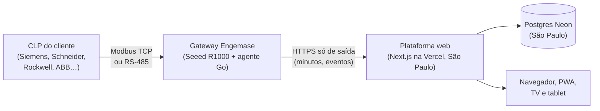

# Proposta atualizada: Sistema de OEE da Engemase

- **Versão:** 2 (13/11/2026). Substitui a [proposta original de 08/10/2025](2025-10-08-proposta-original.md).
- **Propositor:** Pablo Gonçalves Ribas, Automação.
- **Situação:** Fase 0 de código pronta e testada; decisões do produto tomadas em 12/11/2026 ([docs/17 §3](../../17-backlog-e-pendencias.md#3-decisões)). Valores marcados como *provisórios* serão revistos depois do piloto.

## 1. Introdução e justificativa

A proposta continua a mesma na essência: dar aos clientes da Engemase uma plataforma própria de **OEE em tempo real**, vendida como **assinatura mensal por máquina monitorada**, começando com **um cliente-piloto**.

O que mudou é o *como*. Em um ano de planejamento, a proposta virou um projeto de engenharia completo: arquitetura documentada, protótipo de todas as telas, contrato entre gateway e nuvem, banco com isolamento por cliente, gateway industrial próprio e testes automatizados. A seção 7 lista cada mudança e o motivo.

**Diferencial competitivo:**
- **O gateway é da Engemase.** Ele lê o CLP do cliente diretamente (Modbus TCP ou RS-485), sem sensor extra, e guarda os dados por até 30 dias se a internet cair.
- **A Engemase opera o serviço.** Ela configura máquinas e gateways, acompanha a saúde da frota e atualiza o software remotamente. O cliente só gerencia seus usuários e usa os números.
- **Conhecimento de automação embutido.** Um bloco de OEE padrão para o CLP, com guia para Siemens, Schneider, Rockwell e ABB, faz cada instalação seguir o mesmo modelo.

## 2. O que o sistema entrega

**Para o cliente** (plataforma web instalável no celular e no computador):
- **Ao vivo:** estado de cada máquina, OEE do turno e linha do tempo de paradas, com atualização a cada poucos segundos.
- **TV Andon** na linha e **tela do operador** no tablet, para classificar paradas, lançar refugo e trocar produto.
- **Relatórios:** OEE por máquina, linha e unidade, Pareto de paradas e histórico. Exportação em CSV (abre direto no Excel).
- **Alertas:** central no app e notificações push. E-mail e WhatsApp entram na Fase 2.
- **Marca do cliente:** cores e logotipo por cliente, tema claro, escuro ou automático.
- **Segurança:** cada cliente vê só os próprios dados, com acesso de cada pessoa por unidade ou por máquina, 2FA para administradores e auditoria de tudo.

**Para a Engemase** (console interno):
- Cadastro de clientes, unidades, linhas, máquinas e usuários.
- Frota de gateways: ativação por código, saúde e atualização remota.
- Acesso remoto aos gateways por VPN, com aprovação do admin do cliente em cada sessão.
- Planos, limites e cobrança por máquina.

## 3. Tecnologia e arquitetura

| Camada | Escolha | Por quê |
|---|---|---|
| Gateway | **Seeed reComputer R1000** (industrial, 3 portas RS-485, 2 Ethernet, sem rádio) com **agente próprio em Go** | Lê o CLP direto; guarda os dados localmente se a internet cair; atualização remota |
| Comunicação com o CLP | **Modbus TCP, RTU (RS-485) e RTU sobre TCP**; bloco OEE padrão de 32 registradores | Cobre as quatro marcas prioritárias; S7comm e EtherNet/IP nativos na Fase 2 |
| Comunicação com a nuvem | **HTTPS de saída**, a cada 10 s, com retentativas e sem perda | Passa pelo firewall e pelo proxy do cliente sem abrir portas; MQTT só se a escala pedir |
| Plataforma web | **Next.js** (React) na **Vercel**, região São Paulo | Um só código para web, PWA, TV e tablet; deploy automático a cada mudança |
| Banco | **Postgres na Neon** (São Paulo), **Drizzle**, isolamento por cliente com RLS | Postgres padrão, backup com restauração a qualquer instante, sem fornecedor exclusivo |
| Autenticação | **Better Auth** com 2FA | Código aberto, dentro do projeto |
| Qualidade | Monorepo com **mais de 700 testes automatizados** e CI | Cada mudança é conferida antes de ir ao ar |

Detalhes: [arquitetura](../../02-arquitetura.md), [gateway](../../16-projeto-do-gateway.md), [protocolo gateway ↔ nuvem](../../04-protocolo-gateway-nuvem.md), [cálculo do OEE](../../07-calculo-oee.md), [multi-cliente e acesso](../../15-multi-cliente-e-acesso.md).

### 3.1 Investimento

**Nuvem, por mês** (estimativa de 12/11/2026, câmbio de R$ 5,50; detalhe em [planos e preços §8](../planos-e-precos.md#8-base-de-custo)):

| Cenário | Máquinas | Custo da nuvem por mês | Por máquina |
|---|---|---|---|
| Piloto | 10 | R$ 470–690 | R$ 47–69 |
| Primeiro ano | 100 | R$ 1.540–3.030 | R$ 15–30 |
| Meta | 500 | R$ 6.960–9.650 | R$ 14–19 |

Inclui Vercel Pro, Neon Scale (com SLA de 99,95%), Sentry, e-mail, monitor externo e página de status. Domínio próprio: cerca de R$ 40 por ano.

**Bancada, uma vez** (estimativas; pedir cotação):

| Item | Valor estimado |
|---|---|
| 2 gateways R1000 sem rádio, nacionalizados | R$ 4.800–5.400 |
| 4 CLPs de bancada (S7-1200 1211C, M221, Micro820, AC500-eCo) | US$ 270–400 cada no exterior; cotar no Brasil |
| Licença TIA Portal STEP 7 Basic (as outras marcas têm software gratuito na bancada) | A cotar |
| Fonte, disjuntores, cabos, módulo de I/O e barramento RS-485 de teste | A cotar |

**Gateway em cada cliente:** R$ 3.250–4.450 por unidade (R1000, caixa pré-montada, SuperCAP, montagem e teste). Fica em **comodato**: o gateway é da Engemase e a taxa de implantação cobre parte dele.

## 4. Modelo comercial

- **Assinatura do software, por máquina por mês**, com três planos (*provisório*):

| Plano | Preço por máquina por mês | Mínimo de máquinas |
|---|---|---|
| Starter | R$ 230 | 5 |
| Pro | R$ 330 | 10 |
| Enterprise | R$ 420 | 40 |

- Contrato mínimo de **12 meses**, **taxa de implantação** (comissionamento, programação do bloco OEE no CLP, treinamento) e serviços avulsos.
- Cobrança sobre o **maior número** entre máquinas contratadas e máquinas ativas no mês.
- **Exemplo:** 100 máquinas no plano Pro rendem R$ 33.000 por mês. O custo direto estimado é de R$ 55–110 por máquina (nuvem, suporte e plantão), sem contar o hardware em comodato.
- Documentos: [planos e preços](../planos-e-precos.md), [onboarding comercial](../onboarding-comercial.md), [SLA e suporte](../sla-e-suporte.md) e as [minutas de contrato e LGPD](../juridico/README.md) (precisam de revisão por advogado).

## 5. Plano de implementação

Com acompanhamento semanal, atualizado às sextas-feiras, no [status do projeto](../../00-status.md) e no [backlog](../../17-backlog-e-pendencias.md).

| Fase | O que entrega | Situação |
|---|---|---|
| Planejamento | Requisitos, arquitetura (documentos 01 a 17), decisões e protótipo navegável de todas as telas | **Feito** (out/2025 a nov/2026) |
| Fase 0: fundação | Contrato gateway ↔ nuvem, cálculo do OEE, banco com isolamento por cliente, API real dos gateways, agente do gateway revisado, simulador de CLP, pacote de instalação, imagem do sistema e CI. Teste de ponta a ponta (simulador → gateway → nuvem → banco) passando | **Código pronto** (12/11/2026). Faltam contas na nuvem e a bancada |
| Fase 1: MVP | Login real, cadastros, telas com dados reais, alertas no app, gateway instalável com atualização remota, testes de 72 h na bancada | ~15 semanas a partir de 16/11/2026 |
| Piloto | 1 linha de 1 cliente por 2 semanas, com OEE conferido contra planilha (até 0,5 ponto de diferença) e contagem de peças igual à do CLP | **Semanas 14 a 16:** meados de fevereiro a início de março de 2027 |
| Fase 2: produto | S7comm e EtherNet/IP nativos, alertas por e-mail e WhatsApp, acesso remoto por VPN, relatórios avançados (MTBF/MTTR), editor de marca | ~8 semanas depois do piloto |
| Fase 3: escala | API pública e integração com ERP/MES, ordens de produção, módulos de manutenção e qualidade | ~10 semanas |

**Premissa do prazo:** 2 desenvolvedores (um na web, um no gateway). Com uma pessoa só, em tempo parcial, o piloto passa para o segundo semestre de 2027. A trilha do gateway é o caminho crítico.

## 6. Riscos e como estão tratados

| Risco | Tratamento |
|---|---|
| Importação do hardware atrasar a bancada | Comprar já 2 R1000 por courier; cotação formal para a frota |
| CLP do cliente sem Modbus (ex.: CompactLogix) | Bloco da Rockwell (AOI) ou gateway de protocolo agora; driver EtherNet/IP nativo na Fase 2 |
| Internet do cliente cair | O gateway guarda até 30 dias de dados e envia tudo na volta, sem duplicar |
| Vazamento de dados entre clientes | Isolamento no banco (RLS), testes automáticos de isolamento e auditoria |
| LGPD e contrato | Minutas prontas; revisão por advogado e encarregado (DPO) nomeado antes do piloto |
| Domínio provisório (`*.vercel.app`) | Registrar o domínio próprio antes do primeiro gateway ir a um cliente |

## 7. O que mudou em relação à proposta original

| Proposta original | Hoje | Por quê |
|---|---|---|
| Lovable (gerador de app) | **Next.js** com código próprio no repositório | Controle total do código, testes automatizados e nenhuma dependência de uma ferramenta de geração |
| Supabase | **Neon** (Postgres) + **Drizzle** + **Better Auth** | Postgres padrão com SLA, restauração a qualquer instante e região São Paulo; autenticação e isolamento dentro do projeto |
| InfluxDB para telemetria | **Postgres** com agregados por minuto calculados no gateway | O OEE precisa de minutos e eventos, não de série bruta; um banco só é mais simples e barato |
| MQTT do gateway à nuvem | **HTTPS só de saída** | Passa pelo proxy e pelo firewall do cliente sem configuração; MQTT fica para frotas grandes (Fase 3) |
| "Gateway IoT" e sensores | **Gateway industrial próprio** (R1000) lendo o **CLP** direto | Usa o que o CLP já sabe (estado, contadores, falhas) sem instalar sensores; padroniza com o bloco OEE |
| Acesso offline do app | **O gateway coleta offline** (até 30 dias); o tablet do operador guarda apontamentos por até 24 h | O dado que não pode se perder é o da máquina; o painel precisa de internet para mostrar números atuais |
| Manutenção preditiva com Machine Learning | **Fora do MVP.** Alertas por regra (máquina parada, OEE abaixo da meta, gateway offline). Módulo de manutenção na Fase 3 | ML precisa de histórico; primeiro vêm dados confiáveis |
| Dashboards drag-and-drop | **Telas prontas por papel** (gestor, supervisor, operador, TV) | Mais rápido de entregar e igual para todos os clientes; personalização depois |
| Relatórios em PDF/Excel | **CSV que abre no Excel** na Fase 2; PDF depois | Atende o uso real com menos esforço |
| Domínio engemaseoee.com.br | **Endereço da Vercel por enquanto**; domínio próprio antes do primeiro cliente | Decisão D28 |
| R$ 270 por mês | **R$ 470–690 por mês no piloto**, caindo para R$ 15–30 por máquina com 100 máquinas | Planos pagos com SLA e backup, monitoramento e região São Paulo; diluído pela escala |
| Responsável único, 20 h por semana, MVP em 14–16 meses | **2 desenvolvedores**, piloto em fevereiro–março de 2027 | O gateway próprio aumentou o escopo; a Fase 0 de código já está pronta |
| Mensalidade "a definir" | **Planos por máquina com preços iniciais**, implantação e comodato do gateway | Decisão D1 e base de custo documentada |

## 8. Solicitações

1. **Contas na nuvem:** Vercel Pro, Neon (Scale), Sentry e domínio próprio. Cerca de R$ 500–700 por mês no piloto.
2. **Bancada:** 2 gateways R1000, os 4 CLPs de bancada e a licença do TIA Portal (seção 3.1).
3. **Equipe:** um segundo desenvolvedor, ou técnico em tempo parcial, para manter o piloto em fevereiro–março de 2027.
4. **Cliente-piloto:** escolher o cliente e a linha, com uma das quatro marcas de CLP prioritárias.
5. **Jurídico:** revisão das minutas de contrato e LGPD por advogado; nomear o encarregado (DPO) e o substituto.
6. **Autonomia técnica** para conduzir o projeto, com o acompanhamento semanal às sextas-feiras.

**Compromisso:** manter o status e o backlog do repositório atualizados toda semana, com o que foi entregue, o que falta e os riscos.

Atenciosamente,

Pablo Gonçalves Ribas
Engemase Engenharia
