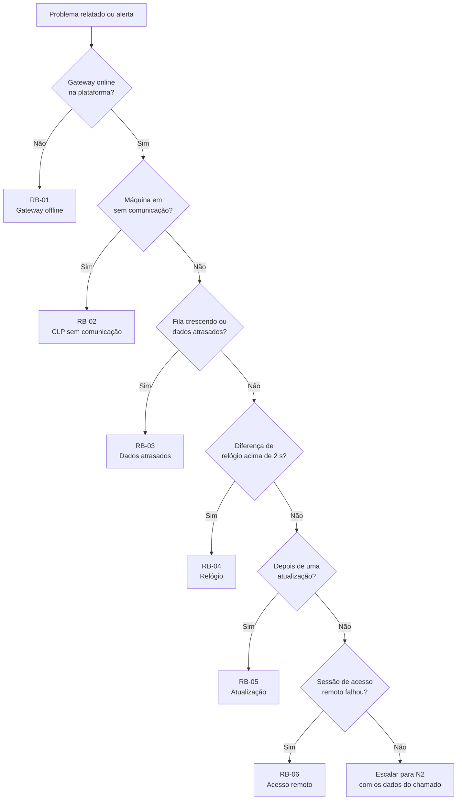

# Operação — runbooks, fichas e bloco OEE

Documentação de operação da plataforma Engemase OEE e do gateway (Seeed reComputer R1000): o que fazer quando algo dá errado, o que enviar ao TI do cliente, como conferir um gateway novo na bancada e como programar o bloco OEE padrão nos CLPs. Marcas de CLP prioritárias (D26): **Siemens, Schneider, Rockwell e ABB**.

**Para quem:** suporte e engenharia de campo da Engemase, equipe de automação (bloco OEE) e TI do cliente (ficha técnica).

**Base canônica:** [docs/16 — Projeto do gateway](../16-projeto-do-gateway.md) (caminhos, usuários, rede, LEDs, CLI), [docs/11 — Integração Modbus](../11-integracao-modbus.md), [docs/04 — Protocolo](../04-protocolo-gateway-nuvem.md), [docs/13 — Alertas](../13-notificacoes-e-alertas.md) e o código em `gateway/`, `packages/contracts/` e, em construção, `deploy/gateway` (pacote `.deb`, units, sudo, firewall) e `deploy/image` (imagem, gravação, *factory init*). Onde houver diferença, valem o docs/16 e o código.

## 1. Índice

| Arquivo | O que é | Para quem |
|---|---|---|
| [runbooks/01-gateway-offline.md](runbooks/01-gateway-offline.md) | Gateway sem contato com a plataforma | Suporte, campo |
| [runbooks/02-clp-sem-comunicacao.md](runbooks/02-clp-sem-comunicacao.md) | Máquina em "sem comunicação" com o gateway online (TCP, RS-485, mapa, heartbeat) | Suporte, campo, automação |
| [runbooks/03-dados-atrasados-buffer.md](runbooks/03-dados-atrasados-buffer.md) | "Dados atrasados" e fila do gateway que não drena | Suporte, engenharia |
| [runbooks/04-relogio-fora-de-sincronia.md](runbooks/04-relogio-fora-de-sincronia.md) | Diferença de relógio, NTP, RTC e efeitos nos dados | Suporte, TI do cliente |
| [runbooks/05-atualizacao-falhou-rollback.md](runbooks/05-atualizacao-falhou-rollback.md) | Atualização do agente que falhou ou voltou à versão anterior (OTA mínimo, Fase 1) | Engenharia |
| [runbooks/06-acesso-remoto-nao-conecta.md](runbooks/06-acesso-remoto-nao-conecta.md) | VPN de manutenção que não conecta (Fase 2) | Suporte, engenharia, TI do cliente |
| [runbooks/07-contagem-divergente.md](runbooks/07-contagem-divergente.md) | CLP mostra um número de peças e a plataforma outro: leitura (tag, tipo, ordem das words), eventos do contador, período, refugo | Suporte, campo, automação |
| [runbooks/08-restauracao-banco-pitr.md](runbooks/08-restauracao-banco-pitr.md) | Restauração do banco na Neon (PITR): quando, como, o que se perde e como recuperar o período que os gateways não reenviam | Engenharia, direção técnica |
| [runbooks/09-rotacao-token-gateway.md](runbooks/09-rotacao-token-gateway.md) | Bloquear o token de um gateway e registrar de novo com código novo (sem `--force`, pelo marcador `auth-blocked`) | Engenharia, campo |
| [runbooks/10-troca-hardware-gateway.md](runbooks/10-troca-hardware-gateway.md) | Troca da unidade com defeito: fila da antiga, gravação com a rede do cliente, registro no mesmo gateway e conferência | Engenharia, bancada, campo |
| [ficha-tecnica-ti-cliente.md](ficha-tecnica-ti-cliente.md) | Ficha de uma página para o TI do cliente: portas, saídas, DNS/NTP, proxy, VPN, dados, checklist | TI do cliente, comercial |
| [verificacao-bancada-r1000.md](verificacao-bancada-r1000.md) | Roteiro de verificação de cada R1000 novo antes de expedir (Partes A e B) e bancada de CLPs das 4 marcas prioritárias, com a matriz de testes por marca (Parte C) | Bancada, engenharia, automação |
| [bloco-oee-v1.md](bloco-oee-v1.md) | Especificação formal v1 do bloco OEE padrão Engemase (mantida pela D26) e template de tags do gateway | Automação, engenharia, campo |
| [FB_OEE_ENGEMASE.st](FB_OEE_ENGEMASE.st) | Bloco de função IEC 61131-3 (ST) que monta o bloco OEE no CLP, com notas de portabilidade (TIA Portal, Studio 5000, Machine Expert, Automation Builder) | Automação |
| [adaptacoes-por-fabricante.md](adaptacoes-por-fabricante.md) | Como expor o bloco por Modbus TCP/RTU em cada marca de CLP: Siemens, Schneider, Rockwell e ABB primeiro, com fontes oficiais; depois as outras marcas | Automação, campo |

## 2. Marcações usadas

| Marcação | Significa |
|---|---|
| **(Fase 1)** | Previsto para antes do piloto, **ainda não implementado** no agente ou na imagem. O texto diz o que fazer até lá |
| **(Fase 2)** | Depois do piloto (ex.: VPN de manutenção) |
| **CONFIRMAR NA BANCADA** | Fato do hardware R1000 que ainda não foi verificado ([docs/16 §9](../16-projeto-do-gateway.md#9-prazo-e-riscos)) |
| **confirmar no manual do fabricante** | Informação de CLP que precisa ser conferida no manual do modelo e testada antes de ir ao cliente |
| D7, D26, D28... | Decisões do dono do produto, tomadas ou pendentes ([docs/17 §3](../17-backlog-e-pendencias.md#3-decisões)) |

Comandos **sem marcação** existem hoje no agente (`gateway/`): `oee-gateway run`, `version`, `enroll`, `diag`, `modbus read` e `config validate`. Os comandos `systemctl` e `journalctl` do serviço `oee-gateway` dependem do pacote `.deb` com a unit systemd, ainda pendente **(Fase 1)**: até lá, na bancada, o agente roda com `oee-gateway run`.

## 3. Regras de ouro

1. **A coleta não depende da nuvem.** Com o gateway ligado e com config, nada se perde por até 30 dias (ou 1 GB). Não há pressa que justifique um atalho.
2. **Nunca apague** `/var/lib/oee-gateway` (`buffer.db`, `credentials.json`), não faça reset de fábrica e não reinstale a imagem para "resolver" um problema: a fila pendente se perde.
3. **Registro de novo (`enroll --force`) só com um código gerado para o mesmo gateway** na plataforma.
4. **Um mestre por barramento RS-485.** A leitura direta (`oee-gateway modbus read --target ...`) é ferramenta de bancada; em campo, use as leituras pela fila do agente **(Fase 1)**, a página local **(Fase 1)** ou o notebook.
5. **Somente leitura no CLP.** Nenhum procedimento escreve no CLP.
6. **Rede do gateway só se muda no local**, com confirmação e volta automática ([docs/16 §5](../16-projeto-do-gateway.md#5-rede-e-instalação)). Nunca abra porta de entrada no firewall do cliente.
7. **Plataforma primeiro, depois remoto, depois o local.** Ir à planta é o último passo.
8. **Registre tudo no chamado:** número de série (`EGW-NNNNN`), horários com fuso, causa, ação e quem fez.

## 4. Referência rápida

| Item | Valor ([docs/16 §4](../16-projeto-do-gateway.md#4-caminhos-usuários-e-identidade-canônico)) |
|---|---|
| Serviço do agente | `oee-gateway` (systemd, usuário `oee`). Linha de status em `systemctl status oee-gateway`: `coletando N/M dispositivos · nuvem online` |
| Estado do agente | `/var/lib/oee-gateway/` (na partição `/data`): `buffer.db`, `credentials.json` (0600, dono `oee`), config atual e anterior |
| Config local | `/etc/oee-gateway/gateway.yaml` (URL da plataforma, caminhos, log) |
| Rede, proxy e CA | `/etc/oee-gateway/network.json` (única fonte; aplicado pelo ajudante privilegiado) |
| Identidade da unidade | `/data/identity/hw.json` |
| Número de série / hostname | `EGW-00042` / `egw-00042` |
| Portas | **ETH0 = OT** (CLPs; endereço de serviço 169.254.x.y sempre ativo) · **ETH1 = IT** (internet, só saída) · RS-485: `rs485-1/2/3` → `/dev/ttyAMA2/3/5` (ordem dos bornes a confirmar) |
| Usuário de campo | `tecnico` (só console local; senha local do cartão lacrado). `sudo` só para `oee-gateway status`, `diag`, `net show/set/confirm/rollback` e `enroll --code` (sem `--url` nem `--force`), **executados como o usuário `oee`**. Membro de `oee-admin` (CLI de leitura sem `sudo`, Fase 1) e de `systemd-journal` (lê o journal) |
| Root | **Não há root nas unidades de campo:** root bloqueado, SSH desligado ([`deploy/image`](../../deploy/image)). Tudo que exige root é feito na bancada ou, na F2, numa sessão de acesso remoto aprovada |
| Firewall | Saída OT só para o usuário do agente (`oee`) e só para os IP:porta cadastrados; saída IT 443 só para o agente e o `apt` ([`deploy/gateway/nftables`](../../deploy/gateway/nftables)) |
| Logs | journald: `journalctl -u oee-gateway` (JSON); `oee-gateway logs` **(Fase 1)** |
| Página local **(Fase 1)** | `https://<IP OT>` ou `https://169.254.x.y`, só pela rede OT, senha local |
| Padrões do agente | `/sync` a cada 10 s (1 s em modo interativo); debounce 1 s; `NO_COMM` após 10 s sem leitura; timeout Modbus 500 ms (TCP) e 300 ms (RTU); lotes de até 2.000 itens |
| Telas ao vivo | Atualizam a cada 2 s; selo "dados atrasados" quando o dado ao vivo passa de 30 s |

**CLI planejada (Fase 1):** `status`, `modbus scan`, `modbus oee-block`, `config show`, `buffer stats`, `logs`, `net show/set/confirm/rollback`, `support-bundle`. **Fase 2:** `remote-access status/on/off --lock`.

## 5. Níveis de atendimento (proposta)

Até a definição de SLA e suporte (lacuna L11 do [docs/17](../17-backlog-e-pendencias.md#4-lacunas-de-especificação)), os runbooks usam estes níveis:

| Nível | Quem | Faz |
|---|---|---|
| **N1** | Suporte Engemase (papel `support`, com concessão de suporte ativa) | Triagem pela plataforma, contato com o cliente, roteiro dos runbooks |
| **N2** | Engenharia Engemase (desenvolvedores do gateway e da plataforma, `field_engineer`) | Logs da ingestão, releases, quarentena, hardware, visitas técnicas |
| **N3** | Direção técnica (`super_admin`) e fornecedores (Vercel, Neon, Seeed, Tailscale) | Incidentes de plataforma, segurança e contratos |

## 6. Qual runbook usar

Um relógio muito errado pode derrubar o TLS e deixar o gateway offline: se o RB-01 apontar erro de certificado, siga o RB-04.

## 7. Pendentes

Os quatro runbooks que faltavam (lacuna L15, lista do [docs/08](../08-seguranca-e-operacao.md#operação-e-suporte-runbooks-a-escrever)) estão no índice: RB-07 a RB-10. Registrar de novo um gateway com token recusado (401) deixou de ser lacuna: o marcador `auth-blocked` do agente permite o `enroll --code` sem `--force` ([RB-09](runbooks/09-rotacao-token-gateway.md)). Continuam em aberto:

| Item | Observação |
|---|---|
| Bloquear o token e gerar código de ativação pela plataforma | **Fase 1.** Até lá, SQL no [RB-09 §5.1](runbooks/09-rotacao-token-gateway.md#51-bloquear-o-token-e-gerar-o-código-equipe-engemase) |
| Recuperar a fila de uma unidade que não fala com a nuvem | Sem ferramenta no MVP ([RB-10 §5.2](runbooks/10-troca-hardware-gateway.md#52-fila-da-unidade-antiga)) |
| Cópia de dados entre ramos da Neon na restauração | Script `db:migrate` contra a Neon e papel com `BYPASSRLS` a confirmar ([RB-08 §5.4](runbooks/08-restauracao-banco-pitr.md#54-recuperar-o-período-entre-t0-e-t1-l14)) |
