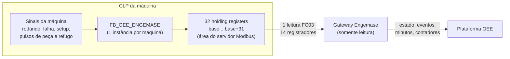

# Bloco OEE padrão Engemase — especificação v1

Especificação formal do **bloco OEE padrão Engemase**: o conjunto de holding registers que a Engemase coloca no programa dos CLPs que ela programa ou altera, para o gateway ler a máquina numa única leitura Modbus. Formaliza a proposta do [docs/11 §3](../11-integracao-modbus.md#3-bloco-oee-padrão-engemase) **sem mudar o layout**: 32 registradores a partir de um endereço base (padrão **HR 1000**), valores de 32 bits em **CDAB**.

> **Status:** versão 1, para aprovação na decisão **D26** ([docs/17 §3](../17-backlog-e-pendencias.md#3-decisões-pendentes-do-dono-do-produto)). O layout é o mesmo já usado pelo gateway (`gateway/internal/modbus/oeeblock.go`), pelo simulador (`tools/plc-sim/block`) e pelo template do protótipo. O que esta especificação acrescenta está marcado com **(novo na v1)**.
>
> **Arquivos relacionados:** bloco de função em ST: [`FB_OEE_ENGEMASE.st`](FB_OEE_ENGEMASE.st). Como expor o bloco em cada marca de CLP: [adaptacoes-por-fabricante.md](adaptacoes-por-fabricante.md).

## 1. Visão geral



Por que um bloco padrão:
- **uma leitura por máquina** (uma transação FC03), em qualquer marca de CLP;
- **template pronto** na plataforma: cadastrar a máquina vira "informar IP, unit id e endereço base";
- **mesmo significado em todas as marcas**, o que simplifica o suporte e o comissionamento.

## 2. Regras gerais

| # | Regra |
|---|---|
| G1 | **Área:** holding registers (lidos com FC03). Alternativa aceita: **input registers** (FC04) com o mesmo layout, só quando o servidor Modbus do CLP expõe dados de leitura apenas nessa área (ver [adaptações](adaptacoes-por-fabricante.md)). |
| G2 | **Endereço base configurável.** Padrão: **HR 1000** (endereço de protocolo, base 0), que na convenção 4xxxx é o **41001** (ou 401001 em 6 dígitos). A plataforma guarda sempre o endereço base 0. |
| G3 | **32 registradores contíguos reservados** (base até base+31). A v1 usa os offsets 0–13. Os offsets 14–31 ficam **em zero** e precisam **responder à leitura** (sem exceção 02), para que versões futuras possam ler o bloco inteiro. |
| G4 | **Somente leitura para o gateway.** O gateway nunca escreve no bloco. O programa do CLP **reescreve os 32 registradores a cada ciclo de scan**, então uma escrita externa indevida não persiste. |
| G5 | **Ordem dos bytes dentro de cada registrador:** a padrão do Modbus (byte mais significativo primeiro). Não há opção de troca de bytes para campos de 16 bits no gateway: um servidor que troca os bytes quebra o bloco (ver §11). |
| G6 | **Valores de 32 bits em CDAB:** a word **baixa** no offset menor e a word **alta** no offset seguinte (§6). O FB monta as words explicitamente, então a ordem não depende da arquitetura do CLP. |
| G7 | **Atualização:** o bloco é atualizado **a cada ciclo de scan** (tarefa cíclica de no máximo 100 ms). |
| G8 | **Consistência:** os 14 registradores lidos numa transação devem vir do **mesmo ciclo**. Se o servidor Modbus roda em outra tarefa, a cópia para a área do Modbus deve ser feita de uma vez, no mecanismo de consistência do fabricante (ver §7). |
| G9 | **Várias máquinas no mesmo CLP:** um bloco de 32 registradores por máquina, em sequência: 1000, 1032, 1064... Cada máquina tem seu próprio template na plataforma, com o seu endereço base. |
| G10 | **Retenção:** os três contadores são **retentivos** (mantêm o valor sem energia e em reinício do CLP) e **nunca são zerados pelo programa**. |

## 3. Mapa de registradores

Endereços para a base padrão 1000. **Acesso** é do ponto de vista do gateway: **L** = só leitura (o CLP escreve, o gateway lê). Na notação de 6 dígitos (a que a CLI `oee-gateway modbus read` mostra e a de alguns softwares de CLP), 41001 vira **401001**.

| Offset | Endereço (base 0) | Convenção 4xxxx | Nome | Tipo | Unidade | Acesso | Descrição |
|---|---|---|---|---|---|---|---|
| 0 | 1000 | 41001 | `versao_bloco` | uint16 | — | L | Versão do layout. **Sempre 1** nesta especificação |
| 1 | 1001 | 41002 | `heartbeat` | uint16 | contagem | L | +1 a cada 1 s; de 65535 volta para 0 (§5.2) |
| 2 | 1002 | 41003 | `estado` | uint16 | código | L | 0 parada · 1 produzindo · 2 falha · 3 setup · 4 manual · 5 emergência (§5.3) |
| 3 | 1003 | 41004 | `codigo_falha` | uint16 | código | L | Código do alarme ativo; 0 = nenhum (§5.4) |
| 4–5 | 1004–1005 | 41005–41006 | `contador_total` | uint32 CDAB | peças | L | Peças produzidas acumuladas (boas + refugo); monotônico (§5.5) |
| 6–7 | 1006–1007 | 41007–41008 | `contador_refugo` | uint32 CDAB | peças | L | Peças refugadas acumuladas; monotônico |
| 8–9 | 1008–1009 | 41009–41010 | `contador_bons` | uint32 CDAB | peças | L | Peças boas acumuladas; monotônico. Conferência local, fora do template v1 (§5.5) |
| 10 | 1010 | 41011 | `produto` | uint16 | código | L | Código do produto ou receita; 0 = não definido (§5.6) |
| 11 | 1011 | 41012 | `velocidade` | uint16 | definida por máquina | L | Velocidade atual (ex.: peças/h); 0 fora de produção (§5.7) |
| 12 | 1012 | 41013 | `ciclo_ultimo_ms` | uint16 | ms | L | Duração do último ciclo; satura em 65535 (§5.8) |
| 13 | 1013 | 41014 | `bits_status` | uint16 (bits) | — | L | Bits de status (§5.9) |
| 14–31 | 1014–1031 | 41015–41032 | reservado | — | — | L | Sempre 0. Expansão futura: não usar |

## 4. Tipos e convenções

- `uint16`: inteiro sem sinal de 0 a 65535, num registrador.
- `uint32 CDAB`: inteiro sem sinal de 0 a 4.294.967.295, em dois registradores, word baixa primeiro.
- `bits`: cada bit é um sinal (bit 0 = menos significativo).
- Nenhum campo é `float` ou com sinal na v1. Isso evita ambiguidade de ordem e de escala entre marcas.

## 5. Campos

### 5.1 `versao_bloco` (offset 0)

- Valor fixo **1** nesta especificação.
- Serve para o técnico e, no futuro, o gateway confirmarem que o layout lido é o esperado.
- Se a leitura der **256** (0x0100), os bytes estão trocados no servidor do CLP (§11).
- O agente atual **não confere** a versão automaticamente. A conferência é feita no comissionamento (`oee-gateway modbus read --oee-block`) e está prevista no comando `modbus oee-block` **(Fase 1)**.

### 5.2 `heartbeat` (offset 1)

- **+1 a cada 1 s** (tolerância: de 0,5 s a 2 s por incremento). De 65535 volta para 0.
- Incrementa sempre que o programa estiver rodando, **com a máquina parada ou não**. Ele diz "o CLP está vivo e o bloco está sendo atualizado", não "a máquina está produzindo".
- **(novo na v1)** O incremento é por tempo (1 s), não por ciclo de scan. O docs/11 admitia os dois; por tempo, o valor é previsível e igual ao do simulador.
- **Uso no gateway:** a tag do heartbeat tem o papel `plc.heartbeat`, e a máquina tem `heartbeat_timeout_s` (template: **5 s**). Se o heartbeat ficar parado por mais que esse prazo, a máquina vai para **`NO_COMM`** mesmo com o servidor Modbus respondendo. É o caso do CLP em STOP, do programa travado ou do FB que deixou de ser chamado.

### 5.3 `estado` (offset 2)

| Código | Nome | Quando o CLP informa | Estado no gateway (template) | Efeito no OEE ([docs/07](../07-calculo-oee.md#modelo-de-estados)) |
|---|---|---|---|---|
| 0 | Parada | Ligada, sem produzir, sem falha (inclui parada planejada, ver bit 4) | `STOPPED` | Parada não planejada até o operador ou o calendário classificar |
| 1 | Produzindo | Ciclo automático ativo | `RUNNING` | Tempo de operação |
| 2 | Falha | Parada por alarme ou defeito | `FAULT` | Parada não planejada, com o `codigo_falha` |
| 3 | Setup | Troca de produto, ajuste, regulagem | `SETUP` | Configurável por organização (D22) |
| 4 | Manual | Máquina em modo manual (não produz em automático) | `STOPPED` | Parada até classificação |
| 5 | Emergência | Emergência acionada | `FAULT` | Parada não planejada |

Regras:
- **Prioridade** quando mais de uma condição é verdadeira (é o que o FB faz): emergência (5) > falha (2) > setup (3) > manual (4) > produzindo (1) > parada (0).
- Um código fora de 0–5 vira o `default_state` da regra da máquina (`STOPPED`, padrão do contrato).
- Cada estado deve durar **pelo menos 1 s**. O gateway aplica debounce de 1 s ([docs/03](../03-gateway.md#determinação-do-estado)): mudanças mais curtas são descartadas.
- O mapeamento código → estado fica no template da plataforma e pode ser trocado por máquina (por exemplo, "manual" como `SETUP`).

### 5.4 `codigo_falha` (offset 3)

- Código do alarme ativo; **0 = nenhum**.
- Com `estado = 2`, deve trazer o código do alarme que **causou** a parada. Use o **primeiro alarme** (first-out) e mantenha-o enquanto ele estiver ativo: uma troca de código dentro da falha gera um novo evento de estado no gateway.
- Pode ser diferente de 0 em outros estados (alarme sem parada). O gateway só associa o código aos eventos em `FAULT`.
- A lista de códigos de cada máquina é cadastrada na plataforma. A classificação automática de paradas pelo código é da F2 ([docs/07](../07-calculo-oee.md#modelo-de-estados)).

### 5.5 Contadores (offsets 4–9)

**Comportamento obrigatório:**
- **Monotônicos:** só aumentam. Nunca diminuem, nunca são zerados pelo programa nem pela IHM. Se a máquina precisa de um contador "zerável" para o operador (lote, turno), use **outro** contador.
- **Rollover:** depois de 4.294.967.295 volta para 0 e continua. O gateway trata a volta como overflow, sem perder peça.
- **Retentivos:** mantêm o valor em queda de energia, reinício do CLP e download de programa sem reinicialização dos dados retentivos.
- **Atualização imediata:** a peça entra no contador no mesmo ciclo do pulso.
- `contador_total = contador_bons + contador_refugo` (módulo 2³²). O FB garante essa relação.

**Duas formas de ligar os sinais** (parâmetro `xModoCiclo` do FB):

| Modo | Sinais da máquina | O FB faz |
|---|---|---|
| Pulsos separados (padrão) | Um pulso por peça boa e um por peça refugada | boas += n · refugo += 1 · total = boas + refugo |
| Ciclo + refugo | Um pulso por ciclo (todas as peças) e um por peça refugada | total += n · refugo += 1 · boas = total − refugo |

`n` é o número de peças por pulso (por exemplo, um molde de 4 cavidades = 4).

**O que o gateway faz com os contadores** ([docs/03](../03-gateway.md#contadores)):

| Situação | Comportamento |
|---|---|
| Valor subiu | Delta = atual − anterior |
| Valor caiu perto do máximo do tipo | Overflow: delta = (máximo − anterior) + atual + 1 |
| Valor caiu sem estar perto do máximo | Reset: delta = atual e evento `counter_reset` |
| Subida absurda (acima de `max_rate_per_s` × tempo + 10) | Salto: delta descartado e evento `counter_jump` |
| Endereço, tipo ou ordem da tag mudou na config | Nova base e evento `counter_rebaseline` |

O último valor de cada contador fica salvo no gateway junto com o minuto. Depois de um reinício do gateway, o delta continua certo.

**`contador_bons` fica fora do template v1 (novo na v1).** A nuvem calcula boas = total − refugo ([docs/07](../07-calculo-oee.md#algoritmo-janela-t0-t1-de-uma-máquina)) e o contrato só envia `good` quando existe uma tag `count.good`. Um CLP antigo que deixe este campo em 0 faria a nuvem receber "0 peças boas". Por isso o template lê só `contador_total` e `contador_refugo`. O `contador_bons` continua obrigatório no bloco programado com o FB e serve para conferência local (o docs/11 o marcava como opcional, "se 0, o gateway calcula total − refugo"; o agente atual não implementa essa regra).

### 5.6 `produto` (offset 10)

- Código numérico do produto ou receita em uso (1–65535). **0 = não definido.**
- O gateway envia o código como texto (ex.: `"1001"`) em cada minuto e gera um evento `product` quando ele muda. A plataforma associa o código ao cadastro de produtos (ciclo ideal por produto).
- Troque o código **antes** de produzir a primeira peça do produto novo, de preferência durante o setup.

### 5.7 `velocidade` (offset 11)

- Velocidade atual da máquina, na unidade definida no cadastro da máquina (ex.: peças/h, golpes/min). 0 fora de produção.
- No gateway, papel `speed.actual` (com escala opcional). Vai na foto ao vivo da máquina. O histórico de amostras é da F2.

### 5.8 `ciclo_ultimo_ms` (offset 12)

- Duração do último ciclo em milissegundos, medida entre dois pulsos de peça (ou de ciclo). Satura em 65535 (65,5 s).
- **Não lido pelo template v1.** Fica disponível na leitura local e para uso futuro (amostras `custom`, F2).

### 5.9 `bits_status` (offset 13)

| Bit | Máscara | Nome | Significado |
|---|---|---|---|
| 0 | 0x0001 | Automático | Máquina em modo automático |
| 1 | 0x0002 | Porta aberta | Porta ou proteção de segurança aberta |
| 2 | 0x0004 | Falta material | Falta de material ou de alimentação |
| 3 | 0x0008 | Manutenção | Máquina em manutenção |
| 4 | 0x0010 | Parada planejada **(novo na v1)** | O CLP sinaliza parada planejada (refeição, manutenção programada) |
| 5–15 | — | Reservados | Sempre 0 |

- **Não lido pelo template v1.** A classificação de paradas planejadas continua sendo feita na nuvem, pelo calendário ou pelo motivo apontado ([docs/07](../07-calculo-oee.md)). O bit 4 fica registrado para uso futuro (sugestão automática de motivo) e para a conferência local.
- O estado (offset 2) continua refletindo a condição física: com o bit 4 ligado e a máquina parada, `estado = 0`.

### 5.10 Reservados (offsets 14–31)

Sempre 0 e sempre legíveis. Nenhum programa pode usá-los para outra finalidade: eles pertencem às próximas versões do bloco.

## 6. Ordem das words (CDAB)

Um valor de 32 bits tem os bytes A (mais significativo), B, C e D (menos significativo). Em **CDAB**, o registrador do offset menor guarda a word baixa (C D) e o seguinte guarda a word alta (A B). Cada registrador mantém a ordem de bytes padrão do Modbus.

Exemplo com `contador_total` = **100.000** (0x000186A0): word alta 0x0001, word baixa 0x86A0.

| Ordem | Offset 4 | Offset 5 | Observação |
|---|---|---|---|
| **CDAB (padrão do bloco)** | 0x86A0 = **34464** | 0x0001 = **1** | O que o FB produz |
| ABCD | 0x0001 = 1 | 0x86A0 = 34464 | Típico de quem copia um DINT nativo em CLP big-endian (ex.: Siemens) |
| BADC | 0x0100 = 256 | 0xA086 = 41094 | Bytes trocados dentro de cada word |
| DCBA | 0xA086 = 41094 | 0x0100 = 256 | Bytes trocados e words invertidas |

Se o CLP entregar outra ordem, o certo é corrigir o programa (usar o FB). Em último caso, o `word_order` da tag pode ser trocado por máquina no template ([docs/11](../11-integracao-modbus.md#3-bloco-oee-padrão-engemase)). Isso vale só para os campos de 32 bits.

## 7. Requisitos de temporização no CLP

| Item | Requisito |
|---|---|
| Chamada do FB | **Todo ciclo**, sem condição, numa tarefa cíclica de até 100 ms |
| Pulsos de peça | Cada pulso precisa ficar **pelo menos 1 ciclo de scan em nível alto e 1 em nível baixo**. Máquinas mais rápidas: usar contador rápido (HSC) e gerar os pulsos a partir dele, ou somar o delta do HSC no contador (comentário no FB) |
| Estados | Mínimo de 1 s em cada estado para aparecer na plataforma (debounce do gateway) |
| Heartbeat | +1 a cada 1 s |
| Servidor Modbus | Responder em até **200 ms** (o timeout do gateway é de 500 ms em TCP e 300 ms em RTU) |
| Consistência | Os 14 primeiros registradores vêm do mesmo ciclo. Atenção aos servidores que rodam em tarefa própria (CODESYS e afins): copie o bloco na mesma tarefa que atualiza a área do servidor ou use a cópia consistente do fabricante. Uma leitura "rasgada" de um contador na virada da word baixa aparece como reset seguido de salto |

## 8. Como o gateway lê o bloco

- **Uma leitura FC03 de 14 registradores** a partir do endereço base, por máquina e por ciclo de leitura. É uma transação só; cabe com folga no limite de 125 registradores.
- **Intervalo:** 500 ms em Modbus TCP. Em RTU, 500 ms com poucos escravos e 1.000 ms com barramento cheio (o mínimo do contrato em RTU é 200 ms). A 19200 bps, a leitura dos 14 registradores leva ~30–45 ms por máquina, contando o tempo de resposta do CLP ([docs/11](../11-integracao-modbus.md#quanto-cabe-num-barramento)).
- **Decodificação:** feita pelo próprio agente (`gateway/internal/modbus`), com as quatro ordens de 32 bits.
- **Estado:** modo `state_code` com o mapa da §5.3. Falha de leitura por mais de `comm_loss_after_s` (padrão 10 s) ou heartbeat parado por mais de `heartbeat_timeout_s` (template 5 s) → `NO_COMM`.
- **Contadores:** deltas por minuto, com os tratamentos da §5.5.
- **Produto e velocidade:** evento `product` na troca; velocidade na foto ao vivo.
- **Lidos mas não usados na v1:** `versao_bloco`, `contador_bons`, `ciclo_ultimo_ms`, `bits_status`. Ficam visíveis na leitura local (`modbus read --oee-block`).

## 9. Template de tags do gateway

### 9.1 Resumo

| Campo | Offset | Papel da tag | Tipo | `word_order` | No template v1 |
|---|---|---|---|---|---|
| `versao_bloco` | 0 | — | uint16 | — | Não (conferência local) |
| `heartbeat` | 1 | `plc.heartbeat` | uint16 | — | **Sim** |
| `estado` | 2 | `state.code` | uint16 | — | **Sim** |
| `codigo_falha` | 3 | `fault.code` | uint16 | — | **Sim** |
| `contador_total` | 4 | `count.total` | uint32 | CDAB | **Sim** |
| `contador_refugo` | 6 | `count.reject` | uint32 | CDAB | **Sim** |
| `contador_bons` | 8 | (`count.good`) | uint32 | CDAB | Não (§5.5) |
| `produto` | 10 | `product.code` | uint16 | — | **Sim** |
| `velocidade` | 11 | `speed.actual` | uint16 | — | **Sim** |
| `ciclo_ultimo_ms` | 12 | (`custom`, F2) | uint16 | — | Não |
| `bits_status` | 13 | (`custom`, F2) | uint16 | — | Não |

### 9.2 Trecho da config (Modbus TCP, base 1000)

No formato do contrato ([docs/03](../03-gateway.md#configuração-de-tags), `packages/contracts/src/config.ts`). Os ids são **ilustrativos**: a nuvem gera UUIDv7.

```json
{
  "devices": [
    {
      "id": "dev_inj03", "name": "CLP Injetora 03", "protocol": "modbus-tcp",
      "params": { "host": "192.168.10.23", "port": 502, "unit_id": 1, "timeout_ms": 500 },
      "blocks": [
        { "area": "holding_register", "start": 1000, "count": 14, "poll_ms": 500 }
      ],
      "tags": [
        { "id": "tag_hb",  "address": { "area": "holding_register", "offset": 1001 }, "type": "uint16", "role": "plc.heartbeat", "machine_id": "mch_inj03" },
        { "id": "tag_est", "address": { "area": "holding_register", "offset": 1002 }, "type": "uint16", "role": "state.code", "machine_id": "mch_inj03" },
        { "id": "tag_flh", "address": { "area": "holding_register", "offset": 1003 }, "type": "uint16", "role": "fault.code", "machine_id": "mch_inj03" },
        { "id": "tag_tot", "address": { "area": "holding_register", "offset": 1004 }, "type": "uint32", "word_order": "CDAB", "role": "count.total", "machine_id": "mch_inj03" },
        { "id": "tag_ref", "address": { "area": "holding_register", "offset": 1006 }, "type": "uint32", "word_order": "CDAB", "role": "count.reject", "machine_id": "mch_inj03" },
        { "id": "tag_prd", "address": { "area": "holding_register", "offset": 1010 }, "type": "uint16", "role": "product.code", "machine_id": "mch_inj03" },
        { "id": "tag_vel", "address": { "area": "holding_register", "offset": 1011 }, "type": "uint16", "role": "speed.actual", "machine_id": "mch_inj03" }
      ]
    }
  ],
  "machines": [
    {
      "id": "mch_inj03", "name": "Injetora 03",
      "state_rules": {
        "mode": "state_code",
        "map": { "0": "STOPPED", "1": "RUNNING", "2": "FAULT", "3": "SETUP", "4": "STOPPED", "5": "FAULT" },
        "default_state": "STOPPED",
        "comm_loss_after_s": 10,
        "heartbeat_timeout_s": 5
      }
    }
  ]
}
```

Regras do contrato que este template já respeita:
- as tags dentro do bloco **não** têm `poll_ms` (vale o do bloco);
- `word_order` só nas tags de 32 bits;
- um papel de cada tipo por máquina;
- `heartbeat_timeout_s` exige a tag `plc.heartbeat`;
- `comm_loss_after_s` × 1000 ≥ 3 × `poll_ms`.

### 9.3 Variações

- **Outra base:** some a nova base a todos os offsets (ex.: base 2000 → bloco `start: 2000` e tags 2001, 2002, 2003, 2004, 2006, 2010, 2011).
- **Modbus RTU:** `"protocol": "modbus-rtu"`, `"params": { "bus": "<id do barramento>", "unit_id": N, "timeout_ms": 300 }` e `poll_ms` de 500 a 1000.
- **Input registers (G1):** `"area": "input_register"` no bloco e nas tags.
- **CLP que só entrega ABCD:** `"word_order": "ABCD"` nas duas tags de 32 bits, registrado no cadastro da máquina.

## 10. Versionamento

| Regra | Detalhe |
|---|---|
| Offsets 0–13 | **Nunca mudam de significado** em versões futuras |
| Campos novos | Só nos offsets 14–31 e nos bits reservados do `bits_status` |
| Qualquer mudança de layout | `versao_bloco` + 1, novo documento `bloco-oee-vN.md` e novo template "Bloco OEE vN" na plataforma |
| Compatibilidade | Um template v1 lê um bloco v2 sem erro (lê só os 14 primeiros). Um template v2 exige CLP com bloco v2 |
| Quem aprova | Engenharia de automação da Engemase + dono do produto (D26) |
| Biblioteca | O `FB_OEE_ENGEMASE.st` e as adaptações por fabricante seguem a versão do bloco |

## 11. Verificação no comissionamento

Leitura com a CLI `oee-gateway` (lê direto, sem a fila do agente). Use na bancada ou num notebook Linux com o binário amd64. Num gateway de campo, o firewall só libera a rede OT para o próprio agente: lá, use o `modbus oee-block --device` ou a página local **(Fase 1)**. Em RS-485, nunca leia com outro mestre ativo no barramento.

```bash
oee-gateway modbus read --target tcp://192.168.10.23:502 --unit 1 --offset 1000 --count 14 --oee-block
oee-gateway modbus read --target tcp://192.168.10.23:502 --unit 1 --offset 1000 --count 14 \
  --decode uint32:CDAB@4 --decode uint32:ABCD@4
```

Com o comando `modbus oee-block` **(Fase 1)**, a mesma conferência sai pronta, com três leituras seguidas para checar o heartbeat.

| # | Teste | Resultado esperado |
|---|---|---|
| 1 | Ler o bloco | `versao_bloco = 1`; offsets 14–31 em 0 (ler com `--count 32`) |
| 2 | Ler de novo depois de 3 s | `heartbeat` subiu cerca de 3 |
| 3 | Ordem de words | Com a máquina parada, o `contador_total` bate com a IHM. Na bancada, forçar o contador interno do FB para 100.000: offsets 4 e 5 = 34464 e 1 |
| 4 | Estados | Forçar parada, falha (com código), setup e produção: o `estado` e o `codigo_falha` seguem, e a tela ao vivo da plataforma também |
| 5 | Contagem | 10 peças → `contador_total` +10; uma peça refugada → `contador_refugo` +1 |
| 6 | Produto | Trocar a receita → `produto` muda e a plataforma registra a troca |
| 7 | Retenção | Desligar e religar o CLP: os contadores mantêm o valor |
| 8 | CLP em STOP | Depois de 5 s com o heartbeat parado, o gateway marca a máquina como `NO_COMM`; na tela ao vivo aparece em até ~10 s como "sem comunicação" |

**Erros comuns:**

| Sintoma na leitura | Causa provável | Correção |
|---|---|---|
| `versao_bloco` = 256 e estado 256, 512... | Bytes trocados no servidor do CLP | Configurar o servidor para a ordem padrão do Modbus |
| O valor 1 (versão) aparece no offset 1, ou o heartbeat no offset 0 | Deslocamento de 1 (base 0 × base 1) | Ajustar o **endereço base no template**, não no CLP |
| Contador enorme e errado | Ordem de words diferente de CDAB | Usar o FB; em último caso, trocar `word_order` |
| Heartbeat parado com a máquina ligada | FB não é chamado, CLP em STOP ou bloco copiado só na inicialização | Chamar o FB e copiar o bloco em todo ciclo |
| Contador volta a 0 quando o CLP é desligado | Contadores não retentivos | Declarar o FB (ou os contadores) em área retentiva |
| Exceção 02 na leitura | Bloco fora da área mapeada do servidor, ou menos de 32 registradores mapeados | Mapear os 32 registradores |
| Estado alternando rápido | Sinais instáveis na entrada do FB | Filtrar a entrada no CLP |

## 12. Pendências

| Item | Situação |
|---|---|
| Aprovação desta v1 e das marcas prioritárias | Decisão D26 |
| Bit 4 (parada planejada) e uso futuro na sugestão de motivo | Proposto nesta v1; uso na plataforma depende de decisão (F2) |
| Conferência automática de `versao_bloco` pelo agente | Previsto no `modbus oee-block` (Fase 1) |
| Leitura de `ciclo_ultimo_ms` e `bits_status` como amostras | Amostras `custom` (F2) |
| Atualizar o template do protótipo da web | Ver o relatório de inconsistências (papel do heartbeat e `count.good`) |
