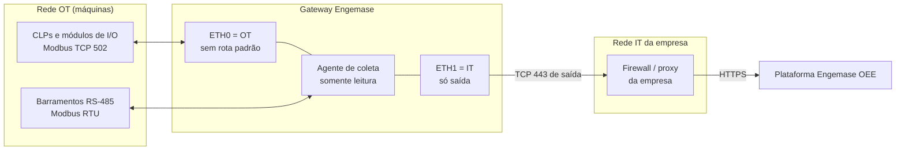

# Ficha técnica para o TI do cliente — Gateway Engemase OEE

*Documento para a equipe de TI e de segurança da informação da planta. Enviar junto com a proposta e devolver preenchido (seção 9) **antes da visita de instalação**. Itens marcados com \* dependem de decisões ainda abertas e serão confirmados na proposta.*

## 1. O que é

Um **computador industrial em trilho DIN** (Seeed reComputer R1000, versão **sem rádio**: sem Wi-Fi, sem Bluetooth, sem 4G) com Linux, instalado no painel da linha. Ele **lê** os CLPs das máquinas pela rede industrial (OT) e envia indicadores de produção para a plataforma Engemase OEE **somente por conexões de saída HTTPS**.

- **Não recebe conexões** de nenhuma das redes. Nenhuma porta precisa ser aberta ou redirecionada no firewall da empresa.
- **Não roteia** entre a rede OT e a rede corporativa (encaminhamento de pacotes desligado).
- **Não escreve** nos CLPs: o software não tem função de escrita.
- **Sem internet, nada se perde:** guarda até 30 dias (ou 1 GB) de dados e reenvia em ordem quando a conexão volta.

## 2. Alimentação e montagem

| Item | Valor |
|---|---|
| Tensão | 24 VDC do painel (o equipamento aceita de 9 a 36 VDC) |
| Consumo | ~3 a 5,5 W em 24 V |
| Proteção | Fonte dedicada ou ramal próprio com fusível; disjuntor e DPS no circuito |
| Montagem | Trilho DIN, sem ventoinha; interior do painel até 50 °C |
| PoE | Não usado |

## 3. Portas e redes



| Porta | Uso | Configuração |
|---|---|---|
| **ETH0** (1 Gb/s) | **OT**: CLPs e módulos de I/O | IP fixo na faixa OT (sugerimos o **.250**), **sem rota padrão**, sem DNS. Também mantém um **endereço de serviço 169.254.x.y** (link-local, impresso na etiqueta), usado só pelo técnico com um notebook ligado no switch OT |
| **ETH1** (100 Mb/s) | **IT**: saída para a internet | DHCP (de preferência com reserva pelo MAC, que enviamos antes) ou IP fixo |
| 3 × RS-485 isoladas | Barramentos Modbus RTU das máquinas | Não se ligam à rede de TI |
| USB, HDMI | Manutenção local (teclado e monitor, pendrive de serviço) | Sem uso em operação |

**IPv6:** desligado. **802.1X na porta IT:** pedimos liberação por MAC (MAB).

## 4. Tráfego de saída necessário (porta IT)

**Nenhuma conexão de entrada.** Liberar **por nome (objeto FQDN)**: a nuvem não tem faixa de IP fixa.

| Destino | Porta | Para quê | Obrigatório |
|---|---|---|---|
| `gw.oee.engemase.com.br`\* | TCP 443 | API dos gateways | Sim |
| `oee.engemase.com.br`\* | TCP 443 | Plataforma (endereço padrão do agente enquanto o domínio dos gateways não for definido) | Sim |
| Host de download das atualizações do agente (`<nome>.public.blob.vercel-storage.com`)\* | TCP 443 | Atualização assinada do software | Sim (nome exato na proposta) |
| `deb.debian.org`, `archive.raspberrypi.com` | TCP 443 | Correções de segurança do sistema operacional (HTTPS) | Recomendado |
| Servidor DNS interno | UDP/TCP 53 | Resolver os nomes acima | Sim |
| Servidor NTP interno (preferido) ou `pool.ntp.br` | UDP 123 | Relógio. Sem relógio certo, a conexão segura falha | Sim |
| Domínios da Tailscale (lista oficial anexa à proposta) | TCP 443; UDP 41641 e 3478 opcionais | Acesso remoto de manutenção sob demanda (seção 6) | Só se o cliente contratar |

\* O domínio definitivo dos gateways e o host de atualização ainda estão em definição e serão confirmados na proposta.

**Proxy:** aceito proxy explícito **HTTP CONNECT**, sem autenticação ou com **Basic**. **NTLM, Kerberos e PAC/WPAD não são suportados**: nesses casos, criar uma regra de saída sem autenticação para o IP ou o MAC do gateway.

**Inspeção SSL:** pedimos **exceção** para os domínios acima. Se não for possível, envie a CA raiz (PEM) e registre o aceite por escrito: com inspeção, o proxy passa a ver a credencial do gateway. Com inspeção do tipo DPI (por exemplo, FortiGate), o acesso remoto de manutenção não funciona; a coleta continua.

**Volume estimado:** ~0,5 a 2 GB por mês por gateway (envio a cada 10 s, em lotes compactados, mais atualizações). Estimativa a medir no piloto.

**Sem rede do cliente:** alternativa com roteador 4G industrial homologado pela ANATEL na porta IT.

## 5. Dados que saem da planta

| Sai | Não sai |
|---|---|
| Estado de cada máquina (produzindo, parada, falha, setup, sem comunicação) e horário das mudanças | Programas dos CLPs |
| Contagens de peças e refugo por minuto; código do produto; código do alarme ativo; velocidade | Imagens, vídeo, áudio |
| Saúde do gateway: versão, CPU, memória, disco, temperatura, fila, diferença de relógio, estado das conexões | Dados de outros equipamentos da rede IT |
| Confirmação de configuração e resultado de testes de leitura pedidos pela plataforma | Dados pessoais (o gateway não coleta nenhum) |

- Transporte: **HTTPS (TLS 1.2 ou superior)**, com validação de certificado. Autenticação por **token próprio de cada gateway**, guardado na plataforma só como hash e revogável a qualquer momento.
- Hospedagem: Vercel e Neon. Região de hospedagem dos dados: em definição (proposta: São Paulo), informada na proposta.

## 6. Acesso remoto de manutenção (fase 2, opcional)

- **Desligado por padrão.** Só existe durante uma **sessão aprovada**.
- **Quem pede:** um técnico da Engemase, com motivo, número do chamado e duração. **Quem aprova:** o **administrador do cliente** na plataforma, com autenticação em dois fatores. Quem pede nunca aprova.
- **Só saída TCP 443.** Nenhuma porta aberta no firewall da empresa.
- **Expira sozinho** (prazo, inatividade e teto local), não volta depois de um reinício e pode ser **bloqueado localmente** pela manutenção do cliente (bloqueio local prevalece sobre a nuvem).
- **Sem acesso à rede OT inteira:** acesso a um CLP é um encaminhamento para **um único IP e porta**, com aprovação própria e prazo curto.
- Tudo fica **registrado** e visível para o cliente (pedido, aprovação, conexões, encerramento).
- Referência interna da Engemase: [docs/12](../12-acesso-remoto-vpn.md).

## 7. Postura de segurança (resumo)

- Modelo de **zonas e condutos** da IEC 62443: o gateway é o único conduto entre OT e IT, e só de saída.
- Firewall local com **bloqueio por padrão** nos três sentidos; saída OT só para os CLPs cadastrados; nenhum serviço escutando na porta IT.
- Software de coleta roda **sem privilégios de administrador**; SSH desligado para a rede (só local, usado apenas em sessão de acesso remoto aprovada).
- **Atualizações assinadas** (Ed25519), com volta automática à versão anterior se a nova falhar; correções de segurança do sistema operacional automáticas.
- Página local de diagnóstico só na **rede OT** (HTTPS, senha local entregue em envelope lacrado). Nunca na rede IT.
- Cada alteração de configuração e cada comando enviado ao gateway ficam na auditoria da plataforma.

## 8. Teste de liberação (antes da visita)

Rodar de um computador **na mesma VLAN e com as mesmas regras** que o gateway terá:

```powershell
Test-NetConnection gw.oee.engemase.com.br -Port 443
Test-NetConnection oee.engemase.com.br -Port 443
```

```bash
curl -sS -o /dev/null -w "%{http_code}\n" https://gw.oee.engemase.com.br/
```

Qualquer **código HTTP** na resposta (200, 401, 404...) mostra que DNS, rota, firewall e TLS estão certos. Erro de conexão, tempo esgotado ou erro de certificado indicam bloqueio. Um endpoint público de teste (`/api/gateway/v1/ping`) está previsto. Envie à Engemase o resultado (print ou texto).

## 9. Checklist para preencher

| # | Item | Preenchimento |
|---|---|---|
| 1 | Empresa, planta e endereço | |
| 2 | Responsável no TI (nome, e-mail, telefone) | |
| 3 | Responsável na manutenção/automação | |
| 4 | MAC da ETH1 (IT) — **a Engemase preenche** | |
| 5 | VLAN da porta IT (porta *access*, sem tag) | |
| 6 | Endereçamento IT: DHCP com reserva **ou** IP / máscara / gateway / DNS 1 / DNS 2 | |
| 7 | Proxy: endereço:porta, tipo de autenticação (nenhuma ou Basic) | |
| 8 | Inspeção SSL ativa? Exceção concedida para os domínios da seção 4? (se não, enviar a CA em PEM) | |
| 9 | Servidor NTP interno (ou liberação de UDP 123 para `pool.ntp.br`) | |
| 10 | 802.1X na porta? (se sim, liberação por MAC) | |
| 11 | Regras de saída criadas (seção 4) — data e responsável | |
| 12 | Teste de liberação (seção 8) — resultado anexado | |
| 13 | Rede OT: porta no switch OT (VLAN das máquinas) ou autorização para switch dedicado no painel | |
| 14 | Rede OT: IP livre para o gateway (sugestão: .250), máscara, outras sub-redes OT e roteadores | |
| 15 | Lista de CLPs: IP, porta e unit id (ou anexar o questionário de levantamento) | |
| 16 | Acesso remoto de manutenção (fase 2): permitido? Quem aprova (admin do cliente)? | |
| 17 | Janela e contato para o dia da instalação | |

Assinatura do TI: ______________________ Data: ____/____/______
