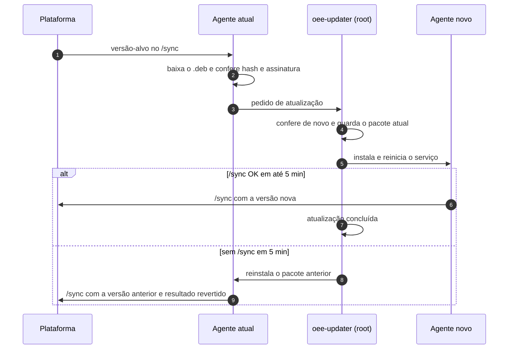

# RB-05 — Atualização falhou ou foi revertida (rollback)

| | |
|---|---|
| **Vale a partir de** | **OTA mínimo (Fase 1, item G4b, decisão D29).** Antes dele, a atualização é feita no local, instalando o `.deb` à mão, e este runbook serve só para o item 4.3 |
| **Severidade típica** | Média (gateway revertido e coletando); crítica (gateway parado depois da atualização) |
| **Alerta** | Resultado da atualização na plataforma (falhou / revertida) **(Fase 1)**; "Gateway offline" se o gateway não voltou |
| **Quem atende** | **N2 sempre** (toda falha de atualização é problema de release). N1 coleta as informações |
| **Perde dados?** | Não. A atualização troca o pacote do agente; a fila e a credencial em `/var/lib/oee-gateway` ficam. Durante a troca a coleta para por alguns segundos (o intervalo entra como "sem comunicação") |

## 1. Sintoma

Uma atualização do agente foi enviada e:
- o gateway continua (ou voltou) na **versão anterior**; ou
- o gateway **parou de responder** depois da atualização.

## 2. Como funciona a atualização (para entender o diagnóstico)

O agente baixa o pacote `.deb` assinado (Ed25519), confere hash e assinatura e entrega o pedido a um **atualizador separado** (`oee-updater`, root). O atualizador confere tudo de novo, guarda o pacote atual, instala o novo e espera o agente novo fazer **um `/sync` bem-sucedido em até 5 min**. Se não fizer, **volta ao pacote anterior** sozinho ([docs/03](../../03-gateway.md#atualização-remota-ota-fase-2), [docs/16 §3](../../16-projeto-do-gateway.md#3-arquitetura-do-software)).



As units do atualizador já estão no empacotamento em construção (`deploy/gateway`, pacote `oee-gateway-updater`): `oee-gateway-updater.path` e `.service` (aplica o pedido) e `oee-gateway-update-check.service` (verificação a cada boot, antes do agente). O binário `oee-updater` ainda não existe **(Fase 1)**.

## 3. Causas prováveis

1. **Download bloqueado:** o host de download das atualizações (Vercel Blob) não foi liberado no firewall do cliente, ou o proxy corta arquivos grandes ([ficha técnica §4](../ficha-tecnica-ti-cliente.md#4-tráfego-de-saída-necessário-porta-it)).
2. **Assinatura ou hash não conferem:** download corrompido, proxy com inspeção alterando o conteúdo, ou pacote publicado com a chave errada. **O pacote é recusado antes de instalar** (comportamento correto).
3. **Arquitetura ou versão mínima:** pacote de outra arquitetura ou abaixo da versão mínima permitida.
4. **Agente novo não sobe ou não sincroniza** em 5 min: erro no release, config incompatível com a versão nova, mudança de contrato. → **Rollback automático** (comportamento correto).
5. **Queda de energia no meio:** o serviço de verificação pós-boot retoma a instalação ou o rollback.
6. **Disco cheio** ou **conflito com a atualização do sistema** (`unattended-upgrades` rodando na mesma janela; as janelas não deveriam se sobrepor, [docs/16 §7](../../16-projeto-do-gateway.md#7-preparação-na-engemase-e-ciclo-de-vida)).
7. **Rollback também falhou:** o gateway fica sem agente funcionando (raro; seção 6).

## 4. Diagnóstico

### 4.1 Pela plataforma (sempre primeiro)

1. **Versão reportada** no detalhe do gateway (`agent.version` do `/sync`) × versão-alvo.
2. **Resultado da atualização** (falhou no download, recusada na verificação, revertida) **(Fase 1)**.
3. **Eventos:** `agent_stop` com motivo `update`, seguido de `agent_start` com a versão (nova ou antiga) e `clean_shutdown`.
4. **Outros gateways na mesma versão-alvo:** se vários falharam, o problema é do release. **Pare o envio da versão** para os demais.
5. **Gateway offline depois da atualização:** ver se o último contato foi logo depois do `agent_stop` (`update`). Se sim, siga a seção 4.3 e o [RB-01](01-gateway-offline.md).

### 4.2 Remoto

- **Logs do gateway:** `logs.upload` mínimo **(Fase 1, D29)**; na F2, SSH durante uma sessão de VPN aprovada.
- **TI do cliente:** o host de download está liberado? Há inspeção SSL nesse host?

### 4.3 No local

```bash
oee-gateway version                                   # versão em execução
dpkg -l oee-gateway                                   # versão instalada pelo dpkg
systemctl status oee-gateway                          # agente rodando? linha de status
oee-gateway update status                             # (Fase 1, comando a definir) versão instalada, alvo e último resultado
journalctl -u oee-gateway-updater -u oee-gateway-update-check --since "-1d" -o cat   # log do atualizador (o tecnico lê o journal)
journalctl -u oee-gateway --since "-1h" -o cat | tail -50
df -h / /data                                         # espaço livre
```

Arquivos: o pedido do agente fica em `/var/lib/oee-gateway/update/request.json`; o estado do atualizador e o pacote anterior ficam em `/var/lib/oee-gateway-updater/` (só root). O `tecnico` não lê esses arquivos: o resultado chega à plataforma e ao `update status` **(Fase 1)**.

## 5. Correção

| Situação | O que fazer |
|---|---|
| Revertido (rollback) e coletando | **Não tente de novo** sem N2. Juntar logs e o resultado; N2 corrige o release e reenvia |
| Download bloqueado | TI libera o host de download; reenviar a atualização |
| Assinatura ou hash recusados | N2 confere o pacote e a chave publicada. Se houver inspeção SSL no caminho, pedir exceção ao TI |
| Gateway parado depois da atualização | No local, desligar e religar a alimentação **uma vez** (a verificação pós-boot retoma o rollback). Se não voltar, seção 6: em campo não há root para reinstalar o pacote à mão |
| Sem OTA (antes da Fase 1) | A versão do agente só muda na bancada: regravação da imagem ou instalação do `.deb` numa unidade com acesso de engenharia. Em campo, troca da unidade |

**Não fazer:** religar a energia várias vezes seguidas durante a atualização; apagar `/var/lib/oee-gateway`; instalar pacote sem assinatura conferida; reinstalar a imagem do sistema (perde a fila).

## 6. Quando escalar

| Situação | Para quem | Urgência |
|---|---|---|
| Qualquer atualização revertida ou recusada | **N2** | Mesmo dia |
| Várias unidades falhando na mesma versão | **N2** + suspender o envio da versão | Imediata |
| Gateway sem agente depois do rollback | **N2** + visita de campo: troca da unidade e recuperação do buffer da antiga na bancada | Imediata |
| Suspeita de pacote adulterado (assinatura inválida sem explicação) | **N2/N3** (incidente de segurança) | Imediata |

## 7. Ao fechar o chamado

Registre: gateway (`EGW-NNNNN`), versão de origem e versão-alvo, resultado (concluída, revertida, recusada), duração da parada de coleta, causa e ação. Se a falha foi do release, referencie a issue de correção.
