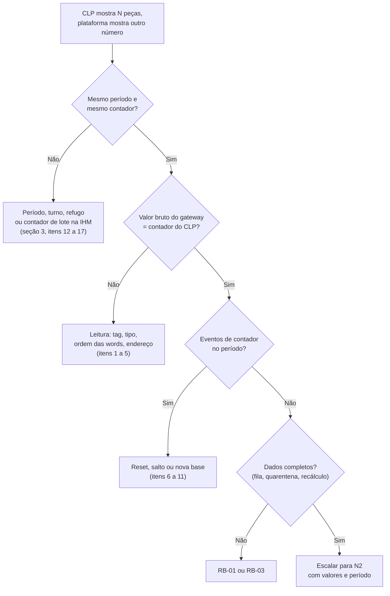

# RB-07 — Contagem divergente (CLP × plataforma)

| | |
|---|---|
| **Severidade típica** | Média (a coleta funciona, o número está errado); alta se a diferença for grande, pegar várias máquinas ou turnos já entregues ao cliente |
| **Alerta** | Nenhum automático. Chega por reclamação do cliente ou na conferência do comissionamento. Os eventos do contador ficam na **auditoria do cliente** |
| **Quem atende** | N1 (triagem pela plataforma); automação do cliente ou da Engemase (programa do CLP); N2 para os dados no banco. Mudar tag ou config é só da equipe Engemase (D12/D13) |
| **Perde dados?** | Depende da causa. Leitura errada (tag, tipo, ordem das words) distorce ou descarta as peças **até a correção**, e o passado não se corrige sozinho. Reset e salto perdem só as peças entre duas leituras. Com a máquina em "sem comunicação" e o CLP contando, nada se perde: o delta da volta inclui o intervalo |

## 1. Sintoma

O CLP (ou a IHM) mostra **N** peças e a plataforma mostra outro número para o mesmo período. Duas perguntas separam quase todos os casos:

1. O **valor bruto** que o gateway lê é igual ao do CLP? Se não, o problema é de **leitura**: tag, tipo, ordem das words, endereço.
2. Se é igual, a **soma dos minutos** do período bate com a diferença do contador do CLP no mesmo período? Se não, o problema é de **período** ou de **eventos**: reset, salto, nova base, refugo, relógio, dados atrasados.



## 2. Como aparece na plataforma e nos alertas

- **Dashboards, relatórios e tela da máquina:** peças do turno (total, boas e refugo). **Boas = total − refugo do CLP − refugo lançado à mão** (o lançado soma ao do CLP, L3; [docs/07](../../07-calculo-oee.md#algoritmo-janela-t0-t1-de-uma-máquina)).
- **Valor bruto do contador:** cada `/sync` leva, na foto ao vivo da máquina, o `counter_total`: o valor do contador `count.total` **como o gateway o decodificou** (tabela `machine_live`). A tela que mostra esse valor é da **Fase 1**; até lá, N2 consulta no banco (seção 4.1).
- **Auditoria do cliente** (Configurações → Auditoria): eventos do gateway por máquina.

| Evento (`action` na auditoria) | Quando o gateway gera | Efeito nas peças |
|---|---|---|
| `gateway.counter_reset` | O valor caiu sem estar perto do máximo do tipo: zerado no CLP, CLP religado com contador não retentivo ou trocado, leitura "rasgada" | Conta o valor atual como peças novas, se couber no limite de taxa (o mesmo do salto); acima dele, não conta nada. As peças entre a última leitura e o zeramento se perdem |
| `gateway.counter_jump` | Subida acima de `max_rate_per_s` × segundos desde a última leitura + 10 (padrão: 1.000 peças/s) | **Descarta** a subida inteira (`discarded_delta`) e passa a contar a partir do valor novo |
| `gateway.counter_rebaseline` | Endereço, tipo ou ordem das words da tag mudou na config | Começa de uma base nova. Nada é contado em dobro |

Cada evento traz `raw` (valor depois), `previous_raw` (antes), `tag_id` e `role` (`count.total` ou `count.reject`); o salto traz também `discarded_delta`. O **overflow** (passou do máximo do tipo e recomeçou perto de zero) não gera evento: é contagem normal ([docs/03](../../03-gateway.md#contadores), [bloco OEE §5.5](../bloco-oee-v1.md#55-contadores-offsets-49)).

- **Minutos "sem comunicação"** (`no_comm_s`) e o aviso "dados incompletos" no período: o tempo não foi observado; as peças, se o CLP continuou contando, entram no primeiro minuto depois da volta.
- **Selo "dados atrasados":** a plataforma ainda não recebeu tudo ([RB-03](03-dados-atrasados-buffer.md)).

## 3. Causas prováveis

**Leitura** (o valor bruto do gateway é diferente do CLP)
1. **Ordem das words diferente de CDAB.** O bloco v1 usa CDAB; um DINT nativo copiado no Siemens S7 ou no Rockwell Micro800 sai ABCD ([bloco OEE §6](../bloco-oee-v1.md#6-ordem-das-words-cdab)). Sintoma típico: valor bruto enorme, **um `counter_jump` a cada peça** com `discarded_delta` múltiplo de 65.536 e a plataforma quase sem peças.
2. **Tag errada:** endereço base deslocado de 1 (base 0 × 4xxxx), offset de outro campo (o `contador_bons` no lugar do `contador_total`), área errada (holding × input), unit id ou bloco de outra máquina do mesmo CLP (1000, 1032, 1064...).
3. **Tipo errado:** `uint16` num contador de 32 bits (o bruto é o resto da divisão por 65.536; a soma ainda pode sair certa, porque a volta é vista como overflow) ou `uint32` num contador de 16 bits (lê o registrador vizinho junto).
4. **Bytes trocados** no servidor Modbus do CLP: a versão do bloco aparece como 256.
5. **A IHM mostra outro contador:** de lote, de turno ou "zerável". O bloco usa contadores acumulados que nunca zeram ([bloco OEE §5.5](../bloco-oee-v1.md#55-contadores-offsets-49)).

**Eventos do contador** (o bruto bate, a soma não)

6. **Contador zerado no CLP** (operador, programa, IHM) → `counter_reset`. Se o contador do bloco zera a cada turno ou lote, o programa está fora do padrão (regra G10 do bloco).
7. **CLP religado com contador não retentivo** → `counter_reset`. Perde as peças entre a última leitura e o desligamento.
8. **Leitura "rasgada":** os dois registradores do contador vieram de ciclos diferentes ([bloco OEE §7](../bloco-oee-v1.md#7-requisitos-de-temporização-no-clp)). Aparece como `counter_reset` seguido de `counter_jump`, com valores perto de múltiplos de 65.536.
9. **`max_rate_per_s` baixo demais** para a máquina, ou contador que soma em lotes (ex.: +50 de uma vez) → `counter_jump` com **peças reais descartadas**.
10. **Tag mudada na config** (endereço, tipo ou ordem) → `counter_rebaseline`: perde só as peças entre a última leitura com a config antiga e a primeira com a nova. Tag **apagada e criada de novo** (id novo) começa sem base **e sem evento**.
11. **CLP trocado** ou contador "corrigido" à mão para o valor da IHM. Se o valor **subiu** além do limite de taxa → `counter_jump` (a diferença é descartada, como deve ser). Se **caiu** (CLP novo zerado, correção para baixo) → `counter_reset`: o valor novo conta como peças, se couber no limite de taxa. Procure os dois eventos na auditoria.

**Período e cálculo** (o bruto bate e não há eventos)

12. **Período diferente:** o turno da plataforma está no fuso da unidade e pertence ao dia em que começa (L2); a IHM usa o relógio do CLP e a hora em que o contador de turno é zerado.
13. **Relógio do gateway errado:** minutos caem no turno vizinho ([RB-04](04-relogio-fora-de-sincronia.md)).
14. **Refugo:** a IHM mostra "produção" como só as boas, ou não desconta o refugo; ou há refugo lançado à mão em dobro com o do CLP.
15. **Dados ainda não chegaram** (gateway offline, fila, quarentena: [RB-01](01-gateway-offline.md), [RB-03](03-dados-atrasados-buffer.md)) ou o turno ainda não foi recalculado (turno "sujo", cron `recompute-dirty`, **Fase 1**).
16. **Troca do gateway no período:** a unidade nova começa sem base e as peças da troca não entram ([RB-10](10-troca-hardware-gateway.md)).
17. **Peças por pulso:** molde de várias cavidades com `n` errado no FB, ou modo "ciclo + refugo" × "pulsos separados" ([bloco OEE §5.5](../bloco-oee-v1.md#55-contadores-offsets-49)). A diferença é uma **proporção fixa** (ex.: plataforma = IHM ÷ 4).

## 4. Diagnóstico

### 4.1 Pela plataforma (sempre primeiro)

1. **Anote o que o cliente comparou:** máquina, período exato (início e fim, com fuso), o número da IHM e de qual tela ou variável ele vem (total, boas, lote, turno).
2. **Mesmo período?** Compare a mesma janela. Se o cliente usa o contador de turno da IHM, pergunte a hora em que ele zera.
3. **Dados completos?** Gateway online, fila perto de zero, `quarantined = 0`, sem "dados incompletos" no período ([RB-01](01-gateway-offline.md), [RB-02](02-clp-sem-comunicacao.md), [RB-03](03-dados-atrasados-buffer.md)).
4. **Eventos de contador** da máquina no período (auditoria) e mudanças de config (`gateway.config_applied`). Use a tabela da seção 2.
5. **Proporção fixa?** Se plataforma ÷ IHM dá sempre o mesmo número (0,25; 0,5), é peças por pulso (item 17).
6. **Só equipe Engemase (N2):** valor bruto, soma dos minutos e eventos no banco. Conexão com o papel de login da aplicação (membro de `app_user`); troque os `<...>` e as datas (UTC):

```sql
BEGIN READ ONLY;
SET LOCAL ROLE app_user;
SELECT app.set_tenant('<organization_id>');

-- Valor bruto do contador total lido por último pelo gateway (foto ao vivo)
SELECT at, counter_total FROM machine_live WHERE machine_id = '<machine_id>';

-- Peças do período pelos minutos
SELECT sum(total) AS total, sum(reject) AS refugo,
       sum(no_comm_s) / 60 AS minutos_sem_comunicacao, count(*) AS minutos_recebidos
  FROM production_minute
 WHERE machine_id = '<machine_id>'
   AND bucket_start >= '2026-11-12T09:00:00Z' AND bucket_start < '2026-11-12T17:00:00Z';

-- Eventos do contador no período
SELECT at, action, after ->> 'role' AS papel, after ->> 'previous_raw' AS antes,
       after ->> 'raw' AS depois, after ->> 'discarded_delta' AS descartado
  FROM audit_log
 WHERE entity_id = '<machine_id>'
   AND action IN ('gateway.counter_reset', 'gateway.counter_jump', 'gateway.counter_rebaseline')
   AND at >= '2026-11-12T09:00:00Z' AND at < '2026-11-12T17:00:00Z'
 ORDER BY at;
COMMIT;
```

`minutos_recebidos` abaixo do número de minutos do período = minutos que não chegaram (gateway desligado, fila, quarentena ou troca de unidade).

### 4.2 Remoto

1. **Automação ou manutenção do cliente:** foto da tela da IHM com o contador e a hora; de qual variável a IHM lê; quando esse contador é zerado; se houve troca de CLP, download de programa, troca de molde (cavidades) ou manutenção no período.
2. **Duas leituras do contador do CLP com hora** (início e fim de 30 a 60 min com a máquina produzindo) e a mesma janela na plataforma (N2, seção 4.1). Diferença de até um ciclo nas pontas é normal (minuto ainda aberto).
3. **F2:** com a VPN de manutenção, a leitura da seção 4.3 por SSH.

### 4.3 No local

**Ler o bloco com o notebook**, ao lado da IHM (o mesmo binário `oee-gateway` amd64, num notebook Linux no switch OT; [bloco OEE §11](../bloco-oee-v1.md#11-verificação-no-comissionamento)). Em Modbus TCP o notebook ocupa uma conexão a mais no CLP. Em RS-485, só com os fios A/B do gateway desligados desse barramento (um mestre por barramento, [RB-02 §4.3](02-clp-sem-comunicacao.md#43-no-local)).

```bash
oee-gateway modbus read --target tcp://192.168.10.23:502 --unit 1 --offset 1000 --count 14 --oee-block
oee-gateway modbus read --target tcp://192.168.10.23:502 --unit 1 --offset 1000 --count 14 \
  --decode uint32:CDAB@4 --decode uint32:ABCD@4 --decode uint32:CDAB@6
```

No gateway de campo a leitura direta não serve ao `tecnico` (firewall e porta serial, [RB-02 §4.3](02-clp-sem-comunicacao.md#43-no-local)). Pela fila do agente **(Fase 1)**: `oee-gateway modbus oee-block --device <id>` ou a tela Leitura ao vivo da página local.

| Leitura | Significa |
|---|---|
| `uint32:CDAB@4` igual ao contador acumulado da IHM | Leitura certa. A tag na plataforma deve ser `uint32` com `word_order` CDAB, no endereço base certo |
| `uint32:ABCD@4` igual à IHM | O CLP entrega ABCD (item 1) |
| Nenhuma bate e a versão do bloco é 256 | Bytes trocados no servidor do CLP (item 4) |
| A versão (1) aparece no offset 1 | Endereço base deslocado de 1 (item 2) |
| Bate com o contador de lote ou de turno da IHM, não com o acumulado | A IHM mostra outro contador (item 5), ou o bloco usa o contador zerável (item 6) |

**Teste de contagem** ([bloco OEE §11](../bloco-oee-v1.md#11-verificação-no-comissionamento), teste 5): 10 peças → `contador_total` +10; uma refugada → `contador_refugo` +1. Depois de alguns minutos, os mesmos números nos minutos da plataforma.

**No programa do CLP** (com o responsável do cliente): contadores do bloco retentivos e nunca zerados; FB chamado todo ciclo; cópia consistente dos 14 registradores ([bloco OEE §7](../bloco-oee-v1.md#7-requisitos-de-temporização-no-clp)); `n` peças por pulso e modo do FB. Detalhes por marca: [adaptações por fabricante](../adaptacoes-por-fabricante.md).

**No gateway** (console, usuário `tecnico`): mudanças de config e saltos de relógio no período.

```bash
journalctl -u oee-gateway --since "-1d" -o cat | grep -E "config aplicada|relógio de parede"
timedatectl                       # hora certa? (RB-04)
```

## 5. Correção

| Causa | O que fazer |
|---|---|
| Ordem das words, tipo, endereço, tag | Corrigir no programa do CLP (preferível: o FB padrão) ou na tag da config, pela equipe Engemase, e publicar. A mudança gera `counter_rebaseline` (sem contagem dupla). **O período já gravado não é corrigido** |
| Contador zerado pelo programa ou pela IHM | Automação do cliente: o contador do bloco é acumulado e nunca zera; o contador "zerável" é outro |
| Contador não retentivo | Declarar o FB ou os contadores em área retentiva |
| Leitura "rasgada" | Cópia consistente do bloco no CLP ([adaptações](../adaptacoes-por-fabricante.md)) |
| `max_rate_per_s` baixo | Subir o `max_rate_per_s` da máquina na config (até 100.000) para acima da taxa real em rajada e publicar |
| Período, turno ou relógio | Explicar a janela ao cliente; relógio: [RB-04](04-relogio-fora-de-sincronia.md) |
| Refugo | Conferir os lançamentos manuais do período; lançamento em dobro se desfaz por estorno (L3) |
| Dados atrasados ou em quarentena | [RB-01](01-gateway-offline.md), [RB-03](03-dados-atrasados-buffer.md) |
| Peças por pulso | Automação corrige `n` ou o modo no FB |
| Troca de gateway | [RB-10](10-troca-hardware-gateway.md) |

**O passado:** não há ferramenta para corrigir minutos já gravados. Registre no chamado os turnos e a diferença, e avise o cliente. Correção manual no banco só com decisão do N2, aceite do cliente por escrito e registro na auditoria.

**Não fazer:** zerar ou "acertar" o contador do bloco no CLP para bater com a IHM (vira `counter_reset` ou `counter_jump` e piora); trocar `word_order` ou tipo "para testar" em produção (cada troca é uma nova base).

**Para dar por resolvido:** valor bruto igual ao da IHM com a máquina parada; teste de 10 peças batendo; e, por um turno, soma dos minutos igual à diferença do contador do CLP (salvo período "sem comunicação" registrado, critério L12).

## 6. Quando escalar

| Situação | Para quem |
|---|---|
| Leitura certa, sem eventos, e a soma continua diferente | **N2**, com período, valores da IHM, valor bruto e soma |
| `counter_reset` ou `counter_jump` frequentes sem mudança no CLP | **N2** (leitura rasgada ou problema no agente) |
| Diferença em várias máquinas ou clientes depois de uma versão nova do agente | **N2**, imediata (release) |
| Precisa alterar o programa do CLP | Automação do cliente ou equipe de automação da Engemase (serviço à parte, com autorização do cliente) |
| Cliente pede correção de turnos fechados ou de relatórios entregues | **N2** e gestor da conta |

## 7. Ao fechar o chamado

Registre: gateway (`EGW-NNNNN`), máquina e tag, período (com fuso), valor da IHM, valor bruto do gateway, soma da plataforma, eventos de contador encontrados, causa, correção, quem fez, e os turnos que ficaram com contagem errada (com a diferença). Se mudou o programa do CLP ou a tag, atualize o cadastro da máquina.
