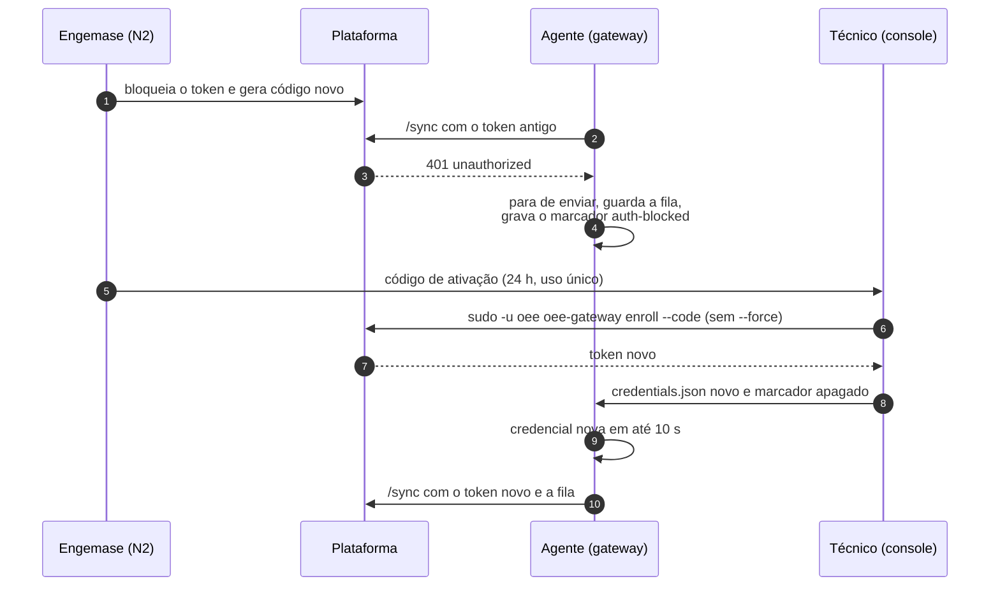

# RB-09 — Rotação do token do gateway

| | |
|---|---|
| **Vale a partir de** | Hoje, com o agente que grava o marcador `auth-blocked`. Bloquear o token e gerar o código pela tela da plataforma é **Fase 1**: até lá, SQL (seção 5.1). A rotação pela nuvem sem ir ao local (`token.rotate`) é da **F2** ([docs/04](../../04-protocolo-gateway-nuvem.md#autenticação)) |
| **Severidade típica** | Alta quando há suspeita de vazamento (S2 no [plano de incidentes](../../negocio/juridico/06-plano-de-resposta-a-incidentes.md#4-severidade)); média quando é só registrar de novo o mesmo gateway |
| **Alerta** | Nenhum próprio. Com o token recusado (401), o gateway para de enviar e aparece como "Gateway offline" ([RB-01](01-gateway-offline.md)); o motivo está no `diag` do gateway e nos logs da ingestão (seção 2) |
| **Quem atende** | **N2** (super admin ou engenheiro de campo atribuído: só a equipe Engemase mexe em gateways, D13); técnico de campo no console; coordenador do incidente se houver vazamento |
| **Perde dados?** | **Não.** Com o token bloqueado, o agente para de enviar e guarda tudo na fila (até 30 dias ou 1 GB). Depois do novo registro, envia a fila com o token novo |

## 1. Sintoma

Sinais de que o token do gateway precisa ser trocado:

- **Suspeita de vazamento** do `credentials.json`: cópia numa imagem de engenharia, num backup ou num chamado; unidade furtada ou perdida.
- **Dois equipamentos com o mesmo token** (eMMC clonado): na aba **Saúde**, `boot_id` e `uptime_s` alternando entre dois valores; na auditoria, minutos reescritos (`production_minute.rewritten`) nas máquinas do gateway.
- **401 sem explicação** na auditoria ([RB-01 §6](01-gateway-offline.md#6-quando-escalar)).
- **Bloqueio ou revogação por engano:** sem vazamento, dá para desfazer sem ir ao local (fim da seção 5.1).

**Troca de hardware não precisa deste runbook:** o registro da unidade nova já troca o token e a antiga deixa de valer na hora ([RB-10](10-troca-hardware-gateway.md)).

**Bloquear o token não é revogar o gateway:**

| Ação | No banco | Resposta ao gateway | Dá para registrar de novo? | Quando usar |
|---|---|---|---|---|
| **Bloquear o token** (este runbook) | `gateway.status = 'pending_enrollment'`. O gateway, a config e o vínculo com as máquinas continuam | 401 `unauthorized` | **Sim**, com um código novo do mesmo gateway | Vazamento, clone, furto, registrar de novo |
| **Revogar o gateway** | `status = 'revoked'` e `revoked_at` | 401 `token_revoked` | **Não**: todo código desse gateway é recusado (`activation_code_invalid`) | Só no encerramento do cliente ou no descarte definitivo do gateway (D4) |
| **Registrar** (`enroll`) | Token novo; o anterior deixa de valer na hora | — | — | Último passo da rotação e da troca de hardware |

## 2. Como aparece na plataforma e nos alertas

**Enquanto o token está bloqueado:**

| Onde | O que aparece |
|---|---|
| Plataforma | Gateway sem contato: "offline" e, depois de 5 min, o alerta "Gateway offline". Avise o cliente antes de bloquear |
| `systemctl status oee-gateway` | `coletando N/M dispositivos · nuvem bloqueada (401)` |
| `sudo oee-gateway diag` | Linha `credencial` em `falha`: `gateway <id>, organização <cliente>: a nuvem recusa o token desde <hora> (unauthorized); gere um código novo na plataforma e rode oee-gateway enroll --code ...` |
| Log do agente | `nuvem recusou o token: envio parado, buffer mantido; o mesmo token é testado de novo a cada 15m0s (se persistir, refaça o enroll)`, com `erro="nuvem respondeu 401 (unauthorized): Token ausente ou inválido."` |

**Como funciona** (para entender o diagnóstico):



- **No 401**, o agente para de enviar, mantém a fila e grava `/var/lib/oee-gateway/auth-blocked` (dono `oee`, 0600) com o início do bloqueio, o último 401 e o código da nuvem (`unauthorized` ou `token_revoked`). A cada 15 min ele testa o **mesmo** token de novo; se a nuvem voltar a aceitar, apaga o marcador e segue sozinho.
- **Com o marcador presente**, o `enroll` troca a credencial existente **sem `--force`**. É o único jeito em campo: o `sudo` do `tecnico` recusa `--force`, `--url`, `--hostname` e `--config`, e a imagem não tem root ([deploy/gateway, sudo do técnico](../../../deploy/gateway/README.md#6-sudo-do-técnico)).
- **Sem o marcador** (o agente ainda não recebeu o 401), o `enroll` recusa trocar a credencial.

## 3. Causas prováveis de falha no novo registro

1. **O agente ainda não recebeu o 401** (gateway offline, sem rede): sem o marcador, o `enroll` recusa.
2. **Código** digitado errado, vencido (24 h) ou já usado.
3. **Gateway revogado** (`revoked`) em vez de bloqueado: nenhum código dele funciona.
4. **Código de outro gateway:** o registro "funciona", mas a unidade passa a ser outro gateway, recebe a config dele e os itens da fila das máquinas antigas são recusados (quarentena). **Nunca** faça isso.
5. **Rede, DNS, proxy ou relógio:** o `enroll` não chega à nuvem ([RB-01](01-gateway-offline.md), [RB-04](04-relogio-fora-de-sincronia.md)).
6. **Opção fora da lista do `sudo`** (`--force`, `--url`, `--hostname`, `--config`).

## 4. Diagnóstico

### 4.1 Pela plataforma (sempre primeiro)

Em suspeita de vazamento ou clone, antes de bloquear:

1. **Abrir o incidente** ([plano, seção 8](../../negocio/juridico/06-plano-de-resposta-a-incidentes.md#8-roteiros-por-tipo-de-incidente), "Token de gateway roubado") e **preservar os logs** da Vercel da rota `/api/gateway/v1/sync` e `/config` desse gateway: eles expiram rápido ([seção 9 do plano](../../negocio/juridico/06-plano-de-resposta-a-incidentes.md#9-preservação-de-evidências)).
2. **Auditoria do cliente:** eventos `gateway.enrolled` (quando, IP, hostname, hardware) que ninguém da equipe fez; `production_minute.rewritten` nas máquinas do gateway.
3. **Aba Saúde:** `boot_id` e `uptime_s` alternando (dois equipamentos com o mesmo token).
4. **Só equipe Engemase (N2):** nos logs da Vercel, os IPs de origem dos `/sync` desse gateway. O IP de saída da planta é conhecido do TI do cliente; outro IP indica uso fora da planta.

### 4.2 Remoto

- **TI do cliente:** IP de saída da planta; o gateway está no painel (foto da etiqueta com o `EGW-NNNNN`)?
- **Furto:** o `proxy.env` da unidade pode ter usuário e senha do proxy do cliente. Peça ao TI para trocar a senha.

### 4.3 No local

```bash
systemctl status oee-gateway                          # "nuvem bloqueada (401)" depois do bloqueio
sudo oee-gateway diag                                 # linha "credencial": recusa desde <hora>
journalctl -u oee-gateway --since "-1h" -o cat | grep -E "token|credencial"
```

O `tecnico` não lista `/var/lib/oee-gateway` (diretório do usuário `oee`): o marcador aparece pelo `diag`.

## 5. Correção

### 5.1 Bloquear o token e gerar o código (equipe Engemase)

**Na plataforma (Fase 1):** detalhe do gateway, bloquear o token e gerar código de ativação. **Até lá, por SQL**, no banco de produção, com o papel de login da aplicação (membro de `app_user`). O banco aplica a RLS do cliente definido por `app.set_tenant`: confira o cliente antes de cada bloco ([packages/db, isolamento](../../../packages/db/README.md#isolamento-por-cliente)).

**1. Achar o cliente e o gateway** (slug do cliente na URL; gateway pelo hostname `egw-NNNNN` ou pelo nome):

```sql
BEGIN READ ONLY;
SET LOCAL ROLE app_user;
SELECT app.set_tenant(id) FROM app.resolve_org_slug('<slug>');
SELECT id, organization_id, unit_id, name, status, hostname, last_seen_at
  FROM gateway
 WHERE hostname = 'egw-00042' AND deleted_at IS NULL;
COMMIT;
```

**2. Gerar o código** fora do banco (8 caracteres sem os ambíguos 0/O, 1/I/L, no formato `XXXX-XXXX`):

```bash
c=$(LC_ALL=C tr -dc 'ABCDEFGHJKMNPQRSTUVWXYZ23456789' < /dev/urandom | head -c 8); echo "${c:0:4}-${c:4:4}"
```

**3. Bloquear o token** (na troca de hardware, [RB-10](10-troca-hardware-gateway.md), pule este passo: o registro da unidade nova já troca o token). Uma instrução só bloqueia e grava a auditoria do cliente, e a auditoria só é gravada se o bloqueio aconteceu. Troque os `<...>`:

```sql
BEGIN;
SET LOCAL ROLE app_user;
SELECT app.set_tenant('<organization_id>');

-- Bloqueia o token atual. O gateway continua cadastrado, com a config e as máquinas.
WITH bloqueado AS (
  UPDATE gateway
     SET status = 'pending_enrollment', previous_token_hash = NULL,
         previous_token_expires_at = NULL, updated_at = now()
   WHERE id = '<gateway_id>' AND status = 'active' AND deleted_at IS NULL
  RETURNING id, organization_id, unit_id
)
INSERT INTO audit_log (organization_id, actor_type, actor_label, action, entity_type, entity_id, unit_id, after)
SELECT organization_id, 'engemase', '<nome> (engenharia Engemase)', 'gateway.token_blocked',
       'gateway', id, unit_id, jsonb_build_object('chamado', '<número>', 'motivo', '<motivo>')
  FROM bloqueado;
COMMIT;
```

O `psql` precisa mostrar `INSERT 0 1`. Com `INSERT 0 0`, **nada mudou**: o gateway não está `active` (já bloqueado, revogado ou nunca registrado) ou o id e o cliente não conferem. Confira com a consulta do passo 1 antes de seguir.

**4. Trocar o código e registrar na auditoria** (uma transação; troque os `<...>` e o código `WXYZ-5678` pelo gerado no passo 2):

```sql
BEGIN;
SET LOCAL ROLE app_user;
SELECT app.set_tenant('<organization_id>');

-- 4a) Códigos ainda não usados deste gateway deixam de valer.
UPDATE gateway_enrollment SET expires_at = now()
 WHERE gateway_id = '<gateway_id>' AND used_at IS NULL AND expires_at > now();

-- 4b) Código novo, válido por 24 h. O banco guarda só o hash.
INSERT INTO gateway_enrollment (organization_id, gateway_id, code_hash, expires_at)
VALUES ('<organization_id>', '<gateway_id>',
        encode(sha256(convert_to('WXYZ-5678', 'UTF8')), 'hex'), now() + interval '24 hours');

-- 4c) Auditoria do cliente (visível para ele).
INSERT INTO audit_log (organization_id, actor_type, actor_label, action, entity_type, entity_id, unit_id, after)
SELECT organization_id, 'engemase', '<nome> (engenharia Engemase)', 'gateway.activation_code_created',
       'gateway', id, unit_id, jsonb_build_object('chamado', '<número>', 'motivo', '<motivo>')
  FROM gateway WHERE id = '<gateway_id>';
COMMIT;
```

**5. Conferir o código** antes de enviá-lo:

```sql
BEGIN READ ONLY;
SET LOCAL ROLE app_user;
SELECT state FROM app.resolve_gateway_enrollment_state(encode(sha256(convert_to('WXYZ-5678', 'UTF8')), 'hex'));
COMMIT;
```

O resultado esperado é `valid` (`gateway_revoked`: o gateway foi revogado e nenhum código dele funciona). Mande o código ao técnico por um canal direto; no chamado, registre só a hora em que foi gerado.

**Bloqueio ou revogação por engano, sem suspeita de vazamento:** o banco mantém o hash do token. N2 volta o gateway para `status = 'active'` (com `revoked_at = NULL`, se foi revogado), invalida o código gerado (passo 4a) e registra na auditoria. O token antigo volta a valer e o agente se recupera sozinho na próxima sonda (até 15 min), sem ir ao local. **Com** suspeita de vazamento, o caminho é voltar para `pending_enrollment` (não `active`) e seguir os passos 4 e 5: um gateway revogado não aceita nenhum código.

### 5.2 Registrar de novo no local (técnico)

1. Confira que o agente já recebeu o 401: `sudo oee-gateway diag` mostra a credencial em `falha` ("a nuvem recusa o token desde ..."). Com o gateway online, isso leva até ~10 s depois do bloqueio.
2. Registre com o código recebido, **sem `--force`**:

```bash
sudo -u oee oee-gateway enroll --code WXYZ-5678
```

3. Leia a saída:

| Saída | Significa | O que fazer |
|---|---|---|
| `Gateway registrado na organização <cliente> (id <id>).` / `Credencial gravada em /var/lib/oee-gateway/credentials.json.` / `Credencial anterior (gateway <id>, organização <cliente>) substituída: a nuvem a recusava desde <hora> (unauthorized).` | Certo | Conferir que o id é o mesmo do gateway na plataforma. Seguir para 5.3 |
| `Proxy de /etc/oee-gateway/proxy.env (HTTPS_PROXY, NO_PROXY).` | Informativo: o `enroll` usou o proxy da unidade | Nada |
| `erro: gateway já registrado (id ..., organização ...) e o agente não marcou a credencial como recusada pela nuvem (sem /var/lib/oee-gateway/auth-blocked); confira com oee-gateway diag. Para registrar de novo assim mesmo, use --force` | O agente ainda não recebeu o 401 | Confirmar o bloqueio (5.1, passo 3) e esperar o próximo `/sync`. Gateway sem rede: [RB-01](01-gateway-offline.md) primeiro. **Não** tente `--force` (o `sudo` recusa) |
| `erro: registro recusado: nuvem respondeu 410 (activation_code_used): Este código de ativação já foi usado. ...` | Código já usado | Pedir código novo |
| `erro: registro recusado: nuvem respondeu 410 (activation_code_expired): Este código de ativação venceu (vale 24 h). ...` | Código vencido | Pedir código novo |
| `erro: registro recusado: nuvem respondeu 400 (activation_code_invalid): Código de ativação inválido. ...` | Código digitado errado, de outro ambiente, ou gateway **revogado** | Conferir o código; se o gateway foi revogado, N2 (5.1, último parágrafo) |
| `erro: registro recusado: ...` com `no such host`, `timeout`, `x509` ou `proxy` | Rede, DNS, proxy ou relógio | [RB-01](01-gateway-offline.md), [RB-04](04-relogio-fora-de-sincronia.md) |
| Recusa do `sudo` ("not allowed to execute") | Opção fora da lista ou código fora do formato `XXXX-XXXX` | Usar só `--code` |

### 5.3 Conferir

```bash
journalctl -u oee-gateway --since "-5min" -o cat | grep -E "credencial nova carregada|sync com a nuvem recuperado"
systemctl status oee-gateway        # "coletando N/M dispositivos · nuvem online"
sudo oee-gateway diag               # credencial em "ok"
```

Na plataforma: gateway online em até ~10 s, `buffer_pending` caindo até perto de zero ([RB-03](03-dados-atrasados-buffer.md)), evento `gateway.enrolled` na auditoria com o hostname e o hardware da unidade certa.

**Não fazer:**
- revogar o gateway (`revoked`) para "trocar o token": ele não pode mais ser registrado;
- usar código de outro gateway;
- apagar `/var/lib/oee-gateway` ou regravar a imagem para "limpar" a credencial: a fila se perde;
- copiar o `credentials.json` de uma unidade para outra.

## 6. Quando escalar

| Situação | Para quem | Urgência |
|---|---|---|
| Suspeita de vazamento, clone ou furto | **N2** e coordenador do incidente ([plano](../../negocio/juridico/06-plano-de-resposta-a-incidentes.md#8-roteiros-por-tipo-de-incidente)) | Imediata |
| Dados enviados com o token vazado (minutos reescritos, eventos estranhos) | **N2**: avaliar o período e avisar o cliente | Mesmo dia |
| Vários gateways com 401 ao mesmo tempo | **N2/N3**: suspeita da plataforma ([RB-01](01-gateway-offline.md), seção 3, item 7). Não bloqueie tokens um a um | Imediata |
| Gateway revogado por engano | **N2** | Mesmo dia |
| `enroll` recusado sem causa nesta tabela | **N2** com a saída completa e o `diag` | Mesmo dia |

## 7. Ao fechar o chamado

Registre: gateway (`EGW-NNNNN`), motivo da rotação, hora do bloqueio e do novo registro (com fuso), quem gerou o código e quem registrou, IPs suspeitos (se houver), e se houve dados a revisar. Se a unidade foi furtada, registre também o boletim de ocorrência e siga a troca ([RB-10](10-troca-hardware-gateway.md)).
