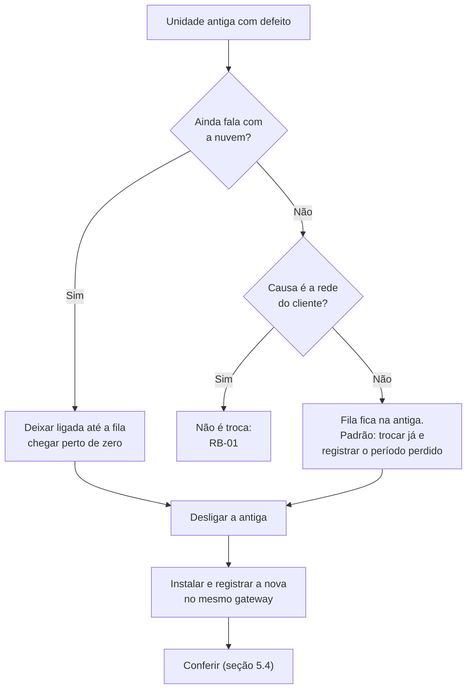

# RB-10 — Troca do hardware do gateway

| | |
|---|---|
| **Vale a partir de** | Imagem Engemase gravada com `flash-emmc.sh` ([deploy/image](../../../deploy/image/README.md#13-gravar)). A primeira imagem depende do hardware de bancada e do pacote de suporte ao R1000 ([docs/17 §6](../../17-backlog-e-pendencias.md#6-itens-fora-do-código)) |
| **Severidade típica** | Alta: as máquinas do gateway ficam sem coleta até a troca |
| **Alerta** | O do defeito: "Gateway offline", "Sem comunicação" das máquinas ou resultado da atualização. A decisão de trocar vem do [RB-01](01-gateway-offline.md), [RB-02](02-clp-sem-comunicacao.md), [RB-04](04-relogio-fora-de-sincronia.md) ou [RB-05](05-atualizacao-falhou-rollback.md) |
| **Quem atende** | **N2** decide a troca e o destino da fila; a bancada grava a unidade nova; o técnico de campo instala; o TI do cliente atualiza o MAC novo. Custo conforme a modalidade do hardware (D2 em aberto, [Anexo H](../../negocio/juridico/01-anexo-h-hardware.md)) |
| **Perde dados?** | **Em parte.** (1) A fila não enviada da unidade antiga, se ela não puder ser esvaziada antes. (2) O período da troca: peças e tempo entre o último minuto fechado da antiga e a primeira leitura da nova ficam "sem dados". **Nada é contado em dobro:** a unidade nova começa sem base de contador |

## 1. Quando trocar

- **Defeito confirmado** na unidade: não liga; eMMC ou banco com erro; porta ETH ou RS-485 que não funciona com a config certa ([RB-02 §6](02-clp-sem-comunicacao.md#6-quando-escalar)); relógio que se perde a cada queda de energia ([RB-04 §6](04-relogio-fora-de-sincronia.md#6-quando-escalar)); agente que não volta depois de uma atualização ([RB-05 §6](05-atualizacao-falhou-rollback.md#6-quando-escalar)).
- **Unidade furtada, perdida ou danificada.** Furto ou perda: bloqueie o token antes ([RB-09](09-rotacao-token-gateway.md)).
- **Não troque** para "resolver" problema de rede, de CLP ou de config: a troca não resolve e arrisca a fila (regra de ouro 2 do [README](../README.md#3-regras-de-ouro)).

## 2. O que muda e o que fica

A unidade nova é registrada **no mesmo gateway da plataforma** ([docs/16 §7](../../16-projeto-do-gateway.md#7-preparação-na-engemase-e-ciclo-de-vida)) e herda tudo o que é dele.

| Fica (é do gateway na plataforma) | Muda (é da unidade) |
|---|---|
| Registro e nome do gateway, unidade (planta), histórico | Número de série `EGW-NNNNN` (novo; **nunca** reaproveitado) e hostname `egw-NNNNN` |
| Config publicada: máquinas, dispositivos, tags. A unidade nova baixa a última versão no primeiro `/sync` | MACs da ETH0 (OT) e da ETH1 (IT): reserva de DHCP, regras de firewall e 802.1X do TI |
| Máquinas e dados já recebidos | Endereço de serviço 169.254.x.y (vem do MAC da ETH0): etiqueta nova |
| | Senha local: cartão lacrado novo |
| | Token: o registro da nova **invalida o da antiga na hora** |
| | Fila (buffer) e base dos contadores: ficam na antiga |



## 3. Causas prováveis de problema na troca

1. **Rede gravada errada** (ficha de TI desatualizada): a nova não fala com a nuvem e fica sem config (LED âmbar piscando, **Fase 1**).
2. **TI não atualizou o MAC novo** na reserva de DHCP, nas regras ou no 802.1X.
3. **As duas unidades ligadas ao mesmo tempo:** IP da OT em conflito, **dois mestres no RS-485**, conexões a mais no CLP.
4. **Registro da nova enquanto a antiga ainda esvazia a fila:** a antiga recebe 401 e para de enviar.
5. **Código de outro gateway:** a nova vira outro gateway e coleta as máquinas erradas.
6. **Bornes RS-485** ligados em outra ordem ou A/B invertidos.
7. **Relógio** da nova sem NTP: o TLS falha ([RB-04](04-relogio-fora-de-sincronia.md)).

## 4. Diagnóstico

### 4.1 Pela plataforma (antes de ir)

1. **Confirme a troca** pelo runbook de origem e anote o número de série da antiga.
2. **Fila da antiga** (aba **Saúde**, última foto): `buffer_pending`, `buffer_oldest_s` e o último contato. Se ela ficou offline muito antes de parar de coletar, há fila parada nela.
3. **Config:** última versão publicada e versão aplicada. A nova vai baixar a última publicada.
4. **Rede:** a [ficha de TI preenchida](../ficha-tecnica-ti-cliente.md#9-checklist-para-preencher) (itens 5 a 10 e 14) e o que mudou desde a instalação.

### 4.2 Remoto

- **TI do cliente:** mande o **MAC da ETH1 da unidade nova** (na etiqueta) para atualizar a reserva de DHCP, as regras de saída e o 802.1X antes da visita. Mesma VLAN e mesma porta. O teste de liberação ([ficha §8](../ficha-tecnica-ti-cliente.md#8-teste-de-liberação-antes-da-visita)) continua valendo se só o MAC mudou.
- **Manutenção do cliente:** janela para desligar o painel, se precisar; quem vai anotar os contadores da IHM na retirada.

### 4.3 No local (antes de desligar a antiga)

Se a antiga ainda liga, no console (usuário `tecnico`):

```bash
systemctl status oee-gateway        # linha "Status:" (nuvem online? quantos dispositivos?)
sudo oee-gateway diag               # credencial, tamanho do buffer.db, DNS da nuvem
ip -br addr                         # IPs em uso na OT (eth0) e na IT (eth1): confira com a ficha
ip route                            # rota padrão só pela eth1
```

Anote, para cada máquina, **o contador da IHM e a hora**: é a referência para medir o que fica sem registro na troca.

## 5. Correção (a troca)

### 5.1 Na bancada (antes da visita)

1. Separe uma unidade aprovada na [verificação de bancada, Parte B](../verificacao-bancada-r1000.md#5-parte-b--aceite-de-cada-unidade-imagem-engemase).
2. **Grave com a rede do cliente** (na Fase 0 é o único jeito: não há root na unidade e o `net set` é da Fase 1). Número de série **novo**; a **mesma** rede da antiga: o mesmo IP da OT (CLPs que liberam o Modbus só para um IP, porta do switch) e a mesma IT (IP fixo ou DHCP com a reserva atualizada pelo TI):

```sh
cd <pasta da imagem>
sudo <repo>/deploy/image/flash/flash-emmc.sh \
     --image egw-os_<versão>_arm64_r1000.img.zst \
     --serial EGW-00057 --operator "Joao Silva" \
     --ot-address 192.168.10.250/24 \
     --it-address 10.20.0.50/24 --it-gateway 10.20.0.1 --it-dns 10.20.0.10,10.20.0.11 \
     --ntp 10.20.0.5 --proxy http://10.20.0.5:3128
```

Sem as opções `--it-*`, a IT fica em DHCP. Teste antes com `--dry-run` (mostra a semente que seria gravada). Detalhes: [deploy/image §1.3](../../../deploy/image/README.md#13-gravar).

3. **Primeiro boot** (factory init, LED verde fixo), cartão lacrado com a senha local nova e etiqueta com série, MACs e endereço de serviço ([deploy/image §1.4](../../../deploy/image/README.md#14-primeiro-boot-factory-init)).
4. **Onde registrar a nova:**

| Situação da antiga | Registrar a nova |
|---|---|
| Ainda fala com a nuvem, ou pode ter fila para esvaziar | **No local**, depois de desligar a antiga (5.3). Registrar antes derruba a antiga com 401 |
| Morta de vez, furtada ou sem fila a recuperar, **e** a unidade nova fala com a nuvem na bancada com a rede gravada (ex.: IT em DHCP, sem proxy) | **Na bancada** ([verificação, B4.4](../verificacao-bancada-r1000.md#55-preparação-para-o-cliente)): é o caminho do [SLA §11](../../negocio/sla-e-suporte.md#11-troca-de-hardware-em-campo) ("sai da bancada já registrado"), que permite a instalação pelo eletricista do cliente com apoio por telefone. Chega com a config e coleta mesmo sem internet. Até ser instalada, marca as máquinas como "sem comunicação" e pode gerar "Gateway offline" no transporte (L23) |

### 5.2 Fila da unidade antiga

| Situação da antiga | O que fazer com a fila |
|---|---|
| **Liga e fala com a nuvem** (defeito em outra parte: RS-485, porta OT) | Deixe ligada até `buffer_pending` chegar perto de zero (aba Saúde). Só então desligue. Perde-se só o período da troca |
| **Não fala com a nuvem por causa da rede do cliente** | Não é caso de troca: [RB-01](01-gateway-offline.md) |
| **Não fala com a nuvem por defeito dela** (ETH1, eMMC, agente), **não liga**, ou **sumiu** | A fila fica na antiga. Padrão: **trocar já** (a coleta vem primeiro) e registrar o período perdido |

**Por que não "recuperar depois" no MVP:** o [SLA §11](../../negocio/sla-e-suporte.md#11-troca-de-hardware-em-campo) prevê recuperar na bancada a fila de uma unidade com o armazenamento bom, mas ainda não há ferramenta para isso. Hoje a fila só pode ser enviada pela própria unidade, com uma credencial válida do **mesmo** gateway. Registrar a antiga de novo na bancada invalida o token da nova (que para com 401 até ser registrada de novo no local). E a antiga, ligada fora da planta, gera minutos "sem comunicação" das máquinas do cliente que **sobrescrevem** os minutos que a nova já enviou para os mesmos horários. Até existir a ferramenta, qualquer recuperação depois da troca é decisão do N2, caso a caso. **Não regrave a antiga** enquanto essa decisão não sair (5.5).

### 5.3 No local

1. **Contadores da IHM e hora** anotados (4.3). Fila resolvida (5.2).
2. **Desligue a antiga** (disjuntor). Fotografe as ligações e marque os cabos: OT (ETH0), IT (ETH1), RS-485 por borne (A, B, comum).
3. **Monte a nova** com os mesmos cabos nas mesmas portas: OT na ETH0, IT na ETH1, RS-485 nos mesmos bornes (a ordem `rs485-1/2/3` dos bornes é **CONFIRMAR NA BANCADA**). A terminação de 120 Ω do barramento fica onde estava (o resistor do R1000 não vem montado). Ligue os 24 V. **Nunca** as duas unidades ligadas ao mesmo tempo.
4. **Console** (usuário `tecnico`, senha do cartão novo):

```bash
ip -br addr                 # eth0: IP da OT da ficha + 169.254.x.y; eth1: IP da IT
ip route                    # rota padrão só pela eth1
timedatectl                 # hora certa? "System clock synchronized: yes"
sudo oee-gateway diag       # credencial: "gateway não registrado" (ou ok, se registrada na bancada); DNS da nuvem: ok
```

5. **Código de ativação para o mesmo gateway**, gerado pela equipe Engemase (unidade já registrada na bancada: pule os passos 5 e 6; o `diag` mostra a credencial em `ok`). Na plataforma é **Fase 1**; até lá, o SQL do [RB-09 §5.1](09-rotacao-token-gateway.md#51-bloquear-o-token-e-gerar-o-código-equipe-engemase) **sem o passo a)** (não precisa bloquear: o registro da nova já troca o token).
6. **Registre**, sem `--force`:

```bash
sudo -u oee oee-gateway enroll --code WXYZ-5678
```

Esperado: `Gateway registrado na organização <cliente> (id <id>).` e `Credencial gravada em /var/lib/oee-gateway/credentials.json.`, **com o id do gateway da antiga**. Numa unidade recém-gravada não aparece a linha "Credencial anterior ... substituída". Erros: tabela do [RB-09 §5.2](09-rotacao-token-gateway.md#52-registrar-de-novo-no-local-técnico).

7. **Acompanhe o agente:**

```bash
journalctl -u oee-gateway -f -o cat
```

| Mensagem | Significa |
|---|---|
| `sem config salva: aguardando a nuvem (nada é coletado até lá)` | Antes do registro: normal numa unidade nova |
| `sincronização com a nuvem iniciada`, com `gateway_id` | Registro lido (em até 10 s). Confira o `gateway_id` |
| `config aplicada`, com `versao` e `anterior` 0 | Config baixada: a coleta começa |

```bash
systemctl status oee-gateway        # "coletando M/M dispositivos · nuvem online"
```

### 5.4 Conferência

| # | O que | Esperado |
|---|---|---|
| 1 | Gateway na plataforma | Online; hostname novo (`egw-NNNNN`); config aplicada = última publicada; relógio abaixo de 2 s; fila perto de zero |
| 2 | Dispositivos | Todos `connected`, com `errors_1m = 0` por **15 min** (critério do [RB-02](02-clp-sem-comunicacao.md#5-correção)) |
| 3 | Máquinas | Estado certo na tela ao vivo; heartbeat mudando |
| 4 | Contagem | 10 peças → +10 na plataforma. Depois de 30 min, soma dos minutos = diferença do contador da IHM no mesmo intervalo ([RB-07](07-contagem-divergente.md)) |
| 5 | Período da troca | Da retirada da antiga à primeira leitura da nova: "sem dados" na linha do tempo. As peças desse período (contador da IHM na primeira leitura da nova − contador na retirada) **não entram**: registre no chamado |
| 6 | Unidade antiga | Se for religada por engano, recebe 401 e para de enviar (o token dela não vale mais) |
| 7 | Inventário | Antiga "em manutenção" (ou "substituído"); nova "instalado". Série, MACs, CID do eMMC e etiqueta na planilha |

### 5.5 Depois: a unidade antiga

1. Volta para a bancada com a etiqueta do chamado. Diagnóstico do defeito (garantia ou devolução ao fornecedor, conforme a modalidade do hardware).
2. **Só depois de decidido o destino da fila**, regrave a unidade (apaga credencial e dados, LGPD) antes de reaproveitar ou descartar ([docs/16 §7](../../16-projeto-do-gateway.md#7-preparação-na-engemase-e-ciclo-de-vida), "Descarte").

**Não fazer:**
- ligar as duas unidades ao mesmo tempo na mesma rede OT ou no mesmo barramento;
- reaproveitar o número de série da antiga;
- usar código de outro gateway;
- registrar a nova enquanto a antiga ainda esvazia a fila;
- regravar ou descartar a antiga antes de decidir a fila;
- copiar o `credentials.json` ou o `buffer.db` de uma unidade para outra.

## 6. Quando escalar

| Situação | Para quem | Urgência |
|---|---|---|
| Fila da antiga com dados que não drenam | **N2** (destino da fila) | Mesmo dia |
| A nova não fala com a nuvem ou não recebe a config | [RB-01](01-gateway-offline.md); **N2** | Imediata |
| Contagem diferente depois da troca | [RB-07](07-contagem-divergente.md) | Mesmo dia |
| Unidade furtada ou perdida | **N2** ([RB-09](09-rotacao-token-gateway.md)) e coordenador do incidente ([plano](../../negocio/juridico/06-plano-de-resposta-a-incidentes.md#8-roteiros-por-tipo-de-incidente), "Gateway furtado ou perdido") | Imediata |
| Custo da troca (mau uso, fora da garantia) | Gestor da conta ([Anexo H](../../negocio/juridico/01-anexo-h-hardware.md)) | Conforme contrato |

## 7. Ao fechar o chamado

Registre: gateway, série da antiga e da nova (`EGW-NNNNN`), MACs novos, horários de retirada e de instalação (com fuso), contadores da IHM nos dois momentos, destino da fila da antiga (esvaziada, perdida, com N2) e o período sem dados, turnos afetados e quem fez. Atualize a ficha de TI do cliente (MAC da ETH1) e o inventário.
