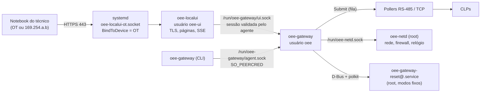
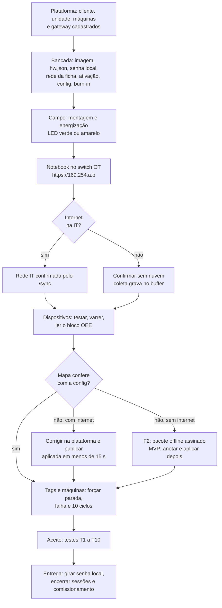

> **Consolidado:** as definições canônicas estão no [`docs/16`](../16-projeto-do-gateway.md); onde este rascunho divergir, vale o docs/16 (ex.: **ETH0 = OT** e **ETH1 = IT**; página local no `oee-localui`, porta 443, só na OT e no endereço de serviço). Implementação em `gateway/` e `deploy/`.

> **Rascunho** gerado pelo projeto do gateway (11/11/2026). Consolidado em `docs/16-projeto-do-gateway.md`.

> **Rascunho** do projeto do gateway (parte "comissionamento local"), 11/11/2026. Ainda não foi revisado nem consolidado no `docs/16`. Nenhum arquivo do repositório foi criado ou alterado.

# Gateway: comissionamento local (página web e CLI)

> **Status:** proposta de projeto, sem código. Complementa os rascunhos `docs/rascunhos/gateway-software.md` (processos, agente e CLI base) e `docs/rascunhos/gateway-rede-e-instalacao.md` (`oee-netd`, endereço de serviço, firewall e procedimento de campo). Quando este texto muda algo desses rascunhos, a seção 9 diz o quê e por quê.
> **"A confirmar":** ponto não verificado. Validar na bancada da Fase 0 ou com o fornecedor (lista na seção 10).
> **Limitação:** nesta sessão não consegui abrir `wiki.seeedstudio.com` nem o PDF do manual em `www.mouser.lt`, porque a rede da sessão bloqueia esses endereços. Para conferir direto na fonte, é preciso liberá-los nas configurações de rede. Os dados do R1000 abaixo vêm dos trechos dessas páginas que apareceram nos resultados de busca.

**Princípios**
1. **Comissionar sem internet.** Tudo na página local e na CLI funciona offline. Só a ativação e a troca de configuração dependem da nuvem, ou de um pacote assinado (F2).
2. **Somente leitura no CLP**, inclusive nas ferramentas de comissionamento (só FC01 a FC04).
3. **Um mestre por barramento.** Toda leitura feita pela página ou pela CLI entra na fila do poller (`Poller.Submit`). Nenhuma ferramenta abre uma segunda conexão com um dispositivo já cadastrado.
4. **A nuvem é a fonte da verdade** de dispositivos, tags e máquinas. A página local testa, mostra e diagnostica, mas não edita o mapa.
5. **Nenhum segredo aparece na tela, e tudo é auditado.** A auditoria local sobe para a plataforma.
6. **A direção segura é fácil, a arriscada é difícil.** Bloquear o acesso remoto, desfazer uma mudança de rede e abrir uma janela de comissionamento com o pendrive são ações simples. Desbloquear o acesso remoto, apagar dados e desvincular o gateway exigem reautenticação e confirmação digitada.

---

## 0. Decisões propostas (resumo)

| Tema | Decisão |
|---|---|
| Onde a página escuta | **Só na interface OT**: todos os IPs da OT e o endereço de serviço `169.254.a.b` (derivado do MAC e impresso na etiqueta). **HTTPS na porta 443**, e a porta 80 só redireciona para ela. Também em `127.0.0.1:8443`, para uso por túnel SSH numa sessão de VPN. **Nunca na IT** |
| Processo | Serviço próprio **`oee-localui`**: mesmo binário, usuário `oee-ui`, sem acesso ao buffer nem à credencial. O systemd abre as portas por ativação de socket, então nenhum processo precisa de privilégio para usar a porta 443 |
| Autenticação | (A) **Aprovação pela plataforma**, com QR e código. Se o gateway estiver online, a aprovação chega no `/sync`; se estiver offline, a plataforma mostra um código de resposta de 12 caracteres (F2). (B) **Senha local** aleatória por gateway, guardada em cofre na plataforma (MVP; é o recurso para quando não há internet nem sinal). **Nada na etiqueta** e nada derivado do MAC ou do número de série |
| Perfis | `leitura` e `técnico`. Ações críticas pedem reautenticação e confirmação digitada |
| Certificado | Autoassinado ECDSA P-256 com **chave estável**. A impressão digital da chave pública (SPKI) aparece na plataforma. F2: CA local Engemase com restrição de nomes |
| Bloqueio | 5 erros em 15 min por origem bloqueiam por 5 min (o prazo dobra até 1 h). 20 erros em 1 h no gateway suspendem a senha local por 1 h (a aprovação pela plataforma continua funcionando) |
| Ferramentas Modbus | Teste de conexão, varredura de unit ids, detecção de parâmetros seriais, leitura ao vivo com ABCD/CDAB/BADC/DCBA e monitor de tráfego. Todas só de leitura, com limite de taxa. **Não existe varredura de IPs** |
| Indicadores | LED USER tricolor com tabela de prioridades; buzzer só para identificar o gateway e confirmar o pendrive. **O R1000 não tem botão de usuário** (só reset e chave de boot). Por isso o "modo comissionamento" e o reset de rede ficam no **pendrive de serviço**, além da página, da CLI e da plataforma |
| Offline no dia | O gateway sai da bancada **ativado e com a config carregada**, então coleta e grava no buffer desde a energização. F2: **pacote offline assinado** (config e ativação adiada), carregado pela página ou pelo pendrive |

---

## 1. Página local: rede, processo e acesso

### 1.1 Onde escuta

| Endereço | Porta | Quando | Para quê |
|---|---|---|---|
| IPs da OT (ex.: `192.168.10.250`) | 443 (HTTPS); 80 só responde 301 para HTTPS | Se `network.ot.local_ui=true` (padrão) | Técnico ligado ao switch OT |
| Endereço de serviço `169.254.a.b` (do MAC da ETH0, impresso na etiqueta) | 443 e 80 | Sempre, salvo política do cliente | Notebook sem IP configurado (APIPA); funciona sem saber o IP OT |
| `127.0.0.1` | 8443 | Sempre | `ssh -L 8443:127.0.0.1:8443` numa sessão de VPN aprovada (F2) |
| IPs da IT | — | **Nunca** | — |

**Alternativas descartadas**
- **IP fixo de fábrica** (ex.: `192.168.250.10`): conflita com as faixas padrão dos CLPs e repete o IP entre gateways (rascunho de rede, §1.2).
- **Interface IT:** abriria uma porta de entrada na rede corporativa, contrariando a ficha do TI.
- **Nome mDNS** (`gw-7f3a2c.local`): exige o avahi, que foi removido da imagem, e multicast na OT. No Windows a resolução é irregular.
- **USB-C como "Ethernet de serviço"** (modo gadget): provavelmente inviável. O único controlador USB do CM4 atende a ETH1 e as USB-A, e o USB-C do R1000 serve para gravar a imagem (`rpiboot`). A confirmar.

**Como o técnico chega à página**
- Notebook numa porta livre do switch OT, ou no mini switch do kit.
- **Nunca tirar o cabo da ETH0 do gateway para ligar o notebook:** isso derruba a coleta.
- Sem DHCP na OT, o Windows e o macOS assumem um endereço `169.254.x.y` em cerca de 1 min. Aí basta abrir `https://169.254.a.b`.
- Com DHCP na OT, usar o IP OT do gateway, ou acrescentar `169.254.1.1/16` como IP secundário no notebook.

**Defesa em camadas**
1. O socket fica preso à interface OT (`BindToDevice=`).
2. O nftables só aceita as portas 80 e 443 na interface OT, vindas de `ot_nets`.
3. O `oee-localui` recusa conexões cujo endereço local não seja da OT, de serviço ou de loopback.
4. O `oee-localui` recusa cabeçalhos `Host` fora da lista (proteção contra DNS rebinding).

**Política "página local desligada na OT"** (`network.ot.local_ui=false`): o `oee-netd` **desabilita o socket**, em vez de só fechar o firewall. Para religar: `sudo oee-gateway localui enable`, ou o pendrive `OEE/commission`, que abre a página por 2 h.

### 1.2 Processo e isolamento

**Por que um processo separado:** a página é o único serviço exposto na OT. Com ela fora do agente, um travamento ou estouro de memória no código HTTP/TLS não afeta a coleta, e esse código não tem acesso ao `buffer.db` nem à credencial. Isso muda o §2.8 do rascunho de software, que colocava a página dentro do agente.



```ini
# /usr/lib/systemd/system/oee-localui-ot.socket
[Unit]
Description=Engemase OEE - página local (rede OT)
[Socket]
ListenStream=0.0.0.0:443
ListenStream=0.0.0.0:80
FreeBind=yes
Backlog=32
# BindToDevice= vem do drop-in /etc/systemd/system/oee-localui-ot.socket.d/10-iface.conf,
# gerado pelo oee-netd com o nome da interface OT resolvido pelo MAC (BindsTo/After do .device)
[Install]
WantedBy=sockets.target

# /usr/lib/systemd/system/oee-localui-lo.socket
[Socket]
ListenStream=127.0.0.1:8443
[Install]
WantedBy=sockets.target

# /usr/lib/systemd/system/oee-localui.service
[Unit]
Description=Engemase OEE - página local
After=oee-gateway.service
[Service]
ExecStart=/usr/bin/oee-gateway localui serve
Sockets=oee-localui-ot.socket oee-localui-lo.socket
User=oee-ui
Group=oee-ui
StateDirectory=oee-localui
StateDirectoryMode=0700
Restart=always
RestartSec=2s
MemoryMax=64M
CPUQuota=50%
TasksMax=64
NoNewPrivileges=yes
CapabilityBoundingSet=
ProtectSystem=strict
ProtectHome=yes
PrivateTmp=yes
PrivateDevices=yes
ProtectKernelTunables=yes
ProtectKernelModules=yes
ProtectControlGroups=yes
# Só cria sockets Unix; aceita conexões nos sockets herdados (a confirmar)
RestrictAddressFamilies=AF_UNIX
SystemCallFilter=@system-service
MemoryDenyWriteExecute=yes
```

- **Sysusers:** `u oee-ui - "Engemase OEE local UI" /nonexistent /usr/sbin/nologin`.
- **Socket entre página e agente:** `/run/oee-gateway/ui.sock`, com dono `oee:oee-ui` e modo `0660`, aberto por uma unit `oee-gateway-ui.socket` e entregue ao agente.
  - Nesse socket o agente só expõe as rotas da página (§2.11).
  - **A sessão é validada pelo agente** em toda chamada, exceto no login. Assim, mesmo um `oee-localui` comprometido não executa nada sem uma sessão válida.
- **Agente parado:** a página mostra, só para leitura, "agente parado desde 15:02, 4 reinícios; o systemd está tentando religar". Também indica o próximo passo: esperar, reiniciar a energia, usar o pendrive `OEE/collect` e acionar o suporte.

### 1.3 HTTPS e certificado

- **Chave:** ECDSA P-256 gerada no primeiro start do `oee-localui`, em `/var/lib/oee-localui/tls/` (modo 0600). É **estável**: sobrevive a atualizações e a troca de IP, e só é regerada no reset de fábrica.
- **Certificado:**
  - autoassinado, com validade de 10 anos (a confirmar como cada navegador trata certificados aceitos manualmente);
  - CN `gw-7f3a2c`, O "Engemase OEE — página local";
  - SAN com o endereço de serviço, os IPs OT atuais, `127.0.0.1` e o DNS `gw-7f3a2c`;
  - quando os IPs OT mudam, é **reemitido com a mesma chave**, sem reiniciar (`tls.Config.GetCertificate`).
- **Impressão digital:** o SHA-256 da SPKI sobe no `/sync` (`agent.localui.spki_sha256`). Aparece na aba "Acesso local" da plataforma e no relatório de instalação. Para conferir, basta comparar com o campo "Public key SHA-256" no visualizador de certificado do navegador.
- **Protocolo:** TLS 1.2 e 1.3 com as suítes padrão do Go (ECDHE + AEAD). HTTP/2 habilitado. Sem HSTS (o acesso é por IP, com certificado autoassinado).
- **F2: CA local Engemase.**
  - No enroll, o gateway envia um CSR. A plataforma assina com uma CA guardada em KMS, com **restrição de nomes**: só IPs privados (10/8, 172.16/12, 192.168/16, 169.254/16, 127/8) e o domínio interno `.gw.oee.local`. Assim, a CA não consegue emitir certificados para sites públicos.
  - O certificado é reemitido no `/sync` quando a rede muda.
  - Notebooks da Engemase (e do cliente, se ele quiser) instalam a raiz e deixam de ver o aviso.

### 1.4 Autenticação

**Opções avaliadas**

| Opção | Veredito | Motivo |
|---|---|---|
| Senha única por gateway **impressa na etiqueta** | **Não** | A etiqueta aparece nas fotos do painel (passo 11 do procedimento de campo), fica à vista de qualquer um e não pode ser trocada sem reimprimir. O Ato 77/2021 da ANATEL exige senha forte, troca no primeiro uso e nada derivado de dados de fácil acesso, como o MAC (aplicabilidade a este equipamento: a confirmar; seguir como boa prática) |
| **Senha local aleatória por gateway**, gerada na preparação e guardada em cofre na plataforma | **Sim** (MVP; recurso para "sem internet nem sinal") | Funciona 100% offline; é rotativa; quem pode ver fica auditado |
| **Chave gerada na ativação** | **Sim**, como base do código de desafio e resposta (não é digitada) | Permite login nominal com o gateway offline |
| Usuário e senha da plataforma **digitados na página local** | **Não** | O gateway veria a senha e o 2FA da conta; a página viraria alvo de phishing; não funciona offline |
| **Aprovação pela plataforma** (QR + código; padrão "device flow" da RFC 8628) | **Sim, método preferido** (F2) | Identidade nominal, 2FA da plataforma, escopo e política do cliente. Funciona com o gateway online e offline |
| Presença física sem senha (botão ou pendrive) | **Só para abrir a janela de comissionamento e zerar o bloqueio**, nunca para entrar | Evita entrada anônima |

**Método A: aprovação pela plataforma (F2)**
1. Na tela de entrada, o técnico escolhe "Entrar com a plataforma" e o perfil (técnico ou leitura).
2. O agente gera um **desafio** de 8 caracteres em base32 Crockford (40 bits), por exemplo `K7QF-2M9X`, e um **QR** com `https://oee.engemase.com.br/gw/acesso-local?g=<gateway_id>&c=<desafio>`.
   - O desafio vale 10 min e só pode ser usado uma vez.
   - Se o gateway estiver online, ele passa a sincronizar a cada 1 s enquanto houver desafio pendente.
3. No celular, o técnico lê o QR, ou abre o gateway na plataforma, entra em "Acesso local" e digita o desafio.
   - A plataforma exige login e 2FA conforme o papel e confere a permissão (§1.5) e a política do cliente.
   - A tela de aprovação mostra o gateway, o perfil pedido, o IP e o MAC do notebook que pediu e a hora, e pergunta: "Você está diante deste gateway agora?".
   - O técnico aprova escolhendo a validade: 1, 2, 4 ou 8 h.
4. **Gateway online:** a plataforma entrega `localui.grant {desafio, user_id, nome, papel, perfil, validade_s}` na resposta do `/sync`. A página, que consulta a cada 2 s, entra sozinha, normalmente em menos de 5 s.
5. **Gateway offline:** a plataforma mostra um **código de resposta** de 12 caracteres (`TB4R-9KQX-M2HD`), que o técnico digita na página.
   - 1º caractere = perfil; 2º = validade.
   - Os 10 restantes são um HMAC-SHA256 truncado em 50 bits de `"oee-local-v1" ‖ gateway_id ‖ desafio ‖ perfil ‖ validade`, calculado com a chave `K_local` (padrão de desafio e resposta da RFC 6287, OCRA).
   - Cinco respostas erradas invalidam o desafio.
6. **`K_local`:**
   - 256 bits por gateway, entregue na resposta do enroll e no `token.rotate`;
   - no gateway, fica em `/var/lib/oee-gateway/localui/key` (0600, dono `oee`);
   - na plataforma, é **derivada no KMS** (HMAC da chave mestra com `gateway_id` e a época de rotação), sem guardar nada por gateway no banco. Alternativa: guardar cifrada com KMS.
7. **Identidade e validade:**
   - online, a identidade fica nominal na auditoria local;
   - offline, a auditoria guarda o desafio, e a plataforma liga o desafio à pessoa quando a auditoria chega;
   - **a validade é contada no relógio monotônico** a partir do login, então funciona mesmo com o relógio de parede errado.

**Método B: senha local (MVP)**
- **Formato:** 16 caracteres em base32 Crockford, em 4 grupos (`7KQM-2XHD-9TRB-W4PF`, 80 bits), aleatória e única por gateway.
- **Na bancada:**
  - MVP: `sudo oee-gateway localui passwd --generate` mostra a senha uma vez, e o preparador a registra no cadastro de hardware da plataforma (Console Engemase).
  - F2: a plataforma gera a senha ao registrar o hardware, e o script de bancada instala só o hash.
- **No gateway:** só o hash argon2id (parâmetros mínimos da OWASP: m = 19 MiB, t = 2, p = 1), em `/var/lib/oee-gateway/localui/password` (0600). A verificação acontece no agente, uma de cada vez, com tempo mínimo de resposta de 1 s.
- **Na plataforma:**
  - fica cifrada com KMS;
  - **"Ver senha local"** exige reautenticação com 2FA e gera registro de auditoria;
  - quem pode ver: `client_admin`, `engineer` com escopo na unidade (se o cliente não for gerenciado pela Engemase), `field_engineer` atribuído e `super_admin`;
  - quando alguém da Engemase vê a senha, o admin do cliente é avisado.
- **Rotação:**
  - "Gerar nova senha" na plataforma envia `localui.password.set {argon2id, yescrypt}` pelo `/sync`. A senha em texto nunca vai para o gateway. O hash yescrypt vai para o usuário `tecnico` do console, aplicado pelo `oee-netd`.
  - **Rotação recomendada na entrega ao cliente**, para que o acesso do instalador expire.
  - Se a senha for trocada localmente (`sudo oee-gateway localui passwd`), a plataforma é avisada: "senha alterada localmente, não disponível na plataforma".
- **Gateway sem senha** (`.deb` recém-instalado): a página mostra só o número de série, a versão e os IPs, com a instrução para definir a senha pela CLI. Não há como entrar.
- **Quem entra com a senha local:** perfil `técnico`, com identidade registrada como "senha local" mais o IP, o MAC do notebook (lido da tabela ARP) e o navegador.
- **Orientação de campo:** antes de ir à planta, copie a senha local na plataforma. Dentro de galpões metálicos muitas vezes não há sinal de celular.

### 1.5 Perfis e permissões

| Perfil | Pode |
|---|---|
| `leitura` | Status, Tags e máquinas, Logs, Sobre, lista de dispositivos e estatísticas, diagnóstico do lado IT e da nuvem |
| `técnico` | Tudo do perfil leitura + ferramentas Modbus, testes na OT, Rede, Ativação (gateway não ativado), sincronizar, recarregar config, identificar, modo comissionamento, reiniciar o agente ou o gateway, pacote de diagnóstico, restaurar a rede de fábrica, bloquear o acesso remoto |
| Ações **críticas** (`técnico` + reautenticação nos últimos 5 min + confirmação digitada) | Restaurar padrão de fábrica, desvincular, ativar de novo um gateway já ativo, trocar a senha local, desligar a página na OT, adicionar CA corporativa, atualizar por arquivo (F2), desligar o gateway |
| Nunca pela página | Desbloquear o acesso remoto (só `sudo oee-gateway remote-access on`), editar dispositivos, tags ou máquinas, escrever no CLP, abrir um shell |

| Quem | Como entra | Perfil local |
|---|---|---|
| `client_admin` | Plataforma ou senha local | `técnico` |
| `engineer` com escopo na unidade do gateway | Plataforma ou senha local | `técnico` (`leitura` se o cliente for `managed_by_engemase`) |
| `supervisor`, `operator`, `viewer` | — | Sem acesso (usam a plataforma) |
| `field_engineer` atribuído ao cliente | Plataforma ou senha local | `técnico` |
| `support` com concessão ativa | Plataforma (no local ou pelo túnel SSH da VPN) | `leitura` |
| `super_admin` | Plataforma | `técnico` |
| Quem tem a senha local | Senha | `técnico` |

### 1.6 Sessões, bloqueio e proteções web

**Sessões**
- Identificador aleatório de 256 bits, guardado com hash, **só em RAM** no agente. Um reinício do agente encerra as sessões.
- Cookie `__Host-oeegw`, com `Secure`, `HttpOnly` e `SameSite=Strict`.
- Expira com 30 min ociosa ou ao fim da validade, que é no máximo 8 h.
- No máximo 4 sessões simultâneas. A 5ª é recusada, com a lista das sessões abertas.
- "Encerrar todas as sessões" está disponível na página, na CLI e na plataforma (comando `localui.sessions.revoke`).
- As sessões ativas sobem no `/sync` (quem, como, de onde, desde quando). A plataforma mostra uma faixa: "Carlos Mendes conectado localmente ao GW-01 desde 14:02".

**Bloqueio**

| Regra | Efeito |
|---|---|
| 5 erros em 15 min por origem (IP + MAC) | Bloqueio de 5 min, que dobra a cada repetição até 1 h |
| 20 erros em 1 h no gateway | Login por senha suspenso por 1 h. A aprovação pela plataforma continua funcionando. O pendrive `OEE/commission` zera os bloqueios |
| 5 respostas erradas a um desafio | Desafio invalidado |
| Todo bloqueio | Gera `local_event` de aviso, entrada de auditoria e alerta na plataforma ("Tentativas de acesso local ao GW-01") |

**Proteções web**
- Cabeçalhos:
  - `Content-Security-Policy: default-src 'self'; img-src 'self' data:; script-src 'self'; style-src 'self'; connect-src 'self'; frame-ancestors 'none'; base-uri 'none'; form-action 'self'`;
  - `X-Content-Type-Options: nosniff`, `Referrer-Policy: no-referrer`, `Cache-Control: no-store`.
- Verificações:
  - `Host` só da lista: IPs OT, endereço de serviço e `127.0.0.1:8443`;
  - em todo POST, `Origin` igual ao host e token CSRF no cabeçalho `X-OEE-CSRF`;
  - só JSON.
- Limites de tamanho:
  - corpo de 1 MB;
  - uploads: PEM de 64 KB, pacote `.oeepkg` de 5 MB e `.deb` de 64 MB.
- Limites de tempo e conexão:
  - `ReadHeaderTimeout` 5 s, `ReadTimeout` 30 s, `IdleTimeout` 120 s;
  - SSE com ping a cada 15 s;
  - no máximo 32 conexões e 4 fluxos SSE por sessão.
- Nenhum recurso externo: a página funciona offline e não "vaza" para a internet.

### 1.7 Modo comissionamento

Estado do gateway, com prazo de até 8 h, renovável.
- **Quem liga:** a página (perfil técnico), a plataforma, a CLI (`oee-gateway commission start --for 4h`) ou o pendrive `OEE/commission`.
- **Efeitos:**
  - a plataforma **silencia os alertas** das máquinas desse gateway ([13](13-notificacoes-e-alertas.md)) e mostra a faixa "em comissionamento até 19:20";
  - o `/sync` passa a cada 2 s, para conferir a tela ao vivo (cerca de 14 mil chamadas em 8 h, desprezível);
  - a sincronização rápida fica disponível para a página.
- **Só pelo pendrive, além disso:** liga a página na OT por 2 h mesmo que a política a tenha desligado, e zera os bloqueios de login.
- **Fim:** manual, por expiração ou ao clicar em "Concluir comissionamento" na plataforma, quando o gateway passa a "em operação".
- **Os dados de produção continuam valendo**: o modo não exclui nada do OEE. As interrupções provocadas pelo técnico (pausa de barramento, troca de rede, reinício) são marcadas com o motivo `gateway_maintenance`.

---

## 2. Telas da página local

### 2.0 Estrutura comum

- **Cabeçalho fixo:**
  - hostname e nome do gateway, com cliente e unidade se estiver ativado;
  - selo da nuvem: Online, "Sem nuvem há 2 h", Bloqueado ou Não ativado;
  - relógio do gateway;
  - usuário, perfil e tempo restante da sessão; botão "Sair".
- **Faixas, por prioridade:**
  1. agente parado;
  2. mudança de rede aguardando confirmação, com contagem regressiva;
  3. relógio inválido;
  4. fila acima de 80%;
  5. **sessão de acesso remoto ativa** (quem e até quando);
  6. modo comissionamento até HH:MM.
- **Menu:** Status · Rede · Ativação · Dispositivos · Tags e máquinas · Logs · Diagnóstico · Manutenção · Sobre.
- **Tecnologia:**
  - HTML no servidor (`html/template`), JS sem framework (módulos ES) e **SSE** para o tempo real. Se a leitura ao vivo pedir mais, usar Preact (~4 KB) compilado com esbuild;
  - tudo embutido (`embed`), até 300 KB comprimidos;
  - fontes do sistema;
  - tokens e cores de estado do [14](14-identidade-visual-e-temas.md), com as cores de estado travadas;
  - tema claro por padrão (reflexo no chão de fábrica) e escuro opcional;
  - português do Brasil;
  - alvo: notebook de 1280×720, utilizável em tablet a partir de 768 px.
- **Atualização:** a cada 2 s por SSE, com pausa quando a aba fica oculta.

### 2.1 Entrar

- **Aba "Pela plataforma" (F2):**
  - QR, desafio `K7QF-2M9X` e contagem de 10 min;
  - indicador "aguardando aprovação…" quando o gateway está online;
  - campo "Código de resposta" quando está offline;
  - escolha do perfil (técnico ou leitura).
- **Aba "Senha local":** campo de senha com máscara `XXXX-XXXX-XXXX-XXXX` (aceita com ou sem hífen, sem diferenciar maiúsculas).
- **Rodapé informativo:** número de série, versão, IPs, impressão digital SPKI e estado da nuvem. Nada sensível.
- **Erros:** "senha incorreta (3 de 5)", "bloqueado até 15:42", "desafio expirado", "relógio do seu computador difere 2 h do gateway (só informativo)".

### 2.2 Status geral

| Bloco | Campos |
|---|---|
| **Nuvem** | Estado (Online, Degradado, Offline, Recuperando, Bloqueado ou Não ativado), último `/sync` OK ("há 4 s"), latência, erros na última hora (por classe), URL e proxy em uso |
| **Coleta** | Dispositivos ok/total; máquinas por estado (contagem com as cores de estado); config `v43` (aplicada em, origem nuvem ou pacote, estado e erro, se houver) |
| **Fila** | Itens pendentes (eventos/minutos e amostras), item mais antigo, % do limite (barra com marcas em 80% e 95%), quarentena, `data_loss` nas últimas 24 h |
| **Relógio** | Hora local (fuso da unidade) e UTC; fonte (NTP sincronizado, servidor da plataforma, RTC, manual ou **inválido**); diferença para o servidor; **diferença para o seu computador**, calculada no navegador |
| **Sistema** | CPU (agora e gráfico de 24 h), RAM do agente e livre, disco livre, tamanho do `buffer.db`, **temperatura do SoC** (agora e máxima em 24 h; alerta acima de 75 °C), desgaste do eMMC, tempo ligado do gateway e do agente, boots não limpos em 24 h |
| **Rede** | Link IT/OT (velocidade e duplex), IPs, endereço de serviço |
| **Energia** | UPS presente, última falta de energia, ação configurada (`reboot`) |
| **Acesso** | Acesso remoto (desligado, bloqueado localmente ou sessão ativa com prazo); sessões locais |
| **Alarmes ativos** | `local_event` de aviso para cima ainda ativos, com hora e link para a tela certa |
| **Versões** | Agente, SO |

**Ações:** "Sincronizar agora", "Identificar" (LED e bipes), "Modo comissionamento", "Copiar resumo". O resumo é um texto sem segredos para mandar ao suporte ou ao TI, por exemplo:

```
gw-7f3a2c (GW-01 Injeção) · agente 1.2.0 · 11/11 15:21 -03
Nuvem: SEM NUVEM há 2 h 14 min (último erro: DNS sem resposta 10.20.0.10)
Fila: 3.214 itens (desde 13:07) · 0,9% · Relógio: RTC (sem NTP), dif. p/ notebook +0,8 s
Dispositivos 2/3 ok · dev_sop02 backoff (timeout) · Máquinas: 1 produzindo, 1 parada, 1 sem comunicação
IT eth1 10.20.30.40/24 100M · OT eth0 192.168.10.250/24 + 169.254.127.58
```

### 2.3 Rede

O motor e as regras são os do rascunho de rede (§1.3 a §1.9): `network.json`, `oee-netd` e confirmação com rollback em 3 camadas.

| Seção | Campos |
|---|---|
| Estado atual | Por porta: MAC, link, IPs, rotas, DNS, gateway; contadores de descarte do firewall; versão da rede vigente (origem: web, local, CLI ou pendrive) |
| IT (ETH1) | Modo DHCP ou estático; IP/máscara, gateway, DNS 1 e 2, domínio de busca; Avançado: VLAN, MTU, aceitar ping |
| OT (ETH0) | Modo estático ou `dhcp_no_route`; até 4 endereços; até 16 rotas OT (nunca `0.0.0.0/0`); endereço de serviço (só leitura; o cliente pode desligar por política); Avançado: VLAN |
| Proxy e CA | URL do proxy (HTTP CONNECT), usuário, **senha só de escrita** (mostra "definida"), `NO_PROXY`; CA corporativa (upload PEM, mostra o titular e a impressão digital; ação **crítica**) |
| NTP | Servidores, usar o do DHCP, reserva `pool.ntp.br` |
| Página local | "Ligada na OT" (desligar é ação **crítica**, com aviso de perda de acesso) |

**Ações**
- "Revisar alterações" mostra a diferença; "Aplicar" abre o modal de confirmação.
- **OT:** contagem de **120 s**. O técnico reconecta pelo IP novo ou pelo endereço de serviço e clica em "Confirmar". Sem isso, a rede volta sozinha.
- **IT:** confirmação automática com um `/sync` bem-sucedido em até 300 s, ou **"Confirmar sem nuvem"** quando o TI ainda não liberou a internet. Nesse caso a versão fica com origem `local`.
- Outras ações: "Desfazer agora", "Histórico" (versões, autor e motivo de rollback) e "Testar conectividade" (§2.8).
- **"Ajustar relógio pelo navegador":** só aparece se o NTP não estiver sincronizado e não houver contato com a nuvem. Envia a hora e o fuso do notebook; o `oee-netd` ajusta o relógio; a qualidade fica `manual` e o evento é auditado.

**Validações:** as da §1.3 do rascunho de rede, por exemplo IT e OT sobrepostas e rota padrão na OT. Há também um aviso quando um IP de dispositivo cadastrado fica fora de todas as sub-redes OT.

**Durante a aplicação** (até 60 s), a falta de comunicação é marcada como `gateway_maintenance`.

### 2.4 Ativação

- **Estado:**
  - Não ativado;
  - Ativado: cliente, unidade, nome, `gateway_id`, desde quando e por quem;
  - Bloqueado (401, credencial revogada): "Reativar com novo código".
- **Formulário** (só para gateway não ativado ou bloqueado):
  - **código de ativação** `XXXX-XXXX`;
  - **URL da plataforma**: padrão `https://oee.engemase.com.br`. Em "Avançado" só se aceitam os hosts de uma lista embutida no binário (produção e homologação), o que impede redirecionar o gateway para um servidor qualquer. URL livre só por CLI root, com `--allow-custom-url`;
  - **proxy e CA**: os mesmos campos da Rede, gravados no `network.json`.
- **Ações:**
  - "Testar conexão": DNS, TCP, TLS, `/ping` e diferença de relógio;
  - "Ativar". Se der certo, mostra cliente, gateway, versão da config baixada e quantos dispositivos, máquinas e tags existem.
- **Erros, com orientação:**
  - código inválido, expirado ou já usado;
  - código **vinculado a outro número de série**;
  - TLS falhou (relógio errado ou inspeção SSL);
  - proxy respondeu 407.
- **"Pacote offline" (F2):** upload de `.oeepkg`. Mostra o conteúdo (gateway, versão da config, ativação adiada, validade, assinatura OK) e o botão "Aplicar" (§6.4).

### 2.5 Dispositivos Modbus

**2.5.1 Lista.** Agrupada por transporte: dispositivos TCP e, para cada barramento RS-485, seus escravos.
- **Colunas:** nome, endereço (`tcp://192.168.10.23:502 u1` ou `rs485-1 u2`), estado (conectado, degradado, backoff ou desabilitado), latência p50/p95, erros no último minuto por tipo (timeout, CRC, exceção n), última leitura boa, máquinas ligadas.
- **Por barramento:** porta (`/dev/ttyAMA2`), parâmetros (19200 8E1, turnaround), modo RS-485 ativo, **ocupação %**, ciclo médio e máximo, transações por segundo, overruns e **bytes não solicitados** (indício de 2º mestre).
- **Ações por linha:** "Testar conexão", "Ler registradores", "Tráfego".

**2.5.2 Testar conexão** (comando `device.test`)
- **Dispositivo cadastrado:** lê o primeiro bloco pela fila do poller e mostra o tempo de conexão, o tempo de resposta e o resultado.
- **Dispositivo novo (ainda não cadastrado):**
  - TCP: IP (só dentro das sub-redes OT), porta (padrão 502) e unit id (1; alguns equipamentos usam 255 ou 0). O `oee-netd` libera o alvo no firewall por 5 min (`ot_targets ... timeout 5m`). No máximo um alvo novo a cada 5 s;
  - RTU: barramento e unit id, com os parâmetros do barramento. Com parâmetros diferentes, é preciso pausar o barramento (§2.5.4).
- **Resultado traduzido**, por exemplo:
  - "conexão recusada: servidor Modbus desligado no CLP?";
  - "exceção 02: endereço inválido. Confira o deslocamento de 1 e o mapa";
  - "timeout: unit id, cabo, A/B invertidos?";
  - "CRC: parâmetros seriais ou terminação".

**2.5.3 Varredura de unit ids**
- **Entradas:**
  - barramento RS-485, ou dispositivo TCP que seja conversor RTU→TCP (topologia d);
  - faixa: padrão 1–32, máximo 1–247;
  - sonda: padrão FC03 HR 0 ×1; opções FC04, FC01 ou FC02 e outro endereço;
  - timeout: 200 ms (entre 100 e 1.000).
- **Funcionamento:** intercalada com a coleta (1 em cada 3 transações). A opção "Pausar a coleta durante a varredura" deixa mais rápido, pede confirmação e marca `gateway_maintenance`. A tela mostra uma estimativa antes de começar ("~7 s; +15% de ocupação no rs485-1").
- **Resultado por unit:**
  - responde (com o tempo);
  - **responde com exceção**: o escravo existe; a exceção 02 só indica que o endereço sondado é inválido;
  - sem resposta;
  - **erro de CRC**: há algo ali, mas com parâmetros diferentes.
- **Cruzamento com a config:** "cadastrado e respondendo", "cadastrado e mudo" e "responde e não está cadastrado".
- **Limite:** uma varredura por barramento de cada vez.

**2.5.4 Detectar parâmetros seriais (F2)**
- **Condição:** só num barramento sem dispositivos cadastrados ou com **pausa explícita**. A pausa dura no máximo 60 s, renovável, e marca `gateway_maintenance`.
- **Combinações testadas**, nesta ordem, nos units 1–3 (ou no unit informado), com no máximo 60 s no total: 19200 8E1, 9600 8N1, 9600 8E1, 19200 8N1, 38400 8N1, 38400 8E1, 57600 8N1, 115200 8N1, 9600 8N2, 19200 8N2, 9600 8O1, 19200 8O1.
- **Modbus ASCII:** se o equipamento responder em ASCII a 9600 7E1, a tela avisa "dispositivo em Modbus ASCII (ex.: Delta DVP de fábrica). Configure RTU no CLP (D1120/M1143)" ([11](11-integracao-modbus.md)).

**2.5.5 Leitura ao vivo de registradores**
- **Entradas:**
  - alvo: dispositivo cadastrado (usa a conexão e a fila existentes) ou novo (como em §2.5.2);
  - área: Coil 0x, DI 1x, IR 3x ou HR 4x;
  - **endereço base 0**, com a convenção ao lado (`1000 = 41001`) e a opção "digitar na convenção 4xxxx";
  - quantidade: 1–125 registradores ou 1–2.000 bits;
  - período: única, 1 s, 2 s ou 5 s. A leitura para sozinha após 10 min.
- **Tabela por registrador:** offset, 4xxxx, hex, binário, uint16, int16 e ASCII (2 caracteres). Valores que mudam piscam, o que ajuda a ver o contador e o heartbeat.
- **Tabela de pares de 32 bits:** uint32, int32 e float32 nas ordens **ABCD, CDAB, BADC e DCBA**. Exemplo real do bloco OEE:

  | Par | ABCD | CDAB | BADC | DCBA |
  |---|---|---|---|---|
  | HR 1004–1005 (`0xFE95 0x000F`) | 4.271.177.743 | **1.048.213** | 2.516.455.168 | 251.696.638 |
  | HR 1006–1007 (`0x0003 0x0000`) | 196.608 | **3** | 50.331.648 | 768 |

- **Predefinição "Bloco OEE Engemase"** (MVP): lê 32 HR a partir da base e mostra os campos com nome. Valida:
  - `versao_bloco = 1`;
  - **heartbeat mudando** em até 2 s (senão: "CLP congelado ou heartbeat não implementado");
  - `estado` entre 0 e 5 (com o rótulo);
  - contadores monotônicos (mostra CDAB e ABCD lado a lado e sugere a ordem);
  - `bits_status` decodificado;
  - reservados 14–31 iguais a 0.
- **"Comparar com a config":** marca os registradores que viram tags (com o nome) e confere se a decodificação da config dá o mesmo valor.
- **"Procurar valor" (F2):** o técnico informa um valor conhecido (por exemplo, o contador da IHM = 100.000). A busca percorre a janela lida em todos os tipos e ordens e responde, por exemplo, "HR 1004–1005, uint32 CDAB".
- **"Anotar" (F2):** guarda `{dispositivo, área, offset, tipo, ordem, escala, nota}` como evento `commissioning_note`. A anotação sobe para a plataforma e aparece como sugestão no assistente de máquina.
- **Outras saídas:** exportar CSV; erros de exceção explicados.
- **Limites:** período mínimo de 1 s; no máximo 2 leituras ao vivo por gateway; no RTU, a tela mostra o impacto na ocupação do barramento antes de começar.

**2.5.6 Monitor de tráfego e erros**
- **Por barramento e por dispositivo TCP**, últimos 15 min: transações por segundo, latência, ocupação, erros por tipo e reconexões, com contadores desde a abertura da tela.
- **"Quadros" (F2):** captura passiva dos últimos 500 quadros em RAM, com hora em µs, sentido (TX/RX), unit, função, faixa, exceção e CRC.
  - Desliga sozinha após 10 min e não grava em disco.
  - Pode ser exportada em texto.
  - **Não existe "enviar quadro"**: isso abriria caminho para escrita.
- **Dicas automáticas:**
  - CRC frequente: terminação, malha ou parâmetros;
  - timeout em um único escravo: endereço ou alimentação dele;
  - timeout em todos: A/B invertidos ou porta errada;
  - bytes não solicitados: **outro mestre (IHM)** no barramento.

### 2.6 Tags e máquinas

**Os valores vêm do motor, não de leituras extras: a tela não gera carga no CLP.**

- **Cartões de máquina:**
  - nome, **estado calculado** (cores de estado da plataforma) e desde quando;
  - código de falha, produto, contador bruto e peças no minuto corrente;
  - último minuto fechado (run, stop, fault, setup e no_comm em segundos; total e refugo), com o selo "**na nuvem ✓**" ou "**no buffer**";
  - regra de estado (`signals`, `state_code` ou `count_derived`), comunicação e heartbeat;
  - últimos 50 eventos de estado, de um buffer em RAM.
- **Tabela de tags:** id, papel, máquina, dispositivo, endereço (área, offset, tipo e ordem), valor bruto, valor convertido, qualidade (boa, ruim ou vencida), idade da leitura e última mudança. Filtros por máquina, dispositivo e papel. Botão "Pausar".
- **Config ativa:** versão, data de aplicação, origem e hash. "Ver JSON" mostra o JSON só para leitura; a config não tem segredos.
- **"Teste de estados" (F2):** checklist de 15 min que registra as transições observadas (parada ✓, falha ✓, produzindo ✓) com horário. Vira evidência dos testes T3 e T4 do SAT no relatório de instalação.

### 2.7 Logs

- **Abas:**
  - **Registro**: journal de `oee-gateway`, `oee-localui`, `oee-netd`, `oee-remote-access`, `oee-gateway-updater` e kernel;
  - **Eventos**: `local_event`, com alarmes ativos e resolvidos;
  - **Auditoria local**.
- **Filtros:** nível, unidade, dispositivo ou máquina (campos `OEE_DEVICE`/`OEE_MACHINE` do journal), texto e período (15 min, 1 h, 24 h, 7 dias ou outro); "Acompanhar" ao vivo.
- **Limites:** no máximo 5.000 linhas na tela. Download em `.jsonl.gz` (auditado).
- **Implementação:** o agente (grupo `systemd-journal`) roda `journalctl -o json` com os filtros. A remoção de segredos já acontece na origem.

### 2.8 Diagnóstico

**"Teste completo"** roda como usuário `oee`, passando pelas mesmas regras de firewall. Os passos aparecem com estado, tempo e dica:
1. link e IP da IT;
2. ping do gateway da IT;
3. DNS do host da plataforma;
4. TCP 443, direto ou pelo proxy;
5. **TLS**: versão e emissor. Emissor inesperado gera "Inspeção SSL detectada: pedir ao TI exceção para gw.oee.engemase.com.br";
6. `/api/gateway/v1/ping`, com a diferença de relógio;
7. credencial (último `/sync` 200);
8. NTP (fontes, estrato e offset, lidos pelo `oee-netd`);
9. plano de controle da VPN (opcional);
10. link e IPs da OT;
11. para cada dispositivo: ping, TCP connect e leitura Modbus de 1 registrador.

**Ferramentas avulsas**
- **Ping:** até 4 pacotes. Na OT, só dentro das sub-redes OT. Usa ICMP sem privilégio (`ping_group_range`; a confirmar na imagem).
- **DNS:** nome a resolver, nos servidores configurados.
- **HTTPS:** só porta 443. Mostra status, tempos (DNS, TCP, TLS, primeiro byte), cadeia de certificados e proxy usado.
- **NTP:** estado e teste de um servidor informado (`chronyd -Q` pelo `oee-netd`).
- **Rota até a plataforma (traceroute por ICMP):** F2, a confirmar.

**"Copiar relatório para o TI":** o mesmo texto do `oee-gateway diag` (§4.3).

### 2.9 Manutenção

| Ação | O que acontece | Apaga | Mantém | Exige |
|---|---|---|---|---|
| Sincronizar agora / Recarregar config | `/sync` imediato / `config.reload` | — | — | técnico |
| Identificar | LED branco e 3 bipes por 60 s | — | — | técnico |
| Nível de log temporário | `debug` por até 60 min | — | — | técnico |
| Reiniciar agente | Desligamento limpo (o minuto aberto é salvo); o systemd religa | — | Tudo | técnico |
| Reiniciar gateway | Reboot pelo logind/polkit; ~60–90 s sem coleta (a medir) | — | Tudo | técnico |
| Desligar | Poweroff, com aviso: **"o R1000 não tem botão de liga; só religa tirando e recolocando a energia"** | — | Tudo | crítica |
| Exportar pacote de diagnóstico | Gera `gw-<serial>-<data>.tar.gz` com `status.json`, `diag.json`, config atual, `network/*.json`, contadores do nftables, `local_event`, auditoria, `metric_hour`, estatísticas do buffer e journal dos últimos 7 dias (com o kernel). **Sem segredos**, garantido por teste automático | — | — | técnico (auditado) |
| Bloquear acesso remoto | Equivale a `remote-access off --lock`. Encerra a sessão ativa e recusa novos pedidos | — | — | técnico |
| Restaurar rede de fábrica | IT em DHCP; OT só com o endereço de serviço | `network.json` atual | Credencial, config, buffer, senha | técnico + confirmação |
| Desvincular do cliente | Se online: envia a fila e o evento `maint.unenroll` antes de apagar | Credencial, config, contadores, `K_local` | Rede, senha local; buffer só com `--keep-buffer` (para reativar o mesmo gateway) | crítica |
| Restaurar padrão de fábrica | Para os serviços, apaga, restaura e reinicia | Credencial, config, **buffer**, contadores, `K_local`, sessões, certificado local, rede, política de acesso remoto (volta a "desligado e bloqueado"), journal | SO, versão do agente, `hw.json`, **senha local** (para não perder o acesso à página; `--wipe-password` só na bancada, pela CLI) e o **histórico de manutenção** (datas e `gateway_id`, sem dados do cliente) | crítica + digitar o hostname. Com fila pendente, digitar também `DESCARTAR 3214` |
| Trocar senha local | Exige a senha atual ou um login novo pela plataforma | — | — | crítica |
| Atualizar por arquivo (F2) | Upload do `.deb` com `manifest.json` e `.sig`; verifica a assinatura e entrega ao `oee-updater` | — | — | crítica |

**Como as restaurações rodam como root**
- O agente grava `/var/lib/oee-gateway/maint/request.json` (modo, nonce, quem e quando).
- Em seguida, inicia por D-Bus a unit `oee-gateway-reset@<modo>.service` (root, oneshot). O polkit só permite os modos `network`, `unenroll` e `factory`.
- A unit confere o nonce e o modo, para os serviços, apaga, chama `oee-netd net reset --factory`, grava o histórico e reinicia o gateway.
- Antes de apagar, o evento vai para a plataforma, se ela estiver alcançável. Senão, fica no histórico e sobe no próximo enroll ("este equipamento passou por reset de fábrica em …").

### 2.10 Sobre

- **Identificação:** número de série, modelo (`/proc/device-tree/model`), revisão da placa e data de preparação (`hw.json`); MAC da ETH0 e da ETH1; hostname; endereço de serviço.
- **Vínculo:** `gateway_id`, cliente, unidade e nome, se ativado.
- **Versões:** agente (versão, commit e data), `oee-updater`, SO (`/etc/os-release`), kernel e bootloader (a confirmar).
- **Segurança:** perfil de hardware; impressão digital SPKI da página local; identificadores das chaves públicas embutidas (OTA e pacotes).
- **Outros:** tempo ligado; **"Licenças de software de terceiros"** (exigido pelas licenças BSD/MIT/Apache das bibliotecas).

### 2.11 API local

São as mesmas rotas na página (`ui.sock`, com sessão) e na CLI (`agent.sock`, com permissão por `SO_PEERCRED`: grupo `oee-admin` = técnico sem ações críticas; root = tudo).

| Rotas | Uso | Perfil |
|---|---|---|
| `POST /api/v1/auth/password` · `POST /api/v1/auth/challenge` · `GET /api/v1/auth/challenge/{id}` · `POST /api/v1/auth/response` | Entrar | — |
| `POST /api/v1/auth/logout` · `GET /api/v1/auth/sessions` · `DELETE /api/v1/auth/sessions/{id}` | Sessões | técnico (encerrar outras) |
| `GET /api/v1/status` · `GET /stream/status` | Status | leitura |
| `GET /api/v1/net` · `POST /api/v1/net/apply` · `POST /api/v1/net/confirm` · `POST /api/v1/net/rollback` · `GET /api/v1/net/history` · `POST /api/v1/time/from-browser` | Rede e relógio (via `oee-netd`) | técnico |
| `GET /api/v1/enroll` · `POST /api/v1/enroll/test` · `POST /api/v1/enroll` · `POST /api/v1/package` (F2) | Ativação e pacote offline | técnico / crítica |
| `GET /api/v1/devices` · `GET /api/v1/buses` | Lista e estatísticas | leitura |
| `POST /api/v1/modbus/probe` · `POST /api/v1/modbus/read` · `GET /stream/modbus/watch` · `POST /api/v1/modbus/find` (F2) | Teste e leituras | técnico |
| `POST /api/v1/jobs/scan` · `POST /api/v1/jobs/serial-detect` (F2) · `GET /stream/jobs/{id}` · `DELETE /api/v1/jobs/{id}` | Varredura e detecção | técnico |
| `GET /stream/buses/{id}/frames` (F2) | Monitor de quadros | técnico |
| `GET /stream/tags` · `GET /stream/machines` · `GET /api/v1/config` | Valores ao vivo e config ativa | leitura |
| `GET /api/v1/logs` · `GET /stream/logs` · `GET /api/v1/events` · `GET /api/v1/audit` | Logs, alarmes, auditoria | leitura |
| `POST /api/v1/diag/run` · `GET /stream/diag/{id}` · `POST /api/v1/diag/ping` · `POST /api/v1/diag/dns` · `POST /api/v1/diag/https` · `POST /api/v1/diag/ntp` | Diagnóstico | leitura (alvos na OT: técnico) |
| `POST /api/v1/sync/now` · `POST /api/v1/config/reload` · `POST /api/v1/identify` · `POST /api/v1/commission` · `POST /api/v1/log-level` | Ações simples | técnico |
| `POST /api/v1/agent/restart` · `POST /api/v1/system/reboot` · `POST /api/v1/system/poweroff` | Reinícios | técnico / crítica (desligar) |
| `GET /api/v1/support-bundle` | Pacote de diagnóstico | técnico |
| `POST /api/v1/maint/{modo}/prepare` + `POST /api/v1/maint/{modo}/commit` | Restaurações (dois passos, com frase de confirmação) | técnico / crítica |
| `POST /api/v1/remote-access/lock` | Bloquear acesso remoto | técnico |
| `POST /api/v1/localui/password` · `POST /api/v1/localui/ot` · `POST /api/v1/update` (F2) | Senha, página na OT, atualização | crítica |
| `GET /api/v1/about` | Sobre | leitura |

---

## 3. Limites de segurança

| Regra | Como é garantida | Teste automático |
|---|---|---|
| **Nada escreve no CLP** | A API só aceita área + offset para FC01–FC04; não existe rota de "função livre" nem de "enviar quadro"; o `forbidigo` proíbe as funções de escrita da `grid-x/modbus` em todo o módulo | Varredura das rotas: nenhuma gera FC05/06/15/16/22/23; captura no `plc-sim` durante o e2e da página com zero escritas |
| **Um mestre por barramento** | Leituras de dispositivo cadastrado e todas as leituras RTU passam por `Poller.Submit`. A CLI sem agente usa `flock` em `/run/oee-gateway/bus-<id>.lock` | Duas sessões lendo o mesmo escravo: nenhuma colisão no `plc-sim` RTU |
| **Não sobrecarregar o CLP** | Limites da tabela abaixo; interativo no máximo 1 em cada 3 transações; nunca uma 2ª conexão TCP num dispositivo cadastrado | Carga máxima da página: ciclo de coleta menor que 1,5× o normal |
| **Sem varredura de rede** | Alvo novo só dentro das sub-redes OT, um a cada 5 s, liberado no firewall por 5 min; não existe varredura de IPs | Testes negativos: IP fora da OT, rajada de alvos |
| **Nenhum segredo exposto** | Token, `K_local`, senha e hash, senha do proxy, chave TLS, chaves de VPN, aprovações e código de ativação usado **nunca** saem do agente. Campos de segredo são só de escrita. Logs e pacote de diagnóstico passam por remoção | Busca de padrões (`gw_live_`, PEM privado, etc.) no pacote de diagnóstico e nas respostas de todas as rotas |
| **Não altera dados de OEE** | Sem rotas para editar contadores, eventos ou minutos; a config só muda pela nuvem ou por pacote **assinado pela plataforma** | — |
| **Não religa o acesso remoto** | Só `lock` pela página; `on` só por CLI root | Rota inexistente |
| **Página não derruba a coleta** | Processo separado com `MemoryMax=64M`; o agente só fornece cópias (snapshots) e usa a fila com limite | Teste de estresse HTTP: coleta intacta |
| **Upload seguro** | Só `.deb` + manifesto assinado (Ed25519), `.oeepkg` assinado e PEM de CA, validados antes de qualquer uso; nada é executado a partir do upload | Arquivos adulterados recusados |

**Limites das ferramentas Modbus**

| Ferramenta | Limite |
|---|---|
| Leitura única | 1 por segundo por sessão |
| Leitura ao vivo | Período ≥ 1 s; ≤ 125 registradores ou 2.000 bits; ≤ 2 por gateway; para sozinha em 10 min |
| Testar dispositivo novo | 1 a cada 5 s; só sub-redes OT; conexão temporária fechada após 30 s ociosa |
| Varredura de unit ids | 1 por barramento; faixa padrão 1–32; 200 ms por unit; intercalada com a coleta |
| Detectar parâmetros (F2) | Barramento livre ou pausa explícita de até 60 s (renovável), marcada como `gateway_maintenance` |
| Monitor de quadros (F2) | 1 por barramento; 10 min; 500 quadros em RAM |

### 3.1 Auditoria local que sobe para a nuvem

- **Onde fica:** tabela `local_audit` no `buffer.db`, só de inserção, com **encadeamento de hash** (`prev_hash`, `hash`) para evidenciar adulteração.
- **Como sobe:** cada linha é gravada **na mesma transação** de um item `local_audit` na `outbox_core`. Vai para a plataforma no `/sync` e entra no `audit_log` com o tipo de ator "pessoa no gateway (local)", visível ao cliente.
- **Retenção:** 90 dias no gateway.
- **O que se registra:**
  - logins (ok, falha, bloqueio, expiração), logout;
  - toda ação que altera estado;
  - ferramentas Modbus: início e fim com parâmetros e número de transações, não cada leitura;
  - downloads (logs e pacote de diagnóstico);
  - ações pelo pendrive e pela CLI (`cli:root (sudo: joao)`).

```json
{ "type": "local_audit", "id": "0193…", "at": "2026-11-11T15:21:07.120Z",
  "actor": { "kind": "platform_user", "user_id": "usr_01J…", "name": "Carlos Mendes", "via": "grant" },
  "source": { "channel": "localui", "ip": "169.254.33.10", "mac": "aa:bb:cc:dd:ee:10", "ua": "Chrome / Windows" },
  "action": "modbus.watch.stop", "target": "dev_inj03",
  "params": { "area": "holding_register", "offset": 1000, "count": 32, "period_ms": 1000, "reads": 184 },
  "result": "ok", "prev_hash": "9c1f…", "hash": "41ab…" }
```

**Ações registradas:**
- `auth.login`, `auth.login_failed`, `auth.lockout`, `auth.logout`, `auth.expired`;
- `net.apply`, `net.confirm`, `net.rollback`, `time.set_manual`;
- `enroll.attempt`, `enroll.ok`, `package.apply`;
- `modbus.probe`, `modbus.read`, `modbus.watch.start`, `modbus.watch.stop`, `modbus.scan`, `modbus.serial_detect`, `modbus.frames.start`, `modbus.frames.stop`;
- `sync.now`, `config.reload`, `identify`, `commission.start`, `commission.stop`, `log.level`;
- `agent.restart`, `system.reboot`, `system.poweroff`;
- `support_bundle.download`, `logs.download`;
- `maint.network_reset`, `maint.unenroll`, `maint.factory_reset`;
- `remote_access.lock`, `remote_access.unlock` (só pela CLI);
- `localui.password_changed`, `localui.ot_disabled`, `localui.ot_enabled`, `ca.added`, `update.install`, `usb.*`.

---

## 4. CLI `oee-gateway`

### 4.1 Princípios

- **Permissões:**
  - comandos de leitura e ferramentas Modbus: grupo `oee-admin`, sem `sudo`;
  - comandos que mudam o sistema: **root**;
  - no console HDMI, o usuário `tecnico` (senha local) fica no `oee-admin` e tem `sudo` restrito a `/usr/bin/oee-gateway`, com registro de I/O do `sudo`.
- **Comunicação:** a CLI fala com o agente por `/run/oee-gateway/agent.sock`.
- **Sem o agente**, funcionam em modo direto:
  - `version`, `diag` (parcial), `net`, `logs`, `localui passwd`, `remote-access`, `update` e `factory-reset`;
  - `modbus read` e `modbus scan`, mas **só se o agente estiver parado**, com `flock` por barramento.
- **Opções globais:** `--json`, `--no-color`, `--timeout 10s`, `-q`. Mensagens em português do Brasil.
- **Códigos de saída:** 0 ok · 1 avisos · 2 falha · 3 uso inválido · 4 sem permissão · 5 agente indisponível.

### 4.2 Lista completa

| Comando | O que faz | Permissão | Fase |
|---|---|---|---|
| `version` | Versão, commit, data, perfil de hardware | qualquer | MVP |
| `status [--json] [--watch 2s]` | Nuvem, relógio, config, fila, sistema, rede, dispositivos, máquinas, alarmes | oee-admin | MVP |
| `diag [--json] [--only it,ot,cloud,time,serial,system] [--report ARQ]` | Diagnóstico completo (§2.8) | oee-admin | MVP |
| `enroll --code XXXX-XXXX [--url URL] [--proxy URL]` | Ativação | root | MVP |
| `unenroll [--keep-buffer]` | Desvincular | root | MVP |
| `net show [--json]` · `net history` · `net test` | Ver a rede, o histórico e testar | oee-admin | MVP |
| `net set it …` · `net set ot …` · `net set proxy …` · `net set ntp …` · `net diff` | Preparar uma mudança (rascunho de rede, §1.4.3) | root | MVP |
| `net apply [--confirm-timeout 300]` · `net confirm` · `net rollback` · `net reset --factory` | Aplicar, confirmar, desfazer, rede de fábrica | root | MVP |
| `time show` · `time set "AAAA-MM-DD HH:MM:SS" [--tz America/Sao_Paulo]` | Relógio (`set` só sem NTP e sem nuvem) | oee-admin / root | MVP |
| `devices [--json]` · `machines [--watch]` | Lista de dispositivos e máquinas | oee-admin | MVP |
| `modbus probe --target URI` | Testar conexão | oee-admin | MVP |
| `modbus read --device ID` ou `--target URI` + `--area hr --offset N --count N [--decode all] [--every 1s]` | Leitura única ou ao vivo | oee-admin | MVP |
| `modbus oee-block --device ID [--base 1000]` | Lê e valida o bloco OEE padrão | oee-admin | MVP |
| `modbus scan --bus rs485-1 --units 1-32 [--fc 3 --addr 0] [--timeout 200ms] [--pause-bus]` | Varredura de unit ids (`--pause-bus` exige root) | oee-admin | MVP |
| `modbus monitor --bus ID [--frames] [--for 10m]` | Estatísticas ao vivo (quadros: F2) | oee-admin | MVP / F2 |
| `modbus detect-serial --bus ID [--units 1-3]` | Detectar parâmetros seriais (pausa o barramento) | root | F2 |
| `modbus find --value 100000 --device ID --area hr --offset N --count N` | Procurar valor | oee-admin | F2 |
| `tags live [--machine ID] [--device ID] [--role count.*] [--watch]` | Valores ao vivo da config ativa | oee-admin | MVP |
| `logs [-f] [--since 1h] [--level warn] [--device ID] [--unit agent,netd,ui,ra,updater,kernel] [--grep TEXTO]` | Logs | oee-admin | MVP |
| `events [--since 24h] [--active]` · `audit [--since 7d]` | Alarmes locais e auditoria | oee-admin | MVP |
| `config show [--previous] [--json]` · `config validate ARQ` · `config reload` | Config | oee-admin | MVP |
| `config import ARQ.oeepkg` | Pacote offline assinado | root | F2 |
| `buffer stats` · `buffer export --since … --out ARQ` | Fila / exportação | oee-admin / root | MVP / F3 |
| `sync now` · `log level debug --for 30m` · `identify [--for 60s]` | Ações simples | oee-admin | MVP |
| `commission start [--for 4h]` · `commission stop` · `commission status` | Modo comissionamento | oee-admin | MVP |
| `localui status` · `localui sessions` · `localui logout --all` | Página local | oee-admin | MVP |
| `localui passwd [--generate]` · `localui enable` · `localui disable` | Senha e página na OT | root | MVP |
| `remote-access status` | Estado e sessão | oee-admin | F2 |
| `remote-access off --lock` · `remote-access on` | Kill switch local / desbloqueio | root | F2 |
| `update status` · `update check` | Versão instalada, alvo, último resultado | oee-admin | F2 (M4b) |
| `update install ARQ.deb --manifest M --sig S` · `update rollback` | Atualização offline / volta à anterior | root | F2 (M4b) |
| `support-bundle [--out ARQ] [--since 7d]` | Pacote de diagnóstico | oee-admin | MVP |
| `restart` · `reboot` | Reiniciar agente / gateway | root | MVP |
| `factory-reset [--network-only] [--discard-buffer] [--wipe-password]` | Restaurações (§2.9) | root | MVP |

**Formato dos alvos (URI):**
- `tcp://192.168.10.23:502?unit=1`;
- `rtu://rs485-1?unit=2` (usa os parâmetros do barramento);
- `rtu://rs485-2?unit=3&baud=9600&parity=N&stop=1` (parâmetros diferentes exigem `--pause-bus`);
- `rtuovertcp://192.168.10.60:4001?unit=1`.

### 4.3 Exemplos e saída esperada

```
$ oee-gateway status
Gateway  gw-7f3a2c · GW-01 Injeção (Serra Azul / Jundiaí)
Agente   1.2.0 (a1b2c3d, 02/11/2026) · recomputer-r1000 · ativo há 3 d 4 h
Nuvem    ONLINE · último /sync há 4 s (182 ms) · config v43 aplicada 10/11 14:02
Relógio  11/11/2026 15:21:07 -03 · NTP sincronizado · dif. p/ servidor +12 ms
Fila     15 itens (mais antigo 6 s) · 0,2% do limite · quarentena 0
Sistema  CPU 4% · agente 61 MB · 1,4 GB livres · disco 9,8 GB livres · SoC 52 °C · eMMC 3%
Rede     IT eth1 10.20.30.40/24 100M · OT eth0 192.168.10.250/24 + 169.254.127.58 1G
Acesso   remoto: bloqueado localmente · página local: 1 sessão (Carlos Mendes, plataforma)

DISPOSITIVO            ENDEREÇO                   ESTADO     P95     ERR/MIN   ÚLTIMA OK
dev_inj03 CLP Inj 03   tcp://192.168.10.23:502 u1 conectado  18 ms   0         0,4 s
dev_sop01 CLP Sop 01   rs485-1 u1 19200 8E1       conectado  41 ms   0         0,3 s
dev_sop02 I/O Sop 02   rs485-1 u2                 backoff    —       12 TO     3 min

MÁQUINA        ESTADO       DESDE     FALHA  PRODUTO  CONTADOR
Injetora 03    PRODUZINDO   14:58:21  —      PRD-001  1.048.213
Sopradora 01   PARADA       15:10:02  —      7        88.120
Sopradora 02   SEM COMUN.   15:18:11  —      —        —
Alarme  [aviso] dev_sop02 sem resposta (timeout) desde 15:18:11
(código de saída 1)
```

```
$ oee-gateway diag
SISTEMA  agente ativo há 3 d · disco 9,8 GB livres · SoC 52 °C · eMMC 3% ................ OK
BANCO    buffer.db 38 MB · quick_check ok · fila 15 · quarentena 0 ....................... OK
SERIAL   rs485-1 /dev/ttyAMA2 modo RS-485 ativo · rs485-2 e rs485-3 sem uso ............... OK
RELÓGIO  NTP 10.20.0.5 estrato 3 +4 ms · RTC ok ...................................... OK
IT       eth1 100 Mb/s full · 10.20.30.40/24 gw 10.20.30.1 ............................... OK
DNS      gw.oee.engemase.com.br resolvido por 10.20.0.10 (12 ms) ......................... OK
HTTPS    gw.oee.engemase.com.br:443 direto · TLS 1.3 · emissor esperado · 182 ms ......... OK
API      /api/gateway/v1/ping · diferença de relógio +12 ms ............................. OK
CREDENC. gw_01JD2X… · último /sync 200 há 4 s ........................................ OK
OT       eth0 1000 Mb/s full · 192.168.10.250/24 + 169.254.127.58/16 ..................... OK
OT       dev_inj03 192.168.10.23:502 · TCP 3 ms · Modbus 21 ms ........................... OK
OT       dev_sop02 rs485-1 u2 · 12 timeouts no último minuto ............................ AVISO
Resultado: 1 aviso (código de saída 1)
```

```
$ sudo oee-gateway enroll --code ABCD-1234
Plataforma https://oee.engemase.com.br · conexão ok (TLS 1.3, 190 ms) · relógio ok (+12 ms)
Ativado: "GW-01 Injeção" (gw_01JD2X…) · cliente Serra Azul · unidade Jundiaí
Config v43 baixada e aplicada: 3 dispositivos, 5 máquinas, 22 tags.
```

```
$ oee-gateway net show
Rede v4 (aplicada 10/11 13:40, origem local, senha local de 169.254.33.10) · pendente: nenhuma
IT  eth1  estático 10.20.30.40/24  gw 10.20.30.1  DNS 10.20.0.10, 10.20.0.11  100 Mb/s full
OT  eth0  192.168.10.250/24 + 192.168.0.250/24 · serviço 169.254.127.58/16 · 1000 Mb/s
    rotas: 192.168.20.0/24 via 192.168.10.1 · sem rota padrão ✓
Proxy nenhum · CA extra nenhuma · NTP 10.20.0.5 (sincronizado) + pool.ntp.br
Página local: ligada na OT (443) · firewall: 0 descartes de saída na OT na última hora

$ sudo oee-gateway net set it --static 10.20.30.41/24 --gw 10.20.30.1 --dns 10.20.0.10
$ sudo oee-gateway net apply
Aplicando v5 (IT) · confirmação automática quando o /sync funcionar (até 300 s) ...
/sync OK pela rede nova em 9 s · v5 confirmada e gravada como última rede boa.
```

```
$ oee-gateway modbus read --device dev_inj03 --area hr --offset 1000 --count 8 --decode all
dev_inj03 · tcp://192.168.10.23:502 u1 · FC03 HR 1000–1007 (41001–41008) · 21 ms · fila do dispositivo
OFF   4xxxx  HEX     UINT16  INT16
1000  41001  0x0001       1      1
1001  41002  0x3A9C   15004  15004
1002  41003  0x0001       1      1
1003  41004  0x0000       0      0
1004  41005  0xFE95   65173   -363
1005  41006  0x000F      15     15
1006  41007  0x0003       3      3
1007  41008  0x0000       0      0
32 BITS   ABCD            CDAB        BADC            DCBA
1004–05   4.271.177.743   1.048.213   2.516.455.168   251.696.638
1006–07   196.608         3           50.331.648      768
```

```
$ oee-gateway modbus oee-block --device dev_inj03 --base 1000
Bloco OEE Engemase em HR 1000–1031 · 3 leituras em 2 s
versao_bloco     1                         ✓
heartbeat        15004 → 15006             ✓ vivo
estado           1 = produzindo            ✓
codigo_falha     0                         ✓
contador_total   1.048.213 (CDAB)          ✓ subindo (+2 em 2 s)
contador_refugo  3 (CDAB)                  ✓
contador_bons    0 → calculado (total − refugo)
produto 7 · velocidade 118 · ciclo_ultimo_ms 6.020 · bits_status 0b0000_0001 (automático)
reservado 14–31  todos 0                   ✓
Resultado: bloco válido; confere com o template "Bloco OEE v1, CDAB" da config v43.
```

```
$ oee-gateway modbus scan --bus rs485-1 --units 1-10
rs485-1 (/dev/ttyAMA2) 19200 8E1 · sonda FC03 HR 0 ×1 · 200 ms · intercalada com a coleta
UNIT  RESULTADO               TEMPO  CADASTRO
1     responde                24 ms  dev_sop01 CLP Sopradora 01
2     sem resposta            —      dev_sop02 I/O Sopradora 02   ← cadastrado e mudo
3     responde (exceção 02)   19 ms  não cadastrado (existe; o endereço 0 é inválido nele)
4–10  sem resposta            —      —
Concluído em 2,1 s · 2 escravos encontrados · 0 erros de CRC (código de saída 1)
```

```
$ oee-gateway modbus monitor --bus rs485-1
rs485-1 19200 8E1 · ciclo 0,31 s (máx 0,44) · ocupação 38% · 6,4 transações/s
UNIT  OK/MIN  TIMEOUT  CRC  EXCEÇÃO  P50/P95
1     372     0        0    0        24/31 ms
2     0       12       0    0        —  (backoff 10 s)
Bytes não solicitados (2º mestre?): 0 · atualiza a cada 2 s (Ctrl+C sai)
```

```
$ oee-gateway tags live --machine mch_inj03
Injetora 03 · PRODUZINDO desde 14:58:21 (22 min) · regra state_code · heartbeat ok
TAG     PAPEL          ENDEREÇO             BRUTO       VALOR         QUAL.  IDADE
tag_hb  plc.heartbeat  HR 1001 uint16       15012       15012         boa    0,4 s
tag_a2  state.code     HR 1002 uint16       1           1 → RUNNING   boa    0,4 s
tag_a3  fault.code     HR 1003 uint16       0           0             boa    0,4 s
tag_a4  count.total    HR 1004 uint32 CDAB  FE95 000F   1.048.213     boa    0,4 s
tag_a5  count.reject   HR 1006 uint32 CDAB  0003 0000   3             boa    0,4 s
Minuto 15:20 (aberto): produzindo 41 s · 9 peças · 0 refugo · minuto 15:19 → na nuvem ✓
```

```
$ oee-gateway logs --since 1h --level warn
15:18:11 AVISO bus    dev_sop02 conectado → backoff (timeout 300 ms, 3 falhas)
15:19:11 AVISO bus    dev_sop02 sem resposta: +60 repetições no último minuto
```

```
$ sudo oee-gateway remote-access off --lock
Acesso remoto DESLIGADO e BLOQUEADO localmente (remote-access.json: allowed=false, locked=true).
Nenhuma sessão ativa. Pedidos da plataforma serão recusados até "sudo oee-gateway remote-access on".
```

```
$ sudo oee-gateway update install oee-gateway_1.2.1_arm64.deb --manifest manifest.json --sig manifest.json.sig
Assinatura Ed25519 ok (chave eng-2026a) · SHA-256 ok · arm64 · 1.2.1 ≥ mínima 1.0.0
Pedido entregue ao oee-updater (coleta parada por ~10 s). Sem nuvem: confirmação pela
verificação local de saúde (5 min com agente e pollers vivos); senão, volta para a 1.2.0.
```

```
$ sudo oee-gateway factory-reset
Isto vai APAGAR: credencial (gw_01JD2X…), config v43, contadores, buffer, certificado e sessões
da página local, rede (IT em DHCP + OT só 169.254.127.58), política de acesso remoto e logs.
Mantém: sistema, agente 1.2.0, hw.json, senha local e histórico de manutenção.
Há 3.214 itens NÃO ENVIADOS (09/11 22:10 a 11/11 15:20) e a nuvem está fora: serão perdidos.
Para continuar, digite:  DESCARTAR 3214 gw-7f3a2c
>
```

```
$ oee-gateway localui sessions
ID    QUEM                           COMO        ORIGEM                       DESDE  EXPIRA
s3f2  Carlos Mendes (field_engineer) plataforma  169.254.33.10 (…:ee:10)      14:02  22:02
s9a1  senha local                    senha       192.168.10.77 (…:ee:77)      15:11  23:11 (ociosa 4 min)
```

---

## 5. Indicadores físicos

**O que o R1000 tem** (wiki e manual da Seeed, via busca):

| Recurso | Fato | Uso |
|---|---|---|
| PWR (verde) | Aceso com energia | Alimentação (hardware) |
| ACT (verde) | Pisca com acesso ao eMMC; no boot, pisca códigos de erro do Raspberry Pi | Boot e disco (hardware) |
| **USER** | Um LED **tricolor** (vermelho, verde e azul), definido pelo usuário: `/sys/class/leds/led-red`, `led-green` e `led-blue` | **Estado do gateway** (tabela abaixo) |
| RS485-1, 2 e 3 (verdes) | Piscam com tráfego (TX ou RX) no canal | Comissionamento: "o gateway está falando no barramento?" |
| Buzzer | 1 buzzer (GPIO21 na v1.0 / PCA9535 P15 na v1.1, a confirmar) | Identificação e confirmação do pendrive |
| Botão de reset / "Reset Hole" | Existe; **função a confirmar**. O provável é reset de hardware do CM4, que não pode ser lido pelo software | Nenhum uso de software previsto |
| Chave lateral de boot | Normal = eMMC; flash = `rpiboot` pelo USB-C | Só na bancada. **Nunca deixar em "flash"**: o gateway não sobe do eMMC |
| Botão de liga | **Não existe**: liga ao energizar | "Desligar" pela página exige religar a energia |
| HDMI 2.0, 2× USB-A, USB-C | USB-C para gravar o SO | Console de emergência; pendrive de serviço |

**LED USER: uma condição por vez, pela maior prioridade**

| Prioridade | Cor e padrão | Significado | O que fazer |
|---|---|---|---|
| 1 | Branco piscando rápido (4 Hz) + 3 bipes | **Identificação** (página, CLI ou plataforma), 60 s | — |
| 2 | **Vermelho piscando rápido (4 Hz)** | **Erro crítico**: agente parado, disco ou banco com problema, fila ≥ 95%, credencial revogada | Página local → Status/Diagnóstico; suporte |
| 3 | Ciano piscando (2 Hz) | **Não desligar**: atualização em andamento ou mudança de rede aguardando confirmação | Esperar |
| 4 | Vermelho piscando lento (1 Hz) | **Nada sendo coletado**: nenhum dispositivo lendo, config rejeitada sem anterior ou relógio inválido | Dispositivos / Diagnóstico |
| 5 | Amarelo (vermelho + verde) piscando 1 Hz | Sem nuvem há mais de 2 min **e** algum dispositivo sem comunicação | Diagnóstico IT + Dispositivos |
| 6 | Amarelo fixo | Sem nuvem há mais de 2 min; dispositivos ok. **Coletando no buffer** | TI / rede IT (nada se perde por até 30 dias) |
| 7 | Verde piscando 1 Hz | Nuvem ok; algum dispositivo sem comunicação | Dispositivos |
| 8 | **Verde fixo** | Tudo ok | — |
| 9 | Azul fixo | Ativado, sem nenhuma máquina configurada | Configurar na plataforma |
| 10 | Azul piscando lento (0,5 Hz) | Não ativado | Ativação |
| Sobreposição | Azul alternando com a cor de estado (1 s cada) | **Sessão de acesso remoto ativa** (transparência para o cliente no painel) | — |
| — | Apagado, com PWR aceso e ACT piscando | Boot (antes de o agente subir) | Esperar ~1 min |

**Detalhes da tabela**
- **Erro crítico sem depender do agente:** o padrão vermelho rápido usa o gatilho `timer` do kernel (`delay_on=125`, `delay_off=125`) e é ligado por `ExecStopPost=` no `oee-gateway.service`. Assim, se o agente cair ou travar (o watchdog mata o processo), o LED continua indicando o erro mesmo sem processo rodando. Os demais padrões são gerados pelo agente.
- **Daltonismo:** os estados críticos se distinguem pelo **padrão de piscada**, não só pela cor. A confusão possível entre "verde fixo" e "amarelo fixo" é de baixo risco, porque os dados não se perdem em nenhum dos dois. O estado exato está sempre na página e na plataforma.
- **Buzzer:** só para identificar o gateway e para o pendrive (1 bipe = lido; 2 bipes = concluído; 1 longo = erro). **Nunca para alarme operacional.** `hardware.buzzer: off` silencia.
- **Etiqueta na porta do painel:** a tabela acima, em versão resumida.

**"Botão" de modo comissionamento e de reset de rede**
- Como o R1000 não tem botão de usuário, a **presença física** é o **pendrive de serviço**: FAT32, montado com `noexec,nosuid,nodev`, só nomes fixos, nada é executado, processado uma vez por inserção e auditado.
- Se a bancada mostrar que o "Reset Hole" é um GPIO legível, mapear: 5 s = janela de comissionamento; 15 s = reset de rede.
- No R1100, uma DI pode receber uma chave de painel (kill switch do acesso remoto, [12](12-acesso-remoto-vpn.md)).

| Arquivo em `OEE/` no pendrive | Efeito | Fase |
|---|---|---|
| `diag` | Grava `OEE/gw-<serial>-diag.txt` (rascunho de rede §1.4.4) | MVP |
| `net-reset` | Rede de fábrica (credencial, config e buffer ficam) | MVP |
| **`commission`** | **Janela de comissionamento de 2 h**: liga a página na OT mesmo com a política desligada, zera os bloqueios de login e liga o modo comissionamento | MVP |
| **`collect`** | Grava o pacote de diagnóstico completo `gw-<serial>-<data>.tar.gz` | MVP |
| `network.json` assinado | Aplica a rede | F2 |
| `*.oeepkg` | Pacote offline assinado (§6.4) | F2 |
| `update/` | Atualização offline assinada | F2 |

**Console HDMI + teclado USB:**
- o tty1 mostra, **sem login**, uma tela de estado: hostname, série, IPs, endereço de serviço, nuvem, versão e alarmes. Implementação proposta: `/etc/issue.d/oee.issue` apontando para `/run/oee-gateway/issue`, atualizado pelo agente (suporte do `agetty` a confirmar);
- o login `tecnico` com a senha local libera a CLI.

---

## 6. Fluxo de comissionamento: do zero à "máquina no ar"

### 6.1 Visão geral



### 6.2 Passo a passo

| # | Onde | O que fazer | Critério para seguir |
|---|---|---|---|
| 1 | Plataforma | Cadastrar cliente, unidade, linhas e máquinas (template "Bloco OEE v1" quando couber) e **provisionar o gateway**: código de ativação **vinculado ao número de série** | Gateway "aguardando instalação" |
| 2 | Bancada | Gravar a imagem; `hw.json`; **senha local** (`localui passwd --generate`, registrada na plataforma); `network.json` da ficha do TI; `enroll`; config baixada; burn-in de 24 h com o `plc-sim`; etiquetas (rascunho de rede §6.1) | `oee-gateway diag` sem falhas; LED verde |
| 3 | Antes de sair | Copiar a senha local na plataforma; conferir o endereço de serviço na etiqueta | — |
| 4 | Campo | Montagem, 24 V, cabos, RS-485 (rascunho de rede §6.2, passos 1–6) e energização | PWR aceso; LED USER verde ou amarelo em ~1–2 min |
| 5 | Página | Notebook no switch OT; abrir `https://169.254.a.b`; aceitar o certificado (opcional: conferir a SPKI na plataforma); entrar pela plataforma ou com a senha local; **ligar o modo comissionamento** | Status abre; relógio válido (senão "Ajustar relógio pelo navegador") |
| 6 | Página → Rede | Conferir/ajustar a OT (`.250`) com confirmação de 120 s; ajustar a IT (DHCP ou fixo) | OT confirmada; IT confirmada pelo `/sync` ou "Confirmar sem nuvem" |
| 7 | Página → Diagnóstico | "Teste completo". Com falha na IT, "Copiar relatório para o TI" e resolver no local | Nuvem OK (ou pendência registrada com o TI) |
| 8 | Página → Dispositivos | Por dispositivo: "Testar conexão". Por barramento: **varredura de unit ids**, olhar os LEDs RS485-n, monitor de erros (CRC, timeout, 2º mestre) | Todos respondendo; 0 CRC em 5 min |
| 9 | Página → Leitura ao vivo | Bloco OEE: versão, heartbeat, estado, contadores (CDAB × ABCD); sem bloco, "Procurar valor" com o contador da IHM | Mapa confere com a config |
| 10 | Plataforma | Se precisar, corrigir tags e publicar. Online: aplicada em < 15 s. Offline: §6.4 | Config `vN` aplicada (Status) |
| 11 | Página → Tags e máquinas | Com o operador: forçar parada, falha e retorno; contar 10 ciclos | Estado correto em ≤ debounce + 2 s; delta = 10 |
| 12 | Página + cabo IT | Tirar o cabo IT por 10 min com produção e recolocar | Status "Sem nuvem → Recuperando → Online"; fila zerada em < 5 min; contagem bate |
| 13 | Plataforma | SAT T1–T10 (rascunho de rede §6.3); fotos; tela ao vivo da máquina | "Máquina no ar" (§6.3) |
| 14 | Entrega | **"Gerar nova senha local"** (envelope ao responsável); "Encerrar todas as sessões"; "Concluir comissionamento"; relatório e termo | Gateway "em operação"; alertas reativados |

### 6.3 Critérios de "máquina no ar"

| Critério | Medida |
|---|---|
| Comunicação estável | Dispositivo `connected` e `errors_1m = 0` por 15 min seguidos |
| CLP vivo | Heartbeat mudando (bloco OEE) ou leituras boas contínuas |
| Estado correto | 3 transições forçadas (parada, falha, produzindo) vistas na página e na plataforma, com horário dentro de debounce + 2 s |
| Contagem exata | 10 ciclos = delta de 10 (e o refugo, se houver) |
| Dados na nuvem | Últimos 5 minutos presentes na plataforma. Offline: no buffer, com verificação marcada como pendente até a IT liberar |
| Resiliência | Teste de 10 min sem a IT sem perda (T5) |

### 6.4 Sem internet no dia

| Situação | Coleta | Ativação | Mudança de config | Como verificar no local |
|---|---|---|---|---|
| **A. Ativado em bancada, com config** (padrão) | Roda desde a energização; buffer de até 30 dias / 1 GB; LED amarelo | Já feita | — | Tags e máquinas, Leitura ao vivo |
| **B. Ativado, mapa precisa de ajuste** | Roda com a config atual (tag errada → `NO_COMM` ou valor errado) | — | **MVP:** a correção feita na plataforma só chega com internet; o intervalo coletado com o mapa errado não se recupera (contadores com endereço errado perdem o delta). **F2:** "Baixar pacote offline" na plataforma (celular com 4G) e upload na página ou no pendrive; aplicação imediata | Leitura ao vivo para achar o mapa; "Anotar" |
| **C. Não ativado** (reserva, troca de hardware) | Não coleta (não há config) | **MVP:** impossível offline. **F2:** pacote com **ativação adiada** (código vinculado ao número de série, válido por até 7 dias); o gateway coleta com a config do pacote e se registra sozinho quando a internet chegar, enviando o buffer | Idem B | Ferramentas Modbus funcionam |
| **D. Sem internet e sem sinal de celular** | Igual a A/B | — | — | Login **só com a senha local** (levar antes, §1.4) |
| **E. Relógio inválido** (bateria do RTC e NTP indisponíveis) | Coleta, com o relógio marcado como "inválido"; LED vermelho lento | — | — | "Ajustar relógio pelo navegador" (qualidade `manual`, auditado) |

**Pacote offline `.oeepkg` (F2)**
- **Formato:** JSON `{format: "oee-pkg/1", gateway_id, serial, issued_at, expires_at, items: [config | enroll_deferred | network], key_id, sig}`, assinado em **Ed25519 por uma chave da plataforma em KMS, separada da chave de OTA**. As duas chaves públicas (atual e próxima) vêm embutidas no agente.
- **O gateway confere:** a assinatura; `serial` igual ao do `hw.json`; `gateway_id`; `config_version` maior que a atual (proteção contra volta de versão); a validade.
- **Na volta da internet:** a versão já é a publicada (a própria plataforma gerou o pacote), então não há conflito.
- **O que a internet traz depois:** os dados chegam em ordem, e os turnos afetados são recalculados ("turno sujo", [07](07-calculo-oee.md)). Nenhuma peça se perde.

---

## 7. Telas que merecem protótipo

**Página local** (notebook de 1280×720 e tablet de 768 px; tema claro):

| Prioridade | Tela | Por quê | Estados a desenhar |
|---|---|---|---|
| **P1** | **Entrar** (plataforma com QR/código + senha local) | Primeiro contato; dois caminhos e erros de bloqueio | Aguardando aprovação, offline com código, bloqueado, sem senha |
| **P1** | **Status geral** | Painel do dia a dia e do suporte | Online, sem nuvem há 2 h com fila crescendo, bloqueado (401), não ativado, agente parado |
| **P1** | **Leitura ao vivo de registradores** (com a predefinição do bloco OEE) | A tela mais densa: conversões, valores piscando, comparação com a config | Bits × registradores, exceção 02, timeout, "Procurar valor" |
| **P1** | **Rede com confirmação e rollback** | Ação arriscada; a contagem regressiva precisa ser à prova de erro | Rascunho com diferença, aguardando confirmação (OT 120 s / IT 300 s), revertida, "Confirmar sem nuvem" |
| **P1** | **Diagnóstico de conectividade** | Conversa com o TI do cliente | Passo a passo com falha de DNS, proxy 407, inspeção SSL |
| P2 | Dispositivos + varredura + monitor de tráfego | Comissionamento RTU | Barramento saudável, escravo mudo, CRC, 2º mestre |
| P2 | Tags e máquinas | Validação do estado e da contagem | Máquina em falha, `NO_COMM`, minuto "no buffer" × "na nuvem" |
| P2 | Manutenção (padrão de diálogo de ação perigosa) | Reset com fila pendente | Confirmação digitada, reautenticação |
| P3 | Ativação, Logs, Sobre | Mais simples | — |

**Na plataforma** (para o mesmo ciclo de desenho):
- **Aprovação de acesso local no celular** (P1);
- **aba "Acesso local" no detalhe do gateway**: senha (ver/gerar), sessões ativas, impressão digital, auditoria local (P1);
- **"Pacote offline"** (P3, F2);
- **cartão impresso de LEDs** para a porta do painel (P2).

---

## 8. Fases e esforço (1 desenvolvedor de gateway + apoio do web)

| Bloco | Conteúdo | Fase | Esforço |
|---|---|---|---|
| **CLI completa** | §4.2 sem os itens F2 (parte já prevista no M4 do rascunho de software) | MVP | ~1 sem |
| **Página MVP-L** | `oee-localui` + sockets + certificado; senha local + sessões + bloqueio + auditoria; Status, Rede, Ativação, Dispositivos (testar, leitura com conversões, bloco OEE, varredura), Tags e máquinas, Logs/eventos, Diagnóstico, Manutenção (sem reset de fábrica), Sobre; LEDs; pendrive `commission`/`collect` | MVP | ~2–2,5 sem |
| Plataforma MVP | Cofre da senha local (ver/gerar com auditoria), sessões locais na tela do gateway, modo comissionamento silenciando alertas | MVP | ~0,5–1 sem (web) |
| Login pela plataforma | Desafio e resposta, `localui.grant`, tela de aprovação no celular | F2 | ~1,5 sem (0,5 gateway + 1 web) |
| Ferramentas avançadas | Detectar parâmetros, monitor de quadros, procurar valor, anotações, teste de estados | F2 | ~1 sem |
| Offline e atualização | `.oeepkg` (gateway + web + KMS), atualização por arquivo, reset de fábrica pela página | F2 | ~1,5 sem |
| CA local Engemase | CSR no enroll, reemissão pelo `/sync` | F2 | ~1 sem |
| Protótipo de interface | Telas P1 e P2 | Antes do MVP-L | ~1 sem (design) |

**Impacto no plano:** o MVP-L soma ~1,5–2 semanas ao M4 do rascunho de software, que só previa uma página de status opcional.

**Recomendação:** fazer. No MVP não há VPN, então sem a página o único acesso de campo seria o console HDMI com teclado. Se faltar prazo, o mínimo é Status + Rede + Diagnóstico + Tags e máquinas + leitura simples (~1–1,5 sem).

---

## 9. Ajustes nos outros documentos e conflitos entre os rascunhos

**Conflitos entre os rascunhos, com a resolução proposta**
1. **Porta da página:**
   - o rascunho de software usa `8443`;
   - o rascunho de rede usa `443`, com `CAP_NET_BIND_SERVICE` no agente, o que conflita com `CapabilityBoundingSet=` vazio no serviço.
   - **Resolução:** porta 443 aberta pelo systemd (ativação de socket com `BindToDevice`), sem capability, e `127.0.0.1:8443` só para o túnel SSH.
2. **Página dentro do agente** (software §2.8) → **processo `oee-localui` separado** (§1.2).
3. **Senha local:**
   - o rascunho de software diz "mostrada uma vez na web";
   - o rascunho de rede diz "fica na plataforma, visível aos papéis permitidos".
   - **Resolução:** cofre cifrado com KMS, "ver" com reautenticação e auditoria, rotação na entrega.
4. **Tabelas de LED divergentes** (software §6.3 × rede §4.10): substituir as duas pela tabela da §5.
5. **"A nuvem nunca altera a rede"** (software §1) × **`net.apply` pela web com rollback em 3 camadas** (rede §1.4.1).
   - Sugestão: aceitar o `net.apply` com as 3 camadas e corrigir a frase do rascunho de software.
   - Registrar a decisão numa ADR.
   - A página local funciona igual nos dois casos.
6. **Rollback do OTA sem nuvem:** o critério "primeiro `/sync` 200 em 5 min" do rascunho de software faria toda **atualização offline por arquivo** voltar atrás. Para atualizações locais, usar um critério de saúde local: 5 min com agente e pollers vivos e o motor rodando.

**Acréscimos propostos aos documentos**

| Documento | Ajuste |
|---|---|
| [03](03-gateway.md) | Trocar "Página local de diagnóstico (Fase 2)" por um resumo desta proposta (MVP-L + F2); incluir `oee-localui` nos processos; tabela de LEDs; pendrive de serviço |
| [04](04-protocolo-gateway-nuvem.md) | **Comandos** `localui.grant`, `localui.password.set`, `localui.sessions.revoke`, `commission.set`. Campos `agent.localui {enabled_ot, sessions[], spki_sha256, lockouts}` e `agent.commissioning_until`. Evento `local_audit`. Resposta do enroll com `local_access_key`. Código de ativação **vinculável ao número de série** e válido por até 7 dias (ativação adiada). Formato `.oeepkg` (F2). Chave de pacotes da plataforma **separada** da chave de OTA |
| [08](08-seguranca-e-operacao.md) | Linha "Página local": "Só na OT e em localhost, processo isolado, login pela plataforma ou com senha local, bloqueio por tentativas, auditada" |
| [12](12-acesso-remoto-vpn.md) | Bloqueio pela página permitido; desbloqueio só por CLI root; faixa e LED azul durante a sessão |
| [13](13-notificacoes-e-alertas.md) | Modo comissionamento silencia os alertas do gateway; alerta "tentativas de acesso local" |
| [15](15-multi-cliente-e-acesso.md) | Permissões `gateway.local_access.approve`, `gateway.local_password.view`/`rotate` (tabela §1.5); tipo de ator "pessoa no gateway (local)"; aviso ao admin do cliente quando a Engemase vê a senha |
| [09](09-roadmap.md) | MVP-L no M4 (+1,5–2 sem); itens F2 no M7 |
| Rascunho de software | §2.1 (+`oee-localui`, +`oee-gateway-reset@.service`); §2.2 (+`u oee-ui`); §2.8 (substituir); §6.3 (LEDs); §7.2 (substituir pela §4.2); regra polkit para `oee-gateway-reset@{network,unenroll,factory}.service`; OTA offline (item 6 acima) |
| Rascunho de rede | §2.1/§2.2: sem `CAP_NET_BIND_SERVICE`; acrescentar a porta 80 (só redirecionamento) na matriz de fluxos, linha 12; §1.4.4: acrescentar `commission` e `collect`; §4.10: substituir a tabela; §6.4 item 4: rotação da senha na entrega; **Trixie**: desligar a rede do cloud-init e os perfis gerados pelo Netplan para que `oee-it`/`oee-ot` prevaleçam (ver §10) |

---

## 10. A confirmar

1. Função do botão de reset / "Reset Hole" do R1000 (seção 2.2.9 do manual): reset de hardware do CM4 ou GPIO legível pelo software.
2. LED USER: só liga/desliga ou com brilho; gatilho `timer` disponível; escrita em `/sys/class/leds` com `ProtectKernelTunables=yes` + `ReadWritePaths`; `ExecStopPost=` com o usuário `oee`.
3. GPIO do buzzer no lote comprado (v1.0 × v1.1).
4. `BindToDevice=` e `FreeBind=` nas units de socket da versão do systemd da imagem; comportamento se a interface OT subir depois do socket.
5. `RestrictAddressFamilies=AF_UNIX` aceitando conexões nos sockets inet herdados.
6. **Raspberry Pi OS Trixie:** a Raspberry Pi diz que o Netplan passou a ser a "fonte da verdade" da rede, com NetworkManager como renderizador e cloud-init. Confirmar que os perfis `oee-it`/`oee-ot` gravados direto no NetworkManager não competem com perfis `netplan-*` e que o checkpoint e rollback do NetworkManager funcionam.
7. Tempo do APIPA no Windows 10/11 e no macOS; acesso a `169.254.a.b` quando o notebook também pega IP por DHCP na OT.
8. `agetty` com `/etc/issue.d` dinâmico no tty1.
9. `net.ipv4.ping_group_range` na imagem, para ping ICMP sem privilégio com o usuário `oee`.
10. Tempo do argon2id (m = 19 MiB, t = 2) no CM4: meta ≤ 300 ms.
11. Navegadores (Chrome, Edge, Firefox) com certificado autoassinado de 10 anos em IP; exibição da SHA-256 da chave pública.
12. Inviabilidade do USB-C como Ethernet de serviço no R1000.
13. Leitura de throttling térmico sem `vcgencmd` dentro do sandbox.
14. Se o Ato 77/2021 da ANATEL se aplica a um equipamento só com Ethernet e RS-485 (o escopo citado é de equipamentos terminais e de infraestrutura de telecom). Seguir as regras como boa prática de qualquer forma.

---

## Fontes

**Verificadas por busca nesta sessão** (o acesso direto a `wiki.seeedstudio.com` e `www.mouser.lt` foi bloqueado pela rede da sessão):
- [Seeed — reComputer R1000 Getting Started](https://wiki.seeedstudio.com/recomputer_r/) e [versão em chinês](https://wiki.seeedstudio.com/cn/recomputer_r/): LEDs PWR, ACT, USER tricolor (sysfs `led-red`/`led-green`/`led-blue`) e RS485-1/2/3; 6 LEDs, buzzer e botão de reset na ficha; sem botão de liga.
- [Manual do reComputer R (Mouser)](https://www.mouser.lt/pdfDocs/reComputerR_UserManual_version01_compressed.pdf) e [versão completa](https://www.mouser.lt/datasheet/3/1361/1/reComputerR_UserManual_version01.pdf): seção 2.2.9 "Reset Hole" (só no índice); HDMI 2.0, 2× USB-A, USB-C para gravação.
- [Seeed — Flash OS no R1000](https://wiki.seeedstudio.com/recomputer_r1000_flash_OS/), [balenaOS no R1000 (chave de boot)](https://wiki.seeedstudio.com/pt-br/build_balenaOS_for_reComputer_r1000/), [FAQ do R1000](https://wiki.seeedstudio.com/reComputer_R1000_FAQ/).
- [Raspberry Pi — Cloud-init on Raspberry Pi OS](https://www.raspberrypi.com/news/cloud-init-on-raspberry-pi-os/): Netplan como fonte da verdade, NetworkManager padrão, cloud-init na versão Trixie.
- Ato 77/2021 da ANATEL: [Tecnoblog](https://tecnoblog.net/401250/anatel-vai-barrar-roteadores-wi-fi-que-venham-com-senha-facil/), [DCI](https://www.dci.com.br/tecnologia-e-games/anatel-proibe-roteadores-wifi-com-senha-fraca-aprenda-a-se-proteger/), [Datacom](https://datacom.com.br/en/blog/115/reforcando-a-seguranca-cibernetica-com-o-ato-77-da-anatel), [modelo de declaração da Anatel](https://sistemas.anatel.gov.br/anexar-api/publico/anexos/download/dd53c83678c350f113ac815489fa7c2c).

**Referências conhecidas, não reabertas nesta sessão:**
- [RFC 8628 — Device Authorization Grant](https://www.rfc-editor.org/rfc/rfc8628)
- [RFC 6287 — OCRA](https://www.rfc-editor.org/rfc/rfc6287)
- [OWASP — Password Storage Cheat Sheet](https://cheatsheetseries.owasp.org/cheatsheets/Password_Storage_Cheat_Sheet.html) (argon2id m = 19 MiB, t = 2, p = 1)
- [systemd.socket](https://www.freedesktop.org/software/systemd/man/latest/systemd.socket.html) (`BindToDevice=`, `FreeBind=`)
- [MDN — prefixos de cookie `__Host-`](https://developer.mozilla.org/en-US/docs/Web/HTTP/Headers/Set-Cookie#cookie_prefixes)
- [NetworkManager — Checkpoint](https://networkmanager.dev/docs/api/latest/gdbus-org.freedesktop.NetworkManager.Checkpoint.html) (citado no rascunho de rede)

**Documentos lidos:**
- `/home/user/engemase-oee/docs/00-status.md`
- `/home/user/engemase-oee/docs/03-gateway.md`
- `/home/user/engemase-oee/docs/04-protocolo-gateway-nuvem.md`
- `/home/user/engemase-oee/docs/08-seguranca-e-operacao.md`
- `/home/user/engemase-oee/docs/10-decisoes-arquiteturais.md`
- `/home/user/engemase-oee/docs/11-integracao-modbus.md`
- `/home/user/engemase-oee/docs/12-acesso-remoto-vpn.md`
- `/home/user/engemase-oee/docs/15-multi-cliente-e-acesso.md`
- `/home/user/engemase-oee/docs/rascunhos/gateway-software.md`
- `/home/user/engemase-oee/docs/rascunhos/gateway-rede-e-instalacao.md`