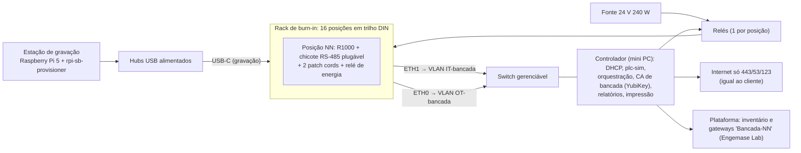
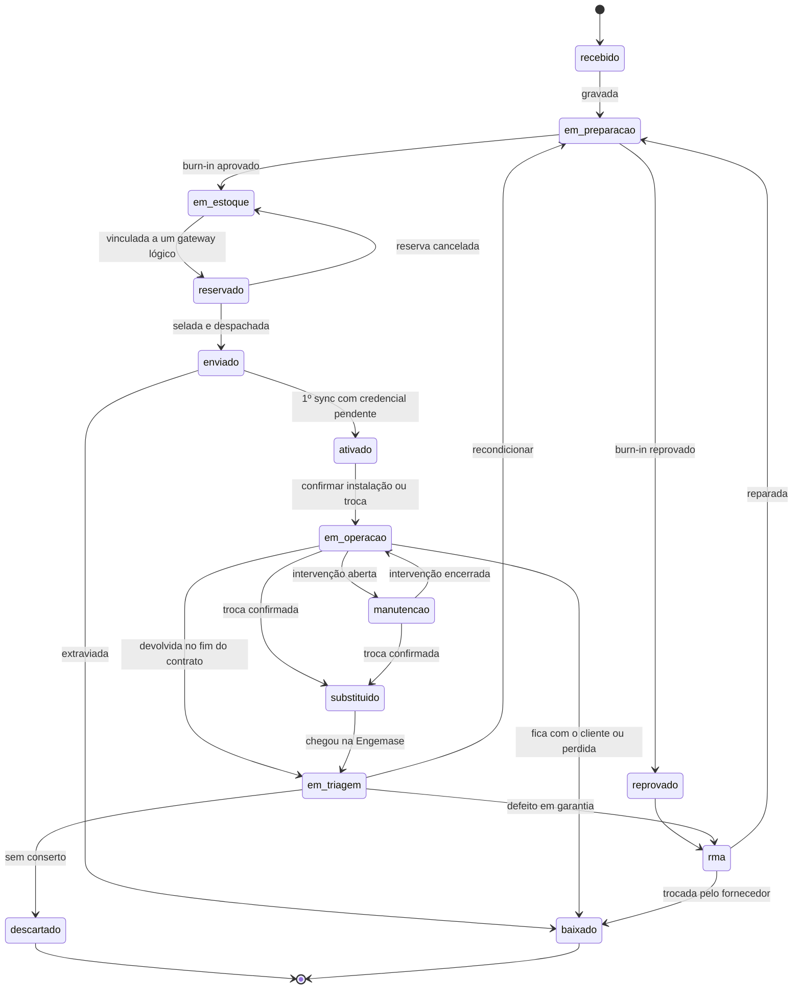

> **Consolidado:** as definições canônicas estão no [`docs/16`](../16-projeto-do-gateway.md); onde este rascunho divergir, vale o docs/16 (ex.: **ETH0 = OT** e **ETH1 = IT**; página local no `oee-localui`, porta 443, só na OT e no endereço de serviço). Implementação em `gateway/` e `deploy/`.

> **Rascunho** gerado pelo projeto do gateway (11/11/2026). Consolidado em `docs/16-projeto-do-gateway.md`.

# Gateway: preparação na Engemase e ciclo de vida (proposta para documentação técnica)

> **Status:** proposta de projeto, 11/11/2026. Faz par com os dois rascunhos em `docs/rascunhos/` (software; rede e instalação) e vai compor o `docs/16-projeto-do-gateway.md`. **"A confirmar"** = não verificado; validar na bancada da Fase 0 ou com o fornecedor.
> **Fontes do R1000:** o `wiki.seeedstudio.com` não abriu nesta sessão porque a rede da sessão não resolve esse domínio. Para conferir o wiki direto, esse domínio precisa ser liberado nas configurações de rede da sessão. Os fatos de hardware abaixo vêm de duas fontes: o repositório oficial `Seeed-Studio/seeed-linux-dtoverlays` (overlay `reComputer-R100x`, lido no commit `1d53c3c`, de 21/10/2026) e trechos do wiki que apareceram nas buscas.

**Princípios**
1. **Uma imagem para todas as unidades.** O que é próprio de cada unidade nasce no 1º boot e fica na partição de dados.
2. **Nenhuma unidade chega ao cliente** sem burn-in aprovado e sem selo.
3. **A unidade física é separada do gateway lógico.** Config, máquinas, rede e histórico pertencem ao gateway lógico (do cliente). O hardware é um ativo da Engemase e pode ser trocado sem perder nada.
4. **Reprodutível e rastreável.** A imagem é gerada por script versionado e tem SBOM. Cada unidade tem um prontuário: testes, versões e eventos.
5. **Atualizar sem visitar.** O agente e as correções de segurança do SO chegam pela internet. Kernel, firmware e driver da Seeed só chegam depois de validados na bancada.
6. **Apagar com prova.** Toda unidade que sai do controle da Engemase passa por apagamento verificável e gera um termo.

---

## 0. Decisões propostas (resumo)

| Tema | Decisão |
|---|---|
| Base do SO | **Debian 13 "Trixie"** com o repositório Raspberry Pi (equivale a um Raspberry Pi OS Lite mínimo), arm64, kernel Raspberry Pi 6.12. **Plano B:** Bookworm (em LTS até 30/06/2028), se o driver da Seeed não funcionar no Trixie na Fase 0 |
| Construção da imagem | **`rpi-image-gen`** (ferramenta oficial da Raspberry Pi), com camadas nossas em `deploy/gateway/image/`, espelho Debian por *snapshot* (build reproduzível) e SBOM |
| Drivers do R1000 | Pacote próprio **`engemase-r1000-support`**: overlay `reComputer-R100x` + módulo `rtc-pcf8563w` **pré-compilado no CI** para o kernel fixado. O script da Seeed **nunca** roda na unidade |
| Partições (MVP) | GPT: `boot` 512 MiB · `root` 4 GiB (ext4, gravável, pouca escrita) · `data` com o resto (~10 GiB, criada no 1º boot): buffer, credencial, identidade e journal. **Raiz imutável (A/B, erofs) só na Fase 3** |
| Gravação | **Unidade a unidade:** chave lateral em "Flash" + `rpiboot -d mass-storage-gadget64` + `bmaptool`. **Em lote:** `rpi-sb-provisioner` no modo `naked`, numa Raspberry Pi 5 |
| Identidade | Nº de série Engemase `EGW-00042`; hostname `egw-00042`; chave Ed25519 da unidade; senha local única; certificado da página local; registro automático no inventário |
| Etiquetas | Etiqueta permanente **sem segredo**, com QR da URL da unidade. A **senha local vai num cartão em envelope lacrado**, não na etiqueta |
| Burn-in | 2 h de estresse + 24 h de operação real contra o `plc-sim`, cobrindo: as 3 RS-485 num barramento de teste, as 2 Ethernet, 30 cortes de energia, RTC e watchdogs. Qualificação de lote a 50 °C |
| Ativação | Credencial **pendente** (só saúde, sem coleta) até alguém **"Confirmar instalação/troca"**. Isso vale para instalação nova e para troca |
| Ciclo de vida | 14 estados da unidade física, separados dos estados do gateway lógico e do status online/offline. Novo papel de plataforma **`producao`** |
| Atualizações | **Agente:** canais `canary`/`beta`/`stable`, ondas de 10/50/100% e pausa automática. **SO:** segurança do Debian automática numa janela noturna. **Kernel, firmware, bootloader e driver da Seeed:** só por "pacote de plataforma" validado |
| Troca | A unidade nova herda tudo do gateway lógico. O token antigo é revogado na confirmação. O buffer antigo é recuperado e reimportado (a ingestão é idempotente) |
| Descarte | Apagamento em 4 níveis (remoto, *Clear*, *Purge*, destruição), termo de eliminação por unidade e recicladora licenciada |

---

## 1. Imagem padrão (golden image)

### 1.1 Base: qual sistema

| Opção | Prós | Contras | Veredito |
|---|---|---|---|
| Imagem de fábrica da Seeed (vem gravada) | Drivers prontos | Usuário padrão conhecido (`recomputer`/`12345678`, segundo o wiki). Pacotes desnecessários, sem controle de versão, Trixie não confirmado | **Nunca em campo.** É apagada no recebimento, sem ligar a unidade na rede |
| Raspberry Pi OS Lite + `sudo ./scripts/reTerminal.sh --device reComputer-R100x` na unidade | Simples | O script compila módulos com DKMS **na unidade** (exige compilador e headers) e pode trocar o kernel. Também liga overlays que não usamos (display DSI 7", câmera IMX708). O resultado muda com a data | Só para PoC na bancada |
| `pi-gen` (gerador do Raspberry Pi OS) | Maduro | Pesado, estágios em shell, difícil de compor | Não |
| **`rpi-image-gen`** (oficial, mar/2025) | Camadas YAML que se combinam. Suporta Trixie e CM4 (camada `rpi-cm4`), espelho por snapshot e SBOM. Tem layout A/B imutável pronto (`image-rota`) e gera artefatos que o `rpi-sb-provisioner` grava | Ferramenta nova, em evolução; nossas camadas precisam de manutenção | **Escolhida** |

**Por que Trixie:**
- O Bookworm saiu do suporte regular em jul/2026 e está no LTS até 30/06/2028. Uma frota que nasce em 2027 não deve começar num sistema em fim de vida.
- O Trixie (Debian 13, ago/2025) tem suporte regular até ~ago/2028 e LTS até ~jun/2030 (**datas a confirmar** no site do Debian).
- O kernel do Raspberry Pi OS Trixie é o 6.12.

**Risco:** não achei imagem Trixie da Seeed para o R1000. O repositório de overlays foi atualizado em out/2026 e trata Bookworm e versões posteriores. **Validar na Fase 0** que overlay e módulo `rtc-pcf8563w` compilam e funcionam no kernel 6.12.

### 1.2 Como montar (reprodutível)

```
deploy/gateway/image/
  config/egw-r1000.yaml      # dispositivo, layout, camadas, versão
  layer/egw-base.yaml        # pacotes, remoções, hardening
  layer/egw-r1000.yaml       # engemase-r1000-support, config.txt, cmdline.txt
  layer/egw-agent.yaml       # .debs: oee-gateway, oee-gateway-updater, oee-netd, engemase-factory
  image/egw-gpt-data/        # layout GPT boot+root (a data nasce no 1º boot)
  files/                     # sysctl, journald, sshd, sudoers, apt, nftables de fábrica, repart.d
  keys/                      # SÓ chaves públicas: OTA (atual e próxima), CA de bancada, CA SSH (F2)
  build.sh                   # rpi-image-gen + bmap + sha256 + manifesto assinado + SBOM
```

Config. A sintaxe segue os exemplos do `rpi-image-gen`. Os nomes exatos de variáveis estão a confirmar com `rpi-image-gen layer --list` na versão fixada:

```yaml
# deploy/gateway/image/config/egw-r1000.yaml
device:
  layer: rpi-cm4
image:
  layer: egw-gpt-data            # layout próprio (seção 1.5)
  name: egw-os-13
  compression: zstd
layer:
  base: debian-trixie-arm64-minbase-snapshot   # snapshot: mesmo conteúdo a cada build
  custom: egw-agent                            # depende de egw-r1000 → egw-base
```

```yaml
# METABEGIN
# X-Env-Layer-Name: egw-base
# X-Env-Layer-Desc: Base Engemase do gateway (pacotes e hardening)
# X-Env-Layer-Version: 1.0.0
# X-Env-Layer-Requires: rpi-debian-trixie,systemd-min,network-manager,chrony
# METAEND
---
mmdebstrap:
  packages: [nftables, unattended-upgrades, needrestart, ca-certificates, sudo, openssh-server,
             mmc-utils, i2c-tools, tpm2-tools, raspi-utils, rpi-eeprom, systemd-repart, curl, less]
  customize-hooks:
    - chroot $1 passwd -l root
    - truncate -s0 $1/etc/machine-id
    - rm -f $1/etc/ssh/ssh_host_*
    - chroot $1 systemctl mask ssh.service ssh.socket serial-getty@ttyAMA0.service rpi-eeprom-update.service
    - chroot $1 systemctl enable fstrim.timer nftables.service
```

```bash
./deploy/gateway/image/build.sh 13.2026.11.1
# ≈ rpi-image-gen build -S deploy/gateway/image -c config/egw-r1000.yaml
#   + bmaptool create + sha256sum + manifest.json assinado (Ed25519) + SBOM + varredura de CVEs
```

- **Onde roda:** o `rpi-image-gen` exige **host arm64 com Debian Bookworm ou Trixie**. Usar um runner self-hosted (Raspberry Pi 5 de 8 GB dedicada ou VM arm64 em nuvem). Tempo estimado: 20–40 min (a medir).
- **Reprodutibilidade:** fixar o commit do `rpi-image-gen` (lido em `fb44a4c`, 05/11/2026), o commit da Seeed e o snapshot do Debian. Mesmo commit + mesmo snapshot = mesmos pacotes.
- **Artefatos guardados para sempre** (a unidade é rastreável até a imagem):
  - `egw-os_13.2026.11.1_arm64_r1000.img.zst`, `.bmap` e `.sha256`;
  - `manifest.json` e `manifest.json.sig`;
  - `sbom.spdx.json` e o relatório de CVEs (grype/trivy).
- **Cadência:** imagem **trimestral**, ou extraordinária em CVE crítico ou lote novo de hardware.
- **Promoção:** canal `canary` (bancada) → `stable`, depois de 2 semanas na bancada HIL e 1 unidade no Engemase Lab.

### 1.3 Pacotes

| Entram | Ficam de fora (nem instalados) |
|---|---|
| systemd; NetworkManager (perfis gerados pelo `oee-netd`); nftables; chrony; unattended-upgrades + needrestart; ca-certificates; sudo; openssh-server (mascarado no MVP); **mmc-utils** (saúde do eMMC); i2c-tools; tpm2-tools (F2); raspi-utils (`vcgencmd get_throttled`); rpi-eeprom (só para ler a versão; a atualização automática fica mascarada); systemd-repart; curl; less | Interface gráfica, avahi, cups, bluez, wpasupplicant/iwd, ModemManager, **rpi-connect**, **cloud-init**, triggerhappy, rsyslog, systemd-timesyncd, **compiladores, dkms e headers**, Python além do mínimo que o unattended-upgrades exige |
| Nossos `.deb`: `oee-gateway`, `oee-gateway-updater`, `oee-netd`, `engemase-r1000-support`, `engemase-factory` (este é removido no selo) | — |

Raiz ocupada: ~1,2–1,8 GB (a medir).

### 1.4 Pacote `engemase-r1000-support` (o que o overlay da Seeed revela)

| Recurso | Fato no overlay `reComputer-R100x` | Consequência |
|---|---|---|
| RTC | **PCF8563W** no I²C 6, endereço 0x51, **com watchdog** de 1–255 s (padrão do overlay: 120 s). Exige o módulo fora da árvore `rtc-pcf8563w` | Sem o módulo, a unidade fica sem RTC e sem esse watchdog. O módulo precisa acompanhar cada kernel |
| TPM | **Infineon SLB9670 (TPM 2.0)** no SPI1 | Base para guardar a chave da unidade no TPM (F2) |
| Expansor PCA9535 (0x21) | LEDs `led-red`, `led-green` e `led-blue` (**três LEDs separados**, ativos em nível baixo). Buzzer (`gpio-beeper`, **pino 13**), reset do TPM, proteção de escrita da EEPROM 0x50 e **`RS485_POWER_EN`** (pino 12, ligado pelo overlay) | Sem o overlay, as **RS-485 ficam sem alimentação**: é a 1ª checagem quando nenhum escravo responde. "Amarelo" = vermelho + verde |
| RS-485 | UART2, UART3 e UART4 com `linux,rs485-enabled-at-boot-time` (rótulos RS485_1/2/3) | Mapeamento para `ttyAMA2/3/5` e para os bornes: **a confirmar** |
| Extras do script | O script liga display DSI 7", câmera IMX708 e parâmetros de PCIe/NVMe | Não levar para a imagem |

O pacote:
- instala só o `reComputer-R100x.dtbo`, compilado no CI a partir do commit fixado;
- instala o `rtc-pcf8563w.ko` compilado no CI para a **versão exata** do kernel da imagem. O pacote depende dessa versão do kernel; por isso kernel e módulo andam juntos no "pacote de plataforma" (seção 6.2);
- grava o `config.txt` e o `cmdline.txt` padrão. Os itens abaixo estão a confirmar na Fase 0, em especial se `dwc2,dr_mode=host` e `enable_uart` são necessários:

```ini
# /boot/firmware/config.txt — Engemase R1000
arm_64bit=1
enable_uart=1
dtparam=i2c_arm=on
dtparam=spi=on
dtparam=watchdog=on
dtparam=audio=off
camera_auto_detect=0
display_auto_detect=0
dtoverlay=dwc2,dr_mode=host
dtoverlay=disable-wifi
dtoverlay=disable-bt
dtoverlay=reComputer-R100x
```
```
console=tty1 root=PARTUUID=<gerado no build> rootfstype=ext4 rootwait fsck.repair=yes panic=10 quiet
```
`panic=10` faz o kernel reiniciar 10 s após uma pane, sem depender só do watchdog.

### 1.5 Partições e sistema de arquivos

**Layout "A" (MVP)**, GPT, eMMC de 16 GB (≈ 14,6 GiB úteis):

| # | Rótulo | Tamanho | FS e opções | Montagem | Conteúdo |
|---|---|---|---|---|---|
| 1 | `boot` | 512 MiB | FAT32 | `/boot/firmware` | Firmware, kernel, dtbo, `config.txt` |
| 2 | `root` | 4 GiB | ext4 `noatime` | `/` | SO e pacotes; só muda em atualização |
| 3 | `data` | Resto (~10 GiB) | ext4 `noatime,nodev,nosuid,noexec` | `/data` | `oee/` (bind em `/var/lib/oee-gateway`: buffer, credencial, config, rede, update), `identity/`, `journal/` (bind em `/var/log/journal`) |

Por que assim:
- **A partição `data` não vai na imagem.** O `systemd-repart` a cria no 1º boot (`/usr/lib/repart.d/50-oee-data.conf` com `Format=ext4` e `Label=data`); o plano B é um script com `sfdisk --append` + `mkfs.ext4`. A imagem fica com ~4,6 GB brutos e ~1,5 GB de dados reais, o que acelera a gravação.
- **Raiz e dados separados.** A raiz quase não recebe escrita, o que prepara o terreno para a raiz somente leitura. Um reflash ou uma raiz corrompida não tocam no buffer nem na identidade. E o buffer não consegue encher a raiz.
- **Outros ajustes:**
  - `/tmp` em tmpfs (padrão do Debian 13; conferir na imagem);
  - sem swap (zram só se a medição pedir);
  - `fstrim.timer` semanal, que ajuda o nivelamento de desgaste do eMMC.

**Por que não usar raiz somente leitura com overlay (raspi-config/overlayroot) no MVP:**
- Com o overlay, tudo que é gravado na raiz vai para a RAM e some no reboot. Isso inclui o `apt` de segurança e o `.deb` do OTA, que "desapareceriam" no boot seguinte.
- Há relatos de `overlayroot` quebrado no Trixie.

**Layout "B" imutável (Fase 3).** Gatilho: frota acima de ~150 unidades, ou cliente que exija controle de mudança por imagem. Usa o `image-rota` do `rpi-image-gen`:
- GPT com `boot` A/B, `system` A/B em **erofs somente leitura** e `data` persistente;
- proteção de escrita da tabela de partições no eMMC (`ptable_protect`);
- o SO é atualizado por imagem inteira, gravada no slot inativo, com `tryboot` e volta automática;
- **muda o desenho do OTA:** o agente passa a viver na imagem ou em `/data`. Por isso fica fora do MVP.

**Não recomendado agora:** modo pSLC do eMMC ("enhanced area"). É irreversível e corta a capacidade pela metade; só vale se o desgaste medido justificar.

### 1.6 Hardening da imagem

| Item | Configuração |
|---|---|
| Usuários | Sem `pi` nem `recomputer`; `root` bloqueado. `tecnico`: login só no console HDMI/teclado, senha = senha local da unidade, `sudo` limitado a `oee-gateway status\|diag\|net *\|enroll *`. `suporte` (F2): sem senha, só SSH com certificado ([12](12-acesso-remoto-vpn.md)). `oee` e `oee-ra` vêm do sysusers do pacote |
| SSH | **MVP:** `ssh.service` e `ssh.socket` mascarados fora do modo fábrica. **F2:** `ListenAddress 127.0.0.1`, `PasswordAuthentication no`, `KbdInteractiveAuthentication no`, `PermitRootLogin no`, `AllowUsers suporte`, `TrustedUserCAKeys /etc/ssh/engemase-user-ca.pub`; chaves de host assinadas pela CA de host da Engemase (sem "confiar no primeiro acesso") |
| sudo | `Defaults use_pty, log_output, iolog_dir=/data/journal/sudo-io` (I/O log pedido no [12](12-acesso-remoto-vpn.md)) e `timestamp_timeout=5` |
| Segredos | Imagem sem segredos: `/etc/machine-id` vazio e sem chaves de host SSH (geradas no 1º boot). Só chaves **públicas** |
| Rede | Perfis NM e nftables "de fábrica" do rascunho de rede: IT em DHCP, OT só com o endereço de serviço, política *drop*, `ip_forward=0` |
| sysctl (além do rascunho de rede) | `kernel.dmesg_restrict=1`, `kernel.kptr_restrict=2`, `kernel.unprivileged_bpf_disabled=1`, `net.core.bpf_jit_harden=2`, `fs.protected_fifos=2`, `fs.protected_regular=2`, `fs.suid_dumpable=0`, `kernel.sysrq=0` (1 só no modo fábrica), `kernel.panic=10`, `kernel.panic_on_oops=1` |
| Serviços | Lista do rascunho de rede §2.4, mais `serial-getty@ttyAMA0` (sem login pela serial de depuração) e `rpi-eeprom-update` (o bootloader só muda pela Engemase) |
| Atualização automática | `unattended-upgrades` só com a origem de segurança do Debian (seção 6.2) |
| Relógio | chrony (config gerada pelo `oee-netd`), sistema em UTC, `rtcsync` (convivência com o RTC da Seeed a confirmar) |
| Logs | journald com os limites do rascunho de software (§6.1), gravando em `/data/journal` |
| Pendrive | Montagem `noexec,nosuid,nodev` e só nomes fixos (rascunho de rede §1.4.4) |
| Integridade | `dpkg --verify` semanal pelo agente (F2). Arquivo de pacote alterado gera alerta de integridade na frota |
| Bootloader | EEPROM do CM4 com versão e configuração fixadas pela Engemase (`BOOT_ORDER` com o eMMC primeiro) |
| Secure boot e criptografia de disco | **Fora do MVP.** A chave gravada no OTP é irreversível, e o kernel passaria a viver num `boot.img` assinado, o que conflita com atualizar o kernel pelo `apt`. Reavaliar com o layout B (F3); o `rpi-sb-provisioner` já faz `secure-boot` e `fde-only` no CM4 |
| Aceite | `systemd-analyze security oee-gateway` ≤ 2,0; `ss -tulpn` e `nmap` no burn-in (B8) |

### 1.7 Modo fábrica e selo

A imagem nasce em **modo fábrica**:
- pacote `engemase-factory` instalado: `stress-ng`, `memtester`, `fio`, `iperf3`, escravo Modbus RTU de teste e o subcomando `oee-gateway factory`;
- SSH ligado **só na ETH1 (IT)**, aceitando só certificados da **CA de bancada**. A chave privada fica num YubiKey no controlador da bancada; os certificados valem 8 h, com o principal `bancada`;
- `kernel.sysrq=1`, para o teste do watchdog.

O **selo** (`oee-gateway factory seal`) é feito na reserva para o cliente (seção 5.4). Ele:
- remove o `engemase-factory`, a configuração de SSH de bancada e a CA de bancada;
- mascara o SSH e volta o `sysrq` para 0;
- apaga buffer, logs e registros da bancada;
- grava `/data/identity/sealed.json` (data, versão da imagem, operador).

A plataforma recusa ativar uma unidade que reporte `sealed=false`. Uma unidade não selada sincronizando fora da Engemase gera **alerta crítico**.

### 1.8 Versões

| Componente | Formato | Exemplo | Onde aparece |
|---|---|---|---|
| Imagem | `<debian>.<ano>.<mês>.<n>` | `13.2026.11.1` | `/etc/engemase-release`, `/sync agent.os.image` |
| Agente | semver, tag `gateway-v*` | `1.2.0` | `oee-gateway version`, `/sync` |
| Pacote de plataforma (kernel, firmware, driver da Seeed) | `<kernel>-egw<n>` | `6.12.x-egw1` | `/sync agent.os.platform` |
| Bootloader (EEPROM) | Data do build | a fixar | Inventário |

```ini
# /etc/engemase-release
EGW_IMAGE_VERSION=13.2026.11.1
EGW_IMAGE_COMMIT=4f2a9c1
EGW_DEBIAN_SNAPSHOT=20261101T000000Z
EGW_RPI_IMAGE_GEN=fb44a4c
EGW_SEEED_OVERLAYS=1d53c3c
EGW_PLATFORM=6.12.x-egw1
EGW_AGENT_AT_BUILD=1.2.0
```

O manifesto do agente traz `min_image_version`. O updater recusa um agente que exija imagem mais nova, e a unidade entra na lista "atualizar imagem".

---

## 2. Gravação do eMMC do CM4 no R1000

### 2.1 Modo de gravação
- **Chave lateral de boot:**
  - **Normal** = boot pelo eMMC (nRPI-BOOT baixo);
  - **Flash** = boot pela USB (nRPI-BOOT alto).
- Segundo o wiki da Seeed, liga-se o **cabo USB-C de dados** ao PC **e também** a alimentação do equipamento.
- **Recebimento:** não ligar a unidade na rede com a imagem da Seeed. Ela vai direto para a gravação.
- **A confirmar:** se a chave lateral fica acessível com a unidade no trilho DIN (afeta o projeto da posição de bancada).

### 2.2 Unidade a unidade (piloto)

```bash
# Estação Linux, uma vez (rpiboot do Raspberry Pi OS ou compilado de github.com/raspberrypi/usbboot)
sudo apt install rpiboot bmap-tools
```
```bash
# Por unidade: chave em "Flash", USB-C ligado na estação, depois os 24 V
sudo rpiboot -d mass-storage-gadget64      # expõe o eMMC como disco USB
lsblk -o NAME,SIZE,MODEL                    # eMMC ≈ 14,6 GiB, ex.: /dev/sdb
sudo bmaptool copy egw-os_13.2026.11.1_arm64_r1000.img.zst /dev/sdb
sudo eject /dev/sdb
# Chave em "Normal", desligar e religar os 24 V
```

- O `bmaptool` grava só os blocos usados e confere o hash de cada faixa.
- O caminho do diretório `mass-storage-gadget64` depende de como o `rpiboot` foi instalado (a confirmar).
- Usar o `mass-storage-gadget64`, não o gadget antigo: segundo o próprio usbboot, o antigo grava bem mais devagar.

### 2.3 Em lote: `rpi-sb-provisioner` no modo `naked`

**O que é:** ferramenta oficial que transforma uma **Raspberry Pi 5** em estação de gravação (`sudo apt install rpi-sb-provisioner`).
- Ao detectar um dispositivo em modo RPIBOOT na USB, grava a imagem sozinha.
- Interface web na porta 3142 (local; HTTPS em 3143).
- **Suporta CM4.**
- Modos: `secure-boot`, `fde-only` e `naked` (só o SO).

**Banco de fabricação (SQLite).** Registra por unidade: número de série, placa, revisão, memória, **MACs**, tamanho e **CID do eMMC**, versão do bootloader, **SHA-256 da imagem** e data. Exporta CSV e tem API.

**Hooks:**
- `post-flash` recebe esses dados (`TARGET_DEVICE_SERIAL`, `ETH_MAC`, `OS_IMAGE_SHA256`...). O nosso hook chama a API de inventário e cria a unidade em `em_preparacao` (seção 3.3).
- `provision-failed` recebe o motivo (`board-absent`, `timed-out`...) e sinaliza na bancada.

**Configuração** (`/etc/rpi-sb-provisioner/config`; nomes conforme `docs/config_vars.md`, valores a confirmar):
- `PROVISIONING_STYLE=naked`
- `RPI_DEVICE_FAMILY=4`
- `RPI_DEVICE_STORAGE_TYPE=emmc`
- `GOLD_MASTER_OS_FILE=/srv/egw/egw-os_13.2026.11.1_arm64_r1000.img`
- `RPI_DEVICE_BOOTLOADER_CONFIG_FILE` com a configuração padrão Engemase

**Cuidados:**
- O guia descreve o CM4 na IO Board com jumper. No R1000, a chave lateral faz o papel do jumper. **Compatibilidade com a placa do R1000: a confirmar no 1º lote.**
- Usar hubs USB alimentados oficiais e gravar em grupos de 4 por hub, porque a USB 2.0 do CM4 limita a vazão.
- **Plano B:** um script udev na estação que roda `rpiboot -d mass-storage-gadget64` + `bmaptool` por porta USB, com o mesmo hook de inventário.

### 2.4 Verificação

1. **Na gravação:** o `bmaptool` confere o hash de cada faixa gravada; o provisioner registra o SHA-256 da imagem.
2. **No 1º boot** (`oee-factory-init`):
   - `fsck` da raiz (`fsck.repair=yes`);
   - `dpkg --verify` de todos os pacotes: arquivo alterado reprova a gravação e a unidade é regravada;
   - `/etc/engemase-release` conferido contra o manifesto.
3. **Coerência do hardware** (B0 do burn-in):
   - RAM e eMMC esperados;
   - **sem rádio** (`/sys/class/ieee80211/` e `/sys/class/bluetooth/` vazios), o que confirma a série `-00`;
   - TPM responde (`tpm2_getrandom 8`);
   - I²C com 0x21 (PCA9535) e 0x51 (RTC). Isso indica a placa v1.1, mas **como identificar a revisão por software está a confirmar com a Seeed**. Não gravar na EEPROM 0x50: pode guardar dados de fábrica;
   - eMMC com `pre_eol_info=0x01` e `life_time` 0x01/0x01.

### 2.5 Tempos

| Etapa | Mão de obra | Máquina |
|---|---|---|
| Chave em Flash, USB-C e 24 V | 1–2 min | — |
| Gravação (~1,5 GB reais) | — | **3–6 min** (estimativa; o provisioner cita ~3 min para uma imagem de 2,6 GB, sem dizer a placa: **medir no CM4**) |
| Chave em Normal e religar | 0,5 min | — |
| 1º boot, criação da `data`, init de fábrica | — | 3–5 min |

Em lote: 4 unidades por hub em paralelo, ~10–15 min por grupo (a medir). O gargalo é o burn-in de 24 h, não a gravação.

---

## 3. Identidade de cada unidade

### 3.1 Identificadores

| Campo | Exemplo | Origem | Uso |
|---|---|---|---|
| **Nº de série Engemase** | `EGW-00042` | Plataforma; sequencial, nunca reaproveitado | Etiqueta, inventário, suporte |
| Hostname | `egw-00042` | Derivado do nº de série | DHCP, logs |
| Nome lógico (do cliente) | `GW-SERRAAZUL-01` | Gateway lógico | Etiqueta do cliente, telas |
| Serial do CM4 | `10000000a1b2c3d4` | `/sys/firmware/devicetree/base/serial-number` | Anticlonagem, RMA |
| CID do eMMC | 32 hex | `/sys/block/mmcblk0/device/cid` | Anticlonagem, termo de eliminação |
| MACs ETH0 e ETH1 | `d8:3a:dd:…` | Interfaces | Etiqueta, reserva DHCP do TI, perfis NM |
| Modelo e revisão | R10xx-00, 2 GB/16 GB, placa v1.1 | Fatos + nota de compra | Lote, garantia |
| Lote de compra | `LOTE-2026-03` | Recebimento | Garantia, qualificação |
| Endereço de serviço OT | `169.254.127.58` | Derivado do MAC da ETH0 (rascunho de rede) | Etiqueta |

### 3.2 Segredos e chaves

| Item | Gerado em | Guardado na unidade | Na plataforma | Rotação |
|---|---|---|---|---|
| Chave de identidade **Ed25519** | 1º boot (`factory init`) | `/data/identity/device.key` (0600, `oee`). **F2: dentro do TPM, não exportável** | Chave pública | Recondicionamento; F2 migra para o TPM |
| **Senha local**: 16 caracteres base32 Crockford (80 bits), ex.: `K7QM-4XTD-9WRB-2HNP` | 1º boot | Hash argon2id (página local) e yescrypt (`tecnico` em `/etc/shadow`) | Cifrada (AES-256-GCM com chave no KMS, o mesmo da CA SSH); exibição auditada | Pela plataforma (comando `localui.passwd`, F2) e no recondicionamento |
| Certificado da página local (ECDSA P-256, 10 anos, SAN = hostname + endereço de serviço) | Depois de receber o nº de série | `/data/oee/localui/` | Impressão digital (web e cartão) | Recondicionamento |
| Chaves de host SSH | 1º boot | `/etc/ssh/` | Impressão digital; F2: certificado de host assinado pela CA | Recondicionamento |
| `machine-id` | 1º boot | `/etc/machine-id` | — | Recondicionamento |
| Token do gateway | Enroll | `/data/oee/credentials.json` (0600) | Só o hash SHA-256 | `token.rotate`, troca, revogação |
| Chaves públicas confiáveis (OTA atual e próxima, CA de bancada, CA SSH) | Imagem | `/usr/share/oee-gateway/keys/` | Privadas: CI (OTA), YubiKey da bancada, KMS (CA SSH) | Por release |

### 3.3 Fluxo de registro no inventário

```mermaid
sequenceDiagram
  autonumber
  actor O as Operador
  participant G as Estação de gravação (Pi 5)
  participant U as Unidade
  participant C as Controlador da bancada
  participant P as Plataforma (inventário)
  participant I as Impressora
  O->>U: chave em Flash, USB-C e 24 V
  G->>U: grava a imagem (naked)
  G->>P: hook post-flash: unidade em_preparacao (serial do CM4, MACs, CID, SHA da imagem)
  P-->>G: nº de série EGW-00042
  O->>U: chave em Normal; unidade vai para a posição de burn-in
  U->>U: 1º boot: cria a /data, machine-id, chaves de host, chave Ed25519, senha local
  C->>U: SSH com certificado de bancada: oee-gateway factory facts
  C->>P: confere os fatos com o lote; grava chave pública, impressões digitais e senha (cifrada)
  C->>U: oee-gateway factory set-identity EGW-00042 (hostname, certificado TLS)
  C->>I: etiqueta permanente + cartão de credencial
  C->>U: inicia o burn-in (seção 4)
  C->>P: relatório; aprovado → em_estoque
```

- Com gravação manual (sem o provisioner), o controlador cria a unidade no primeiro contato.
- A senha local em texto claro passa uma vez pelo controlador, que **nunca a registra em log**.

**API de inventário** (usuário de serviço "estação de bancada", escopo `inventory:write`, IP da Engemase em lista de permissão):
- `POST /api/admin/v1/inventory/units` — cria a unidade e devolve o nº de série;
- `PATCH /api/admin/v1/inventory/units/{serial}` — fatos e impressões digitais;
- `PUT /api/admin/v1/inventory/units/{serial}/credential` — senha local; **só escrita**;
- `POST /api/admin/v1/inventory/units/{serial}/test-runs` — relatório do burn-in;
- `POST /api/admin/v1/inventory/units/{serial}/transition` — `{to, reason, refs}`.

### 3.4 Etiquetas

**Etiqueta 1, permanente**: poliéster com transferência térmica, ~60 × 40 mm, na frente da unidade.
```
ENGEMASE OEE GATEWAY                 EGW-00042
R10xx-00 · 2 GB/16 GB · placa v1.1 · fab. 2026-11
ETH0 (OT) d8:3a:dd:xx:xx:01   ETH1 (IT) xx:xx:xx:xx:xx:02
Serviço OT: 169.254.127.58
[QR] https://oee.engemase.com.br/g/EGW-00042
Suporte: (xx) xxxx-xxxx
```
- O QR **não carrega segredo**.
- A URL exige login. Quem tem acesso ao gateway lógico vê a página dele; papel de plataforma vê a ficha da unidade; quem não tem acesso recebe 404, conforme o isolamento do [15](15-multi-cliente-e-acesso.md).

**Etiqueta 2, da caixa**: nº de série + QR, para leitura no recebimento e na expedição.

**Etiqueta 3, do cliente**: impressa na reserva, com nome lógico, hostname, OT/IT, bornes e cabos (rascunho de rede §4.9).

**Cartão de credencial**, em envelope de segurança lacrado, enviado junto com a unidade:
- nº de série;
- senha local inicial (texto + QR só com a senha);
- impressão digital do certificado da página local (`SHA256:ab12…`);
- endereço de serviço.

### 3.5 Senha local: política

- **Recomendação: a senha não vai impressa na unidade.** Quem abre o painel teria acesso ao console e à página local. O cartão lacrado + a plataforma (exibição auditada) atendem o técnico sem deixar a senha à vista.
- **Se o dono do produto quiser a senha na etiqueta:** usar etiqueta **destacável**, retirada na instalação, e **forçar a troca** em "Confirmar instalação".
- **Quem vê a senha na plataforma:** `super_admin`; `field_engineer` atribuído; `support` com concessão ativa; `client_admin` e `engineer` do cliente. Toda exibição vai para a auditoria.
- **Trocar a senha quando:** sair alguém que a conhecia, houver visita de terceiros, no recondicionamento ou a pedido.

### 3.6 Enroll e credencial pendente

**MVP: enroll em bancada com código de ativação** (já previsto no rascunho de rede).
- A credencial nasce **pendente**. Com ela, o `/sync` só envia saúde: a config vem com `collection: "paused"`, sem polling.
- Ela vira **ativa** quando alguém clica **"Confirmar instalação"** (ou "Confirmar troca"). Podem confirmar: `field_engineer`, `support` com concessão ou `engineer` do cliente não gerenciado.
- Isso evita gerar `NO_COMM` das máquinas do cliente enquanto a unidade está na bancada ou em trânsito.
- Na troca, isso mantém a unidade antiga coletando até o momento da troca física (seção 7).

**F2: enroll por identidade de fábrica ("liga e funciona").**
- A unidade sai do estoque já selada.
- No 1º contato, faz `POST /api/gateway/v1/enroll/challenge` (devolve um nonce) e depois `POST /api/gateway/v1/enroll` com `{mode:"device", unit_serial, nonce, signature}`.
- A plataforma entrega uma credencial pendente se a unidade estiver `reservado` ou `enviado` para um gateway lógico.
- O código de ativação continua para hardware não preparado pela Engemase (perfil `generic`).

**Anticlonagem:**
- O `/sync` leva `hw{unit_serial, cm4_serial, emmc_cid, mac_eth0, mac_eth1, board_rev, sealed}` no boot e uma vez por dia.
- Divergência com a unidade vinculada → **alerta crítico** e credencial suspensa (configurável).
- No MVP, copiar o eMMC copia a chave. Com a chave no TPM (F2), não copia mais. O certificado EK da Infineon pode ainda atestar a unidade (a confirmar).

---

## 4. Teste de aceite em bancada (burn-in)

### 4.1 Bancada



**Endereçamento:**
- VLAN IT-bancada `10.77.1.0/24`, com DHCP do controlador;
- VLAN OT-bancada `192.168.77.0/24`: `plc-sim` em `.10` e unidade da posição N em `.100+N` (perfil de rede de bancada);
- o controlador liga as posições **uma a uma pelo relé** e associa a posição ao MAC que aparece no DHCP.

**Chicote RS-485 por posição:**
- as **3 portas no mesmo barramento curto**: A–A, B–B, `GND_ISO`, com 120 Ω nas duas pontas;
- a ferramenta de fábrica alterna quem é mestre (só um por vez) e cada porta é testada como mestre e como escravo;
- não precisa de adaptador externo por posição.

### 4.2 Roteiro e critérios (por unidade)

| # | Etapa | Duração | O que roda | Critério de aprovação |
|---|---|---|---|---|
| B0 | Identificação | 5 min | `factory facts`; registro na plataforma | Igual ao lote: série `-00` (sem Wi-Fi e sem BT), 2 GB, 16 GB, TPM responde, 0x21 e 0x51 no I²C, eMMC `pre_eol=0x01` e `life_time` 0x01/0x01; `dpkg --verify` limpo |
| B1 | Estresse | 2 h | `memtester 1024M 1` (~30–45 min), depois `stress-ng --cpu 4 --vm 1 --vm-bytes 512M --verify` até fechar 2 h. `fio` de 512 MB com verificação na `data` | Zero erros. SoC < 80 °C a ~25 °C ambiente. `vcgencmd get_throttled` = `0x0` (sem subtensão nem *throttling*). `journalctl -k -p err` sem erros fora da lista conhecida |
| B2 | RS-485 | 15 min (e contínuo no B4) | 6 combinações mestre→escravo × 9600 8E1, 19200 8E1 e 115200 8N1; 10.000 transações FC03 por combinação e velocidade | **0 erros de CRC e 0 timeouts** (exceto o 1º quadro); p95 < 30 ms a 19200 |
| B3 | Ethernet | 10 min | Link negociado; `iperf3` por 60 s em cada sentido; contadores de `ip -s link`; queda e volta de link (porta do switch desligada pela API); reboot | ETH0 em 1000/full com ≥ 900 Mb/s; ETH1 em 100/full com ≥ 90 Mb/s; 0 erros de RX/CRC; link detectado em < 5 s; **MAC da ETH1 igual depois do reboot** |
| B4 | Operação real | **24 h** | Agente registrado no gateway lógico "Bancada-NN" (Engemase Lab). 20 máquinas no `plc-sim` TCP (OT) + 3 escravos RTU no chicote. 1 h sem internet (nftables no controlador) | **Conservação de peças 100%** contra o gabarito do `plc-sim`; estados ± 1 s; zero `data_loss`; fila drenada em < 10 min após a volta; RSS do agente < +10%; 0 reinícios do agente |
| B5 | Energia | Nas últimas 4 h do B4 | 30 cortes secos pelo relé (5–300 s ligado, 2–30 s desligado) | 30/30 voltam sozinhos; `quick_check` OK; conservação 100%; zero duplicatas; 1º `/sync` em < 120 s |
| B5b | SuperCAP (se houver) | +30 min | Quedas com retorno em 1 s, 10 s e 60 s, e **durante o desligamento** (T-PWR-3) | Evento `power_loss`; sempre volta sozinho; autonomia ≥ referência do lote − 20% |
| B6 | Relógio e watchdogs | 15 min | RTC: acertar, desligar 10 min, religar sem rede. Watchdog do agente (`SIGSTOP`). Watchdog do SoC (`echo c > /proc/sysrq-trigger`). Watchdog do RTC (armar 30 s e não alimentar) | Deriva < 2 s; reinício em ≤ 35 s (agente), ≤ 20 s (kernel) e ≤ 40 s (RTC) |
| B7 | Interface | 2 min | LEDs R, G, B e amarelo; buzzer; pendrive `OEE/diag` | Operador confirma no app da bancada; arquivo de diagnóstico gerado |
| B8 | Superfície de ataque | 2 min | `ss -tulpn`; `nmap` do controlador nas duas interfaces com o perfil de produção; `systemd-analyze security` | Só as portas previstas; nota ≤ 2,0 |
| E | Entrada no estoque | 3 min | Desregistra do "Bancada-NN"; apaga buffer, logs e rede de bancada; volta à rede de fábrica; **continua em modo fábrica**; desliga | Status "não registrado"; relatório enviado; unidade em `em_estoque` |

**Total por unidade:** ~27 h de máquina e ~10 min de mão de obra nesta etapa. A temperatura por unidade é medida no B1 (ambiente + carga). A temperatura extrema fica na qualificação de lote (4.3).

### 4.3 Qualificação de lote

**Amostra:** no 1º lote, 3 unidades; depois, 1 a cada 20 (mínimo 1 por lote).

| Teste | Critério |
|---|---|
| 72 h a **50 °C ambiente** (estufa), carga típica (20 máquinas, 3 barramentos) | Sem *throttling*; SoC < 80 °C; critérios do B4 |
| **500 cortes de energia** (F4 do rascunho de software) | 500/500 voltam sozinhos; conservação 100% |
| SuperCAP: autonomia e retorno durante o desligamento | Sempre volta; fixa a autonomia de referência do lote |
| CLPs reais na bancada HIL (Delta ou Schneider + I/O remoto) | Igual ao B4 |
| Consumo em 24 V (mínimo, típico, máximo) | Típico ≤ 5,5 W (ficha) |
| Foto da placa e lista de componentes, se a revisão mudar | Igual ao lote qualificado |

A faixa de temperatura declarada pela Seeed (−30 a 70 °C numa subsérie) está **a confirmar para a série -00**.

### 4.4 Reprovação
- **Falha no B2 ou no B3:** trocar o chicote ou o cabo e repetir **uma vez**.
- **Reprova direto** (unidade em `reprovado` → RMA por DOA): falha repetida, ou falha em B0 (modelo, revisão, rádio), B1 (memória, eMMC), B5 (não volta) ou B6 (RTC, watchdog).
- Prazo de DOA da Seeed: a confirmar.

### 4.5 Relatório
- O controlador gera JSON + PDF com:
  - versões e fatos da unidade;
  - resultado e métricas de cada etapa;
  - temperaturas máximas;
  - operador e estação.
- Vai para `gateway_unit_test_run` no Blob, guardado por ≥ 5 anos (garantia e auditoria).

---

## 5. Estados do ciclo de vida

### 5.1 Três coisas diferentes
1. **Estado da unidade física** (ativo da Engemase): abaixo.
2. **Estado do gateway lógico** (do cliente): `rascunho → aguardando_instalacao → ativo ⇄ em_manutencao → desativado`.
3. **Status operacional** (calculado da saúde): `online`, `degradado`, `offline`. Não é estado de ciclo de vida.

### 5.2 Diagrama da unidade física



### 5.3 Tabela de estados

| Estado | Significado | Entra por | Quem muda | Exige |
|---|---|---|---|---|
| `recebido` | Chegou do fornecedor, ainda com a imagem da Seeed | Registro do lote | `producao` | NF ou DI, lote, foto da etiqueta Seeed |
| `em_preparacao` | Gravada e em teste | Hook do provisioner ou 1º contato com o controlador | Sistema | Fatos coerentes com o lote |
| `reprovado` | Falhou duas vezes no burn-in, ou fatos errados (ex.: tem rádio) | Controlador | `producao` confirma | Relatório |
| `em_estoque` | Aprovada, em modo fábrica, desligada no armário | Burn-in aprovado | Sistema, com conferência do `producao` | Relatório B0–B8 |
| `reservado` | Destinada a um gateway lógico (instalação nova ou troca) | Pedido de reserva | Pedem: `field_engineer` atribuído, `support` com concessão ou `super_admin`. Executa: `producao` | Cliente, gateway lógico, motivo, previsão de envio |
| `enviado` | Selada, com credencial pendente, despachada | Expedição | `producao` | Selo OK, enroll OK, NF de remessa, rastreio |
| `ativado` | Falou com a nuvem a partir do cliente | 1º `/sync` depois de `enviado` | Sistema | — |
| `em_operacao` | Coletando em produção | "Confirmar instalação/troca" | `field_engineer`, `support` com concessão, `engineer` do cliente (se não gerenciado) | Credencial ativa. SAT T1–T10 e termo de aceite anexados em até 7 dias (lembrete) |
| `manutencao` | Intervenção remota ou local em andamento | Abertura | `support` com concessão, `field_engineer`, `engineer` do cliente | Motivo, chamado, prazo (padrão 8 h, renovável). Suprime alertas do cliente desse gateway; `NO_COMM` marcado como `gateway_maintenance` |
| `substituido` | Saiu de operação por troca e aguarda retorno | Troca confirmada | Sistema | Unidade substituta ativa |
| `em_triagem` | Na Engemase, aguardando diagnóstico e apagamento | Recebimento da devolução | `producao` | Recuperar o buffer (se pedido) **antes** de apagar |
| `rma` | Com o fornecedor | Envio para garantia | `producao` | Nº de RMA; *Purge* ou destruição do eMMC antes de enviar |
| `descartado` | Destinada à reciclagem | Fim | `producao`, com aprovação do `super_admin` | Termo de eliminação + certificado de destinação |
| `baixado` | Saiu da frota sem passar pela Engemase (extraviada, roubada, ficou com o cliente, trocada pelo fornecedor) | Registro | `super_admin` | Credencial revogada; apagamento remoto se possível; B.O. em caso de roubo |

Toda transição grava `gateway_unit_event` (append-only) e entra no `audit_log`. O cliente vê do seu gateway lógico: nº de série, modelo, data de fabricação, garantia, versões e histórico de trocas. Ele não muda estados da unidade, mas pode **pedir troca ou manutenção**.

### 5.4 Reserva e expedição (R1–R6)

1. **R1.** Ligar a unidade na bancada (modo fábrica).
2. **R2.** Atualizar o agente para o `stable` atual e o pacote de plataforma. Se a imagem estiver mais de 1 release trimestral atrás ou em outra versão do Debian, **regravar**; o controlador guarda e restaura `/data/identity`.
3. **R3.** Teste de fumaça de 1 h no "Bancada-NN": sync, `plc-sim`, 1 corte de energia.
4. **R4.** Desregistrar da bancada. Aplicar o `network.json` do gateway lógico (vindo da ficha de TI). Fazer o enroll no gateway lógico do cliente → credencial **pendente**, config com `collection: paused`. Conferir sync e download da config.
5. **R5.** Selar (`factory seal`).
6. **R6.** Etiqueta do cliente, cartão lacrado, embalagem, NF, transportadora → `enviado`.

**F2 (enroll por identidade):** R4 e R5 passam para a entrada no estoque, e a reserva fica só em R1, R2 e R6.

### 5.5 Modelo de dados (acréscimos ao [06](06-banco-de-dados.md))

| Tabela | Conteúdo |
|---|---|
| `gateway_unit` (plataforma, sem `organization_id`) | Nº de série, modelo, revisão, serial do CM4, CID do eMMC, MACs, RAM/eMMC, lote, propriedade (`engemase`/`cliente`/`comodato`), estado, chave pública, impressões digitais, senha local cifrada, versões (imagem, plataforma, bootloader, agente), garantia até, última leitura do eMMC, observações |
| `gateway_unit_event` | Unidade, de → para, ator, motivo, chamado, anexos, data (append-only) |
| `gateway_unit_test_run` | Unidade, tipo (burn-in, smoke, qualificação, triagem), estação, operador, versões, resultado, métricas, URL do relatório |
| `gateway_unit_binding` | Gateway lógico × unidade, `organization_id`, início/fim, motivo (instalação, troca, devolução) |
| `gateway_credential` | Gateway lógico, unidade, `organization_id`, `token_hash`, status (`pending`/`active`/`suspended`/`revoked`), datas, motivo da revogação. **Substitui `gateway.token_hash`** |
| `inventory_lot` | Fornecedor, pedido, NF/DI, data, quantidade, revisão declarada, garantia, resultado da qualificação |
| `os_image_release`, `platform_release`, `agent_release` | Versão, canal, SHA-256, URL, notas, compatibilidade |
| `rollout` | Release, canal, onda, percentual, status, pausado por, critérios |

`gateway` (lógico) ganha `current_unit_id` e perde a "info de hardware" (vai para `gateway_unit`).

### 5.6 Papel novo: `producao` (plataforma)

- **Pode:** recebimento, preparação, estoque, reserva (execução), expedição, triagem, RMA e descarte (com aprovação do `super_admin`).
- **Vê** do cliente só o nome do gateway lógico e o endereço de entrega.
- **Não vê** dados de produção.
- **2FA obrigatório**, como o resto da equipe Engemase.

---

## 6. Operação contínua

### 6.1 Atualização do agente (OTA, conforme o rascunho de software §2.6)

| Canal / onda | Quem | Permanência mínima | Promove quando |
|---|---|---|---|
| `canary` | Bancada HIL + gateways do Engemase Lab | 48 h | Testes F1–F20 verdes, sem rollback |
| `beta` | Gateways marcados (clientes que aceitaram), ~5% | 7 dias | Nenhum critério de pausa disparado |
| `stable` onda 1 | 10% (mín. 3, máx. 20; no máximo 1 por cliente) | 24 h | Idem |
| `stable` onda 2 | 50% | 48 h | Idem |
| `stable` onda 3 | 100% | — | — |

**Escolha dos gateways de cada onda:** `bucket = SHA-256(gateway_id) mod 100`, fixo por gateway.

**Pausa automática da onda:**
- qualquer rollback na onda 1 (> 1% nas seguintes);
- mais de 3 reinícios do agente por hora;
- erro de `/sync` acima de 2× a linha de base;
- qualquer `data_loss` ou `config_rejected` novo;
- RSS ou CPU mediana acima de +30%.

**Rollback:**
- por gateway, automático: o `oee-updater` aguarda até 5 min pelo 1º `/sync` OK;
- da frota, manual: a versão-alvo volta para a anterior. O updater só aceita versão mais antiga se estiver em `allowed_rollback_to` no manifesto assinado.

**Janelas:**
- `update_window` por cliente; padrão 22h–5h no horário local (pergunta P5);
- `freeze_until` para congelamento (auditoria, pico de produção);
- **emergência de segurança:** ignora as ondas, com aprovação do `super_admin`, e sobe o `min_agent_version`.

O pacote vem do Vercel Blob com hash e assinatura conferidos, como no rascunho de software.

### 6.2 Atualização do SO

| Categoria | Exemplos | Como | Quando | Reboot |
|---|---|---|---|---|
| **Segurança do Debian** | openssl, openssh, libc, systemd, sudo | `unattended-upgrades` automático | Diário, 03:30 no horário local ± 90 min | Nunca automático. `needrestart` reinicia serviços. "Reinício pendente" vai no `/sync`; a plataforma agenda o reboot na janela (comando `gateway.reboot`, F2) |
| Atualizações pontuais do Debian | Correções gerais | Na imagem trimestral validada | Trimestral | Na janela |
| **Plataforma** | `linux-image-*`, `raspi-firmware`, `rpi-eeprom`, `engemase-r1000-support` | **Bloqueados no unattended**. "Pacote de plataforma" assinado, pelo canal do OTA, em ondas | Trimestral ou CVE crítico | Sim, na janela. F3: `tryboot` com volta automática (a confirmar) |
| Bootloader (EEPROM) | — | Só na bancada (MVP) | Raramente | — |

Motivos para bloquear o kernel no automático:
- o módulo da Seeed precisa ser recompilado para cada kernel;
- segundo a comunidade, o repositório da Raspberry Pi **não tem canal de segurança separado** (a confirmar).

```
// /etc/apt/apt.conf.d/52engemase-unattended
#clear Unattended-Upgrade::Origins-Pattern;
Unattended-Upgrade::Origins-Pattern {
  "origin=Debian,codename=${distro_codename}-security,label=Debian-Security";
};
Unattended-Upgrade::Package-Blacklist {
  "linux-image-"; "linux-headers-"; "raspi-firmware"; "rpi-eeprom"; "raspberrypi-"; "engemase-";
};
Unattended-Upgrade::Automatic-Reboot "false";
Unattended-Upgrade::MinimalSteps "true";
Acquire::http::Dl-Limit "256";
```
```ini
# /etc/systemd/system/apt-daily-upgrade.timer.d/50-engemase.conf
[Timer]
OnCalendar=
OnCalendar=*-*-* 03:30:00 America/Sao_Paulo
RandomizedDelaySec=90min
```

- **Fuso:** começa com `America/Sao_Paulo`. Na F2, o `oee-netd` reescreve o timer com o fuso da unidade.
- **Fontes apt em HTTPS:** `https://deb.debian.org/debian-security`; `archive.raspberrypi.com` (HTTPS a confirmar, já listado no rascunho de rede).
- **Origins-Pattern:** conferir com `unattended-upgrade -d --dry-run` na imagem.
- **F3, se a frota ou um cliente exigir:** espelho apt próprio (aptly + armazenamento de objetos) para escalonar também as atualizações do SO em ondas.

### 6.3 Monitoramento da frota

Campos novos no `/sync` (opcionais, compatíveis com o [04](04-protocolo-gateway-nuvem.md)):
- `os{image, platform, debian, last_apt_ok_at, pending_security, reboot_required}`;
- `hw{…}` (seção 3.6);
- `emmc{life_time_a, life_time_b, pre_eol}`;
- `temp_c` e `throttled`;
- `disk{root_free_mb, data_free_mb}`;
- `rtc{battery_low}`;
- `power{fail_24h, supercap_f}` (F2).

**Console da frota** (`/admin`):
- tabela filtrável por cliente, versão, imagem, estado, saúde e idade da última atualização do SO;
- distribuição de versões e de desgaste do eMMC;
- unidades com selo, hardware ou integridade divergentes;
- estoque por estado e idade.

### 6.4 Alertas da frota

Alertas internos da Engemase (Telegram/e-mail, [13](13-notificacoes-e-alertas.md)). Os do cliente seguem o catálogo do 13.

| Alerta | Condição | Severidade | Para quem |
|---|---|---|---|
| Gateway offline | Sem `/sync` > 60 s por ≥ 5 min (catálogo do 13) | Crítico | Engenharia do cliente + suporte |
| Fila presa | `buffer_oldest_s` > 1 h com o gateway online | Aviso | Suporte |
| Buffer | ≥ 80% / ≥ 95% | Aviso / crítico | Suporte |
| `data_loss` | Qualquer | Crítico | Suporte + engenharia do cliente |
| Disco `data` | < 2 GB / < 1 GB livres | Aviso / crítico | Suporte |
| Disco `root` | < 500 MB livres | Aviso | Suporte |
| Temperatura | SoC > 75 °C por 15 min / > 82 °C ou *throttling* | Aviso / crítico | Suporte (e cliente: ventilação do painel) |
| **Desgaste do eMMC** | `life_time` ≥ 0x07 (60–70%) / ≥ 0x09 ou `pre_eol` = 0x02 / `pre_eol` = 0x03 | Aviso (planejar troca) / crítico (trocar em 30 dias) / urgente | Suporte |
| Energia | > 3 boots não limpos em 24 h; > 5 `power_loss` por dia | Aviso | Suporte + manutenção do cliente |
| Agente | > 3 reinícios/h; versão < mínima; fora do canal | Aviso | Suporte |
| Relógio | Diferença > 2 s; NTP fora > 24 h | Aviso / info | Suporte |
| SO | Segurança pendente > 14 dias; último `apt` OK > 7 dias; reinício pendente > 7 dias | Aviso / info | Suporte |
| **Segurança** | Unidade não selada fora da Engemase; hardware divergente da unidade vinculada; mesmo token de dois hosts; `dpkg --verify` alterado | Crítico | `super_admin` + suporte |
| RTC | Bateria fraca (bit VL do PCF8563; leitura pelo driver a confirmar) | Aviso | Suporte |
| Logística | `enviado` > 30 dias sem ativar; `substituido` > 30 dias sem retorno; garantia vencendo | Info | `producao` |

### 6.5 Manutenção preventiva

| Item | Quando | Ação |
|---|---|---|
| eMMC | Pelo alerta de desgaste (anos, pela estimativa de 40–70 GB/ano) | Troca programada da unidade (seção 7) |
| Bateria CR2032 do RTC | Alerta de bateria fraca, ou 5 anos (vida útil a confirmar) | Troca em visita ou na próxima troca de unidade |
| SuperCAP | Medida de capacitância do LTC3350 por I²C, mensal (F2, a confirmar) | Troca do módulo abaixo de 70% da referência |
| Estoque parado | > 6 meses: atualizar na reserva (R2). > 12 meses: repetir o B1 | — |
| Chaves | OTA: troca anual usando a "próxima chave" já embutida. CA de bancada: anual | — |
| Hardware | Produção do R1000 declarada até pelo menos dez/2030 | Qualificar o sucessor em 2029 |

---

## 7. Troca, devolução e descarte

### 7.1 Troca sem perder a configuração

```mermaid
sequenceDiagram
  autonumber
  actor S as Suporte Engemase
  participant P as Plataforma
  participant B as Bancada
  participant N as Unidade nova
  participant V as Unidade antiga
  actor T as Técnico ou cliente no local
  S->>P: Abrir troca de GW-SERRAAZUL-01 (motivo, chamado)
  P->>B: Reserva EGW-00057 (em_estoque → reservado)
  B->>N: R1–R5: atualiza, smoke, rede do gateway lógico, enroll pendente, selo
  B->>T: Envio (enviado) + cartão lacrado + etiqueta de devolução
  Note over V,P: V continua coletando e sincronizando até a troca física
  T->>V: Desliga e retira (cabos já etiquetados OT/IT/RS-485)
  T->>N: Instala nos mesmos cabos e bornes e liga
  N->>P: /sync com credencial pendente (ativado): só saúde
  T->>P: Confirmar troca (ou o suporte, remotamente)
  P->>P: credencial de N ativa; a de V revogada; config com counter_seed
  P-->>N: config com collection=running
  N->>P: coleta normal + evento counter_gap
  P->>S: V em substituido; acompanhar o retorno
```

- Se V ainda tiver fila pendente, o botão "Confirmar troca" **avisa** (`buffer_pending` > 0) e sugere esperar o envio ou exportar a fila (7.3).
- **F2:** com enroll por identidade, uma unidade de reserva na planta é só ligar e confirmar.

| Item | Herda? | Como |
|---|---|---|
| Dispositivos, tags, máquinas, regras | Sim | Pertencem ao gateway lógico; N baixa a versão atual |
| Rede (`network.json`) | Sim | Versão atual aplicada no R4 |
| Nome lógico, vínculo gateway↔máquina, histórico, auditoria | Sim | Gateway lógico |
| Portas seriais | Sim | Nomes lógicos `rs485-1/2/3` (rascunho de software §5.2) |
| Política local de acesso remoto (F2) | Sim | Reaplicar a última política que V informou, com confirmação do cliente |
| Token | Não | Credencial nova; a de V é revogada na confirmação |
| Senha local, chaves, certificado | Não | São da unidade; N tem os seus (cartão) |
| Estado dos contadores | Parcial | `counter_seed` (7.4) |
| Fila não enviada de V | Recuperável | 7.3 |

### 7.2 Devolução e triagem
1. Recebimento: fotos, conferência do lacre e de danos; a unidade entra em `em_triagem`.
2. Se houver dados pendentes, **recuperar o buffer antes de qualquer apagamento** (7.3).
3. Diagnóstico com B0 e B1 rápidos.
4. Decisão:
   - **Recondicionar:** apagamento L2, **nova identidade** (chave, senha, certificados; o nº de série fica), burn-in completo, `em_estoque` com marca "recondicionada";
   - **RMA:** L3 ou L4 antes de enviar;
   - **Descarte:** L3 ou L4 e depois 7.6.

### 7.3 Recuperar o buffer da unidade antiga

| Situação | Como |
|---|---|
| V online | Deixar a fila esvaziar antes de "Confirmar troca" |
| V liga, mas sem rede IT | No local: `sudo oee-gateway buffer export --since-ack --out /media/OEE/EGW-00042.ndjson.gz` (recomendação: **antecipar esse comando de F3 para F2**) e enviar pela tela "Importar buffer" |
| V não opera | Na bancada: `rpiboot -d mass-storage-gadget64`; montar `data` **somente leitura**; `oee-recover` abre o `buffer.db` (`PRAGMA integrity_check`, `.recover` se estiver corrompido) e exporta os itens com `seq > acked_seq`, com um manifesto assinado pelo operador |

A importação usa `POST /api/admin/v1/gateways/{id}/import`. Ela passa pela mesma validação do `/sync` (máquinas do gateway lógico, limites de horário) e é idempotente (IDs UUIDv7 e chave por minuto). Os itens recebem `origin=recovered`, e os turnos afetados ficam "sujos" e são recalculados.

### 7.4 Continuidade dos contadores (proposta, toca o [07](07-calculo-oee.md))

1. Na confirmação da troca, a config de N traz `counter_seed`: o último valor confirmado de cada contador, com horário.
2. Na 1ª leitura, se o valor for ≥ semente e o salto for plausível (≤ `max_rate_per_s` × lacuna, sem reset), N emite `counter_gap{machine_id, from_at, to_at, from_value, to_value, delta}`.
3. A nuvem lança o delta como **"produção sem detalhe"** no intervalo da lacuna.
4. Se o buffer de V for recuperado depois, os minutos recuperados têm prioridade e o bloco da lacuna é recalculado.
5. Fora dessas condições, vale a nova base (`counter_rebaseline`), como hoje.

### 7.5 Apagamento seguro e LGPD

**O que existe na unidade:**
- dados de produção do cliente: confidenciais por contrato, em geral não pessoais;
- config de rede e proxy do cliente, que pode incluir senha de proxy;
- token e segredos da unidade;
- logs com identificação de técnicos e IPs (dados pessoais mínimos);
- I/O log do `sudo` (F2).

| Nível | Quando | Como | Evidência |
|---|---|---|---|
| **L1 Remoto** (`gateway.decommission`, F2, **dupla aprovação**) | Unidade online: fim de contrato, antes de retirar, roubo com unidade ainda conectada | Para a coleta → esvazia a fila (até 10 min) → `oee-netd` volta a rede de fábrica → apaga credencial, buffer, config, rede, segredos da página local, journal (`journalctl --rotate --vacuum-time=1s`) e I/O log → relatório final assinado com a chave da unidade → plataforma revoga a credencial | Evento + relatório assinado |
| **L2 Clear** (reuso interno) | Recondicionamento | Descarte de todo o eMMC antes de gravar (erase do provisioner/fastboot, ou `blkdiscard -f` na própria unidade) + reflash + nova identidade | Registro no prontuário |
| **L3 Purge** | Sai do controle da Engemase (RMA, venda de usada, descarte) | **Imagem de serviço "purga" carregada pela USB** e executada no próprio CM4: `blkdiscard --secure /dev/mmcblk0` (Secure Erase/Trim do eMMC) ou `mmc sanitize /dev/mmcblk0`, depois leitura por amostragem (zeros/0xFF). Comandos suportados pelo eMMC do CM4: **a confirmar** | **Termo de eliminação** |
| **L4 Destruição** | L3 impossível (placa morta) ou exigência contratual | Destruição física do chip eMMC do CM4 (ou do CM4 inteiro) por empresa certificada | Certificado de destruição |

**Termo de eliminação**, por unidade:
- conteúdo: nº de série, CID do eMMC, cliente (se houver), nível e método, data, operador e hash do log;
- fica na plataforma e o `client_admin` vê no encerramento do contrato (pergunta P7 do [15](15-multi-cliente-e-acesso.md)).

**Referências e próximos passos:**
- **NIST SP 800-88 Rev. 2** (set/2025): o *Clear* pode deixar resíduo em memória flash. Para mídia que sai do controle, usar *Purge* ou destruição; detalhes das técnicas pela IEEE 2883.
- **F3:** a criptografia da partição de dados (`fde-only` do provisioner ou `pmap: cryptdata` do `rpi-image-gen`) transforma o L3 em apagamento criptográfico: basta destruir a chave.

### 7.6 Descarte ambiental
- A PNRS (Lei 12.305/2010) se aplica. O Decreto 10.240/2020 trata de produtos de **uso doméstico**: a ABREE define "uso doméstico" como uso por pessoa física.
- Para equipamento corporativo: **recicladora licenciada** pelo órgão ambiental, com MTR e **CDF** (certificado de destinação final) no SINIR. **A confirmar com consultoria ambiental.**
- Bateria CR2032 do RTC: logística reversa de pilhas (CONAMA 401/2008, a confirmar).
- SuperCAP: descarregar antes do transporte.
- O nº do CDF fica registrado na unidade.

### 7.7 Fim do contrato do cliente
- **Comodato** (hardware da Engemase): L1 remoto, recolhimento, unidade em `em_triagem`.
- **Vendido** (hardware do cliente): L1 remoto; a unidade fica com o cliente e vai para `baixado`. Opções: oferecer recompra, ou orientar o reset (`sudo oee-gateway factory-reset --purge` pelo console, com a senha local).
- Em ambos: revogar a credencial e seguir os prazos do [15 §6](15-multi-cliente-e-acesso.md#6-ciclo-de-vida-do-cliente).

---

## 8. Custos e tempos por unidade

### 8.1 Tempo por unidade

| Etapa | Mão de obra | Máquina / espera |
|---|---|---|
| Recebimento (série -00, lote, foto, NF/DI no inventário) | 5 min | — |
| Montagem do SuperCAP (se não vier de fábrica; abertura da caixa a confirmar) | 10–15 min | — |
| Gravação | 2–3 min | 4–8 min |
| 1º boot, identidade, registro, etiqueta permanente | 3 min | 5 min |
| Colocar e retirar da posição de burn-in (chicote plugável) | 3 min | — |
| Burn-in B0–B8 | 2 min (LED e buzzer) | ~27 h |
| Entrada no estoque (limpeza, saco antiestático, armário) | 3 min | 2 min |
| **Subtotal até `em_estoque`** | **~20–35 min** | **~28 h** |
| Reserva R1–R6 (atualizar, smoke, ativar, selar, etiquetas, cartão) | 10–15 min | ~1,5 h |
| Expedição (embalagem, NF, transportadora) | 10–15 min | — |
| **Total** | **~40–65 min** | **~2 dias corridos** |

### 8.2 Custo por unidade (fora o hardware; estimativas de nov/2026, a cotar)

| Item | R$ |
|---|---|
| Mão de obra (0,7–1,1 h × R$ 50–80/h com encargos) | 35–90 |
| Etiquetas de poliéster, ribbon, cartão e envelope de segurança | 5–12 |
| Embalagem (caixa, espuma, saco antiestático, lacre) | 15–35 |
| Energia do burn-in (~5 W × 28 h) | < 1 |
| Depreciação da bancada (R$ 25 mil em 36 meses): 20 un./mês → ~35; 100 un./mês → ~7 | 7–35 |
| Frete nacional + seguro (varia por região) | 50–180 |
| Provisão de DOA/RMA (2–4% do hardware, com frete internacional) | 50–110 |
| **Total sem hardware** | **~160–460** |
| Hardware: R1000 R10xx-00 nacionalizado por courier ([03](03-gateway.md)) | 2.400–2.700 |
| SuperCAP UPS | A cotar |

### 8.3 Bancada: o que comprar

| Item | Qtd | R$ (estimativa) |
|---|---|---|
| Raspberry Pi 5 de 8 GB + SSD NVMe 256 GB + fonte 27 W + caixa (estação do `rpi-sb-provisioner`) | 1 | 1.300–2.000 |
| Hub USB alimentado (oficial ou industrial, 4–7 portas) + cabos USB-C **de dados** | 2–4 hubs + 16 cabos | 400–900 |
| Mini PC x86 (16 GB, SSD 512 GB, 2 portas de rede): controlador, DHCP, `plc-sim`, relatórios | 1 | 2.500–4.500 |
| Switch gerenciável GbE de 24 portas com VLAN | 1 | 1.200–2.500 |
| Fonte 24 VDC 240 W em trilho DIN (ex.: Mean Well SDR-240-24) | 1 | 600–1.000 |
| Módulos de relé de 8 canais (Modbus TCP/RTU ou USB) para ciclos de energia | 2 | 400–1.200 |
| Placas de montagem com trilho DIN, bornes com fusível por posição, canaletas | 2 (8 posições cada) | 800–1.600 |
| Chicotes RS-485 com bornes plugáveis + resistores + patch cords | 16 + 32 cabos | 800–1.500 |
| Impressora de etiquetas por transferência térmica (ex.: Zebra ZD421t ou Brother TD-4) + ribbon de resina + etiquetas de poliéster | 1 | 3.000–5.500 |
| Leitor 2D USB | 1 | 200–500 |
| Bancada antiestática (manta, pulseira, aterramento) + estante com caixas ESD | 1 | 600–1.500 |
| Medidor de energia CC + registrador de temperatura de 4 canais | 1 | 300–900 |
| Estufa de laboratório 40–60 L (qualificação a 50 °C) ou caixa com resistência e termostato | 1 | 800–6.000 |
| Nobreak de 1,5 kVA para a bancada | 1 | 1.200–2.500 |
| Armário com chave para o estoque | 1 | 800–1.800 |
| YubiKey (CA de bancada; uma de reserva) | 2 | 700–1.000 |
| **Total, 16 posições** | | **~16–35 mil** |

- **Comece pequeno:** para o piloto (até ~10 unidades/mês), notebook Linux, 4 posições, fonte de 120 W, relé de 4 canais, switch de 8 portas com VLAN e impressora simples: **~R$ 4–8 mil**. Crescer para 16 posições quando passar de ~20 unidades/mês.
- **Capacidade com 16 posições:** 16 unidades por dia, ~300 por mês. Na prática, 1 lote a cada 1–2 dias.
- **Estoque de reserva:** max(2, 5% da frota ativa) unidades em `em_estoque`, já aprovadas no burn-in.

---

## 9. Impactos em outros documentos e inconsistências entre os rascunhos

**Inconsistências a resolver na revisão crítica**

| # | Tema | Rascunho de software | Rascunho de rede | Proposta |
|---|---|---|---|---|
| 1 | Porta OT/IT | IT = eth0 (GbE), OT = eth1 (§2.9 e §5.1) | **OT = ETH0 (GbE), IT = ETH1 (USB)**, com justificativa | Ficar com o de rede e corrigir o de software |
| 2 | Porta da página local | 8443, agente sem capacidades | 443 na OT, agente com `CAP_NET_BIND_SERVICE` | Agente em 8443 sem capacidade + `redirect` 443→8443 no nftables, só na OT |
| 3 | Falta de energia | `power_fail_action: reboot` | `systemctl poweroff` | `reboot` até a bancada provar o watchdog do RTC. O overlay confirma o watchdog (padrão 120 s) e o driver `rtc-pcf8563w` |
| 4 | LEDs | Azul = não registrado / sem config | Azul fixo = acesso remoto; amarelo = sem nuvem | Uma só tabela. O overlay confirma **três LEDs separados** (amarelo possível). Acrescentar padrões de bancada (ex.: branco = burn-in rodando, magenta = reprovado) |
| 5 | Comando de identificação | `gateway.identify` | `gw.identify` | `gateway.identify` |
| 6 | Hostname | — | `gw-<6 últimos do nº de série>` | `egw-00042` |
| 7 | `hw.json` | — | `/etc/oee-gateway/hw.json` | `/data/identity/hw.json` (sobrevive a reflash da raiz) |
| 8 | Buzzer | GPIO21 (v1.0) / PCA9535 P15 (v1.1) | Idem | O overlay atual usa o **PCA9535, pino 13** (`gpio-beeper`): corrigir |
| 9 | Enroll em bancada | — | Código usado na bancada | Mantido, com **credencial pendente** até "Confirmar instalação" |

**Acréscimos aos documentos**
- **[03](03-gateway.md):**
  - Trixie + `rpi-image-gen`; partições; pacote `engemase-r1000-support` (não rodar o script da Seeed na unidade);
  - TPM SLB9670 e RTC com watchdog confirmados no overlay; `RS485_POWER_EN`;
  - substituir o fluxo "apt install + enroll" no cliente pelo fluxo de preparação em bancada.
- **[04](04-protocolo-gateway-nuvem.md):**
  - blocos `hw`, `os`, `emmc` e `disk` no `/sync`;
  - credencial `pending` (só saúde) e `collection: paused|running` na config;
  - enroll `mode: device` com desafio (F2);
  - comandos `gateway.reboot`, `gateway.decommission` e `localui.passwd` (F2);
  - `counter_seed` e evento `counter_gap`;
  - endpoint admin de importação de buffer recuperado.
- **[06](06-banco-de-dados.md):** tabelas da seção 5.5; `gateway_credential` substitui `gateway.token_hash`.
- **[07](07-calculo-oee.md):** "produção sem detalhe" vinda do `counter_gap`.
- **[08](08-seguranca-e-operacao.md):**
  - política de atualização do SO;
  - hardening da imagem;
  - níveis de apagamento e descarte;
  - runbook de troca detalhado (seção 7).
- **[09](09-roadmap.md):**
  - **Fase 0:** imagem v0 Trixie no R1000; validar overlay, módulo, provisioner e tempos.
  - **Fase 1:** imagem v1, modo fábrica e selo, inventário mínimo, burn-in com script (orquestração manual), credencial pendente.
  - **Fase 2:** bancada automatizada, enroll por identidade, TPM, `decommission`, `buffer export`, alertas de frota completos.
  - **Fase 3:** layout imutável, espelho apt próprio, criptografia/secure boot.
- **[12](12-acesso-remoto-vpn.md):** certificado de host SSH assinado pela CA; I/O log em `/data/journal/sudo-io`.
- **[13](13-notificacoes-e-alertas.md):** alertas da seção 6.4.
- **[15](15-multi-cliente-e-acesso.md):** papel `producao`; cliente vê os dados de hardware do seu gateway; "Confirmar instalação/troca" entre as permissões.

---

## 10. A confirmar (bancada da Fase 0 ou fornecedor)

1. Overlay `reComputer-R100x` e módulo `rtc-pcf8563w` no kernel 6.12 do Trixie.
2. `rpi-sb-provisioner` (`naked`) com a placa do R1000 (chave lateral + USB-C + 24 V); tempo real de gravação no CM4.
3. Caminho do `mass-storage-gadget64` no pacote `rpiboot`.
4. Identificar a revisão v1.1 da placa por software; conteúdo da EEPROM 0x50 (não gravar nela).
5. GPT no CM4 e criação da `data` com `systemd-repart` no 1º boot.
6. Mapeamento UART2/3/4 → `ttyAMA2/3/5` → bornes.
7. `config.txt` mínimo: `dwc2,dr_mode=host`, `enable_uart` e console HDMI sem `vc4-kms-v3d`.
8. Datas de suporte do Trixie (site do Debian); ausência de canal de segurança no repositório da Raspberry Pi.
9. Watchdog do RTC reiniciando a placa após *halt*; configuração `POWER_OFF_ON_HALT`/`WAKE_ON_GPIO` do bootloader no caso "não religa".
10. Bit de bateria fraca do RTC exposto pelo driver da Seeed; medida de capacitância do LTC3350 por I²C.
11. TPM com `go-tpm` em `/dev/tpmrm0`; certificado EK da Infineon para atestar a unidade.
12. Garantia e prazo de DOA da Seeed; SuperCAP montado de fábrica em lote; código exato do R10xx-00 de 2 GB/16 GB.
13. `blkdiscard --secure` e `mmc sanitize` no eMMC do CM4; imagem de serviço "purga" pela USB.
14. Destinação de eletrônico corporativo e da pilha CR2032 (consultoria ambiental).
15. Runner arm64 para o build da imagem.
16. Acesso à chave lateral com a unidade montada no trilho DIN da posição de bancada.

## 11. Perguntas para o dono do produto

| # | Pergunta | Padrão até a resposta |
|---|---|---|
| G1 | Hardware vendido ao cliente ou em comodato? Muda a devolução, o descarte e quem paga a troca | Comodato |
| G2 | Senha local no cartão lacrado (recomendado) ou impressa na etiqueta? | Cartão |
| G3 | SuperCAP em todas as unidades? (já perguntado no rascunho de rede) | Sim |
| G4 | Tamanho do estoque de reserva e quem financia | max(2, 5% da frota) |
| G5 | Janela padrão de atualização | 22h–5h no horário local, todos os dias, com congelamento por cliente |
| G6 | Quem pode "Confirmar instalação/troca": só a Engemase ou também o engenheiro do cliente? | Os dois (não gerenciado) |
| G7 | Termo de eliminação sempre entregue ao cliente, ou só a pedido? | Sempre no fim do contrato |
| G8 | Bancada: começar com 4 posições e crescer para 16? | Sim |

---

## Fontes

- `rpi-image-gen`, repositório e documentação (camadas `rpi-cm4`, `trixie-minbase`, `debian-trixie-arm64-minbase-snapshot`, layout `image-rota` com erofs/A/B/`ptable_protect`, sintaxe de config e camadas; lido no commit `fb44a4c`, 05/11/2026): https://github.com/raspberrypi/rpi-image-gen · https://raspberrypi.github.io/rpi-image-gen · https://raspberrypi.github.io/rpi-image-gen/layer/index.html · https://www.raspberrypi.com/news/introducing-rpi-image-gen-build-highly-customised-raspberry-pi-software-images/
- `rpi-sb-provisioner` (suporte a CM4, modo `naked`, banco de fabricação, hooks, porta 3142, ~3 min por imagem de 2,6 GB, escala; lido no commit `8c59729`, 10/11/2026): https://github.com/raspberrypi/rpi-sb-provisioner · whitepaper: https://pip-assets.raspberrypi.com/categories/685-app-notes-guides-whitepapers/documents/RP-003468-WP-5-Using%20the%20Compute%20Module%20Provisioner.pdf
- usbboot/rpiboot e `mass-storage-gadget64`: https://github.com/raspberrypi/usbboot · https://www.jeffgeerling.com/blog/2020/how-flash-raspberry-pi-os-compute-module-4-emmc-usbboot/ · https://github.com/raspberrypi/documentation/blob/67a10b519991cdd5f9399456569df0f48f3b2ab3/hardware/computemodule/cm-emmc-flashing.md
- Seeed, overlays e script do R1000 (RTC PCF8563W com watchdog, TPM SLB9670, PCA9535 com LEDs, buzzer e `RS485_POWER_EN`, `--device reComputer-R100x`; lido no commit `1d53c3c`, 21/10/2026): https://github.com/Seeed-Studio/seeed-linux-dtoverlays
- Seeed, gravação do R1000 (chave Normal/Flash, USB-C + alimentação, rpiboot, usuário padrão), **via trechos de busca**: https://wiki.seeedstudio.com/recomputer_r1000_flash_OS/ · https://wiki.seeedstudio.com/ja/recomputer_r1000_flash_OS/ · manual: https://www.mouser.lt/datasheet/3/1361/1/reComputerR_UserManual_version01.pdf
- Debian, Bookworm passado ao LTS (até 30/06/2028): https://www.debian.org/News/2026/20260712.en.html · https://www.debian.org/releases/bookworm/index.html
- Raspberry Pi OS (Trixie com kernel 6.12): https://www.raspberrypi.com/software/operating-systems/
- Raiz somente leitura e overlayroot no Trixie: https://www.dzombak.com/blog/2024/03/running-a-raspberry-pi-with-a-read-only-root-filesystem/ · https://lists.debian.org/debian-cloud/2025/08/msg00016.html
- unattended-upgrades (sintaxe e `#clear`): https://github.com/mvo5/unattended-upgrades
- NIST SP 800-88 Rev. 2 (set/2025): https://csrc.nist.gov/pubs/sp/800/88/r2/final
- Logística reversa (Decreto 10.240/2020; ABREE, uso doméstico): https://www.coad.com.br/home/noticias-detalhe/98221/regulamentada-a-coleta-e-a-destinacao-do-lixo-eletronico · https://abree.org.br/pagina/download/6323

**Observações**
- Nenhum arquivo do repositório foi criado nem alterado.
- Documentos lidos:
  - `/home/user/engemase-oee/docs/03-gateway.md`, `04-protocolo-gateway-nuvem.md`, `08-seguranca-e-operacao.md`, `09-roadmap.md`, `10-decisoes-arquiteturais.md`, `11-integracao-modbus.md`, `12-acesso-remoto-vpn.md`, `13-notificacoes-e-alertas.md`, `15-multi-cliente-e-acesso.md`, `00-status.md`;
  - trechos de `/home/user/engemase-oee/docs/06-banco-de-dados.md`;
  - os rascunhos `/home/user/engemase-oee/docs/rascunhos/gateway-software.md` e `/home/user/engemase-oee/docs/rascunhos/gateway-rede-e-instalacao.md`.
- Os repositórios consultados foram clonados no scratchpad, só para leitura:
  - `/tmp/claude-0/-home-user-engemase-oee/35ceafc6-6b17-5fb9-b13e-a81382838d93/scratchpad/dl/seeed-linux-dtoverlays`
  - `/tmp/claude-0/-home-user-engemase-oee/35ceafc6-6b17-5fb9-b13e-a81382838d93/scratchpad/dl/rpi-sb-provisioner`
  - `/tmp/claude-0/-home-user-engemase-oee/35ceafc6-6b17-5fb9-b13e-a81382838d93/scratchpad/dl/rpi-image-gen`
- Foram usadas 11 buscas na web.
