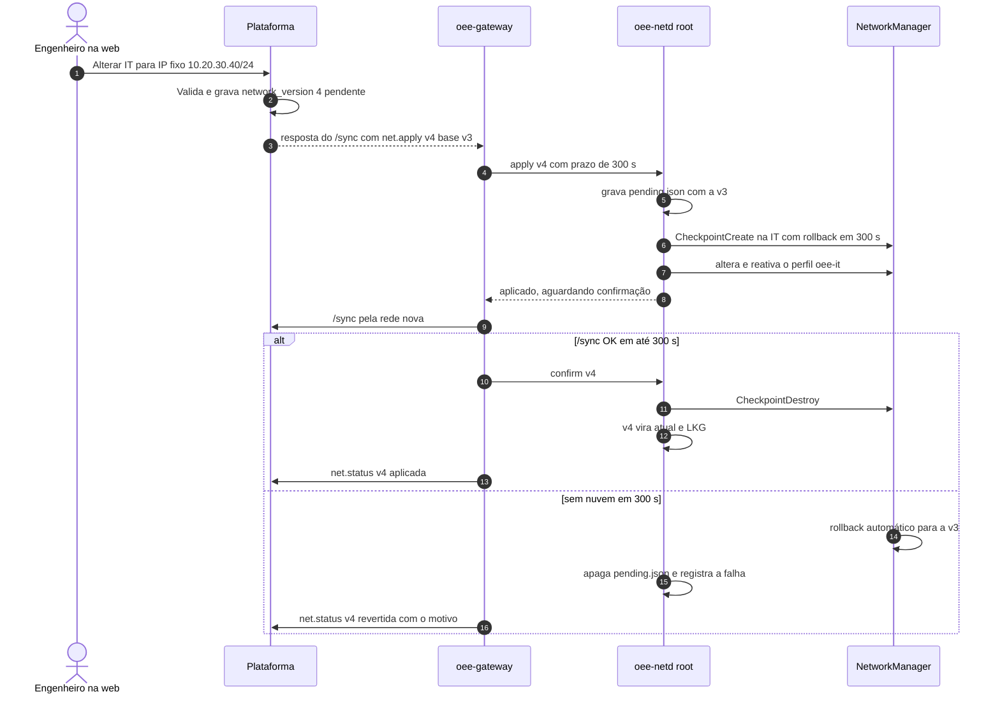
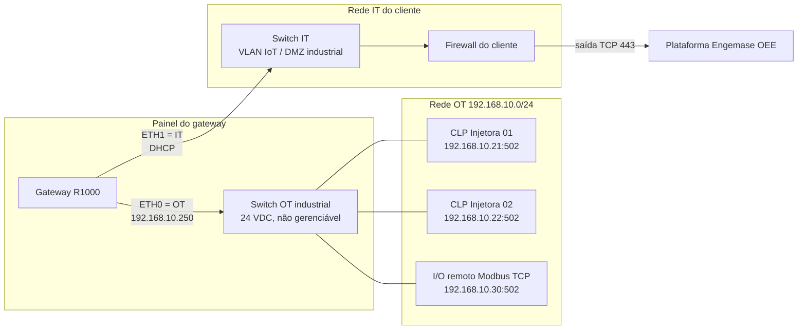
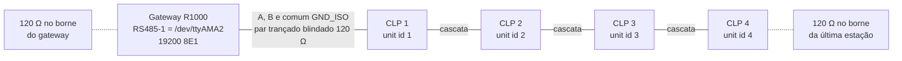
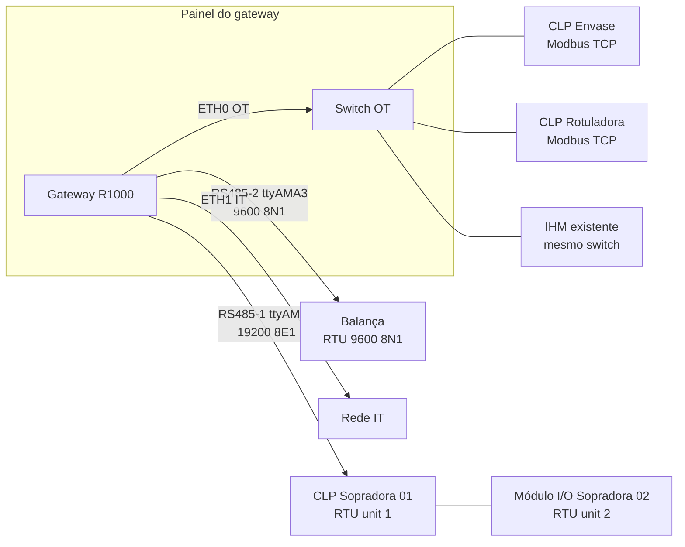
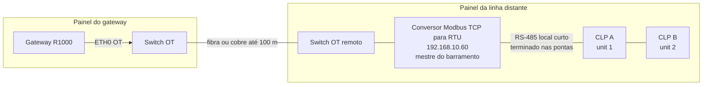
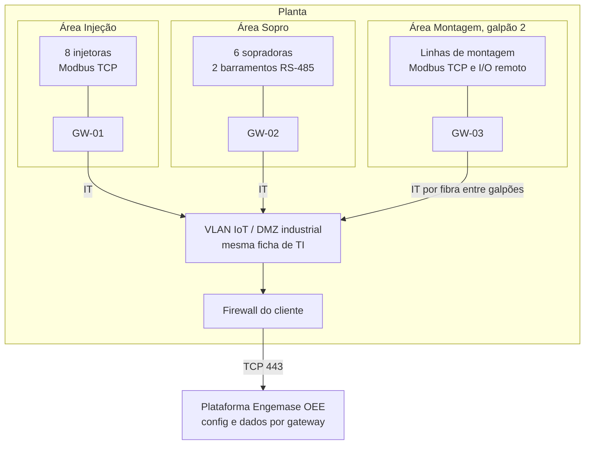

> **Consolidado:** as definições canônicas estão no [`docs/16`](../16-projeto-do-gateway.md); onde este rascunho divergir, vale o docs/16 (ex.: **ETH0 = OT** e **ETH1 = IT**; página local no `oee-localui`, porta 443, só na OT e no endereço de serviço). Implementação em `gateway/` e `deploy/`.

> **Endereço (D28, 12/11/2026):** por enquanto só o domínio da Vercel, `engemase-oee.vercel.app`, para o produto e para os gateways. Os exemplos com `oee.engemase.com.br` e `gw.oee.engemase.com.br` foram trocados por ele; o domínio próprio (e um host só dos gateways) fica para depois. Troca futura: [`docs/16` §4](../16-projeto-do-gateway.md#4-caminhos-usuários-e-identidade-canônico).

> **Rascunho** gerado pela análise do projeto do gateway (interrompida em 11/11/2026). Ainda não revisado nem consolidado no `docs/16`.

# Gateway: rede, instalação física e procedimento em campo

> **Status:** proposta de projeto, ainda sem código, para virar o doc `16-gateway-rede-e-instalacao.md` (ou entrar como seções novas do [03](03-gateway.md)).
> **Base:** docs 03, 04, 08, 10, 11, 12 e 15, mais pesquisa de nov/2026 (fontes no fim).
> **"A confirmar":** marca o que não foi verificado e deve ser validado na bancada da Fase 0.
> **Limitação:** a rede desta sessão bloqueou o `wiki.seeedstudio.com`. Os fatos do R1000 vêm dos resumos de busca do wiki, do manual e de revendas. Vale reconferir no PDF oficial antes de publicar.

---

## 0. Decisões propostas (resumo)

| Tema | Decisão |
|---|---|
| Porta OT | **ETH0**, a Gigabit nativa do CM4 |
| Porta IT | **ETH1**, a 10/100 ligada por USB |
| PoE | **Não usar.** Alimentação sempre por 24 VDC do painel |
| IT de fábrica | DHCP IPv4 com hostname `gw-<serial6>`. IPv6 desligado |
| OT de fábrica | **Endereço de serviço link-local derivado do MAC** (`169.254.a.b/16`, impresso na etiqueta). O IP principal da OT vem da ficha do cliente, gravado na preparação em bancada. **Sem rota padrão na OT, nunca** |
| Quem aplica a rede | Daemon root mínimo **`oee-netd`**. O agente `oee` continua sem privilégios |
| Pilha Linux | NetworkManager (perfis *keyfile* gerados), nftables gerado, chrony, sysctl |
| Mudança de rede | Pela web, pela página local (OT), por CLI ou por pendrive de serviço. Sempre com **confirmação e rollback automático** em 3 camadas: checkpoint do NetworkManager (300 s), arquivo pendente que sobrevive ao reboot, e retorno à "última rede boa" após 30 min sem nuvem |
| Firewall | Política *drop* nos três sentidos. Saída na IT só 443/53/123/DHCP **e só para os usuários de sistema esperados** (`meta skuid`). Na OT, só para os **IP:porta cadastrados**. Encaminhamento bloqueado, `ip_forward=0` |
| Domínio das gateways | **D28 (12/11/2026):** por enquanto o domínio da Vercel, **`engemase-oee.vercel.app`**, o mesmo do produto. Um host próprio para a API dos gateways (ex.: `gw.<domínio próprio>`) fica para depois, com o domínio próprio: com ele, a ingestão pode mudar de lugar sem nova liberação no TI |

---

## 1. Interfaces de rede

### 1.1 Qual porta é OT e qual é IT

O que se sabe do R1000:
- **ETH0** é a 10/100/1000 nativa do CM4. Aceita PoE só com um módulo opcional (entrada de 44–57 V, típico 48 V).
- **ETH1** é a 10/100 convertida de USB, sem PoE.
- O módulo PoE não vem no produto padrão. Em amostras, quem compra solda o módulo. Em lotes, a Seeed oferece a montagem.

**Recomendação: ETH0 = OT e ETH1 = IT.** Isso já bate com o diagrama do [08](08-seguranca-e-operacao.md).

| Critério | Por que ETH0 na OT |
|---|---|
| Criticidade | Uma falha na OT **perde dados**: o CLP não é lido, e não há buffer que recupere isso. Uma falha na IT **não perde nada**, porque a outbox guarda até 30 dias. A porta mais robusta (MAC/PHY nativos, sem pilha USB) vai para o lado que não tolera falha |
| Tráfego de fundo | Redes OT costumam ter multicast e broadcast de Profinet, EtherNet/IP e IHMs. A porta nativa absorve isso melhor que uma USB 2.0, que também é compartilhada com as portas USB |
| Banda | As duas sobram. O `/sync` é de KB, uma OTA tem ~10–20 MB e o polling Modbus é pequeno |
| Reset da USB | Se a pilha USB reiniciar (ESD num pendrive, por exemplo), cai só a IT. O buffer cobre |

**PoE: não usar no padrão.**
- Exige um módulo soldado.
- Deixa a alimentação do gateway dependente de um switch.
- A alimentação do painel com supercapacitor é mais previsível.

Exceção, só com módulo montado de fábrica: área sem 24 VDC e com switch OT PoE. Nesse caso a energia vem pela própria ETH0.

**Nomes e identificação das interfaces**
- Os perfis do NetworkManager **amarram a interface pelo MAC** (`[ethernet] mac-address=`), com os MACs gravados em `/etc/oee-gateway/hw.json` na preparação.
- O `oee-netd` gera o nftables com o nome **resolvido pelo MAC** a cada boot. Assim, um adaptador USB-Ethernet espetado por alguém não troca OT por IT.
- O MAC da ETH1 fica na EEPROM do controlador USB: o manual traz comandos de EEPROM para `eth1`. **A confirmar** que ele é estável entre boots e lotes.
- No `/etc/NetworkManager/conf.d/90-oee.conf`, usar `no-auto-default=*`. Isso impede o NM de criar o perfil "Wired connection" com DHCP em qualquer interface nova.

### 1.2 Endereçamento padrão de fábrica

| Item | Padrão |
|---|---|
| Hostname | `gw-<6 últimos do nº de série>`, por exemplo `gw-7f3a2c`. É enviado no DHCP |
| **IT (ETH1)** | DHCP IPv4, métrica 100. IPv6 desligado. Ping de entrada liberado (limitado a 5/s). DNS e NTP vindos do DHCP, se houver |
| **OT (ETH0)**, IP principal | **Nenhum de fábrica.** É gravado na preparação a partir da ficha do cliente. Convenção: **`.250` da sub-rede OT**, se estiver livre (por exemplo `192.168.10.250/24`) |
| **OT (ETH0)**, endereço de serviço | `169.254.a.b/16`, derivado do MAC da ETH0: `a = 1 + (byte5 mod 254)` e `b = byte6`. Fica sempre ativo, sai na etiqueta e no QR. Com detecção de IP duplicado (ACD) |
| OT, rota, DNS e IPv6 | **Sem rota padrão** (`never-default=true`), sem DNS, IPv6 desligado |
| Proxy | Nenhum |
| NTP | NTP do DHCP (opção 42), se houver, mais `pool.ntp.br` como reserva |
| Página local | Ligada, **só na OT** (IPs da OT e o endereço de serviço), HTTPS 443 com certificado próprio, senha local por gateway |

**Por que não `192.168.250.10/24` como padrão da OT**
1. A faixa `192.168.250.x` é a de fábrica dos CLPs Omron NJ/NX/CP1 (`192.168.250.1`). O mesmo vale para outras faixas "padrão" de fabricantes, como `192.168.0.x` da Siemens e `192.168.127.x` da Moxa. Um gateway que chega já nessa faixa pode entrar em conflito com algo que exista lá.
2. Dois gateways novos na mesma OT teriam o mesmo IP.

O endereço de serviço link-local resolve os dois problemas:
- Um notebook Windows ou macOS ligado direto na ETH0 (ou no switch OT), em modo DHCP, se autoconfigura em 169.254.x.y em ~1 min. Basta abrir `https://169.254.a.b`.
- Por ser derivado do MAC, não colide entre gateways.
- Nenhuma rede planejada usa 169.254, e nenhum roteador encaminha essa faixa.

O cliente pode desligar o endereço de serviço por política (`service_address: null`). Nesse caso, o resgate fica com o pendrive (1.4.4).

### 1.3 Modelo de configuração de rede (`network.json`)

A rede é um **documento separado** da config de dispositivos, com **versão própria** (`network_version`). O motivo: a config de tags muda o tempo todo e é aplicada a quente, enquanto a mudança de rede é arriscada e exige o protocolo de confirmação.

```json
{
  "network_version": 4,
  "hostname": "gw-7f3a2c",
  "it": {
    "mac": "xx:xx:xx:xx:xx:02",
    "mode": "static",
    "address": "10.20.30.40/24",
    "gateway": "10.20.30.1",
    "dns": ["10.20.0.10", "10.20.0.11"],
    "dns_search": ["cliente.local"],
    "vlan_id": null,
    "mtu": 1500,
    "ipv6": "disabled",
    "allow_ping": true
  },
  "ot": {
    "mac": "xx:xx:xx:xx:xx:01",
    "mode": "static",
    "addresses": ["192.168.10.250/24", "192.168.0.250/24"],
    "routes": [{ "to": "192.168.20.0/24", "via": "192.168.10.1" }],
    "service_address": "169.254.127.58/16",
    "vlan_id": null,
    "local_ui": true
  },
  "proxy": { "url": "http://proxy.cliente.local:3128", "no_proxy": ["10.0.0.0/8", "cliente.local"] },
  "ca_bundle_pem": null,
  "ntp": { "servers": ["10.20.0.5"], "use_dhcp": true, "public_fallback": true },
  "apply": { "confirm_timeout_s": 300, "local_confirm_timeout_s": 120, "require_ot_check": true, "lkg_revert_after_min": 30 }
}
```

| Campo | Valores e regras |
|---|---|
| `it.mode` | `dhcp` ou `static`. No modo `static`, exige `address`, `gateway` e ao menos 1 DNS |
| `it.vlan_id` / `ot.vlan_id` | 1–4094 ou `null`. Recomendado: **porta *access* sem tag**. A VLAN com tag existe para portas tronco |
| `it.ipv6` | `disabled` (MVP) ou `auto` (F2). Ver 1.7 |
| `ot.mode` | `static` ou `dhcp_no_route`. Este último usa DHCP na OT ignorando gateway, rotas e DNS (`never-default`, `ignore-auto-routes`, `ignore-auto-dns`). Só para plantas com DHCP e reserva na OT |
| `ot.addresses` | Até 4 endereços. Servem para máquinas de fornecedores diferentes com sub-redes diferentes **no mesmo switch físico**, caso comum em retrofit |
| `ot.routes` | Até 16 rotas estáticas para **outras sub-redes OT** atrás de um roteador ou switch L3 OT. **Proibido `0.0.0.0/0`** |
| `proxy.url` | `http://` ou `https://`, com autenticação Basic opcional. A senha é campo só de escrita, nunca devolvida à web |
| `ca_bundle_pem` | CA corporativa, só se houver inspeção SSL sem exceção (ver 1.5) |

**Validações antes de aceitar (na web e de novo no `oee-netd`)**
- As sub-redes da IT e da OT **não podem se sobrepor**.
- O gateway da IT precisa estar dentro da sub-rede da IT.
- O `via` de cada rota OT precisa estar dentro de uma sub-rede OT.
- Nenhuma rota padrão na OT.
- O endereço de serviço precisa estar em 169.254.1.0–169.254.254.255.
- MTU entre 1280 e 9000.
- Aviso (não bloqueio) quando o IP de um dispositivo cadastrado não estiver em nenhuma sub-rede ou rota OT.
- Aviso quando a IT não tiver DNS no modo `static`.

### 1.4 Como o técnico muda a rede

Há quatro caminhos, todos levando ao **mesmo motor** (`oee-netd`), com o mesmo protocolo de confirmação.

#### 1.4.1 Pela nuvem (aba "Rede" no detalhe do gateway)
- **Permissões:**
  - Podem editar: `engineer` (se o cliente não for `managed_by_engemase`), `field_engineer` e `super_admin`.
  - `support` só lê e roda `net.test`.
  - Tudo vai para o `audit_log`.
- **Telas:** estado reportado (IP, MAC, velocidade e duplex do link, DNS, proxy, NTP, contadores de bloqueio do firewall), versão desejada × aplicada, histórico de versões e diferença antes de aplicar.
- **Entrega:** comando novo **`net.apply`** com `{network_version, base_version, network}`. Se `base_version` ≠ versão atual do gateway (alguém mudou localmente), o gateway responde `rejected: conflict` e a web pede para recarregar.
- **Limite:** um gateway **offline** não recebe mudança pela nuvem. Nesse caso o caminho é local.

#### 1.4.2 Pela página local (OT ou endereço de serviço)
- **Aba "Rede":** mesmo formulário da web, mais o botão **"Testar conectividade"** (1.9) e **"Ajustar relógio pelo navegador"**. Este último é para relógio muito errado com NTP bloqueado, situação que impede o TLS.
- **Mudança na OT:** a página mostra contagem regressiva de **120 s**. O técnico precisa reconectar no IP novo (ou no endereço de serviço, que não muda) e clicar em **"Confirmar"**. Sem isso, a rede volta sozinha.
- **Mudança na IT:** a confirmação é automática se o `/sync` funcionar em até 300 s. Se o TI ainda não liberou a internet, o técnico pode marcar **"Confirmar sem nuvem"**, e a versão vira atual com origem `local`.
- **Sincronização com a nuvem:** toda mudança local sobe no próximo `/sync` (origem `local`, usuário `tecnico`) e vira a versão vigente também na nuvem.

#### 1.4.3 Pela CLI
A CLI fica disponível por SSH durante uma sessão de VPN ([12](12-acesso-remoto-vpn.md)) ou no console local (HDMI e teclado USB). No console, o login `tecnico` usa a senha local e tem `sudo` restrito a `oee-gateway net|diag|status`.

```bash
sudo oee-gateway net show
sudo oee-gateway net set it --static 10.20.30.40/24 --gw 10.20.30.1 --dns 10.20.0.10,10.20.0.11
sudo oee-gateway net set it --dhcp
sudo oee-gateway net set it --vlan 120
sudo oee-gateway net set ot --address 192.168.10.250/24 --add-address 192.168.0.250/24
sudo oee-gateway net set ot --route 192.168.20.0/24 via 192.168.10.1
sudo oee-gateway net set proxy http://proxy.cliente.local:3128 --no-proxy 10.0.0.0/8
sudo oee-gateway net set ntp 10.20.0.5,10.20.0.6
sudo oee-gateway net apply --confirm-timeout 300
sudo oee-gateway net confirm
sudo oee-gateway net rollback
sudo oee-gateway net reset --factory
sudo oee-gateway net test
```

#### 1.4.4 Pendrive de serviço (resgate sem notebook na rede)
- **Montagem:** uma regra udev mais `oee-usb-service@.service` montam o pendrive FAT32 com `noexec,nosuid,nodev`. Só nomes fixos são lidos, e nada é executado.
- **`OEE/diag`** (arquivo vazio): o gateway grava `OEE/gw-<serial>-diag.txt` com IPs, MACs, link, resultado do `net test`, versão e últimos erros. O LED azul pisca 3 vezes ao terminar.
- **`OEE/net-reset`:** volta a rede ao padrão de fábrica (IT em DHCP, OT só com o endereço de serviço). A credencial, o buffer e a config de dispositivos ficam como estão. O evento sobe para a auditoria.
- **F2, `OEE/network.json`:** uma config de rede **assinada pela plataforma** (Ed25519, a mesma infraestrutura da OTA), baixada da web.

### 1.5 Proxy corporativo e CA

- **Tipos aceitos:** proxy explícito HTTP CONNECT (`http://` ou `https://`), com ou sem Basic. **NTLM, Kerberos e PAC/WPAD não são suportados.** Nesses casos, o TI cria uma regra de saída sem autenticação para o IP ou MAC do gateway.
- **Onde o proxy é aplicado:**
  - `oee-netd` gera `/etc/oee-gateway/proxy.env` (0640 `root:oee`) com `HTTPS_PROXY` e `NO_PROXY`. O arquivo é lido por `oee-gateway` e `oee-remote-access` via `EnvironmentFile=`.
  - Para o apt: `/etc/apt/apt.conf.d/95oee-proxy` com `Acquire::http::Proxy` e `Acquire::https::Proxy`.
- **Fora do proxy:** NTP (UDP 123) e DNS. O Modbus é TCP cru na OT e nunca passa por proxy.
- **Inspeção SSL:** a recomendação é **exceção para os domínios da Engemase e da Tailscale**.
  - Se o cliente não aceitar, a CA dele entra em `ca_bundle_pem`. Ela vai para `/usr/local/share/ca-certificates/oee-cliente-<hash>.crt`, seguida de `update-ca-certificates`. O Go usa o pool do sistema.
  - **Aviso na ficha:** com inspeção, o proxy do cliente vê o token do gateway. É preciso aceite por escrito e rotação do token se houver suspeita.
  - **VPN:** com inspeção (ex.: FortiGate com DPI), a VPN Tailscale não funciona, como já registrado no [12](12-acesso-remoto-vpn.md). Isso não afeta a coleta.

### 1.6 NTP e relógio

- `chrony` com `/etc/chrony/chrony.conf` **inteiro gerado** pelo `oee-netd`:

```
# gerado pelo oee-netd — network_version=4
server 10.20.0.5 iburst prefer
pool pool.ntp.br iburst maxsources 3
makestep 1.0 3
rtcsync
port 0        # não atua como servidor NTP
cmdport 0     # chronyc só pelo socket Unix
```

- **NTP do DHCP (opção 42):** usado quando `ntp.use_dhcp` estiver ligado. O chrony do Debian traz scripts de dispatcher do NetworkManager para isso (**a confirmar** na imagem).
- **RTC com bateria CR2032:** mantém a hora durante falta de energia. O `rtcsync` com o RTC do R1000 está **a confirmar**.
- **NTP bloqueado na fábrica:** se o `/sync` mostrar diferença acima de 2 s por mais de 10 min, o `oee-netd` ajusta o relógio pelo `server_time`, que é autenticado por TLS (`chronyc settime` com diretiva `manual`).
- **Relógio muito errado** (bateria do RTC morta e NTP bloqueado): o TLS falha e o LED fica vermelho piscando. A página local oferece "Ajustar relógio pelo navegador". Não há atalho inseguro.

### 1.7 DNS, VLAN, rotas na OT, IPv6 e 802.1X

- **DNS:** vem do DHCP ou é estático, **só na IT**. O DNS interno do cliente precisa resolver nomes externos (DNS dividido costuma resolver).
- **VLAN:** um perfil NM `type=vlan` (`[vlan] parent=<mac da IT> id=120`), com o perfil-pai sem IP. Uso raro, só quando a porta é tronco.
- **Várias sub-redes OT:** endereços secundários (`ot.addresses`) quando estão no mesmo segmento físico, e rotas estáticas (`ot.routes`) quando estão atrás de um roteador OT. O gateway **nunca** tem rota padrão pela OT.
- **IPv6:**
  - **Desligado no MVP** nas duas portas, via sysctl, perfil NM e regra `meta nfproto ipv6 drop`.
  - Motivo: muitas redes corporativas anunciam RA de IPv6 sem que o firewall libere a saída v6. Isso gera atrasos e um caminho de saída que o TI não aprovou.
  - `ipv6: auto` na IT fica para F2. Exige regras ICMPv6/ND e teste da API em v6 (**a confirmar**: suporte IPv6 do domínio na Vercel).
- **802.1X na porta IT:** no MVP, pedir **MAB** (liberação por MAC da ETH1). EAP-TLS pelo NetworkManager fica para F2.

### 1.8 Confirmação de mudança de rede e rollback automático

Há três camadas de proteção:

1. **Checkpoint do NetworkManager.** Antes de aplicar, o `oee-netd` chama `CheckpointCreate` (D-Bus) nas interfaces afetadas, com `rollback_timeout` = `confirm_timeout_s` (300 s pela nuvem, 120 s pela página local). Sem confirmação, o NM volta sozinho. Ressalvas:
   - O rollback depende de o NM continuar rodando.
   - O checkpoint **não sobrevive a reboot**. Daí a segunda camada.
2. **`pending.json` persistente** (`/var/lib/oee-gateway/network/pending.json`, com a versão anterior). Se o gateway reiniciar com uma mudança pendente, o `oee-netd` **restaura a versão anterior no boot**.
3. **"Última rede boa com nuvem" (LKG).** Cobre a mudança confirmada sem nuvem que estava errada.
   - **Quando dispara:** se a versão atual ≠ `lkg_cloud.json` e o gateway passar **30 min** sem `/sync` bem-sucedido.
   - **O que faz:** aplica a LKG em teste por 10 min.
   - **Se a nuvem voltar:** fica na LKG e reporta "mudança revertida".
   - **Se não voltar:** a causa é outra (queda de internet). Volta para a versão nova e **não tenta de novo** para essa versão. Isso evita ficar alternando durante uma queda de link da fábrica.
   - **Nunca volta sozinho ao padrão de fábrica.** O padrão de fábrica só vem por `reset --factory` ou pelo pendrive.

**Critérios de confirmação automática**

| Mudança | Confirma quando | Senão |
|---|---|---|
| IT (pela nuvem ou local) | `/sync` OK pela rede nova em até 300 s | Rollback e `net.status` com o motivo (link, DHCP, rota, DNS, proxy, TLS) |
| OT pela nuvem, `require_ot_check=true` | `/sync` OK **e** todo dispositivo TCP que respondia antes volta a responder (TCP connect em 2 s) em até 60 s | Rollback |
| OT pela nuvem, `require_ot_check=false` | `/sync` OK. É o caso de re-IP planejado da planta inteira, junto com a config de dispositivos | — |
| OT pela página local | Clique em "Confirmar" em até 120 s, vindo da rede nova ou do endereço de serviço | Rollback |



**O que acontece em cada erro**

| Erro | Efeito | Proteção |
|---|---|---|
| IP ou gateway IT errado, VLAN errada | Sem nuvem | Checkpoint de 300 s; LKG após 30 min |
| DNS ou proxy errado | Sem nuvem | Idem. O `net test` aponta a etapa que falhou |
| IP OT errado | Máquinas em NO_COMM; o técnico perde a página no IP antigo | Confirmação manual de 120 s; endereço de serviço sempre ativo; `require_ot_check` |
| OT e IT sobrepostas, ou rota padrão na OT | — | Rejeitado na validação |
| Reboot ou queda de energia durante a confirmação | — | `pending.json` volta à versão anterior no boot |
| OT e IT ligadas no mesmo switch ou VLAN | Mistura física das redes | Alerta "OT e IT no mesmo segmento": um ARP probe pela OT para o gateway da IT, se responder, dispara o alerta |
| IP duplicado na OT | Conflito com um CLP | ACD do NM e alerta |
| Tudo falhou | — | Pendrive `net-reset` ou endereço de serviço via OT |

Durante a aplicação (≤ 60 s), a falta de comunicação com as máquinas é registrada com motivo `gateway_maintenance`, para não poluir a disponibilidade.

### 1.9 Implementação no Linux

| Arquivo | Conteúdo |
|---|---|
| `/var/lib/oee-gateway/network/{current,pending,lkg_cloud,factory}.json` | Estados da rede |
| `/etc/oee-gateway/hw.json` | Nº de série, MACs da ETH0 e da ETH1, revisão da placa (gravado em bancada) |
| `/etc/NetworkManager/system-connections/oee-it.nmconnection` e `oee-ot.nmconnection` | Perfis gerados (0600) |
| `/etc/NetworkManager/conf.d/90-oee.conf` | `[main] no-auto-default=*` |
| `/etc/nftables.conf` | Regras geradas (seção 2) |
| `/etc/sysctl.d/90-oee-gateway.conf` | Sysctl (seção 2.1) |
| `/etc/chrony/chrony.conf` | Gerado (1.6) |
| `/etc/oee-gateway/proxy.env`, `/etc/apt/apt.conf.d/95oee-proxy` | Proxy |

Exemplo de perfil da OT:

```ini
# /etc/NetworkManager/system-connections/oee-ot.nmconnection — gerado pelo oee-netd
[connection]
id=oee-ot
type=ethernet
autoconnect=true

[ethernet]
mac-address=xx:xx:xx:xx:xx:01

[ipv4]
method=manual
address1=192.168.10.250/24
address2=192.168.0.250/24
address3=169.254.127.58/16
route1=192.168.20.0/24,192.168.10.1
never-default=true
ignore-auto-dns=true

[ipv6]
method=disabled
```

O perfil da IT segue o mesmo formato:
- **DHCP:** `method=auto`, `dhcp-hostname=gw-7f3a2c` e `route-metric=100`.
- **IP fixo:** `method=manual`, `address1=10.20.30.40/24,10.20.30.1`, `dns=10.20.0.10;10.20.0.11;` e `dns-search=cliente.local;`.

**`oee-netd`**
- É um binário Go do mesmo módulo (`cmd/oee-netd`), rodando como root.
- Escuta no socket `/run/oee-netd.sock` e só aceita o UID `oee` (checado por `SO_PEERCRED`).
- Valida o JSON contra o schema e só executa operações fechadas: apply, confirm, rollback, status, test, adicionar alvo temporário no firewall e identificar.
- O agente nunca roda `nmcli` nem `nft`.

**`net test`** roda como `oee`, para passar pelas mesmas regras do firewall. Exemplo de saída:

```
IT  eth1  link 100 Mb/s full  10.20.30.40/24  gw 10.20.30.1 .............. OK
DNS 10.20.0.10  engemase-oee.vercel.app ............................... OK
TCP 443 engemase-oee.vercel.app via proxy 10.20.0.5:3128 .............. OK  38 ms
TLS emissor do certificado ............................................ OK (CA pública esperada)
API /api/gateway/v1/ping  offset do relógio 12 ms ..................... OK
NTP 10.20.0.5  stratum 3  offset 4 ms ................................. OK
VPN controlplane.tailscale.com:443 .................................... OK (opcional)
OT  eth0  link 1000 Mb/s full  192.168.10.250/24 + 169.254.127.58/16 .. OK
OT  192.168.10.21:502 ................................................. OK   4 ms
OT  192.168.10.23:502 ................................................. FALHA timeout 2 s
```

Se o emissor do TLS for inesperado (por exemplo, a CA de um FortiGate), a mensagem é: **"Inspeção SSL detectada. Pedir ao TI a exceção para engemase-oee.vercel.app."**

---

## 2. Firewall local (nftables)

### 2.1 Princípios e sysctl

- Política **drop** em `input`, `forward` e `output`.
- Os únicos processos com socket aberto: SSH em `127.0.0.1:22` ([12](12-acesso-remoto-vpn.md)) e a página local nos IPs da OT, porta 443. O agente recebe `CAP_NET_BIND_SERVICE` para isso.
- O tsnet roda em espaço de usuário. O encaminhamento para um CLP é feito pelo helper como conexão TCP comum que sai pela OT, e por isso passa pela regra `ot_targets`.

```
# /etc/sysctl.d/90-oee-gateway.conf
net.ipv4.ip_forward = 0
net.ipv6.conf.all.forwarding = 0
net.ipv6.conf.all.disable_ipv6 = 1
net.ipv6.conf.default.disable_ipv6 = 1
net.ipv4.conf.all.rp_filter = 1
net.ipv4.conf.default.rp_filter = 1
net.ipv4.conf.all.accept_redirects = 0
net.ipv4.conf.all.send_redirects = 0
net.ipv4.conf.all.accept_source_route = 0
net.ipv4.conf.all.arp_ignore = 1
net.ipv4.conf.all.arp_announce = 2
net.ipv4.conf.all.log_martians = 1
net.ipv4.icmp_echo_ignore_broadcasts = 1
net.ipv4.tcp_syncookies = 1
```

`arp_ignore` e `arp_announce` evitam que o gateway responda ARP de um IP da IT pela OT, e vice-versa.

### 2.2 Matriz de fluxos

| # | Porta | Sentido | Destino ou origem | Protocolo | Processo (UID) | Motivo |
|---|---|---|---|---|---|---|
| 1 | IT | saída | Nuvem Engemase | TCP 443 | `oee` | `/sync`, `/config`, OTA |
| 2 | IT | saída | Repositórios do SO | TCP 443 | `_apt` | Atualizações de segurança (fontes apt em HTTPS) |
| 3 | IT | saída | Tailscale | TCP 443; UDP 41641 e 3478 opcionais | `oee-ra` | VPN sob demanda |
| 4 | IT | saída | Proxy do cliente | TCP na porta do proxy | `oee`, `oee-ra`, `_apt` | Se houver proxy |
| 5 | IT | saída | DNS do cliente | UDP e TCP 53 | qualquer | Resolução de nomes |
| 6 | IT | saída | NTP | UDP 123 | `_chrony` | Relógio |
| 7 | IT | saída e entrada | DHCP | UDP 67/68 | NM (root) | Endereço |
| 8 | IT | entrada | Rede do TI | ICMP echo, 5/s | — | Monitoramento (opcional) |
| 9 | IT | entrada | qualquer | qualquer outro | — | **Bloqueado** |
| 10 | OT | saída | **Dispositivos cadastrados (IP:porta)** | TCP 502 ou a porta da config | `oee`, `oee-ra` | Leitura Modbus; encaminhamento aprovado |
| 11 | OT | saída | Sub-redes OT | ICMP echo | qualquer | Diagnóstico |
| 12 | OT | entrada | Sub-redes OT e 169.254/16 | TCP 443 | — | Página local |
| 13 | OT | entrada | Sub-redes OT | ICMP echo, 5/s | — | Diagnóstico |
| 14 | — | encaminhamento | qualquer | qualquer | — | **Bloqueado** (`ip_forward=0` e chain `forward` em drop) |

### 2.3 Regras (geradas pelo `oee-netd`; os valores são exemplo)

```nft
#!/usr/sbin/nft -f
# /etc/nftables.conf — GERADO pelo oee-netd. Não editar à mão.
# network_version=4
flush ruleset

define IF_OT   = "eth0"     # resolvido pelo MAC no boot
define IF_IT   = "eth1"
define UID_OEE = 990        # oee-gateway
define UID_RA  = 991        # oee-remote-access
define UID_APT = 42         # _apt
define UID_NTP = 105        # _chrony (UIDs reais preenchidos pelo gerador)

table inet oee {
  set ot_nets {
    type ipv4_addr; flags interval
    elements = { 192.168.10.0/24, 192.168.0.0/24, 192.168.20.0/24, 169.254.0.0/16 }
  }
  set ot_targets {
    type ipv4_addr . inet_service; flags timeout
    elements = { 192.168.10.21 . 502, 192.168.10.23 . 502, 192.168.20.40 . 502 }
  }
  set it_dns   { type ipv4_addr; elements = { 10.20.0.10, 10.20.0.11 } }
  set it_proxy { type ipv4_addr . inet_service; elements = { 10.20.0.5 . 3128 } }

  chain input {
    type filter hook input priority filter; policy drop;
    iif "lo" accept
    ct state invalid drop
    ct state established,related accept
    meta nfproto ipv6 drop
    iifname $IF_IT udp sport 67 udp dport 68 accept
    iifname $IF_IT icmp type echo-request limit rate 5/second accept
    iifname $IF_OT ip saddr @ot_nets tcp dport 443 accept
    iifname $IF_OT ip saddr @ot_nets icmp type echo-request limit rate 5/second accept
    limit rate 6/minute log prefix "oee-drop-in: " level info
    counter
  }

  chain forward {
    type filter hook forward priority filter; policy drop;
    limit rate 6/minute log prefix "oee-drop-fwd: " level warn
    counter
  }

  chain output {
    type filter hook output priority filter; policy drop;
    oif "lo" accept
    ct state invalid drop
    ct state established,related accept
    meta nfproto ipv6 drop

    # IT
    oifname $IF_IT udp sport 68 udp dport 67 accept
    oifname $IF_IT ip daddr @it_dns udp dport 53 accept
    oifname $IF_IT ip daddr @it_dns tcp dport 53 accept
    oifname $IF_IT meta skuid $UID_NTP udp dport 123 accept
    oifname $IF_IT meta skuid { $UID_OEE, $UID_RA, $UID_APT } tcp dport 443 accept
    oifname $IF_IT meta skuid { $UID_OEE, $UID_RA, $UID_APT } ip daddr . tcp dport @it_proxy accept
    oifname $IF_IT meta skuid $UID_RA udp dport { 3478, 41641 } accept
    oifname $IF_IT icmp type echo-request accept

    # OT: só para os dispositivos cadastrados
    oifname $IF_OT meta skuid { $UID_OEE, $UID_RA } ip daddr . tcp dport @ot_targets accept
    oifname $IF_OT ip daddr @ot_nets icmp type echo-request accept

    limit rate 6/minute log prefix "oee-drop-out: " level info
    counter
  }
}
```

Observações:
- **O conjunto `ot_targets` vem da config de dispositivos.** Ele é atualizado a quente a cada nova `config_version`.
- **Liberações temporárias:** o `device.test` de um IP ainda não cadastrado e o `ot.forward.open` da VPN entram com prazo, por exemplo `nft add element inet oee ot_targets { 192.168.10.99 . 502 timeout 5m }`. O alvo do `device.test` continua limitado como no [15](15-multi-cliente-e-acesso.md) (item 13).
- **Filtro por domínio:** o gateway **não filtra por domínio**, porque os IPs da Vercel são dinâmicos. A lista de domínios fica no firewall do cliente. No gateway, a restrição é por porta e por processo (`skuid`).
- **Saúde:** os contadores de descarte (`oee-drop-*`) vão no bloco de saúde do `/sync`. Descartes de saída na OT indicam dispositivo mal cadastrado.

### 2.4 Serviços removidos ou desligados na imagem

| Serviço | Ação |
|---|---|
| `avahi-daemon`, `cups`, `rpcbind`, `triggerhappy` | Remover |
| `ModemManager`, `wpa_supplicant`, `bluetooth`/`hciuart` (série -00 sem rádio) | Remover |
| **`rpi-connect` / `rpi-connect-lite`** (acesso remoto da própria Raspberry Pi) | Remover, se presente |
| `cloud-init` | Desabilitar após o primeiro boot, **se presente** (a confirmar na imagem Trixie) |
| OpenSSH | Só em `127.0.0.1` ([12](12-acesso-remoto-vpn.md)) |

**Teste de aceite:**
- `ss -tulpn` deve listar só `127.0.0.1:22`, `<IPs OT>:443` e o socket Unix do chrony.
- Um `nmap -p- <IP IT>`, rodado do lado da IT, deve mostrar **zero portas abertas**.

---

## 3. Ficha técnica para o TI do cliente

*Para anexar à proposta. Linguagem para o TI. Os domínios marcados com \* ainda dependem da definição final de nomes.*

**O que é:** um computador industrial em trilho DIN que lê as máquinas pela rede industrial (OT) e envia indicadores de produção para a nuvem da Engemase **somente por conexões de saída HTTPS**.
- Não recebe conexões.
- Não roteia entre a rede OT e a rede corporativa.
- Não escreve nos CLPs.

**O que pedimos**

| # | Item | Detalhe |
|---|---|---|
| 1 | **Um ponto de rede IT** (RJ45) | Porta *access* sem tag, preferencialmente numa **VLAN de IoT ou DMZ industrial**, fora da VLAN de escritório. 100 Mb/s bastam |
| 2 | **Endereço** | **DHCP com reserva** pelo MAC da porta IT (que enviamos antes da visita) **ou** IP fixo: IP, máscara, gateway, DNS 1 e 2 |
| 3 | **Saída TCP 443** para estes FQDN | Obrigatórios: `engemase-oee.vercel.app` (API dos gateways; não liberar `*.vercel.app` inteiro) e `<store>.public.blob.vercel-storage.com`\* (downloads de atualização do agente; nome exato informado na proposta). Atualizações de segurança do SO: `deb.debian.org`, `archive.raspberrypi.com`. **A nuvem não tem faixa de IP fixa: liberar por nome (objeto FQDN no firewall)** |
| 4 | **DNS** | O DNS interno precisa resolver os nomes acima |
| 5 | **NTP** | Informe o servidor NTP interno (preferido). Se não houver, liberar UDP 123 para `pool.ntp.br` |
| 6 | **Proxy** (se houver) | Endereço:porta, do tipo HTTP CONNECT. Autenticação só Basic. **NTLM e Kerberos não são suportados**: nesse caso, criar regra sem autenticação para o IP ou MAC do gateway |
| 7 | **Inspeção SSL** | Pedimos **exceção** para os domínios acima. Se não for possível, envie a CA raiz (PEM). Com inspeção ativa, o proxy passa a ver a credencial do gateway |
| 8 | **Acesso remoto de manutenção** (opcional, sob aprovação do cliente) | Saída TCP 443 para `login.tailscale.com`, `controlplane.tailscale.com`, `log.tailscale.com`, `log.tailscale.io` e os relays DERP da lista oficial da Tailscale (`derp*.tailscale.com`). UDP 41641 e 3478 de saída são opcionais (só aceleram). **Exceção de inspeção SSL obrigatória**: com DPI (ex.: FortiGate), a VPN não conecta. A coleta não depende disso |
| 9 | **802.1X** (se a porta exigir) | Liberação por MAC (MAB) |
| 10 | **Rede OT** | Uma porta no switch OT (porta *access* na VLAN das máquinas) **ou** autorização para instalarmos um switch industrial dedicado no painel. Também: um **IP livre** na faixa OT (sugerimos o `.250`), máscara, outras sub-redes OT e seus roteadores (se houver) e a lista de IPs e portas dos CLPs |
| 11 | **Contato e janela** | Responsável no TI e janela para o teste de liberação |

**O que garantimos**
- **Nenhuma porta de entrada.** Sem NAT nem redirecionamento no firewall do cliente.
- **Encaminhamento desativado** (`ip_forward=0`) e firewall local com política de bloqueio. As redes OT e IT nunca são ligadas pelo gateway.
- **Saída só pelas portas e destinos listados.** O gateway não acessa AD, compartilhamentos nem outros equipamentos da rede IT.
- **Tráfego estimado:** ~0,5–2 GB por mês por gateway (sincronização a cada 10 s em lotes compactados, mais atualizações). **Estimativa a medir na PoC.**
- **Sem internet, nada se perde:** o gateway guarda até 30 dias de dados e reenvia em ordem.
- **Acesso remoto** só com aprovação do admin do cliente, com prazo, auditado e com bloqueio local ([12](12-acesso-remoto-vpn.md)).

**Teste de liberação (o TI roda antes da visita, de um computador na mesma VLAN)**

```powershell
Test-NetConnection engemase-oee.vercel.app -Port 443
Invoke-RestMethod https://engemase-oee.vercel.app/api/gateway/v1/ping
```

```bash
curl -sS https://engemase-oee.vercel.app/api/gateway/v1/ping
```

Resposta esperada: `{"ok":true,"server_time":"..."}`. O endpoint `/ping` é público, sem dados, e está **a criar**.

**Alternativa quando o TI não libera a rede:** um roteador 4G industrial **homologado pela ANATEL**, ligado na porta IT, com chip M2M. Para o gateway, é só mais uma "rede IT". Modelo e homologação a confirmar.

**Cliente que só libera por IP:** a Vercel não publica faixa fixa para o tráfego de entrada. Fica como pendência avaliar, em F2, uma entrada de ingestão com IP fixo.

---

## 4. Instalação física

### 4.1 Onde montar

| Opção | Quando usar | Observações |
|---|---|---|
| **A — Painel existente** do cliente (automação ou comando da linha) | Painel com espaço, 24 VDC e temperatura sob controle | Pedir autorização formal. Circuito e proteção próprios para o gateway |
| **B — Caixa Engemase pré-montada** (padrão de produto) | Painel cheio ou quente, ou instalação nova | Caixa metálica ou de policarbonato IP65, ~400×300×200 mm, com placa de montagem: trilho DIN, disjuntor, DPS, fonte 24 VDC, bornes com fusível, gateway, switch OT e régua de PE. **Montada e testada em bancada** (reduz o tempo em campo) |

Regras:
- Altura de trabalho entre 0,8 e 1,6 m.
- Longe de inversores, contatores de potência e resistências.
- Folga de ~50 mm acima e abaixo do gateway, para dissipação.
- Raio de curvatura dos cabos respeitado na frente.

### 4.2 Alimentação

| Item | Recomendação |
|---|---|
| Entrada do R1000 | 9–36 VDC no borne do fabricante, consumo de ~3–5,5 W em 24 V. **Medir com multímetro antes de ligar**: 22–26 V típico, dentro da faixa IEC 61131-2 de 20,4–28,8 V. Proteção contra inversão de polaridade **a confirmar**: conferir a polaridade |
| Fonte | **Dedicada**, 24 VDC em trilho DIN, **30–60 W** (por exemplo, Mean Well HDR-60-24 ou NDR, Phoenix, Weidmüller). Atende gateway + switch OT + conversor com folga para carregar o supercapacitor |
| Usar o 24 V do painel | Aceitável se houver capacidade, com **ramal próprio com fusível**. **Evitar** dividir a fonte com solenoides, válvulas e contatores sem supressão |
| Proteção CA | Disjuntor **1P+N de 4 A, curva C** (ou conforme a corrente de partida da fonte), a partir de um circuito protegido do quadro |
| Proteção CC | **Borne com fusível de 2 A retardado** por ramal: um para o gateway, outro para o switch e o conversor |
| Cabos de alimentação | 0,75–1,5 mm² com ponteira. Vermelho/azul (ou conforme o padrão do cliente) para +24 e 0 V. 0 V comum identificado |

### 4.3 Surto (DPS) e aterramento

| Ponto | Regra |
|---|---|
| CA | DPS classe II, 275 V, no quadro que alimenta o circuito. Se não existir, incluir no kit B |
| Ethernet IT ou OT | **Entre prédios ou galpões, fibra óptica, nunca cobre.** DPS RJ45 Cat6 em trilho só se o cobre sair do prédio ou correr em área externa |
| RS-485 | DPS de dados (2 fios + comum) se o barramento sair do painel por longas distâncias (> 30 m entre prédios ou ao ar livre). A isolação das portas do R1000 ajuda, mas não substitui o DPS |
| PE | Trilho DIN e placa ligados à barra de PE. Terra funcional do gateway (se houver borne ou parafuso) na barra (**a confirmar** no R1000) |
| Malha do cabo RS-485 | Aterrada **em um único ponto**, no lado do gateway, com braçadeira 360° na barra de PE. Nas estações intermediárias, dar continuidade à malha sem aterrar |
| Comum do RS-485 | O fio de comum vai no **`GND_ISO`** do R1000 e no GND/0 V de todas as estações. **O comum deve ter um único ponto ligado ao PE.** Se algum escravo não isolado já aterra o comum no painel dele, **não** ligar o `GND_ISO` ao PE no gateway |
| Ethernet blindado | Malha aterrada no lado do switch |

### 4.4 Ethernet

- **No campo:** cabo industrial **Cat5e ou Cat6 blindado (SF/UTP)**, capa PUR em área com óleo, conectores RJ45 industriais. Dentro do painel, patch cords Cat6 blindados curtos (0,5–2 m).
- **Até 100 m por canal.** Acima disso, switch intermediário ou fibra.
- **Separação:** ≥ 20 cm de cabos de motor ou inversor, em canaleta separada, cruzando a 90°.
- **CLP com uma porta só, ocupada pela IHM:** colocar um **switch industrial de 5 portas** entre CLP e IHM e ligar o gateway nele. Exige autorização e uma parada curta. Conferir o limite de conexões Modbus TCP do CLP ([11](11-integracao-modbus.md)).
- **Switch OT fornecido pela Engemase:** não gerenciável, 24 VDC, trilho DIN, 5 portas (por exemplo, linhas de entrada de Moxa, Phoenix Contact, Weidmüller ou Hirschmann).

### 4.5 RS-485 no R1000

| Item | Regra |
|---|---|
| Portas | 3 portas isoladas: `/dev/ttyAMA2`, `ttyAMA3` e `ttyAMA5`. **A correspondência borne ↔ dispositivo está a confirmar em bancada** e vai na etiqueta (`RS485-1 = ttyAMA2`...) |
| Ligação | A, B e `GND_ISO` (comum) em **cascata**. Nada de estrela. Derivações o mais curtas possível (limite da especificação: 20 m) |
| Cabo | Par trançado blindado de 120 Ω, 2 pares de 22–24 AWG: um par para A/B e um condutor do segundo par como comum |
| Terminação | 120 Ω 1/4 W **só nas duas pontas**. **No R1000 o resistor não vem montado**: colocar o resistor no borne do gateway quando ele for ponta (caso típico) e outro no borne da última estação |
| Polarização | Um único par no barramento. **A confirmar em bancada** se o R1000 polariza. Teste: medir a tensão entre A e B em repouso (≥ 200 mV). Se não houver, usar a polarização de um escravo que a ofereça |
| Nomes A/B | Varia entre fabricantes. **Sem comunicação, a primeira suspeita é A/B invertidos** |
| Mestre único | Conferir que não há IHM ou outro mestre no barramento ([11](11-integracao-modbus.md#5-um-mestre-por-barramento)) |

### 4.6 Energia: supercapacitor e queda de energia

- **Módulo SuperCAP UPS LTC3350** da Seeed: 4 supercapacitores de 7 F/2,7 V em série, com sinal de falha de energia ativo em nível baixo. Uma fonte cita o **GPIO25** com o overlay `gpio-shutdown` (**a confirmar**).
- **Autonomia estimada:** ~10–15 s com 5 W. **Medir em bancada.** Serve para desligar com segurança, não para continuar operando.
- **Comportamento do agente na falha de energia:**
  1. Grava o evento `power_loss` na outbox, com fsync.
  2. Para o polling.
  3. Tenta um `/sync` imediato, que só funciona se o switch IT ainda estiver ligado.
  4. Executa `systemctl poweroff`.
- **Bônus de OEE:** a plataforma pode **sugerir "falta de energia"** como motivo das paradas que coincidem com `power_loss`.
- **Risco de "desligado sem religar":** se a energia voltar antes de o supercapacitor esgotar, o CM4 pode ficar parado depois do `poweroff`. Mitigação a validar: armar o **watchdog via RTC do R1000** (configurável de 1 a 255 s, segundo o manual) antes de desligar, para forçar o reset.
  - Isso **corrige o [03](03-gateway.md)**, que diz que o R1000 só tem o watchdog interno.
  - Testar em bancada: queda de 2 s, retorno durante o desligamento e quedas repetidas.
- **Nobreak CC (UPS 24 VDC com bateria)** só quando o cliente quiser que o gateway continue registrando durante quedas longas. Normalmente as máquinas também param.
- **Padrão sugerido:** supercapacitor **em todas as unidades da frota**. O custo é pequeno perto de uma ida a campo para recuperar um eMMC corrompido. Decisão do dono do produto.

### 4.7 Temperatura e ambiente

- **Faixa de operação do R1000:** uma tabela da Seeed cita −30 a 70 °C e 10–95% UR sem condensação, ligada a uma subsérie R1013 (**a confirmar para a série -00**).
- **Meta de projeto:** interior do painel ≤ 50 °C. O CM4 começa a reduzir o clock por volta de 80 °C no SoC.
- **Monitoramento:** o agente reporta a temperatura do SoC (`/sys/class/thermal/thermal_zone0/temp`). Alerta acima de 75 °C.
- **Aceite:** medir com o painel fechado após 1 h.
- **Ambiente:** painel IP54 ou mais. Em painel acima de ~45 °C no uso normal: ventilação com filtro ou a caixa B em outro local.

### 4.8 Distâncias de referência

| Meio | Limite prático | Acima disso |
|---|---|---|
| Ethernet cobre | 100 m por canal | Switch intermediário ou fibra |
| Entre prédios | Sempre fibra (multimodo ~300–550 m em 1 Gb/s; monomodo para km) | — |
| RS-485 | ~1.000–1.200 m a ≤ 19200 bps com cabo adequado; 32 cargas unitárias | Repetidor ou conversor RTU→TCP perto do barramento (topologia d) |
| Derivação RS-485 | O mínimo possível (máx. 20 m) | — |
| 24 VDC | Fonte no mesmo painel; queda ≤ 5% | — |

### 4.9 Identificação e etiquetas

| Onde | Conteúdo |
|---|---|
| Frente do gateway | `GW-<cliente>-<nº>`, hostname, nº de série, **MAC ETH0 e ETH1**, **endereço de serviço 169.254.a.b**, QR com o `gateway_id` (que abre a página do gateway na plataforma) |
| Ao lado de cada RJ45 | **"OT — ETH0"** e **"IT — ETH1"** |
| Bornes RS-485 | `RS485-1 (ttyAMA2) → Barramento Sopro`... |
| Cabos (as duas pontas) | `GW01-IT`, `GW01-OT`, `GW01-B1→CLP SOP01`, `GW01-24V` |
| Porta do painel | "Gateway OEE Engemase — não desligar sem avisar — suporte: <telefone/e-mail>", com a **tabela de LEDs** (4.10) |

### 4.10 LEDs e sinalização

O R1000 tem:
- PWR verde (energia) e ACT verde (acesso ao eMMC), controlados pelo fabricante;
- LEDs de usuário `led-red`, `led-green` e `led-blue` em `/sys/class/leds`. **A confirmar** se são três LEDs ou um RGB;
- buzzer: GPIO21, ou PCA9535 P15 na placa v1.1.

| Sinal | Significado |
|---|---|
| Verde fixo | Nuvem OK e todos os dispositivos lendo |
| Verde piscando a 1 Hz | Nuvem OK, mas um ou mais dispositivos sem comunicação |
| Amarelo (vermelho + verde) piscando | Sem nuvem há mais de 2 min. A coleta continua no buffer |
| Vermelho piscando | Sem nuvem e sem dispositivos, config inválida ou relógio inválido |
| Vermelho fixo | Agente parado, erro de disco ou buffer acima de 95% |
| **Azul fixo** | **Sessão de acesso remoto ativa** (transparência para o cliente no painel) |
| Azul piscando | Boot, aplicação de config ou mudança de rede aguardando confirmação |
| Todos alternando + 3 bipes | Comando **`gw.identify`** pela web (60 s), para achar o gateway certo em plantas com vários |

---

## 5. Topologias típicas

### (a) CLPs em Modbus TCP num switch OT



### (b) Barramento RS-485 com vários CLPs



A malha é aterrada só no painel do gateway. Até ~10 escravos a 19200 bps com leitura a cada ~1 s ([11](11-integracao-modbus.md#quanto-cabe-num-barramento)).

### (c) Misto: TCP + dois barramentos RS-485



Cada porta RS-485 é um barramento independente, com velocidade e formato próprios.

### (d) Barramento distante com conversor RTU→TCP



- **Modos do conversor:** gateway Modbus TCP (o agente usa `modbus-tcp` com o unit id de cada escravo) ou transparente (o agente usa RTU sobre TCP).
- **Timeouts:** o timeout serial do conversor (ex.: 300 ms) deve ser **menor** que o do agente (ex.: 1.000 ms).
- **Carga:** 1 requisição por vez por conversor.
- **Mestre único:** continua valendo, porque o conversor é o mestre.

### (e) Planta com várias áreas e mais de um gateway



**Quando usar mais de um gateway:**
- áreas em prédios ou painéis distantes;
- redes OT separadas e não roteadas;
- mais de 3 barramentos RS-485;
- isolar o impacto de uma falha;
- muitas dezenas de dispositivos TCP (limite a validar na PoC).

Cada máquina pertence a **um** gateway (vínculo `gateway_machine`).

### Anti-padrões (proibidos)

| Anti-padrão | Por quê |
|---|---|
| OT e IT no mesmo switch ou VLAN | Junta as redes fisicamente (o agente gera um alerta) |
| Gateway como roteador ou NAT | Quebra a segmentação (`ip_forward=0`) |
| Gateway como segundo mestre RS-485 com a IHM | Colisões ([11](11-integracao-modbus.md#5-um-mestre-por-barramento)) |
| RS-485 em estrela, ou terminação em todas as estações | Reflexões e carga excessiva |
| Cobre Ethernet ou RS-485 entre prédios | Surto e diferença de potencial de terra |
| Gateway na mesma fonte de solenoides, sem fusível | Transientes e queda conjunta |

---

## 6. Procedimento de instalação em campo

### 6.1 Antes da visita

**Com o cliente (D-15 a D-5)**
1. **Questionário de levantamento:** para cada máquina, marca, modelo, firmware, protocolo, IP/porta/unit id, parâmetros seriais, se o bloco OEE Engemase já existe e se há IHM como mestre. Também fotos dos painéis e o diagrama de rede.
2. **Ficha de TI (seção 3):** enviada e devolvida preenchida. **Teste de liberação (`/ping`) feito pelo TI e evidenciado.** É o item que mais atrasa: começar cedo.
3. **Local de montagem:** opção A ou B, disponibilidade de 24 VDC, ponto IT e ponto OT.
4. **Segurança:** integração de segurança, permissão de trabalho, NR-10 para quem mexe em painel, bloqueio e etiquetagem (LOTO) e NR-12 perto das máquinas.
5. **Janelas de parada combinadas com a produção:** necessárias para inserir switch, mexer no CLP e testar falhas.

**Na Engemase**
6. **Cadastro na plataforma:** cliente, unidade, linhas, máquinas (com o template do bloco OEE quando couber) e gateway.
7. **Preparação em bancada.** O código de ativação expira em 24 h, por isso **o *enroll* é feito em bancada**:
   - gravar a imagem padrão e o agente estável;
   - registrar nº de série, MACs e revisão da placa (`hw.json`);
   - gravar o `network.json` da ficha e o IP OT `.250`;
   - fazer o *enroll*;
   - rodar **burn-in de 24 h** com o `plc-sim` (Modbus TCP e as 3 RS-485 em laço);
   - teste de queda de energia com supercapacitor;
   - imprimir as etiquetas;
   - montar a caixa B, se aplicável.
   - O gateway fica com o estado "aguardando instalação" na plataforma.
8. **Separar o material** (BOM, 6.7) e o kit do técnico (6.6).

### 6.2 No local

| # | Passo | Critério |
|---|---|---|
| 1 | Integração de segurança, permissão de trabalho, bloqueio e etiquetagem do painel | Liberado pelo cliente |
| 2 | Fixar trilho, disjuntor, DPS, fonte, bornes com fusível, gateway e switch (ou fixar a caixa B) | Fixação firme, folgas respeitadas |
| 3 | Fiação de 24 V; **medir a tensão antes de ligar o gateway** | 22–26 VDC, polaridade correta |
| 4 | Lançar e crimpar os cabos IT e OT; **testar com o testador de cabos**; etiquetar | Todos os pares OK |
| 5 | Fiação RS-485: cascata, terminação nas pontas, comum, malha num ponto; etiquetar | Resistência A–B com tudo desligado ≈ 60 Ω (duas terminações de 120 Ω em paralelo) |
| 6 | Energizar | PWR aceso; LED azul piscando no boot; depois verde ou amarelo |
| 7 | **IT:** ligar o cabo; com o celular, conferir o gateway "online" na plataforma. Se não aparecer, pegar o `net test` pela página local ou pelo pendrive `diag` e resolver com o TI no local | Online; relógio OK; latência do `/sync` abaixo de 2 s |
| 8 | **OT:** conferir o IP OT (ajustar pela página local ou pela web, com confirmação); `ping` e `device.test` em cada CLP | Todos os dispositivos TCP respondendo |
| 9 | Comissionar as máquinas pelo checklist do [11](11-integracao-modbus.md#7-checklist-de-comissionamento-em-campo): "Testar conexão", "Ler agora", ordem de words, escala | Valores batem com a IHM ou o CLP |
| 10 | Testes de aceite (6.3) | Todos aprovados |
| 11 | Fechar o painel, fotografar o painel aberto e o fechado, anexar ao cadastro do gateway | Fotos no cadastro |
| 12 | Entrega e treinamento (6.4) | Termo assinado |

### 6.3 Testes de aceite (SAT)

| # | Teste | Como | Critério de aprovação |
|---|---|---|---|
| T1 | Alimentação | Medir na entrada; cortar a energia do circuito por 10 s e religar | Volta sozinho em menos de 2 min; com supercapacitor, evento `power_loss` registrado |
| T2 | Nuvem e relógio | Painel do gateway na web | Online; NTP sincronizado; diferença de relógio abaixo de 1 s |
| T3 | Estados | Forçar parada, falha e retorno em cada máquina | Tela ao vivo correta em até 15 s |
| T4 | Contagem | Comparar 10 ciclos com o contador do CLP ou da IHM | Diferença zero |
| T5 | Buffer | Desconectar a IT por 10 min com produção e reconectar | Nenhuma peça perdida; fila zerada em menos de 5 min |
| T6 | Isolamento | Do lado da IT: `nmap -p- <IP IT>` e ping para um IP da OT usando o gateway como rota | Zero portas abertas; sem roteamento |
| T7 | RS-485 | 15 min de operação | `errors_1m = 0` e ciclo de leitura dentro do esperado |
| T8 | Temperatura | SoC após 1 h com o painel fechado | Abaixo de 70 °C |
| T9 | Identificação | `gw.identify` pela web; conferir as etiquetas | LED e bipe no gateway certo; etiquetas completas |
| T10 | Acesso remoto (se contratado) | Pedir e aprovar uma sessão com o admin do cliente | Sessão abre e encerra; LED azul fixo durante a sessão |

### 6.4 O que entregar ao cliente

1. **Relatório de instalação** (PDF gerado pela plataforma a partir do cadastro): fotos, IPs IT e OT, MACs, endereço de serviço, dispositivos e tags, resultado de T1–T10 e versão do agente.
2. **Termo de aceite** assinado: responsável do cliente e técnico Engemase.
3. **Diagrama de rede *as-built*** (topologia da seção 5 preenchida) e **ficha de TI final**.
4. **Senha local** do gateway, em envelope lacrado ao responsável. Ela também fica na plataforma, visível só para os papéis permitidos e com auditoria.
5. Tabela de LEDs colada na porta do painel; contatos de suporte e procedimento "o que fazer se o LED estiver vermelho ou amarelo".
6. **Treinamento de 30 min** para a manutenção: LEDs, não desligar sem avisar, onde está o gateway, quem chamar e a política de acesso remoto.

### 6.5 Tempo estimado

| Etapa | Tempo |
|---|---|
| Levantamento e questionário (remoto) | 2–4 h |
| Liberação pelo TI do cliente | **3–10 dias úteis de prazo**, ~1 h de esforço |
| Preparação em bancada | 2–3 h de trabalho + 24 h de burn-in sem acompanhamento |
| Montagem em painel existente (A) | 1,5–3 h |
| Montagem com caixa pré-montada (B) | 0,5–1 h |
| Rede IT/OT e conexão à nuvem (com o TI pronto) | 0,5–1 h |
| Comissionamento por máquina TCP com bloco OEE | 20–40 min |
| Comissionamento por máquina RTU ou com mapa próprio | 45–90 min |
| Inclusão do bloco OEE num CLP | 2–8 h por CLP (serviço à parte) |
| Testes de aceite | 1–2 h |
| Entrega e treinamento | 0,5–1 h |
| **Típico: 1 gateway + 5 máquinas Modbus TCP com o bloco pronto** | **~1 dia em campo (6–8 h)**, mais meio dia a cada 5 máquinas a mais |

### 6.6 Kit do técnico

- Notebook com navegador, cliente Modbus (mbpoll, QModMaster ou Modbus Poll), adaptador USB-RS485 isolado e adaptador USB-Ethernet.
- Pendrive de serviço com `OEE/diag` e `OEE/net-reset`.
- Mini switch não gerenciável para diagnóstico e patch cords de reserva.
- Multímetro, testador de cabos, alicate de crimpar RJ45 e ponteiras.
- Resistores de 120 Ω, etiquetadora, abraçadeiras e braçadeiras de malha.
- Teclado USB e cabo HDMI para o console local.

### 6.7 Lista de materiais (BOM) por gateway

> **Valores estimados em nov/2026, só para orçamento preliminar.** Cotar com fornecedores. O preço do R1000 vem do [03](03-gateway.md). Os demais são ordens de grandeza do mercado brasileiro, sem cotação.

| Item | Qtd | Faixa (R$) | Quando |
|---|---|---|---|
| Seeed reComputer R1000 **R10xx-00**, 2 GB/16 GB | 1 | 2.400–2.700 (nacionalizado por courier) | Sempre |
| Módulo SuperCAP UPS LTC3350 (Seeed) | 1 | **a cotar** | Recomendado como padrão |
| Fonte 24 VDC 30–60 W em trilho DIN (ex.: Mean Well HDR-60-24) | 1 | 150–350 | Sempre (ou ramal do painel) |
| Disjuntor 1P+N 4 A curva C | 1 | 30–80 | Sempre |
| Borne com fusível + fusível de 2 A retardado | 2 | 20–50 cada | Sempre |
| DPS CA classe II 275 V | 1 | 60–200 | Se o quadro não tiver |
| Switch industrial 5 portas 24 VDC em trilho DIN | 0–1 | 400–1.500 | Sem switch OT ou CLP ligado direto à IHM |
| Conversor Modbus RTU→TCP em trilho DIN | 0–1 | 400–3.000 | Topologia (d) |
| DPS RJ45 Cat6 em trilho DIN | 0–2 | 300–1.000 | Cobre saindo do prédio ou em área externa |
| DPS para RS-485 | 0–1 | 200–700 | Barramento longo ou externo |
| Cabo Ethernet industrial Cat6 blindado | por metro | 5–15/m | Conforme o trajeto |
| Patch cords Cat6 blindados de 0,5–2 m | 2–4 | 20–60 cada | Sempre |
| Cabo RS-485 de 120 Ω blindado, 2 pares | por metro | 6–20/m | Com RTU |
| Resistores de 120 Ω 1/4 W | 2 por barramento | ~1 | Com RTU |
| Trilho DIN, bornes, ponteiras, canaleta, braçadeiras de malha, barra de PE | kit | 80–200 | Sempre |
| Etiquetas: gateway, cabos, porta do painel | kit | 20–50 | Sempre |
| Caixa IP65 ~400×300×200 mm com placa (opção B) | 0–1 | 400–900 | Opção B |
| Roteador 4G industrial homologado + chip M2M | 0–1 | 800–2.000 + 20–60/mês | Sem rede do cliente |

**Totais orientativos**
- **Mínimo:** gateway em painel existente, Modbus TCP no switch do cliente → **~R$ 2,8–3,5 mil**, mais o supercapacitor.
- **Kit completo:** caixa B, switch OT, fonte, proteções e cabos → **~R$ 4–6,5 mil**, mais conversor e DPS de dados quando necessários.

---

## 7. Impacto nos outros documentos e pendências

**Acréscimos propostos**
- **[03](03-gateway.md):**
  - daemon `oee-netd` (root) separado do agente;
  - LEDs e `gw.identify`;
  - comportamento com o supercapacitor;
  - **correção:** o R1000 tem watchdog via RTC (1–255 s) além do interno do SoC (a confirmar);
  - página local na OT, com endereço de serviço link-local.
- **[04](04-protocolo-gateway-nuvem.md):**
  - comandos `net.apply`, `net.status`, `net.test` e `gw.identify`;
  - endpoint público `GET /api/gateway/v1/ping`;
  - bloco `net` na saúde do `/sync`: IPs, link, NTP, proxy, temperatura, `power_loss` e contadores de descarte do firewall;
  - host dedicado para os gateways: fica para depois, com o domínio próprio (D28); por enquanto, `engemase-oee.vercel.app`.
- **[08](08-seguranca-e-operacao.md):** trocar a linha "Firewall local" pela matriz 2.2; incluir a lista de serviços removidos (com `rpi-connect`).
- **[12](12-acesso-remoto-vpn.md):**
  - usuário `oee-ra` para o helper;
  - `ot.forward.open` adiciona um elemento temporário em `ot_targets`;
  - lista de domínios e portas da Tailscale na ficha.
- **Banco:** tabela `gateway_network_config`, com versão, origem (web, local, CLI, USB), estado (pendente, aplicada, revertida, rejeitada), autor e diferença.

**Validar na bancada da Fase 0**
1. Driver e **estabilidade do MAC da ETH1** (USB); nomes `eth0`/`eth1` no boot.
2. **Checkpoint do NetworkManager** na versão do Raspberry Pi OS escolhida. Confirmar também se o Trixie mantém o NetworkManager como padrão (no Bookworm, mantém).
3. Endereço de serviço link-local com notebooks Windows e macOS; ACD.
4. Regras com `meta skuid`, apt (`_apt`), resolvedor do Go e chrony (`_chrony`).
5. Fontes apt em HTTPS (`deb.debian.org`, `archive.raspberrypi.com`; HTTPS do segundo **a confirmar**). Segurar as atualizações de kernel fora da imagem testada, para não quebrar os overlays da Seeed.
6. **Supercapacitor:** autonomia real, GPIO de falha de energia e o caso "desligado sem religar" com o watchdog via RTC.
7. Correspondência borne ↔ `/dev/ttyAMA*`, polarização da RS-485 e revisão v1.1 da placa.
8. Temperatura do SoC em painel fechado; consumo real com o supercapacitor carregando.
9. `tsnet` através de proxy e com CA corporativa (já listado no [12](12-acesso-remoto-vpn.md)).
10. Nome exato do host do Vercel Blob para a ficha, ou servir a OTA pelo próprio domínio.

**Perguntas para o dono do produto**
- Caixa pré-montada (opção B) como padrão de venda?
- Supercapacitor em todas as unidades?
- Quem fornece o switch OT?
- Nome do domínio dos gateways?
- IPv6 fica fora do MVP?

---

## Fontes

- Seeed — reComputer R1000 Getting Started (ETH0 10/100/1000 com PoE por módulo, 44–57 V; ETH1 10/100 via USB; LEDs de usuário; buzzer): https://wiki.seeedstudio.com/recomputer_r/ e https://wiki.seeedstudio.com/cn/recomputer_r/
- Manual do R1000 (EEPROM/MAC da eth1, LEDs PWR/ACT, RTC com CR2032, watchdog via RTC de 1–255 s): https://files.seeedstudio.com/wiki/reComputer-R1000/reComputer_R1000_uermanual.pdf · https://www.mouser.com/pdfDocs/reComputerR_UserManual_version01_compressed.pdf · https://www.manualslib.com/manual/3520942/Seeedstudio-Recomputer-R1000.html
- Modo de boot (chave lateral): https://wiki.seeedstudio.com/build_balenaOS_for_reComputer_r1000/
- Faixa de temperatura e garantia: https://www.seeed.cc/product/recomputer-r · https://wiki.seeedstudio.com/recomputer_r1000_warranty/
- Módulo SuperCAP UPS LTC3350 (4 × 7 F/2,7 V, PF0 ativo em nível baixo): https://www.fabtolab.com/seeed-supercap-ups-ltc3350-module-recomputer-r1000-backup-power-high-efficiency · https://openelab.com/products/seeed-studio-supercap-ups-ltc3350-module
- NetworkManager, checkpoint e rollback: https://networkmanager.dev/docs/api/latest/gdbus-org.freedesktop.NetworkManager.Checkpoint.html · https://developer-old.gnome.org/NetworkManager/stable/gdbus-org.freedesktop.NetworkManager.html · https://manpages.opensuse.org/Tumbleweed/NetworkManager/nmcli.1.en.html
- Raspberry Pi OS (NetworkManager no Bookworm; lançamento do Trixie): https://www.jeffgeerling.com/node/3312 · https://www.raspberrypi.com/news/trixie-the-new-version-of-raspberry-pi-os/
- Tailscale, portas e domínios de firewall: https://tailscale.com/kb/1082/firewall-ports
- Vercel, IPs dinâmicos e Static IPs: https://vercel.com/kb/guide/how-to-allowlist-deployment-ip-address · https://vercel.com/docs/networking/static-ips.md
- Fonte Mean Well HDR-60-24 (referência de modelo): https://octopart.com/pt/part/mean-well/HDR-60-24

Nenhum arquivo do repositório foi criado ou alterado. Documentos lidos: `/home/user/engemase-oee/docs/02-arquitetura.md`, `03-gateway.md`, `04-protocolo-gateway-nuvem.md`, `08-seguranca-e-operacao.md`, `10-decisoes-arquiteturais.md`, `11-integracao-modbus.md`, `12-acesso-remoto-vpn.md` e `15-multi-cliente-e-acesso.md`.