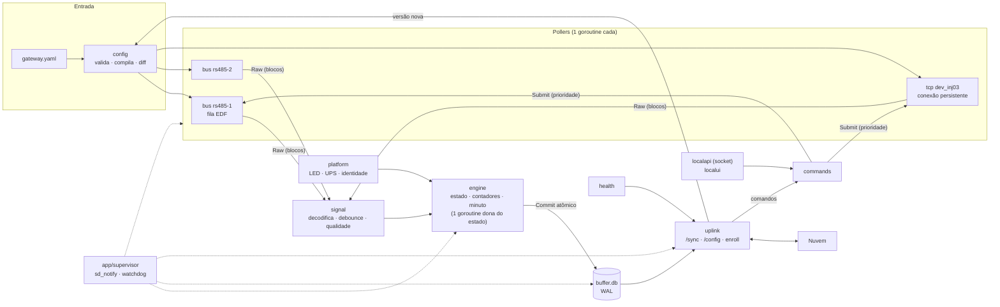
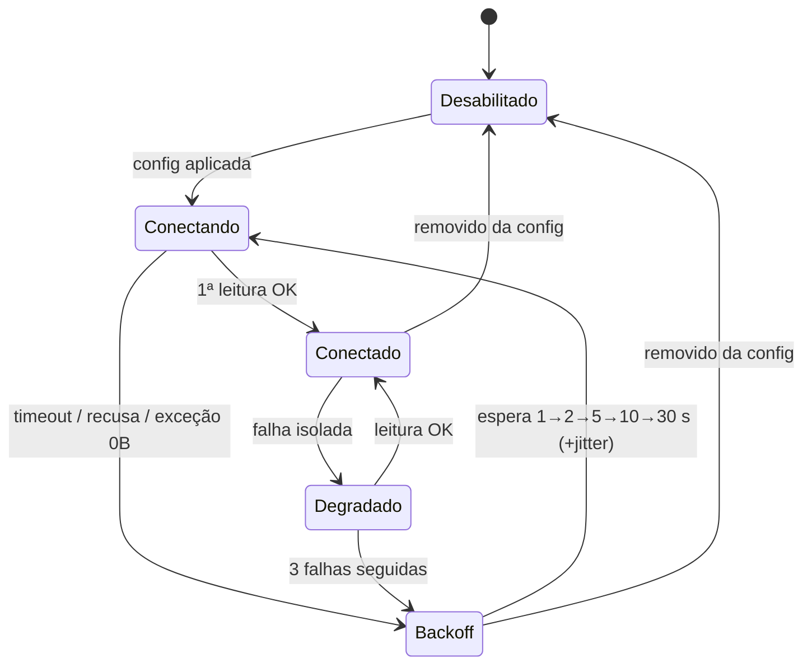
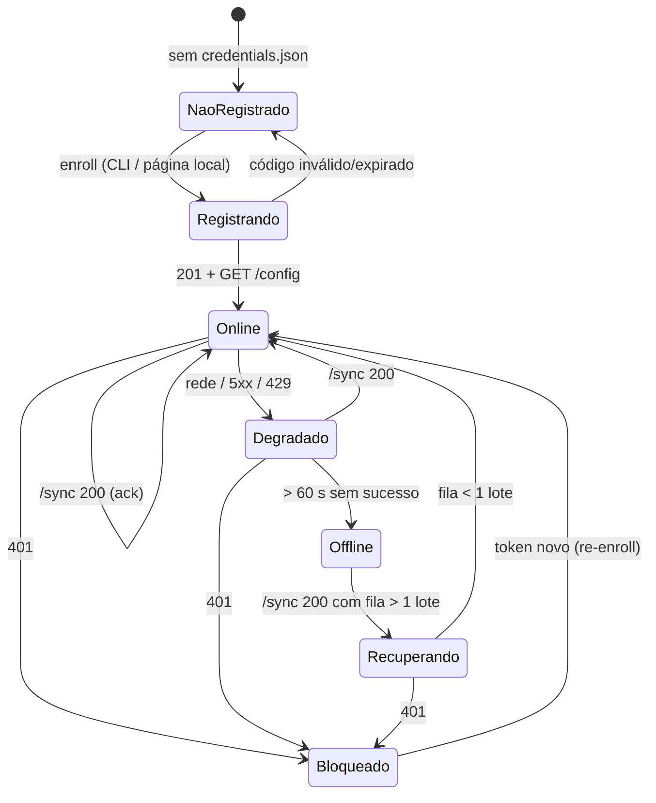
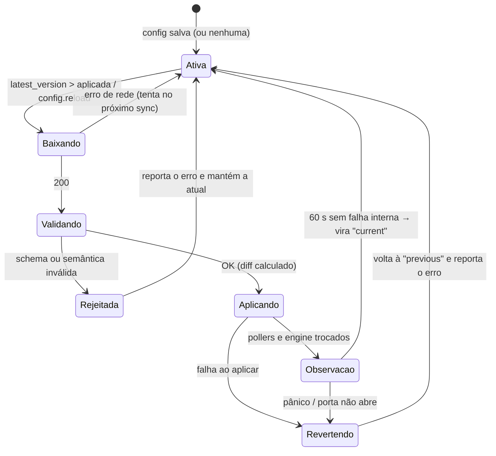

> **Consolidado:** as definições canônicas estão no [`docs/16`](../16-projeto-do-gateway.md); onde este rascunho divergir, vale o docs/16 (ex.: **ETH0 = OT** e **ETH1 = IT**; página local no `oee-localui`, porta 443, só na OT e no endereço de serviço). Implementação em `gateway/` e `deploy/`.

> **Rascunho** gerado pela análise do projeto do gateway (interrompida em 11/11/2026). Ainda não revisado nem consolidado no `docs/16`.

# Gateway: projeto do software (proposta para documentação técnica)

> **Status:** proposta de projeto, 11/11/2026. Parte do que está em [03](03-gateway.md), [04](04-protocolo-gateway-nuvem.md), [11](11-integracao-modbus.md), [12](12-acesso-remoto-vpn.md), [08](08-seguranca-e-operacao.md) e nas ADRs 002, 003, 006, 008, 011, 012 e 013. Itens **"a confirmar"** dependem da bancada com o reComputer R1000 ou do fornecedor. A seção 9 lista os ajustes que este projeto propõe aos documentos e ao contrato.

**Princípios que guiam todas as decisões abaixo**
1. **A coleta nunca depende da nuvem.** Com uma config válida salva, o agente coleta e grava, esteja online, offline, sem credencial válida ou atualizando.
2. **Nenhuma peça se perde nem é contada duas vezes.** Isso vale para queda de rede, queda de energia, `kill -9` e reinício. É o invariante principal dos testes ("conservação de peças").
3. **Somente leitura no CLP, por construção.** Nenhuma interface interna tem método de escrita, e o lint barra chamadas de escrita da biblioteca.
4. **Um mestre por barramento.** Toda leitura num RS-485 (polling, comando da web, CLI, página local) passa pela mesma fila do barramento.
5. **Poupar o eMMC.** Gravar em lote, nada de escrita por leitura, e só o necessário no disco.
6. **O privilégio mínimo em cada processo.** O agente roda sem root. Só o atualizador (e, na F2, o acesso remoto) tem privilégios, e cada um fica em um processo pequeno e separado.

---

## 1. Funções do gateway

| # | Função | O que faz | Fase |
|---|---|---|---|
| **Coleta** ||||
| F01 | Modbus TCP | FC01–FC04; **uma conexão persistente por dispositivo**; timeout curto; reconexão com backoff | **MVP** |
| F02 | Modbus RTU (RS-485) | **Uma goroutine por barramento** (até 3 no R1000), requisições serializadas, intervalo mínimo entre quadros | **MVP** |
| F03 | RTU sobre TCP | Para conversores serial↔Ethernet transparentes | **MVP** |
| F04 | Planejador de blocos | Agrupa registradores contíguos (≤ 125 registradores / 2.000 bits). Se o CLP responder exceção 02 (endereço inválido), divide o bloco ao meio até isolar a tag ruim | **MVP** |
| F05 | Decodificação | bool, bit de registrador, int16/uint16, int32/uint32, float32; ordens ABCD/CDAB/BADC/DCBA; escala (`mul`, `add`) | **MVP** (int64/float64/string: F2) |
| F06 | Saúde por dispositivo | Estado da conexão, latência, erros por tipo (timeout, CRC, exceção n), backoff do escravo morto sem travar o barramento | **MVP** |
| F07 | Detector de 2º mestre | Bytes recebidos no RS-485 sem requisição nossa indicam IHM ou outro mestre no barramento → alerta (ver [11 §5](11-integracao-modbus.md#5-um-mestre-por-barramento)) | **MVP** (barato) |
| **Processamento** ||||
| F08 | Sinais | Debounce de booleanos, deadband de analógicos, qualidade (boa/ruim/vencida) | **MVP** |
| F09 | Estado da máquina | Modos `signals`, `state_code` e `count_derived`; `NO_COMM`; **heartbeat** do bloco OEE (CLP "congelado" vira `NO_COMM`) | **MVP** |
| F10 | Contadores | Delta com overflow, reset, salto absurdo e troca de endereço; estado persistido junto com os minutos | **MVP** |
| F11 | Minutos e eventos | Agregado por minuto e eventos de estado, produto, reset, salto, relógio, energia e início/parada do agente | **MVP** |
| F12 | Amostras `custom` | Histórico livre com deadband e intervalo mínimo/máximo | MVP se houver folga; senão **F2** |
| **Armazenamento e nuvem** ||||
| F13 | Outbox SQLite | Fila principal (eventos e minutos) e fila de amostras, com retenção por prioridade | **MVP** |
| F14 | Registro (enroll) | Troca o código de ativação por credencial (CLI; página local na F2) | **MVP** |
| F15 | Sincronização | `/sync` com gzip, ack, backoff com jitter, envio imediato em mudança de estado, recuperação de fila com limite de taxa | **MVP** |
| F16 | Config remota | Baixa, valida, aplica sem reiniciar (por diferença) e volta à última config boa se algo falhar | **MVP** |
| F17 | Proxy e CA corporativa | `HTTPS_PROXY`/`NO_PROXY` e CAs extras em PEM | **MVP** |
| F18 | Relógio | Diferença em relação ao `server_time`, detecção de salto, operação sem NTP | **MVP** |
| **Comandos** ||||
| F19 | `tag.read`, `device.test`, `config.reload`, `agent.restart` | Como no [04](04-protocolo-gateway-nuvem.md#tipos-de-comando), sempre pela fila do barramento | **MVP** |
| F20 | `modbus.scan`, `logs.upload`, `token.rotate`, `log.level` (com prazo), `gateway.identify` (LED/buzzer) | Suporte e comissionamento remotos | **F2** |
| F21 | `agent.update` (OTA) | `.deb` assinado (Ed25519), instalador root separado, rollback automático | **F2**. **Recomendação:** antecipar uma versão mínima para antes do piloto (ver M4b) |
| **Operação local** ||||
| F22 | CLI de campo | `enroll`, `status`, `diag`, `modbus read/scan`, `config show/validate`, `buffer stats`, `unenroll` | **MVP** |
| F23 | Página local | MVP: **status somente leitura** (opcional). F2: comissionamento (teste de leitura, diagnóstico, logs) | MVP opcional / **F2** |
| F24 | LEDs de status | LED RGB do R1000 mostrando o estado (seção 6.3) | **MVP** |
| F25 | Queda de energia | Lê o sinal de falta de energia do módulo UPS, grava tudo e decide entre reboot e desligamento (seção 4.6) | **MVP** se o kit tiver UPS; senão F2 |
| F26 | Watchdog | `sd_notify` com verificação real de saúde + watchdog de hardware | **MVP** |
| F27 | Logs | Estruturados no journald, sem segredos, com limite de repetição; nível temporário | **MVP** (envio sob demanda: F2) |
| F28 | Telemetria de saúde | CPU, RAM, disco, temperatura, **desgaste do eMMC**, links, NTP, fila, latências | **MVP** |
| **Acesso remoto** ||||
| F29 | VPN sob demanda | `vpn.enable/disable/status`, `ot.forward.open/close`, kill switch local, auditoria na outbox ([12](12-acesso-remoto-vpn.md)) | **F2** |
| **Futuro** ||||
| F30 | Credencial selada no TPM | `systemd-creds` com TPM2 (o R1000 tem TPM; suporte a confirmar) | F2/F3 |
| F31 | Exportação do buffer | `buffer export` para pendrive, em planta sem internet | F3 |
| F32 | Protocolos nativos | S7comm, EtherNet/IP, OPC UA (nova implementação de `Transport`/driver) | F2/F3 |
| F33 | Uplink MQTT/Sparkplug B | Nova implementação de `Uplink` | F3 |
| F34 | Andon local sem internet | TV ligada ao gateway, lendo o `live` local | F3 (ideia) |
| F35 | Escrita controlada no CLP | Allowlist, papel, confirmação e auditoria (ADR-008) | F3+ |

**Fora do gateway, de propósito:** cálculo de OEE, calendário, motivos e micro-paradas ficam na nuvem (ADR-006). **A nuvem nunca altera a rede, o proxy nem a política de acesso remoto do gateway**, porque um erro desses deixaria um equipamento remoto inacessível.

---

## 2. Processos e serviços no Linux

### 2.1 Processos

| Processo | Binário | Usuário | Quem inicia | Quando | Fase |
|---|---|---|---|---|---|
| Agente de coleta | `/usr/bin/oee-gateway run` | `oee` | systemd (`oee-gateway.service`, habilitado) | Sempre | MVP |
| Socket da CLI | `oee-gateway.socket` → mesmo processo | `oee` | systemd (ativação por socket) | Sempre | MVP |
| Página local | Dentro do agente (`internal/localui`) | `oee` | Agente | Se `localui.enabled` | MVP (status) / F2 |
| Atualizador | `/usr/lib/oee-gateway/oee-updater` | root | `oee-gateway-updater.path` (pedido gravado pelo agente) | Só durante uma atualização | F2 (ou M4b) |
| Verificação pós-boot do OTA | `oee-updater boot-check` | root | `oee-gateway-update-check.service`, antes do agente | Em todo boot (sai em < 1 s se não houver atualização pendente) | F2 (ou M4b) |
| Acesso remoto | `/usr/lib/oee-gateway/oee-remote-access` | `oee-ra` | Agente, via D-Bus + polkit (unidade **nunca habilitada**) | Só em sessão aprovada | F2 |

**Por que o atualizador é um binário separado:** se o agente se atualizasse sozinho, um binário novo que não sobe não conseguiria fazer o rollback de si mesmo. O `oee-updater` é pequeno, muda raramente e é empacotado à parte (`oee-gateway-updater`), **nunca na mesma transação** do agente.

### 2.2 Usuários e grupos (`/usr/lib/sysusers.d/oee-gateway.conf`)

```
u oee     - "Engemase OEE gateway"      /var/lib/oee-gateway /usr/sbin/nologin
u oee-ra  - "Engemase OEE remote access" /nonexistent         /usr/sbin/nologin
g oee-admin -
m oee dialout          # /dev/ttyAMA* (RS-485)
m oee gpio             # /dev/gpiochip* (sinal de falta de energia, buzzer)
m oee systemd-journal  # ler o journal para logs.upload
```

- Pessoas que podem usar a CLI sem `sudo` (por exemplo, o usuário `suporte` da F2) entram no grupo `oee-admin`.
- `m` cria o grupo se ele não existir (por exemplo, `gpio` num amd64 de bancada).

### 2.3 Diretórios e arquivos

| Caminho | Dono / modo | Conteúdo |
|---|---|---|
| `/usr/bin/oee-gateway` | root 0755 | Agente + CLI (binário estático) |
| `/usr/lib/oee-gateway/oee-updater`, `oee-remote-access` | root 0755 | Atualizador e helper (F2) |
| `/etc/oee-gateway/gateway.yaml` | root:oee 0640, *conffile* | Config **local** mínima (seção 5) |
| `/etc/oee-gateway/remote-access.json` | root 0644 | Política local de acesso remoto; **prevalece sobre a nuvem** (F2) |
| `/etc/oee-gateway/ca.d/*.pem` | root 0644 | CAs corporativas extras |
| `/etc/default/oee-gateway` | root 0644 | `HTTPS_PROXY`, `NO_PROXY` |
| `/var/lib/oee-gateway/` | oee:oee 0750 | Estado (`StateDirectory`) |
| `…/buffer.db`, `-wal`, `-shm` | oee 0640 | SQLite (seção 4) |
| `…/credentials.json` | oee 0600 | `gateway_id`, token. **Saiu de `/etc`** (ver seção 9) |
| `…/localui/` | oee 0700 | Certificado autoassinado, hash da senha |
| `…/update/` | oee 0750 | Downloads, `request.json`, `state.json`, `previous.deb` |
| `/run/oee-gateway/agent.sock` | oee:oee-admin 0660 | API local (CLI e página local) |
| `/usr/lib/systemd/system.conf.d/50-oee-watchdog.conf` | root | Watchdog de hardware |
| `/usr/lib/systemd/journald.conf.d/50-oee.conf` | root | Rotação de logs |
| `/usr/share/polkit-1/rules.d/50-oee-gateway.rules` | root | Permissões D-Bus do usuário `oee` (F2 / energia) |

### 2.4 `oee-gateway.service`

```ini
[Unit]
Description=Engemase OEE - agente de coleta do gateway
Documentation=https://oee.engemase.com.br/ajuda/gateway
After=network.target
# Não espera internet nem NTP: a coleta começa mesmo offline.
StartLimitIntervalSec=0

[Service]
Type=notify
NotifyAccess=main
ExecStart=/usr/bin/oee-gateway run --config /etc/oee-gateway/gateway.yaml
Sockets=oee-gateway.socket
EnvironmentFile=-/etc/default/oee-gateway
Environment=GOMEMLIMIT=120MiB
User=oee
Group=oee
SupplementaryGroups=dialout gpio systemd-journal
Restart=always
RestartSec=5s
# Trixie (systemd ≥ 254): RestartSteps=5 e RestartMaxDelaySec=60s
WatchdogSec=30s
TimeoutStartSec=60s
TimeoutStopSec=80s   # leitores voltam em até 6 × timeout_ms (RTU sobre TCP) + gravação final; valor canônico na unit de deploy/gateway
OOMScoreAdjust=-500
Nice=-5
StateDirectory=oee-gateway
StateDirectoryMode=0750
ConfigurationDirectory=oee-gateway
UMask=0027

# Recursos (R1000: 4 núcleos, 2 GB)
CPUQuota=100%
MemoryHigh=150M
MemoryMax=256M
TasksMax=256
LimitNOFILE=4096

# Hardening
NoNewPrivileges=yes
CapabilityBoundingSet=
AmbientCapabilities=
ProtectSystem=strict
ProtectHome=yes
PrivateTmp=yes
DevicePolicy=closed
DeviceAllow=char-ttyAMA rw
DeviceAllow=char-ttyUSB rw
DeviceAllow=char-gpiochip rw
ProtectKernelTunables=yes
ProtectKernelModules=yes
ProtectKernelLogs=yes
ProtectControlGroups=yes
ProtectClock=yes
ProtectHostname=yes
ProtectProc=invisible
# LEDs de status (a confirmar na bancada; plano B: ProtectKernelTunables=no)
ReadWritePaths=-/sys/class/leds
RestrictAddressFamilies=AF_UNIX AF_INET AF_INET6 AF_NETLINK
RestrictNamespaces=yes
RestrictRealtime=yes
RestrictSUIDSGID=yes
LockPersonality=yes
MemoryDenyWriteExecute=yes
RemoveIPC=yes
SystemCallArchitectures=native
SystemCallFilter=@system-service
SystemCallFilter=~@privileged
SystemCallErrorNumber=EPERM

[Install]
WantedBy=multi-user.target
```

```ini
# oee-gateway.socket — API local da CLI (o agente recebe o fd por ativação de socket)
[Socket]
ListenStream=/run/oee-gateway/agent.sock
SocketUser=oee
SocketGroup=oee-admin
SocketMode=0660
DirectoryMode=0755

[Install]
WantedBy=sockets.target
```

Notas:
- **`ProtectClock=yes`** bloqueia `adjtimex`. Por isso o estado do NTP é lido pelo D-Bus (`org.freedesktop.timedate1`, propriedade `NTPSynchronized`), e não por syscall.
- **Não usar `ProcSubset=pid`**: o coletor de saúde lê `/proc/stat`, `/proc/meminfo` e `/proc/loadavg`.
- Os nomes de grupo de dispositivo (`char-ttyAMA`, `char-gpiochip`) vêm de `/proc/devices`. **A confirmar no R1000**; a alternativa é listar os caminhos (`/dev/ttyAMA2` etc.).
- Meta: `systemd-analyze security oee-gateway` com nota ≤ 2,0 ("OK"). O valor exato será fixado no M4.

### 2.5 Watchdog

| Camada | Configuração | O que cobre |
|---|---|---|
| Agente → systemd | `WatchdogSec=30s`. O agente envia `WATCHDOG=1` a cada 10 s **somente se** o motor rodou o tick há < 5 s, cada poller deu sinal de vida dentro do seu limite e o gravador SQLite respondeu | Agente travado, deadlock, leitura serial presa no kernel |
| systemd → hardware | `/usr/lib/systemd/system.conf.d/50-oee-watchdog.conf`: `[Manager]` `RuntimeWatchdogSec=15s` `RebootWatchdogSec=2min` | Kernel ou systemd travados |
| Hardware | Watchdog do BCM2711 (`bcm2835_wdt`): **máximo de ~15 s**. Valor maior falha com "Invalid argument" | — |
| Hardware (R1000) | A ficha da Seeed cita um **watchdog de 1 a 255 s implementado pelo RTC** (externo ao SoC). Dispositivo (`/dev/watchdog1`?) e uso combinado com o do SoC: **a confirmar** | Recuperação após *halt* (seção 4.6) |

Além do watchdog, o agente informa `STATUS=` ao systemd, visível em `systemctl status`. Exemplo: `coletando 18/20 dispositivos · nuvem online · fila 15`.

Um poller travado é reiniciado primeiro pelo supervisor interno. O agente só para de alimentar o watchdog se o poller continuar travado por mais de 60 s (por exemplo, `read()` serial que não volta).

### 2.6 Atualizador (OTA)

```ini
# oee-gateway-updater.path
[Path]
PathChanged=/var/lib/oee-gateway/update/request.json
Unit=oee-gateway-updater.service
[Install]
WantedBy=multi-user.target

# oee-gateway-updater.service (root, oneshot)
[Service]
Type=oneshot
ExecStart=/usr/lib/oee-gateway/oee-updater apply --request /var/lib/oee-gateway/update/request.json
TimeoutStartSec=10min
NoNewPrivileges=yes
ProtectHome=yes
PrivateTmp=yes
```

Fluxo:
1. O agente baixa o `.deb` e o `manifest.json.sig` e confere hash e assinatura.
2. O agente grava `request.json`.
3. O `oee-updater` **confere de novo** (nunca confia no processo sem privilégio):
   - assinatura Ed25519 do manifesto e SHA-256 do arquivo;
   - `Package: oee-gateway` e arquitetura;
   - versão ≥ mínima permitida (sem downgrade fora do rollback).
4. O `oee-updater` guarda o `.deb` atual em `previous.deb`, roda `dpkg -i` e reinicia o agente.
5. Espera até **5 min** por `update/health.json`, que o agente novo grava após o primeiro `/sync` 200 com a versão-alvo. Sem isso, roda `dpkg -i previous.deb` e grava `result.json` = `rolled_back`.
6. **Queda de energia no meio da atualização:** `oee-gateway-update-check.service` (`Before=oee-gateway.service`) roda `dpkg --configure -a` e retoma a verificação ou o rollback a partir de `state.json`.

O OTA usa **`.deb`**, não só o binário. Assim, units, hardening e arquivos de sysusers/tmpfiles também se atualizam, e o `dpkg` sempre sabe a versão instalada.

### 2.7 Helper de acesso remoto (F2, resumo; detalhe no [12](12-acesso-remoto-vpn.md))

```ini
# oee-remote-access.service — nunca habilitado; iniciado pelo agente via D-Bus
[Service]
Type=notify
User=oee-ra
ExecStart=/usr/lib/oee-gateway/oee-remote-access --session /run/oee-gateway/ra/session.json
# Estado do tsnet em tmpfs: some no reboot ("nunca religa após reboot")
RuntimeDirectory=oee-remote-access
# Teto local, mesmo sem nuvem
RuntimeMaxSec=8h
Restart=no
MemoryMax=192M
CPUQuota=50%
NoNewPrivileges=yes
ProtectSystem=strict
ProtectHome=yes
PrivateTmp=yes
PrivateDevices=yes
CapabilityBoundingSet=
RestrictAddressFamilies=AF_UNIX AF_INET AF_INET6 AF_NETLINK
```

Regra polkit (o usuário `oee` só pode iniciar e parar essas unidades e pedir reboot ou desligamento por falta de energia):

```js
polkit.addRule(function (action, subject) {
  if (subject.user !== "oee") return polkit.Result.NOT_HANDLED;
  if (action.id === "org.freedesktop.systemd1.manage-units" &&
      action.lookup("unit") === "oee-remote-access.service" &&
      ["start", "stop"].indexOf(action.lookup("verb")) >= 0) return polkit.Result.YES;
  if (action.id === "org.freedesktop.login1.reboot" ||
      action.id === "org.freedesktop.login1.power-off") return polkit.Result.YES;
  return polkit.Result.NOT_HANDLED;
});
```

### 2.8 Página local (dentro do agente)

- **Escuta** só no IP da interface OT e em `127.0.0.1`, porta **8443**, HTTPS com certificado autoassinado (ECDSA P-256) gerado no primeiro boot. A impressão digital do certificado vai no `/sync` para a web exibir.
- **Senha:**
  - hash argon2id em `/var/lib/oee-gateway/localui/`;
  - senha inicial gerada no enroll e mostrada **uma vez** na web para engenheiro ou Engemase (ou definida com `oee-gateway localui passwd`);
  - 5 tentativas erradas bloqueiam por 5 min; sessão de 30 min.
- **MVP (opcional, 1–2 dias):** página única de status somente leitura (nuvem, relógio, config, dispositivos, máquinas, fila). Usa o mesmo JSON do `oee-gateway status`.
- **F2:**
  - teste de leitura ad hoc (somente leitura, pela fila do barramento);
  - diagnóstico (`diag`), últimos logs e eventos locais;
  - enroll pela página.
- **Nunca** edita dispositivos e tags: a nuvem é a fonte da verdade.
- Implementação com `html/template` + `embed`, sem framework JS.

### 2.9 Perfil de hardware: reComputer R1000

| Recurso | Valor | Status |
|---|---|---|
| RS-485 lógicas | `rs485-1` → `/dev/ttyAMA2`, `rs485-2` → `/dev/ttyAMA3`, `rs485-3` → `/dev/ttyAMA5` | Portas confirmadas; **ordem dos bornes a confirmar** |
| Modo RS-485 | Já ativado pelo overlay da Seeed → o agente **não refaz o `TIOCSRS485`** (`rs485_ioctl: leave`). Na v1.1 o DE está ligado a pinos com RTS | A confirmar na PoC (testar `leave` vs `kernel`) |
| Ethernet | IT = `eth0` (GbE), OT = `eth1` (10/100) | Nomes a confirmar |
| LEDs | `/sys/class/leds/led-red`, `led-green`, `led-blue` (USER, RGB) | Wiki Seeed |
| Buzzer | GPIO21 (placa v1.0) / PCA9535 P15 (v1.1) | A confirmar no lote |
| Falta de energia (UPS) | GPIO25, ativo em nível baixo (o overlay `gpio-shutdown` da Seeed usa esse pino); tensão de entrada por I²C (barramento 6, LTC3350) | A confirmar |
| Watchdog | SoC ≤ 15 s; RTC 1–255 s | Seção 2.5 |
| Identidade | `/sys/firmware/devicetree/base/serial-number`, `/proc/device-tree/model` | — |

Os perfis `recomputer-r1100`, `revpi-connect4` e `generic` (bancada x86/USB-RS485) usam a mesma interface `Platform`.

---

## 3. Arquitetura interna do agente

### 3.1 Fluxo



### 3.2 Pacotes

| Pacote | Responsabilidade |
|---|---|
| `app` | Monta tudo, supervisor de goroutines (reinício com backoff, `recover`), sinais, `sd_notify`, verificação de vida |
| `buildinfo` | Versão, commit e data (ldflags) |
| `cli` | Comandos cobra |
| `clock` | Relógio monotônico + parede, diferença para o servidor, qualidade do relógio, detecção de salto |
| `config` | `gateway.yaml`, config remota, validação, **`Runtime` compilado** (índices prontos), diff entre versões |
| `contracts` | Tipos Go do contrato `/v1` + fixtures de teste do `packages/contracts` |
| `pkg/mbcodec` (público) | Codec Modbus puro, sem I/O: áreas, tipos, ordem de words, CRC, planejador de blocos. Público para o `plc-sim` reutilizar |
| `drivers/modbustcp`, `drivers/modbusrtu`, `drivers/rtuovertcp`, `drivers/sim` | Implementações de `Transport` sobre a `grid-x/modbus` |
| `bus` | Pollers (barramento serial e dispositivo TCP), escalonamento por prazo, backoff, estatísticas, detector de 2º mestre |
| `signal` | Raw → `Sample` por tag |
| `engine` | Máquinas: estado, contadores, minutos, eventos, `live` |
| `buffer` | SQLite: migrações, transações, outbox, retenção, integridade |
| `uplink` | Cliente HTTP: lote, gzip, backoff, erros tipados, relógio do servidor |
| `commands` | Executor (deduplicação, prazo) e handlers |
| `health` | Coletores de processo, sistema, eMMC, rede, temperatura e NTP |
| `localapi` / `localui` | HTTP no socket unix / página HTTPS |
| `platform` | Perfis de hardware, LEDs, buzzer, GPIO de energia, identidade |
| `updater` | Lado do agente (download e verificação) e lado root (`cmd/oee-updater`) |
| `remoteaccess` | Política local e comandos `vpn.*` (F2) |
| `logx` | `slog` → journald (campos estruturados), remoção de segredos, limite de repetição |

### 3.3 Interfaces principais

```go
// clock — todo instante carrega parede (UTC) e monotônico.
type Stamp struct {
	Wall time.Time     // UTC; corrigida pela diferença do servidor se o NTP não sincronizou
	Mono time.Duration // monotônico desde o início do processo
}
type Clock interface {
	Now() Stamp
	NewTicker(d time.Duration) Ticker
	Quality() ClockQuality // NTPSynced | ServerOffset | RTCOnly | Invalid
}

// pkg/mbcodec — puro, 100% testável.
type Area uint8 // Coil, DiscreteInput, InputRegister, HoldingRegister
type Block struct {
	Unit  uint8
	Area  Area
	Start uint16 // base 0
	Count uint16 // ≤125 registradores ou ≤2000 bits
}
type Raw struct {
	Block Block
	Regs  []uint16
	Bits  []bool
	At    clock.Stamp
	RTT   time.Duration
}
func Plan(tags []TagAddr, opt PlanOptions) []Block       // agrupa (max_gap, limites)
func Decode(r Raw, spec TagSpec) (Value, error)           // tipo, word order, bit, escala

// drivers — SOMENTE LEITURA por construção: não existe método de escrita.
type Transport interface {
	// Uma goroutine dona por transporte; nunca chamado em paralelo.
	ReadBlock(ctx context.Context, b mbcodec.Block) (mbcodec.Raw, error)
	Close() error
	Info() TransportInfo // "tcp://192.168.10.23:502", "rtu://rs485-1@19200-8E1"
}
type Opener interface {
	Open(ctx context.Context, spec TransportSpec) (Transport, error)
}
// Erros classificados (backoff e diagnóstico): ErrTimeout, ErrConnRefused, ErrCRC,
// ErrPortUnavailable, *ModbusException{Code: 0x02}

// bus — um Poller por barramento RS-485 ou por dispositivo TCP.
type Poller interface {
	Run(ctx context.Context) error
	Submit(ctx context.Context, r AdhocRead) (mbcodec.Raw, error) // comandos/CLI: prioridade alta
	Update(p PollPlan) error                                     // config nova sem fechar a porta
	Stats() PollerStats                                          // ciclo, ocupação, overruns, por dispositivo
}
type DeviceEvent struct {
	DeviceID string
	From, To ConnState
	Err      error
	At       clock.Stamp
}

// signal
type Sample struct {
	TagID   string
	Value   Value   // bool | int64 | uint64 | float64 | string
	Quality Quality // Good | Bad | Stale
	At      clock.Stamp
}
type Processor interface {
	OnRaw(r mbcodec.Raw, dev string) []Sample
	OnFailure(dev string, at clock.Stamp) []Sample
}

// engine — uma goroutine é dona de todo o estado das máquinas.
type Engine interface {
	Run(ctx context.Context, in <-chan Input) error
	Live() []contracts.Live           // cópia; segura para outras goroutines
	Apply(rt *config.Runtime) error   // enviado pelo canal de controle
	Stop(ctx context.Context) error   // grava minuto aberto + contadores
}

// buffer — tudo o que gera itens da fila é gravado na MESMA transação.
type Store interface {
	Commit(ctx context.Context, w Write) error
	NextBatch(ctx context.Context, lim BatchLimits) (Batch, error)
	Ack(ctx context.Context, a Ack) error
	Enforce(ctx context.Context, p Retention) (Dropped, error)
	LoadState(ctx context.Context) (State, error) // contadores, máquinas, minuto aberto, config, uplink
	Stats(ctx context.Context) (Stats, error)
}
type Write struct {
	Core        []Item // eventos e minutos
	Samples     []Item
	Counters    []CounterState
	Machines    []MachineState
	OpenMinutes []OpenMinute // só no desligamento limpo
	Meta        map[string]string
}

// uplink (como no 04, com enroll e upload)
type Uplink interface {
	Enroll(ctx context.Context, r contracts.EnrollRequest) (contracts.EnrollResponse, error)
	Sync(ctx context.Context, r contracts.SyncRequest) (contracts.SyncResponse, error)
	FetchConfig(ctx context.Context, etag string) (body []byte, newETag string, err error) // 304 → ErrNotModified
	Upload(ctx context.Context, commandID string, r io.Reader) error                     // F2
}
// Erros tipados: *HTTPError{Status, RetryAfter}, ErrUnauthorized, ErrTooLarge, ErrBadRequest

// commands
type Handler interface {
	Type() string // "tag.read"
	Timeout() time.Duration
	Execute(ctx context.Context, c contracts.Command) (any, error)
}

// health
type Source interface {
	Collect(ctx context.Context, h *Health) error
}

// platform
type Platform interface {
	Name() string                                  // "recomputer-r1000"
	SerialPort(logical string) (SerialPort, error) // "rs485-1" → {Path, RS485Mode}
	Identity() HWIdentity
	Indicator() Indicator         // LEDs/buzzer; no-op se não houver
	PowerEvents() <-chan PowerEvent // nil sem UPS
}

// app — usado para decidir se o watchdog é alimentado.
type Liveness interface {
	Name() string
	LastBeat() time.Time
	MaxSilence() time.Duration
}
```

**Regra de lint (ADR-008):** o `golangci-lint` usa o `forbidigo` para proibir, em todo o módulo, `WriteSingleCoil|WriteMultipleCoils|WriteSingleRegister|WriteMultipleRegisters|ReadWriteMultipleRegisters|MaskWriteRegister|WriteFileRecord`. A interface da `grid-x/modbus` tem esses métodos, e a nossa não.

### 3.4 Concorrência

| Goroutine | Quantidade | Dona de | Comunicação |
|---|---|---|---|
| Supervisor (`app`) | 1 | Ciclo de vida, sinais, watchdog | `context`, reinício com backoff |
| Poller serial | **1 por barramento** (≤ 3) | Porta serial e fila do barramento | `chan Input` → engine |
| Poller TCP | **1 por dispositivo** TCP / RTU sobre TCP | Conexão TCP persistente | Idem |
| Engine | 1 | Estado das máquinas, minutos | Entrada com buffer de 1.024 → `Store.Commit` |
| Gravador SQLite | 1 (conexão única de escrita, `_txlock=immediate`) | Escrita | Chamadas síncronas em fila |
| Leitores SQLite | Pool de 2 | — | WAL permite ler durante a escrita |
| Uplink | 1 | Ciclo de sync, backoff, modo rápido | Store (leitura), commands, config |
| Config manager | 1 | Fetch, validação, aplicação | Canal de controle → pollers e engine |
| Executor de comandos | 1 + até 4 workers | `command_log` | `Poller.Submit` |
| Health | 1 (a cada 10 s) | Snapshot de métricas | Valor atômico |
| `localapi` / `localui` | `net/http` | — | Snapshots + `Submit` |
| Energia (UPS) | 0 ou 1 | Linha GPIO | Evento → engine/store |

Regras:
- **Pollers não compartilham conexão.** Nenhum outro código abre a porta serial ou o IP de um dispositivo configurado. CLI, página local e comandos usam `Submit`. Assim o RS-485 tem um mestre só, e não se abre uma 2ª conexão TCP num CLP que aceita poucas.
- **Escalonamento por prazo** dentro do poller (*earliest deadline first*):
  - comandos interativos primeiro, com limite de 1 a cada 3 transações para não matar o polling;
  - depois polling por prazo vencido;
  - por último, varreduras.
  - **Sem fila acumulada:** um prazo perdido por mais de 1 período é pulado e conta como *overrun*.
- **Contrapressão:** se o canal do engine encher, os pollers bloqueiam (o ciclo alonga e as métricas acusam). Nada é descartado em silêncio.
- **Pânico:** em poller, uplink ou health, é recuperado e a goroutine reinicia. No engine ou no gravador, o processo sai e o systemd reinicia (estado consistente vem do SQLite).

### 3.5 Valores padrão dos drivers (sobre a `grid-x/modbus` v1.5.1)

| Parâmetro | TCP | RTU (RS-485) | Observação |
|---|---|---|---|
| `Timeout` por leitura | 500 ms | 300 ms | O padrão da biblioteca é 10 s (TCP) e 5 s (serial): **sempre sobrescrever** |
| Timeout de conexão | 2 s | — | `Dial` próprio |
| `IdleTimeout` | **−1** (conexão nunca expira) | **0** (porta nunca fecha) | Na biblioteca, negativo = conexão em cache sem expirar; no serial, ≤ 0 desliga o fechamento por inatividade |
| `LinkRecoveryTimeout` / `ProtocolRecoveryTimeout` | 0 | 0 | A reconexão é nossa (backoff e estado) |
| Retentativas | 1 | 1 | — |
| Backoff de dispositivo | 1 → 2 → 5 → 10 → 30 s + jitter | Idem | Escravo morto não consome o barramento a cada ciclo |
| Intervalo entre quadros | — | `max(3,5 caracteres; 2 ms)` + `turnaround_ms` (padrão 5) | Alguns escravos precisam de 10–20 ms |
| Dados em voo por dispositivo | 1 | 1 (barramento) | Vários CLPs não aceitam pipeline |
| `max_gap` do planejador | 8 registradores | 8 | `0` para CLPs que rejeitam leitura de endereços não mapeados |
| `poll_ms` mínimo | 100 | 200 | Validado na config |

### 3.6 Motor de máquina: regras que garantem a contagem

**Estados:** `RUNNING`, `STOPPED`, `FAULT`, `SETUP`, `NO_COMM` ([07](07-calculo-oee.md#modelo-de-estados)), e `UNKNOWN` só internamente, até a primeira leitura boa após o boot.

1. **Debounce** (padrão 2 s): o estado candidato precisa se manter pelo prazo. O evento leva o **instante em que o candidato começou**, não o da confirmação.
2. **`NO_COMM`:** é declarado após `comm_loss_after_s` sem leitura boa de qualquer tag de papel `state.*` ou `count.*`. O timestamp é o da **primeira falha**. O mesmo vale quando o `plc.heartbeat` fica parado por mais de `heartbeat_timeout_s` (papel novo, ver seção 9).
3. **Contadores.** Sendo `Δt` o tempo desde a última leitura contabilizada e `limite = max_rate_per_s × max(Δt, 1 s) + 10`:
   - `cur ≥ prev` → `delta = cur − prev`. Se `delta > limite`, é **salto**: descarta o delta, gera o evento `counter_jump` e redefine a base.
   - `cur < prev` → calcula `wrap = (max − prev) + cur + 1`. Se `wrap ≤ limite`, é **overflow** (`delta = wrap`). Senão é **reset** (`delta = cur` + evento `counter_reset`).
   - Endereço, tipo ou ordem de words mudou na config → **redefine a base** sem delta + evento `counter_rebaseline`.
   - Contador `int16/int32` é tratado como sem sinal da mesma largura.
   - `max_rate_per_s` vem da config. Padrão: `20 / ideal_cycle_s`, ou 1.000/s se não houver ciclo ideal.
   - Após `NO_COMM` longo, `Δt` é grande e o limite também: a produção do intervalo entra no primeiro minuto após a volta ([07](07-calculo-oee.md)).
4. **Invariante de exatamente uma vez:**
   - o `counter_state.last_raw` gravado é **sempre o valor ao fim do último minuto confirmado no banco**;
   - minuto e estado do contador vão na **mesma transação**;
   - num crash, o minuto aberto (em RAM) se perde, mas as peças não: o próximo delta parte do último valor gravado e entra no primeiro minuto após o retorno;
   - **por isso tudo fica num único arquivo SQLite:** em WAL, uma transação com bancos anexados não é atômica entre arquivos.
5. **Minuto aberto no desligamento limpo:**
   - no SIGTERM, o acumulado do minuto corrente vai para `open_minute`, **sem enviar**;
   - no boot, se ainda for o mesmo minuto, o agente continua acumulando nele; se o minuto já passou, fecha e envia;
   - **nunca enviar minuto parcial e depois o mesmo minuto de novo:** a nuvem faz upsert por `(machine_id, bucket_start)` e o segundo envio apagaria o primeiro.
6. **Fronteiras de minuto** pelo relógio de parede (UTC); **durações** pelo monotônico, convertido para parede pela âncora do boot. Num salto de relógio maior que 1 s, gera o evento `clock_jump`, ancora de novo e limita cada minuto a 60 s.
7. **Produto:** o minuto leva o produto vigente no fim do minuto. A troca gera o evento `product` com o instante exato. O código vai bruto (`"7"`) e a nuvem traduz para o produto cadastrado.
8. **`live`** não vai para o disco: é montado do estado em RAM a cada `/sync`.

### 3.7 Máquinas de estado

**Conexão com dispositivo** (TCP; no RTU, a porta é do barramento e "conectar" = primeira resposta do escravo):



Mapeamento para o contrato (`devices[].status`): `connected` (Conectado), `degraded`, `disconnected` (Backoff/Conectando), `disabled`. A porta serial ausente ou ocupada é erro **do barramento** (`bus.port_unavailable`), e todos os escravos dela vão para Backoff.

**Sincronização com a nuvem:**



- **A coleta continua em todos os estados** se houver config salva. `Bloqueado` só para de enviar (e derruba a VPN na F2).
- **Ritmo:**
  - a cada `sync_interval_s` (10 s);
  - **imediato** em mudança de estado (debounce de 1 s, no máximo um a cada 2 s);
  - **modo rápido** (1 s) por 2 min após receber um comando;
  - em **Recuperando**, o próximo lote sai logo após o ack, com no mínimo 1 s entre lotes e jitter;
  - o servidor pode impor `next_sync_s`.
- **Erros:** como na tabela do [04](04-protocolo-gateway-nuvem.md#erros-e-retentativas). Backoff de 1 s a 5 min com *full jitter*. `413` divide o lote. `400` faz bisseção até isolar o item, que vai para `quarantine` (sai da fila principal, fica registrado e é reportado).
- **Diferença de relógio:** `offset = server_time − (t_envio + RTT/2)`, filtrada por mediana das últimas 5 medidas.

**Aplicação de config:**



- **Validação semântica:**
  - barramento existe no perfil de hardware e nenhuma porta é usada por dois barramentos;
  - unit id entre 1 e 247;
  - blocos dentro dos limites; ids únicos;
  - `poll_ms ≥ mínimo`; `comm_loss_after_s ≥ 3 × poll`;
  - cada máquina tem estado ou contador;
  - limite de 2.000 tags e 64 dispositivos por gateway.
- **Aplicação por diferença:**
  - transportes que não mudaram mantêm a conexão;
  - máquinas que continuam mantêm estado, contadores e minuto aberto;
  - máquina removida tem o minuto parcial fechado e enviado (é o último dela).
- **Falha de comunicação com um CLP depois da config nova não é motivo de rollback.** É reportada normalmente. O rollback é só para falha interna do agente.
- O resultado vai no `/sync` (campo proposto `agent.config_status`).

### 3.8 Comandos

- Recebidos na resposta do `/sync`, gravados em `command_log` e **deduplicados por `id`**: se a nuvem reenviar, o agente não executa de novo, só reenvia o resultado.
- Comando expirado (`expires_at` comparado com o relógio corrigido pela diferença do servidor) é descartado com status `expired`.
- **Prazos:** `tag.read` 5 s, `device.test` 10 s, `config.reload` 60 s.
- `device.test` em **RTU com parâmetros seriais diferentes do barramento** exigiria pausar o barramento e afetaria os outros escravos. Só é aceito com `allow_bus_pause: true` e no máximo 5 s; sem isso, o erro é explícito.
- `agent.restart`: o agente envia o resultado num sync imediato, faz o desligamento limpo e sai. O `Restart=always` religa.

---

## 4. Armazenamento local (SQLite)

### 4.1 Pragmas

```sql
PRAGMA page_size = 4096;            -- na criação
PRAGMA auto_vacuum = INCREMENTAL;   -- na criação
PRAGMA journal_mode = WAL;
PRAGMA synchronous = FULL;          -- ver 4.3: NORMAL arrisca dupla contagem
PRAGMA wal_autocheckpoint = 1000;   -- ~4 MB
PRAGMA journal_size_limit = 67108864;
PRAGMA busy_timeout = 5000;
PRAGMA foreign_keys = ON;
PRAGMA temp_store = MEMORY;
```

### 4.2 Esquema (versão 1, tabelas `STRICT`)

```sql
CREATE TABLE meta (key TEXT PRIMARY KEY, value TEXT NOT NULL) STRICT;
-- schema_version, gateway_id, boot_id, last_alive_ms, clean_shutdown, unclean_boots

-- Fila principal: eventos e minutos (nunca descartada antes da política de retenção)
CREATE TABLE outbox_core (
  seq        INTEGER PRIMARY KEY AUTOINCREMENT,
  kind       TEXT    NOT NULL CHECK (kind IN ('event','minute')),
  item_id    TEXT    NOT NULL,   -- UUIDv7 do evento | 'machine_id|bucket_ms'
  machine_id TEXT,
  at_ms      INTEGER NOT NULL,
  payload    BLOB    NOT NULL,   -- JSON no formato do contrato, sem seq
  bytes      INTEGER NOT NULL,
  created_ms INTEGER NOT NULL,
  quarantine INTEGER NOT NULL DEFAULT 0,  -- recusado com 400 após bisseção
  UNIQUE (kind, item_id)                  -- um minuto nunca é fechado duas vezes
) STRICT;

-- Fila de amostras (descartável sob pressão)
CREATE TABLE outbox_samples (
  seq     INTEGER PRIMARY KEY AUTOINCREMENT,
  tag_id  TEXT    NOT NULL,
  at_ms   INTEGER NOT NULL,
  payload BLOB    NOT NULL,
  bytes   INTEGER NOT NULL,
  UNIQUE (tag_id, at_ms)
) STRICT;

CREATE TABLE uplink_state (
  id                INTEGER PRIMARY KEY CHECK (id = 1),
  acked_core_seq    INTEGER NOT NULL DEFAULT 0,
  acked_samples_seq INTEGER NOT NULL DEFAULT 0,
  last_sync_ok_ms   INTEGER,
  server_offset_ms  INTEGER,
  updated_ms        INTEGER NOT NULL
) STRICT;

CREATE TABLE counter_state (
  tag_id      TEXT PRIMARY KEY,
  machine_id  TEXT    NOT NULL,
  role        TEXT    NOT NULL,   -- count.total | count.good | count.reject
  bits        INTEGER NOT NULL,   -- 16 | 32
  addr_key    TEXT    NOT NULL,   -- área, offset, tipo, word_order: mudou → nova base
  last_raw    INTEGER NOT NULL,   -- último valor bruto CONTABILIZADO (fim do último minuto gravado ou checkpoint de evento)
  last_raw_ms INTEGER NOT NULL,
  updated_ms  INTEGER NOT NULL,
  -- Colunas acrescentadas no Open, sem subir o user_version (um agente anterior continua abrindo o arquivo):
  carry       INTEGER NOT NULL DEFAULT 0,  -- peças já contadas em minutos abertos, somadas ao 1º delta depois do restore
  carry_ms    INTEGER NOT NULL DEFAULT 0   -- updated_ms da gravação que escreveu carry; diferente → carry vale 0
) STRICT;
-- O código (gateway/internal/buffer/store.go) é a referência do esquema.

CREATE TABLE machine_state (
  machine_id    TEXT PRIMARY KEY,
  state         TEXT    NOT NULL,
  since_ms      INTEGER NOT NULL,
  fault_code    INTEGER,
  product       TEXT,
  last_event_id TEXT,
  updated_ms    INTEGER NOT NULL
) STRICT;

CREATE TABLE open_minute (       -- só no desligamento limpo
  machine_id TEXT PRIMARY KEY,
  bucket_ms  INTEGER NOT NULL,
  acc        BLOB    NOT NULL,     -- run_ms, stop_ms, fault_ms, setup_ms, no_comm_ms, total, reject, product
  saved_ms   INTEGER NOT NULL
) STRICT;

CREATE TABLE config (
  version     INTEGER PRIMARY KEY,
  slot        TEXT    NOT NULL CHECK (slot IN ('current','previous','candidate','rejected')),
  etag        TEXT,
  sha256      TEXT    NOT NULL,
  body        BLOB    NOT NULL,     -- JSON exatamente como veio da nuvem
  received_ms INTEGER NOT NULL,
  applied_ms  INTEGER,
  error       TEXT
) STRICT;
CREATE UNIQUE INDEX config_one_per_slot ON config(slot)
  WHERE slot IN ('current','previous','candidate');

CREATE TABLE command_log (
  id          TEXT PRIMARY KEY,
  type        TEXT    NOT NULL,
  received_ms INTEGER NOT NULL,
  expires_ms  INTEGER,
  status      TEXT    NOT NULL CHECK (status IN ('received','running','ok','error','expired','rejected')),
  result      BLOB,
  reported_ms INTEGER                -- quando a nuvem aceitou o resultado
) STRICT;

CREATE TABLE local_event (         -- alarmes e fatos operacionais, para diag e página local
  id      INTEGER PRIMARY KEY AUTOINCREMENT,
  at_ms   INTEGER NOT NULL,
  level   TEXT    NOT NULL,         -- info | warn | error | critical
  code    TEXT    NOT NULL,         -- device.comm_lost, buffer.high, power.fail ...
  subject TEXT,                     -- device_id, machine_id, bus
  message TEXT    NOT NULL,
  data    BLOB
) STRICT;
CREATE INDEX local_event_at ON local_event(at_ms);

CREATE TABLE metric_hour (         -- métricas por hora (os minutos ficam em RAM)
  hour_ms INTEGER NOT NULL,
  key     TEXT    NOT NULL,         -- cpu_pct.avg, rss_mb.max, dev.dev_inj03.latency_p95_ms ...
  value   REAL    NOT NULL,
  PRIMARY KEY (hour_ms, key)
) STRICT, WITHOUT ROWID;
```

### 4.3 Transações e por que `synchronous=FULL`

| Transação | Conteúdo | Frequência |
|---|---|---|
| Fechamento de minuto | Minutos de **todas** as máquinas + `counter_state` + `machine_state` + `meta.last_alive_ms` + `acked_*` pendente | 1 por minuto |
| Eventos | Eventos acumulados em até 200 ms + `machine_state` + `counter_state` (se houver reset ou salto) | Poucas por minuto |
| Amostras | Lote dos últimos 10 s | ≤ 6 por minuto |
| Limpeza | `DELETE` do que já foi confirmado + `incremental_vacuum` se houver mais de 20% de páginas livres | A cada 10 min / 1 vez por semana |
| Desligamento | `open_minute` + contadores + `clean_shutdown=1` + `wal_checkpoint(TRUNCATE)` | No SIGTERM |

**Por que `FULL`:** com `NORMAL` em WAL, uma queda de energia pode desfazer a última transação já confirmada. Se esse minuto já tiver sido **enviado e confirmado** pela nuvem, após o boot o contador volta ao valor anterior e as mesmas peças entram de novo num minuto novo, ou seja, **dupla contagem**. Com `FULL`, o custo é um `fsync` por commit, cerca de 2 a 10 por minuto, irrelevante.

O `acked_seq` **não** precisa de `fsync` imediato. Ele vai junto no próximo commit. Num crash, reenviamos até 1 min de itens já confirmados, e a nuvem é idempotente.

### 4.4 Retenção

| Dado | Limite padrão (config local) | Ao atingir |
|---|---|---|
| `outbox_core` não confirmado | **30 dias e 1 GB** (o que vier primeiro) | Alarme a 80% e 95%. Acima do limite, descarta os mais antigos e grava o evento **`data_loss`** (faixa de `seq`, período, quantidade): a perda nunca é silenciosa |
| `outbox_core` confirmado | Apagado a cada 10 min | — |
| `outbox_core` em quarentena | 30 dias | Reportado no `/sync` e no diag |
| `outbox_samples` | 7 dias / 200 MB | Descarta os mais antigos (métrica `samples_dropped`) |
| `command_log` | 7 dias | — |
| `local_event` | 30 dias / 20 mil linhas | — |
| `metric_hour` | 30 dias | — |
| `config` | `current`, `previous`, `candidate` + 5 últimas rejeitadas | — |
| Disco livre < `min_free_mb` (1 GB) | — | Para de gravar amostras; o core continua até o limite próprio |

**Dimensionamento:** cerca de 400 KB por máquina por dia (1.440 minutos × ~250 B + eventos). Com 20 máquinas, 30 dias ≈ **240 MB**, bem dentro de 1 GB.

### 4.5 Poupar o eMMC

- Nada é gravado por leitura: estado em RAM, gravação por minuto, por evento e por lote.
- `live`, saúde e métricas de minuto ficam em RAM. Só o agregado por hora vai para o disco.
- **Estimativa de escrita:** SQLite ~70–150 MB/dia (commits em WAL + checkpoint) + journald 20–50 MB/dia ≈ **40–70 GB/ano**. Isso fica ordens de grandeza abaixo da endurance típica de um eMMC de 16 GB (endurance do lote: **a confirmar** com a Seeed).
- O agente **monitora o desgaste** em `/sys/block/mmcblk0/device/life_time` e `pre_eol_info` (EXT_CSD) e reporta no `/sync`. Alerta quando `pre_eol_info ≠ normal` ou quando o desgaste passa de 70%.
- Na imagem do SO: sem swap no eMMC (zram, se necessário), `noatime` e journald com limites (seção 6.1). O detalhe fica no documento de preparação da imagem.

### 4.6 Queda de energia

| Cenário | Comportamento | Perda |
|---|---|---|
| **Corte seco (sem UPS)** | Transações confirmadas sobrevivem (`FULL` + ext4 com journal). O minuto aberto em RAM se perde. No boot: `PRAGMA quick_check`, evento `agent_start{clean:false, prev_alive_at, boot_id}` | Só os **segundos de estado** do intervalo sem energia (tempo sem gateway, de qualquer forma). **Nenhuma peça**, se o CLP manteve o contador |
| **Com UPS (supercapacitor)** | O sinal de falta de energia (GPIO25) gera o evento `power_loss` e grava minuto aberto, contadores e checkpoint. O agente segue coletando durante uma tolerância de 5 s (filtra piscadas). Se a energia voltar, gera `power_restored`. Se não, executa a ação configurada (abaixo) | Nenhuma |
| **Desligamento normal** (`systemctl poweroff`, `agent.restart`) | SIGTERM, desligamento limpo em < 10 s | Nenhuma |
| **Banco corrompido** (`quick_check` falha) | Renomeia para `buffer.db.corrupt-<ts>`, cria um novo, gera o evento `buffer_corrupted`. Contadores ganham nova base (o delta do intervalo é perdido e vira evento) | Itens não enviados do arquivo antigo (recuperação offline com `.recover` fica para a F2) |

**Atenção, problema conhecido no R1000:** há relatos no fórum da Seeed de que, se a energia **volta enquanto o sistema está desligando pelo UPS**, o CM4 fica parado e **não religa** até alguém tirar e recolocar a alimentação. Num gateway remoto, isso é inaceitável. Por isso:
- **Não usar o overlay `gpio-shutdown`.** O agente lê o GPIO (grupo `gpio`) e decide.
- **Ação padrão `reboot`, não `poweroff`** (`hardware.power_fail_action`):
  - se a energia voltou, o equipamento sobe sozinho;
  - se não voltou, o supercapacitor esgota durante o reboot, o que equivale a um corte seco já com os dados gravados.
- **Alternativa preferível, se a bancada confirmar:** `poweroff` com o **watchdog do RTC (1–255 s) armado** (ex.: 120 s) antes de desligar, para que ele reinicie a placa se a energia voltar.
- Teste obrigatório **T-PWR-3** (seção 7.5). Autonomia do supercapacitor com o R1000 em 24 V: **a medir**.

---

## 5. Configuração local × remota

### 5.1 `/etc/oee-gateway/gateway.yaml` (local, mínima, editada no campo)

```yaml
schema: 1

cloud:
  url: https://oee.engemase.com.br     # o caminho /api/gateway/v1 é fixo no agente
  proxy: ""                            # vazio = HTTPS_PROXY/NO_PROXY de /etc/default/oee-gateway
  extra_ca_dir: /etc/oee-gateway/ca.d  # CAs corporativas (PEM), somadas às do sistema
  timeout_s: 30

hardware:
  profile: auto                        # auto | recomputer-r1000 | recomputer-r1100 | revpi-connect4 | generic
  serial_ports: {}                     # só no "generic": { rs485-1: /dev/ttyUSB0 }
  power_fail: auto                     # auto | disabled | gpio:25:active_low
  power_fail_action: reboot            # reboot | poweroff | none   (ver 4.6)

network:                               # só identificação e diagnóstico; quem configura é o NetworkManager
  it_interface: eth0
  ot_interface: eth1

localui:
  enabled: true
  listen: [ot, localhost]
  port: 8443

storage:
  max_core_mb: 1024
  max_core_days: 30
  max_samples_mb: 200
  min_free_mb: 1024

log:
  level: info                          # a nuvem pode elevar temporariamente, com prazo
```

**Outros arquivos locais**
- `/var/lib/oee-gateway/credentials.json` (0600):

  ```json
  { "gateway_id": "gw_01JD2X...", "token": "gw_live_...", "org": "acme",
    "cloud_url": "https://oee.engemase.com.br", "enrolled_at": "2026-11-11T13:00:00Z" }
  ```

- `/etc/oee-gateway/remote-access.json` (F2):

  ```json
  { "allowed": false, "allow_ot_forward": false, "locked": true, "max_hours": 8 }
  ```

  Ausente = acesso remoto desligado.

### 5.2 Config remota (JSON da nuvem): acréscimos ao exemplo do [03](03-gateway.md#configuração-de-tags)

```json
{
  "schema_version": 1,
  "config_version": 43,
  "serial_buses": [
    { "id": "bus_1", "port": "rs485-1", "baud": 19200, "parity": "E", "data_bits": 8, "stop_bits": 1,
      "turnaround_ms": 5, "rs485_ioctl": "leave" }
  ],
  "devices": [
    { "id": "dev_inj03", "protocol": "modbus-tcp",
      "params": { "host": "192.168.10.23", "port": 502, "unit_id": 1, "timeout_ms": 500,
                  "connect_timeout_ms": 2000, "retries": 1, "max_gap": 8, "backoff_max_s": 30 },
      "tags": [
        { "id": "tag_hb", "address": { "area": "holding_register", "offset": 1001 }, "type": "uint16",
          "role": "plc.heartbeat", "machine_id": "mch_inj03" },
        { "id": "tag_auto", "address": { "area": "holding_register", "offset": 1013, "bit": 0 }, "type": "bool",
          "role": "custom", "debounce_ms": 500, "machine_id": "mch_inj03" },
        { "id": "tag_temp", "address": { "area": "input_register", "offset": 20 }, "type": "int16",
          "scale": { "mul": 0.1, "add": 0 }, "role": "custom",
          "sample": { "deadband_abs": 0.5, "min_s": 10, "max_s": 600 } }
      ] }
  ],
  "machines": [
    { "id": "mch_inj03",
      "state_rules": { "mode": "state_code", "map": { "0": "STOPPED", "1": "RUNNING", "2": "FAULT", "3": "SETUP" },
                       "debounce_s": 2, "comm_loss_after_s": 10, "heartbeat_timeout_s": 10 },
      "counters": { "max_rate_per_s": 20 } }
  ],
  "uplink": { "sync_interval_s": 10, "max_batch_items": 2000, "max_batch_kb": 1024,
              "fast_sync_s": 1, "fast_sync_for_s": 120 },
  "features": { "samples": false }
}
```

- `port` passa a ser **lógico** (`rs485-1`). O caminho `/dev/...` continua aceito por compatibilidade.
- O agente guarda o JSON **exatamente como veio** (`config.body`, com `sha256`) para diagnóstico.

### 5.3 O que fica onde

| Item | Local (`gateway.yaml` e arquivos) | Remoto (nuvem) | Motivo |
|---|---|---|---|
| URL da nuvem, proxy, CA | X | | Sem isso não se chega à nuvem |
| Credencial | X (`/var/lib`) | Hash do token | Segredo; nunca vai na config |
| Perfil de hardware, ação em falta de energia | X | | Depende do equipamento |
| IPs, rotas, DNS (NetworkManager) | X | | **A nuvem nunca altera a rede** |
| Política de acesso remoto | X (prevalece) | X (pedido e aprovação) | O cliente tem a palavra final no local |
| Página local liga/desliga, porta | X | | Superfície de ataque decidida no local |
| Limites de armazenamento | X | | Depende do disco |
| Nível de log | X (padrão) | X (temporário, com prazo) | Diagnóstico remoto sem deixar debug esquecido |
| Barramentos, dispositivos, tags, máquinas, regras | | X | Fonte da verdade versionada |
| Ritmo de sync, tamanho de lote, recursos (`features`) | | X | Operação central |

---

## 6. Logs, métricas e orçamento de recursos

### 6.1 Logs

**Formato:** `log/slog` com handler para o protocolo nativo do journald (`go-systemd/journal`, Go puro). Os campos ficam pesquisáveis, por exemplo `journalctl -u oee-gateway OEE_DEVICE=dev_inj03`. Fora do systemd, o log vai em JSON para stdout.

| Nível | O que registrar |
|---|---|
| `error` / `critical` | Config rejeitada, porta serial indisponível, 401, banco corrompido, `data_loss`, disco crítico, rollback de OTA |
| `warn` | Dispositivo entrou em Backoff (com o erro classificado), barramento com mais de 80% de ocupação ou overrun, bytes não solicitados (2º mestre), `counter_reset`/`counter_jump`, `clock_jump`, diferença de relógio > 2 s, fila a 80%/95%, `power_loss`, temperatura alta |
| `info` | Início (versão, commit, perfil, `boot_id`, se o desligamento anterior foi limpo), parada (motivo), config aplicada, transições do uplink, comandos (id, tipo, duração, status: auditoria), enroll, acesso remoto |
| `debug` | Mudanças de estado de máquina, lotes enviados, tempos de commit |
| `trace` | Quadros Modbus em hexadecimal, **por dispositivo e com prazo** |

Regras:
- **Nunca registrar** token, `Authorization`, código de ativação, senha nem chave da VPN (redação no handler).
- **Limite de repetição:** uma mensagem por chave (por exemplo, `dev_inj03:timeout`) por minuto, com contador de "+N repetições".
- **Transições, não repetições:** "dev_inj03 conectado → backoff (timeout)" uma vez, e depois um resumo por minuto enquanto durar.
- **Nível temporário:** `log.level` (comando F2 ou CLI) com prazo de no máximo 60 min; depois o nível volta sozinho.

**Rotação** (`/usr/lib/systemd/journald.conf.d/50-oee.conf`):

```ini
[Journal]
Storage=persistent
Compress=yes
SystemMaxUse=256M
SystemKeepFree=1G
SystemMaxFileSize=32M
MaxRetentionSec=30day
SyncIntervalSec=5m
RateLimitIntervalSec=30s
RateLimitBurst=2000
ForwardToSyslog=no
```

Se a imagem trouxer `rsyslog`, desligar para não gravar em dobro (a confirmar na imagem).

**Envio sob demanda (`logs.upload`, F2):**
- o agente roda `journalctl -o json --since … -u oee-gateway -u oee-remote-access` (ler o journal pela biblioteca exigiria cgo);
- junta `local_event`, o `status` e a config atual (sem segredos);
- comprime e envia para **`POST /api/gateway/v1/uploads/{command_id}`** em partes de até 4 MB. Usar o mesmo domínio evita mais uma exceção no firewall do cliente.

### 6.2 Métricas

| Grupo | Métricas | Onde |
|---|---|---|
| Processo | CPU %, RSS, goroutines, pausas de GC, reinícios, uptime | `/sync agent`, diag |
| Sistema | Carga, memória disponível, disco livre, temperatura do SoC (`/sys/class/thermal/thermal_zone0/temp`), throttling (a confirmar), **desgaste do eMMC**, links e velocidade de `eth0`/`eth1`, NTP sincronizado (D-Bus `timedate1`), boots não limpos em 24 h | `/sync agent` (campos novos opcionais) |
| Dispositivos | Estado, latência p50/p95, erros por classe (timeout, CRC, exceção por código), reconexões, última leitura boa | `/sync devices` |
| Barramentos | Tempo de ciclo, ocupação %, overruns, fila de comandos, bytes não solicitados | `/sync buses` (novo) |
| Fila | Pendentes (core e amostras), idade do item mais antigo, tamanho do banco, quarentena | `/sync agent` |
| Uplink | Último sync OK, latência, bytes por dia, erros por classe, diferença de relógio | `/sync agent`, diag |
| Energia (F2) | Tensão de entrada (UPS por I²C), eventos de falta de energia | `/sync agent` |

Localmente, as métricas ficam em buffer circular em RAM (24 h com resolução de 1 min), são agregadas por hora em `metric_hour` e expostas em texto Prometheus no socket local (útil na bancada).

### 6.3 LED de status (USER RGB)

| LED | Significado |
|---|---|
| Verde fixo | Coletando e sincronizado |
| Verde piscando | Coletando, nuvem fora (gravando no buffer) |
| Azul fixo / piscando | Não registrado / registrado sem config |
| Vermelho piscando | Um ou mais dispositivos em `NO_COMM` |
| Vermelho fixo | Erro crítico: 401, disco crítico, sem config válida, banco corrompido |
| Azul e verde alternados | Atualização em andamento |
| Branco piscando + buzzer 3× | `gateway.identify` (achar o gateway num painel) |

### 6.4 Orçamento de recursos no R1000 (2 GB / 16 GB)

| Recurso | Orçamento | Limite rígido / alarme |
|---|---|---|
| CPU (4× A72, 1,5 GHz) | Agente: < 5% de um núcleo em regime (20 máquinas, 3 barramentos); recuperação de fila: < 50% de um núcleo | `CPUQuota=100%`; alarme acima de 50% de média em 5 min |
| RAM | Agente: 30–80 MB RSS. Helper VPN: 40–80 MB (a medir). SO sem desktop: ~200–300 MB | Agente: `MemoryHigh=150M`, `MemoryMax=256M`, `GOMEMLIMIT=120MiB`. Helper: `MemoryMax=192M` |
| Disco | SO 3–5 GB (a confirmar na imagem); buffer ≤ 1 GB + WAL ≤ 64 MB; journal ≤ 256 MB; atualizações ≤ 100 MB | Alarme com < 2 GB livres; com < 1 GB, para de gravar amostras |
| Escrita no eMMC | ~100–200 MB/dia | Métrica EXT_CSD |
| Rede IT | ~3 KB por `/sync` × 8.640/dia ≈ 25 MB/dia ≈ **0,8 GB/mês** (20 máquinas; a medir). Importa se o link for 4G | — |
| Arquivos / threads | < 100 / < 30 | `LimitNOFILE=4096`, `TasksMax=256` |
| Binário | ~15–20 MB (Go + SQLite em Go puro); `.deb` ~7–9 MB | — |

---

## 7. Repositório, CLI, build e testes

### 7.1 Estrutura

```
gateway/
├── go.mod                       # módulo próprio (ADR-001); caminho a definir
├── Makefile                     # build, test, lint, sim, deb, hil
├── .goreleaser.yaml
├── .golangci.yml                # inclui forbidigo (proíbe escrita Modbus)
├── cmd/
│   ├── oee-gateway/             # agente + CLI
│   ├── oee-updater/             # instalador root do OTA (pacote separado)
│   └── oee-remote-access/       # helper VPN com tsnet (F2)
├── pkg/mbcodec/                 # codec Modbus puro (reutilizado pelo plc-sim)
├── internal/
│   ├── app/ buildinfo/ cli/ clock/ config/ contracts/
│   ├── drivers/{modbustcp,modbusrtu,rtuovertcp,sim}/
│   ├── bus/ signal/ engine/ buffer/ uplink/ commands/ health/
│   ├── localapi/ localui/ platform/{r1000,r1100,revpi,generic}/
│   ├── updater/ remoteaccess/ logx/
│   └── testutil/                # relógio falso, nuvem falsa, fixtures
├── test/
│   ├── e2e/                     # agente + plc-sim + nuvem falsa (docker compose)
│   ├── faults/                  # cenários F1–F20 + verificador de conservação de peças
│   └── hil/                     # roteiros da bancada (runner self-hosted)
└── testdata/
deploy/gateway/
├── systemd/                     # oee-gateway.{service,socket}, updater.{path,service},
│                                # update-check.service, oee-remote-access.service
├── system.conf.d/50-oee-watchdog.conf
├── journald.conf.d/50-oee.conf
├── sysusers.d/oee-gateway.conf
├── tmpfiles.d/oee-gateway.conf
├── polkit/50-oee-gateway.rules
├── etc/gateway.yaml             # padrão (conffile)
├── nfpm/{postinst,prerm,postrm}.sh
└── install.sh
tools/
├── plc-sim/                     # TCP: simonvetter/modbus; RTU: escravo próprio sobre PTY
└── release-sign/                # assinatura Ed25519 do manifesto
go.work                          # gateway + tools/plc-sim + tools/release-sign
```

**Bibliotecas** (versões vistas por `git ls-remote` em 11/11/2026; fixar no `go.mod` ao começar):

| Biblioteca | Versão | Uso |
|---|---|---|
| `github.com/grid-x/modbus` | v1.5.1 | Cliente TCP/RTU/RTU sobre TCP; RS-485 via `serial.RS485Config` |
| `modernc.org/sqlite` | v1.62.x | SQLite em Go puro |
| `github.com/coreos/go-systemd/v22` | v22.7.0 | `daemon` (sd_notify, watchdog), `journal`, `activation` (socket) |
| `github.com/godbus/dbus/v5` | v5.2.x | timedate1, logind (reboot), systemd (F2) |
| `github.com/warthog618/go-gpiocdev` | v0.10.x | GPIO de falta de energia e buzzer |
| `github.com/spf13/cobra` | v1.10.x | CLI |
| `github.com/google/uuid` | ≥ v1.6 | UUIDv7 |
| `go.yaml.in/yaml/v3` | — | `gateway.yaml` (fork mantido do `gopkg.in/yaml.v3`; a confirmar) |
| `crypto/ed25519` (stdlib) | — | Verificação do manifesto de release |
| `github.com/santhosh-tekuri/jsonschema/v6` | v6.0.x | Testes de contrato |
| `pgregory.net/rapid` | — | Testes de propriedade (contadores, codec) |
| `github.com/simonvetter/modbus` | v1.6.4 | Servidor do `plc-sim` (**só TCP e TCP+TLS**; o RTU do simulador é nosso, sobre PTY) |
| `tailscale.com/tsnet` | — | Só no `oee-remote-access` (F2), para não engordar o agente |

### 7.2 CLI (`oee-gateway`, cobra)

| Comando | Para quê | Permissão | Fase |
|---|---|---|---|
| `run` | Processo do serviço | `oee` (systemd) | MVP |
| `enroll --code ABCD-1234 [--url …]` | Registra; usa o socket se o agente estiver rodando, senão grava a credencial direto | root | MVP |
| `status [--json]` | Nuvem, relógio, config, dispositivos, máquinas, fila | `oee-admin` | MVP |
| `diag [--json]` | DNS, TLS/proxy até a nuvem, relógio/NTP, portas seriais e modo RS-485, links, disco, integridade do banco, credencial. Código de saída 0 (OK), 1 (avisos), 2 (falhas) | `oee-admin` | MVP |
| `modbus read --target tcp://192.168.10.23:502 --unit 1 --area hr --offset 1000 --count 14 [--decode uint32:CDAB@4]` | Leitura ad hoc, pela fila do agente | `oee-admin` | MVP |
| `modbus read --target "rtu://rs485-1?baud=19200&parity=E" …` | Idem em RTU. Parâmetros diferentes dos do barramento exigem `--pause-bus` | `oee-admin` | MVP |
| `modbus scan --bus rs485-1 --units 1-32` | Varre unit ids (FC03, 1 registrador, 200 ms cada) | `oee-admin` | MVP local / F2 remoto |
| `config show [--previous] \| validate FILE \| reload` | Ver, validar ou recarregar a config | `oee-admin` | MVP |
| `buffer stats` / `buffer export --since … --out arq.ndjson.gz` | Estado da fila / exportação para pendrive | `oee-admin` / root | MVP / F3 |
| `log level debug --for 30m` | Nível temporário | `oee-admin` | MVP |
| `net show` | IPs, links e rotas (somente leitura) | `oee-admin` | MVP |
| `identify [--for 30s]` | LED e buzzer | `oee-admin` | F2 |
| `localui passwd` | Senha da página local | root | MVP/F2 |
| `remote-access off --lock \| on \| status` | Kill switch local | root | F2 |
| `update install ARQ.deb --sig ARQ.sig` | Atualização offline assinada | root | F2 |
| `unenroll [--keep-buffer]` / `factory-reset` | Troca de cliente ou de hardware | root | MVP |
| `version` | Versão, commit, data, perfil de hardware | — | MVP |

### 7.3 Build e pacote

- **Compilação:** `CGO_ENABLED=0`, `-trimpath`, `-ldflags "-s -w -X …/buildinfo.Version={{.Version}} …"`, `mod_timestamp` do commit (build reproduzível).
- **Alvos:** `linux/arm64` (R1000), `linux/amd64` (bancada e x86), `linux/arm` v7 (opcional).
- **goreleaser (v2)**, trecho; validar com `goreleaser check`:

  ```yaml
  version: 2
  project_name: oee-gateway
  builds:
    - id: agent
      main: ./cmd/oee-gateway
      env: [CGO_ENABLED=0]
      goos: [linux]
      goarch: [arm64, amd64, arm]
      goarm: ["7"]
      flags: [-trimpath]
      ldflags: ["-s -w -X github.com/engemase/oee/gateway/internal/buildinfo.Version={{.Version}} -X github.com/engemase/oee/gateway/internal/buildinfo.Commit={{.Commit}}"]
      mod_timestamp: "{{ .CommitTimestamp }}"
    - id: updater
      main: ./cmd/oee-updater
      env: [CGO_ENABLED=0]
      goos: [linux]
      goarch: [arm64, amd64, arm]
      goarm: ["7"]
  nfpms:
    - id: oee-gateway
      package_name: oee-gateway
      builds: [agent]
      formats: [deb]
      bindir: /usr/bin
      dependencies: [systemd, ca-certificates]
      recommends: [chrony]
      contents:
        - { src: ../deploy/gateway/systemd/oee-gateway.service, dst: /usr/lib/systemd/system/oee-gateway.service }
        - { src: ../deploy/gateway/systemd/oee-gateway.socket,  dst: /usr/lib/systemd/system/oee-gateway.socket }
        - { src: ../deploy/gateway/sysusers.d/oee-gateway.conf, dst: /usr/lib/sysusers.d/oee-gateway.conf }
        - { src: ../deploy/gateway/tmpfiles.d/oee-gateway.conf, dst: /usr/lib/tmpfiles.d/oee-gateway.conf }
        - { src: ../deploy/gateway/system.conf.d/50-oee-watchdog.conf, dst: /usr/lib/systemd/system.conf.d/50-oee-watchdog.conf }
        - { src: ../deploy/gateway/journald.conf.d/50-oee.conf, dst: /usr/lib/systemd/journald.conf.d/50-oee.conf }
        - { src: ../deploy/gateway/etc/gateway.yaml, dst: /etc/oee-gateway/gateway.yaml, type: "config|noreplace" }
      scripts:
        postinstall: ../deploy/gateway/nfpm/postinst.sh
        preremove: ../deploy/gateway/nfpm/prerm.sh
    - id: oee-gateway-updater
      package_name: oee-gateway-updater
      builds: [updater]
      formats: [deb]
      bindir: /usr/lib/oee-gateway
  signs:
    - artifacts: checksum
      cmd: go
      args: [run, ../tools/release-sign, --in, "${artifact}", --out, "${signature}"]
  sboms:
    - artifacts: package
  ```

- **`postinst`:** `systemd-sysusers`, `systemd-tmpfiles --create`, `systemctl daemon-reload`, `enable oee-gateway.socket oee-gateway.service` e `restart`. O agente sobe mesmo sem registro, em modo "não registrado", com LED azul, CLI e página local.
- **Assinatura:**
  - manifesto `manifest.json` (versão, canal, arquivos, SHA-256, tamanho) assinado em **Ed25519** → `manifest.json.sig`;
  - a chave privada fica num *environment* protegido do GitHub Actions, com aprovação manual para o canal `stable`;
  - **duas chaves públicas embutidas** (atual e próxima) permitem trocar a chave sem gateway órfão;
  - assinatura GPG do `.deb` só se houver repositório apt próprio.
- **Segurança da cadeia:** `govulncheck`, SBOM (syft via goreleaser) e `go mod verify` em todo release.

### 7.4 CI

| Gatilho | Etapas |
|---|---|
| PR com mudança em `gateway/`, `packages/contracts`, `tools/plc-sim` | `go vet`, `golangci-lint` (com `forbidigo`), `go test -race ./...`, testes de contrato (fixtures TS ↔ Go), e2e TCP com `plc-sim`, e2e RTU sobre **PTY** (`socat pty,raw,echo=0 pty,raw,echo=0`), `govulncheck`, build snapshot arm64/amd64/armv7, verificação do `.deb` |
| Noturno | e2e longo (24 h simuladas em 2 h com relógio acelerado), fuzz (codec, parser de config, decodificador de resposta), **bancada (HIL)** num R1000 com runner self-hosted: ciclos de energia por relé, CLPs reais |
| Tag `gateway-v*` | goreleaser, assinatura, publicação no Blob no canal `beta`. A promoção para `stable` é manual |

Runner arm64: runners Linux arm64 do GitHub (disponibilidade no plano: **a confirmar**) ou QEMU. Os testes de hardware rodam só na bancada.

### 7.5 Testes

**Unitários (meta de cobertura ≥ 85% em `mbcodec`, `engine`, `buffer`, `uplink`):**
- codec: 4 ordens de words, bits, escala, limites; propriedade "decodificar(codificar(x)) = x";
- planejador: agrupamento, `max_gap`, limite de 125, bisseção com exceção 02;
- contadores: tabela + propriedade (rapid) para overflow, reset, salto, nova base, tipos de 16/32 bits;
- motor de estados com relógio falso: 3 modos, debounce, `NO_COMM`, heartbeat, divisão de minuto, salto de relógio, minuto aberto retomado;
- outbox: ordem, ack, retenção, `data_loss`, quarentena;
- uplink com `httptest`: 200, 400 (bisseção), 401, 409, 413 (divide), 429 (`Retry-After`), 5xx, timeout, proxy;
- config: validação semântica e diff.

**Contrato:** toda saída do agente valida contra o JSON Schema do `packages/contracts`, e as fixtures do lado TS são lidas pelo Go.

**Simulador (`tools/plc-sim`):**
- máquinas com o **bloco OEE padrão**, cenários com semente, perfis (estável, paradas frequentes, falhas, reset, overflow, CLP congelado, escravo intermitente) e relógio acelerado;
- RTU: escravo próprio sobre PTY;
- grava um **gabarito**: total real de peças e intervalos de estado.

**Invariante de conservação de peças:** soma dos deltas recebidos pela nuvem falsa = contador final − contador inicial do simulador, descontados os resets declarados. Sem duplicatas por `id` ou por `(machine, bucket)`.

**Testes de falha (bancada e CI):**

| ID | Cenário | Como provocar | Critério |
|---|---|---|---|
| F1 | Internet cai 4 h | nftables bloqueia 443 / tirar o cabo IT | Conservação 100%; fila drena em < 10 min, lotes ≤ 2.000, sem 429 |
| F2 | Nuvem com erros | Nuvem falsa com 500/429/413/400/401 programados | Comportamento da tabela do [04](04-protocolo-gateway-nuvem.md); item ruim isolado; 401 mantém o buffer |
| F3 | Proxy + CA corporativa + inspeção TLS | squid + mitmproxy | Funciona com a CA em `ca.d`; erro claro no `diag` sem ela |
| F4 | Corte seco | Relé, **500 ciclos** com 5–300 s ligado | `quick_check` OK; conservação 100%; zero duplicatas |
| F5 (T-PWR-3) | Corte com UPS | Retorno em 1 s, 10 s, 60 s, 5 min, **inclusive durante o desligamento** | Sempre volta sozinho, sem intervenção |
| F6 | `kill -9` aleatório | Loop de 1.000× | Igual ao F4 |
| F7 | CLP desligado | Parar o sim / desligar o CLP | `NO_COMM` em `comm_loss_after_s` ± 1 s; demais escravos com ciclo < 1,5× o normal |
| F8 | Fio A/B rompido / escravo ausente | Bancada | Backoff; barramento não trava |
| F9 | Reset do contador | Sim / operador | `counter_reset`; delta correto |
| F10 | Overflow uint16/uint32 | Sim começa perto do máximo | Delta exato |
| F11 | Salto absurdo | Sim soma +10⁶ | Delta descartado + alerta |
| F12 | Relógio pula ±1 h | `date -s` / `chronyc makestep` | `clock_jump`; nenhum minuto duplicado |
| F13 | Disco cheio | `fallocate` / tmpfs pequeno | Descarta pela prioridade, alarme, agente não trava |
| F14 | Config inválida | Publicar config com erro | Rejeitada; coleta segue com a anterior; erro visível na web |
| F15 | Banco corrompido | Escrever lixo no arquivo | Recria, gera evento, coleta continua |
| F16 | Agente travado | `kill -STOP` | Reinício em ≤ 30 s + 5 s |
| F17 | Kernel travado | sysrq / loop no kernel | Watchdog de hardware reinicia em ≤ 15 s |
| F18 | Longa duração | 14 dias | RSS cresce < 10%; sem vazamento de goroutine |
| F19 | Barramento saturado | 10 escravos a 9600 bps, poll de 250 ms | Alerta de ocupação; sem fila acumulada |
| F20 | IHM como 2º mestre | Bancada | Detector de 2º mestre alerta |

**Bancada com hardware (HIL):**
- 2 reComputer R1000;
- um CLP Modbus TCP nativo (ex.: M221 ou Delta) e um módulo de I/O remoto;
- um barramento RS-485 com 2–3 escravos a 9600, 19200 e 115200, 8E1/8N1;
- relé de alimentação controlado pelo host do runner, sem rádio;
- fonte 24 V;
- medição de consumo e temperatura.

---

## 8. Plano de implementação (time: 1 desenvolvedor dedicado ao gateway, conforme o [09](09-roadmap.md))

| Marco | Escopo | Prazo | Critério de pronto |
|---|---|---|---|
| **M0: fundação e PoC** (Fase 0) | `gateway/`, CI, `mbcodec` + planejador, transportes TCP/RTU sobre a `grid-x/modbus`, `modbus read`, `plc-sim` TCP + RTU/PTY, `.deb` mínimo com `sd_notify` | 3 sem | R1000 lê as **3 RS-485** (9600/19200/115200) e um CLP TCP por 24 h com erros de CRC < 0,1%; decidido `rs485_ioctl` (`leave` vs `kernel`); `.deb` arm64 instala e sobe; pipeline do PR verde |
| **M1: núcleo de coleta** | Config (de arquivo), pollers por barramento e dispositivo, `signal`, `engine` (3 modos, `NO_COMM`, heartbeat), contadores, minutos e eventos gravados no SQLite (sem uplink) | 2 sem | 72 h contra o sim com 20 máquinas: **conservação 100%**, estados batem com o gabarito (± 1 s), F7–F11 aprovados, cobertura ≥ 85% em `engine`/`mbcodec` |
| **M2: buffer e uplink** | Esquema, outbox, retenção, `enroll`/`sync`/`config` contra a nuvem falsa e o preview, erros, relógio | 2 sem | F1, F2, F6 e F12 aprovados; contrato validado; 100 agentes simulados contra o preview por 1 h sem erro de ingestão |
| **M3: config remota, comandos e saúde** | Hot reload por diff, máquina de estados da config, `tag.read`, `device.test`, `config.reload`, `agent.restart`, saúde no `/sync`, LEDs | 1,5 sem | Config publicada na web aplicada em < 15 s sem reiniciar; F14 aprovado; "Ler agora" responde em < 3 s; saúde visível na web |
| **M4: produto instalável** | `.deb` completo (sysusers, tmpfiles, hardening, socket, watchdog, journald), CLI `status`/`diag`/`enroll`/`net show`, tratamento de falta de energia, página de status (opcional), roteiro de instalação | 1,5 sem | Instalação do zero em R1000 em ≤ 15 min por alguém de campo, só com o roteiro; `systemd-analyze security` ≤ 2,0; F4 (500 ciclos), F5, F16 e F17 aprovados |
| **M4b: OTA mínimo** (recomendado antes do piloto) | `oee-updater`, `.deb` assinado, rollback automático, `agent.update` para uma versão-alvo (sem canais nem rollout gradual) | 1–1,5 sem | Atualização e rollback (binário propositalmente quebrado) em 2 gateways da bancada; queda de energia no meio da atualização se recupera |
| **M5: piloto** | Soak de 14 dias na bancada em paralelo ao piloto no cliente | 2 sem | Critério do [09](09-roadmap.md#fase-1-mvp-7-semanas--2-de-piloto): zero perda de contagem (inclusive com horas sem internet), máquina no ar pela equipe de campo, OEE batendo em 3 turnos; F18 aprovado |
| **M6: operação remota** (F2) | OTA completo (canais, rollout, `min_agent_version`), `logs.upload`, `log.level`, `token.rotate`, `modbus.scan` remoto, amostras `custom` (se ficaram de fora) | 2 sem | 10 gateways atualizados por rollout; pacote de diagnóstico recebido na web em < 1 min |
| **M7: comissionamento local** (F2) | Página local completa, `identify`, enroll pela página | 1,5 sem | Comissionar uma máquina **sem internet** (só testes de leitura) e registrar depois |
| **M8: acesso remoto** (F2) | `oee-remote-access` (tsnet), polkit, SSH com certificado, `ot.forward`, kill switch, auditoria na outbox | 2–3 sem | Testes negativos do [12](12-acesso-remoto-vpn.md#itens-para-a-prova-de-conceito) automatizados; a VPN nunca religa após reboot; teto local respeitado sem nuvem |
| **M9: novos protocolos e transporte** (F2/F3) | S7comm / EtherNet/IP / OPC UA como novos drivers; uplink MQTT | — | Mesmo conjunto de testes de engine e conservação, rodando sobre o driver novo |

**Decisão pedida ao dono do produto:** M1 a M4 cabem nas 7 semanas da Fase 1. **M4b soma 1 a 1,5 semana.** Sem ele, qualquer correção durante o piloto exige ir até a fábrica, porque no MVP não há VPN. Recomendação: fazer o M4b.

---

## 9. Ajustes propostos aos documentos e ao contrato

| # | Onde | Ajuste | Por quê |
|---|---|---|---|
| 1 | [03](03-gateway.md), [08](08-seguranca-e-operacao.md) | `credentials.json` vai de `/etc/oee-gateway/` para **`/var/lib/oee-gateway/`** | Com `ProtectSystem=strict`, o agente não escreve em `/etc`, e o `token.rotate` precisa gravar |
| 2 | [03](03-gateway.md), [04](04-protocolo-gateway-nuvem.md) | `serial_buses[].port` **lógico** (`rs485-1`) | Desacopla da placa (R1000, R1100, RevPi, USB de bancada) |
| 3 | [04](04-protocolo-gateway-nuvem.md) | **Duas filas** com ack próprio: `batch.seq_*` (core) + `batch.samples_seq_*`; resposta com `ack_seq` e `ack_samples_seq` | O [03](03-gateway.md) manda enviar eventos e minutos antes das amostras, o que é incompatível com um único `ack_seq` "até aqui" |
| 4 | [04](04-protocolo-gateway-nuvem.md) | Campos opcionais em `agent`: `config_status{version,state,error}`, `buffer_oldest_s`, `samples_pending`, `quarantined`, `temp_c`, `emmc_wear_pct`, `ntp_synced`, `boot_id`, `unclean_boots_24h`, `links`; `devices[]` com `timeouts_1m`, `exceptions`, `last_ok_at`; `buses[]` novo | Hoje uma config rejeitada não tem como ser reportada |
| 5 | [04](04-protocolo-gateway-nuvem.md), [07](07-calculo-oee.md) | Minuto com `setup_s` (o estado `SETUP` existe no bloco OEE e não tem campo no minuto) | Fecha a conta de 60 s por minuto |
| 6 | [04](04-protocolo-gateway-nuvem.md) | Tipos de evento: `state`, `product`, `counter_reset`, `counter_jump`, `counter_rebaseline`, `agent_start`, `agent_stop`, `power_loss`, `power_restored`, `clock_jump`, `data_loss`, `buffer_corrupted`, `config_applied`, `config_rejected`, `remote_access.*` | Auditoria e lacunas visíveis na nuvem |
| 7 | [04](04-protocolo-gateway-nuvem.md) | Comandos `log.level` (com prazo) e `gateway.identify`; endpoint `POST /uploads/{command_id}` para `logs.upload` | Mesmo domínio que o firewall já libera |
| 8 | [03](03-gateway.md) | Papel **`plc.heartbeat`** na tabela de papéis | O bloco OEE já tem `heartbeat`; sem o papel, um CLP em STOP com o servidor Modbus ativo parece "parado" e não `NO_COMM` |
| 9 | [03](03-gateway.md) | Watchdog: `RuntimeWatchdogSec` **≤ 15 s** no CM4; registrar o watchdog de RTC (1–255 s) do R1000 | O texto atual atribui watchdog externo só ao R1100 |
| 10 | [03](03-gateway.md) | Seção de queda de energia com o problema de "não religa" do UPS e a ação `reboot` | Achado da pesquisa (fórum Seeed) |
| 11 | [03](03-gateway.md), [09](09-roadmap.md) | OTA em pacote `.deb` + atualizador root separado; OTA mínimo antes do piloto (M4b) | Rollback confiável; piloto sem VPN |
| 12 | [03](03-gateway.md) | `plc-sim`: RTU por escravo próprio sobre PTY | O servidor da `simonvetter/modbus` só faz TCP e TCP+TLS |
| 13 | [03](03-gateway.md) | Página local: status somente leitura no MVP (opcional) | Apoio ao critério "campo sem desenvolvimento" |

---

## 10. A confirmar (bancada ou fornecedor)

1. Modo RS-485 no R1000: deixar o overlay (`leave`) ou refazer o `TIOCSRS485`; confirmar que o lote é a revisão v1.1 da placa (DE em pinos com RTS).
2. Correspondência entre bornes RS485-1/2/3 e `ttyAMA2/3/5`; nomes `eth0`/`eth1` e qual é a GbE.
3. GPIO de falta de energia do UPS (GPIO25, ativo em nível baixo), autonomia do supercapacitor em 24 V, leitura de tensão por I²C.
4. Watchdog de RTC do R1000: dispositivo, se reinicia a placa após *halt*, convivência com o `bcm2835_wdt`.
5. Buzzer: GPIO21 (v1.0) ou PCA9535 P15 (v1.1); acesso aos LEDs com `ProtectKernelTunables=yes` + `ReadWritePaths`.
6. Nomes `char-ttyAMA` e `char-gpiochip` em `/proc/devices` para o `DeviceAllow`.
7. Imagem: Raspberry Pi OS Bookworm ou Trixie (a Trixie, Debian 13, saiu em out/2025; a versão do systemd muda as opções disponíveis, como `RestartSteps`); NetworkManager como padrão na imagem Lite/Seeed; presença de `rsyslog`; journald persistente.
8. Endurance e `life_time` do eMMC do lote; consumo de RAM e CPU do `tsnet` no CM4.
9. Disponibilidade de runner arm64 no plano do GitHub.

---

## Fontes

- Seeed, reComputer R1000 (LEDs `led-red`/`led-green`/`led-blue`, buzzer GPIO21/PCA9535, watchdog 1–255 s, `gpio-shutdown` no GPIO25): https://wiki.seeedstudio.com/recomputer_r/ · manual: https://files.seeedstudio.com/wiki/reComputer-R1000/reComputer_R1000_uermanual.pdf
- Seeed, UPS do R1000 (LTC3350, I²C): https://wiki.seeedstudio.com/recomputer_use_ups/
- Fórum Seeed, "Recomputer R1000 UPS shutdown, no recovery": https://forum.seeedstudio.com/t/recomputer-r1000-ups-shutdown-no-recovery/283199
- Limite de ~15 s do `bcm2835_wdt`: https://forum.snapcraft.io/t/raspberry-pi-4-watchdog-not-working-bug-or-configuration-issue/24262 · patch: https://lists.infradead.org/pipermail/linux-arm-kernel/2023-November/880681.html
- Raspberry Pi OS Trixie (out/2025): https://www.cnx-software.com/2025/10/06/raspberry-pi-os-debian-13-trixie/ · rede no Debian 13: https://lists.debian.org/debian-user/2025/08/msg00288.html
- rpi-image-gen: https://github.com/raspberrypi/rpi-image-gen · https://www.raspberrypi.com/news/introducing-rpi-image-gen-build-highly-customised-raspberry-pi-software-images/ · rpiboot no CM4: https://www.jeffgeerling.com/blog/2020/how-flash-raspberry-pi-os-compute-module-4-emmc-usbboot/
- `grid-x/modbus`, código lido no commit de 05/10/2026 (`serial.go`, `tcpclient.go`, `RS485Config` no `grid-x/serial`): https://github.com/grid-x/modbus
- `simonvetter/modbus` (servidor só `tcp`/`tcp+tls`): https://github.com/simonvetter/modbus
- Versões das bibliotecas: `git ls-remote` em 11/11/2026 (grid-x/modbus, simonvetter/modbus, coreos/go-systemd, goreleaser/nfpm, gitlab.com/cznic/sqlite, godbus/dbus, warthog618/go-gpiocdev, spf13/cobra, santhosh-tekuri/jsonschema).

Observação: `wiki.seeedstudio.com` não pôde ser aberto diretamente nesta sessão (bloqueado pela rede). Os dados da Seeed acima vêm dos trechos dos resultados de busca e devem ser conferidos na página antes de virar documentação definitiva. Nenhum arquivo do repositório foi alterado. Documentos lidos: `/home/user/engemase-oee/docs/03-gateway.md`, `04-protocolo-gateway-nuvem.md`, `11-integracao-modbus.md`, `12-acesso-remoto-vpn.md`, `15-multi-cliente-e-acesso.md`, `08-seguranca-e-operacao.md`, `10-decisoes-arquiteturais.md`, `09-roadmap.md`, `07-calculo-oee.md`, `06-banco-de-dados.md`.