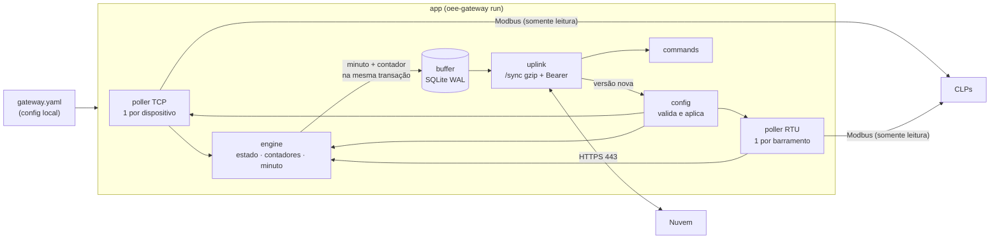

# oee-gateway — agente de borda (Go)

Agente que roda no gateway Linux da fábrica: lê os CLPs por **Modbus TCP, RTU (RS-485) e RTU sobre TCP**, **somente leitura**, determina o estado de cada máquina, calcula os deltas dos contadores, gera **eventos** e **agregados por minuto**, guarda tudo numa **outbox SQLite** e sincroniza com a nuvem por **HTTPS de saída** (`/api/gateway/v1`). Projeto: [docs/03](../docs/03-gateway.md), [docs/04](../docs/04-protocolo-gateway-nuvem.md), [docs/11](../docs/11-integracao-modbus.md) e [docs/16](../docs/16-projeto-do-gateway.md).

> **Status: esqueleto funcional (Fase 0).** O núcleo (Modbus, motor, buffer, uplink, config) está implementado e testado; o agente coleta, grava e sincroniza de ponta a ponta. A lista do que falta está no fim.

Módulo Go próprio: `github.com/engemaseautomacao/engemase-oee/gateway` (`go 1.24.0`, sem cgo).

## Arquitetura



| Pacote | O que faz |
|---|---|
| `cmd/oee-gateway` | Binário único (agente + CLI) |
| `internal/cli` | Comandos cobra: `run`, `enroll`, `version`, `diag`, `modbus read`, `config validate` |
| `internal/app` | Monta o agente: pollers → motor → buffer → uplink; aplica config nova; `agent_start`/`agent_stop`; `sd_notify` e watchdog do systemd; saúde básica |
| `internal/config` | `gateway.yaml` (local), `credentials.json` (0600) e a config remota do contrato, com **validação estrutural + todas as regras semânticas** do `packages/contracts` (mesmos ids de regra e caminhos) |
| `internal/modbus` | Tipos, decodificação (bool, bit, int16/uint16, int32/uint32, float32; ABCD/CDAB/BADC/DCBA), planejador de blocos (≤ 125 registradores / 2000 bits), bloco OEE padrão, cliente **somente leitura** sobre a `github.com/grid-x/modbus` (timeout 500 ms TCP / 300 ms RTU, 1 nova tentativa só em timeout, erros classificados) |
| `internal/modbus/mbtest` | Escravo Modbus em memória (MBAP e RTU sobre TCP) para testes |
| `internal/poller` | Grupos de leitura por dispositivo, prazos sem fila acumulada, backoff do escravo morto (1→2→5→10→30 s), saúde por dispositivo |
| `internal/engine` | Máquina de estados (`signals`, `state_code`, `count_derived`, `NO_COMM` por falha/silêncio/heartbeat, debounce), contadores (overflow uint16/uint32, reset, salto absurdo, nova base), minutos e eventos com UUIDv7. **Sem relógio próprio**: todo instante vem de quem chama |
| `internal/buffer` | Outbox SQLite (`modernc.org/sqlite`, WAL, `synchronous=FULL`), `seq` monotônico (AUTOINCREMENT), peek/ack/quarentena, contadores e config atual/anterior |
| `internal/uplink` | Cliente HTTP (gzip, Bearer, User-Agent, proxy por `HTTPS_PROXY`, CA extra, TLS 1.2+), backoff com jitter e o `Syncer` (ritmo por `next_sync_s`, envio imediato em mudança de estado) |
| `internal/commands` | Deduplicação por id e prazo; por ora responde `rejected/unsupported` (handlers são pendência) |
| `internal/contracts` | Tipos Go do `/sync`, `/enroll` e eventos |
| `internal/ids` | UUIDv7 monotônico com timestamp injetável |

### Regras que garantem a contagem

- **Minuto + contador na mesma transação.** O valor persistido de cada contador é o do **fim do último minuto fechado**; depois de um crash o delta parte dele (nenhuma peça perdida ou duplicada; teste `TestPieceConservationAcrossRestart`).
- **Contabilidade sem dúvida.** O tempo só vai para um estado quando não há candidato pendente (debounce) nem indício de perda de comunicação. Por isso o instante do evento e os segundos do minuto sempre batem, e o minuto só fecha depois que a dúvida se resolve.
- **Minuto sempre soma 60 s** (maior resto); tempo não observado (boot, crash, antes da 1ª leitura) entra em `no_comm_s`. Minuto parcial nunca é enviado; minuto repetido é ignorado na outbox (`UNIQUE(kind, item_id)`).
- **Contadores:** com `limite = max_rate_per_s × max(Δt, 1 s) + 10`: subida acima do limite é salto (`counter_jump`, descartado); queda com `wrap ≤ limite` é overflow; senão é reset (`counter_reset`, delta = valor atual se plausível). Endereço/tipo/ordem mudou → `counter_rebaseline`.
- **Erros do `/sync`** (docs/04): 200 confirma até `min(ack_seq, seq_to)`; 400 faz bisseção e manda só o item culpado para a quarentena (antes confere com um sync sem itens); 401 para de enviar, mantém o buffer, testa o mesmo token a cada 15 min e grava o marcador `auth-blocked` (ver "Token revogado"); 409 baixa a config; 413 divide o lote; 429 respeita `Retry-After`; 5xx/rede: backoff 1 s → 5 min com jitter.
- **Log das falhas do `/sync`** (slog, estruturado): cada falha leva a `classe` (`dns`, `tls`, `proxy`, `timeout`, `conexao`, `http_4xx`, `http_5xx`, `buffer`, `outro`), o `erro` e, se veio da nuvem, `status`/`codigo`. A primeira falha e cada classe nova na queda saem na hora; uma classe já vista (a mesma, ou uma que volta: `dns` ↔ `timeout` quando o cache do resolvedor expira, proxy instável) no máximo uma linha a cada 10 min (com `falhas`, `omitidas`, `duracao` e, se a queda teve mais de uma classe, `classes`); na volta, uma linha "sync com a nuvem recuperado" com a duração da queda. O limite vale também entre quedas (enlace instável: roteador 4G, proxy sobrecarregado, timeout ocasional): uma queda que começa menos de 10 min depois da abertura registrada, com uma classe já vista desde então, fica quieta, e a volta dela também; se durar, sai pela mesma regra de 10 min, contada daquela abertura. A abertura seguinte leva `quedas_omitidas` (quantas terminaram sem linha). O 401 não repete aqui: o alarme dele é o do agente (a cada sonda), mas a volta também é registrada. Falha de handshake (versão de TLS antiga, certificado ilegível da inspeção SSL) é `tls`, não `proxy`, mesmo quando o Go a devolve só como texto.
- **Somente leitura por construção:** a interface `modbus.Reader` só tem `ReadBlock`, e o teste `TestNoModbusWriteCalls` falha se qualquer arquivo do módulo chamar um método de escrita da biblioteca.

## Compilar

```bash
cd gateway
export GOTOOLCHAIN=local

# reComputer R1000 (linux/arm64), binário estático
GOOS=linux GOARCH=arm64 CGO_ENABLED=0 go build -trimpath -ldflags "-s -w" -o bin/oee-gateway-linux-arm64 ./cmd/oee-gateway

# ou pelo Makefile (injeta versão, commit e data em internal/buildinfo)
make build-arm64 VERSION=0.1.0
make build-all            # arm64, amd64 e armv7
```

O binário tem ~11 MB (Go + SQLite em Go puro).

## Testar

```bash
cd gateway
GOTOOLCHAIN=local go test ./...                      # unitários + contrato + ponta a ponta (≈ 10 s)
GOTOOLCHAIN=local go test -race -cover ./...         # com detector de corrida
GOTOOLCHAIN=local go test -tags integration -v ./test/integration/   # sobe o tools/plc-sim
make vet                                             # gofmt + go vet
```

- **Testes de contrato:** as fixtures de `packages/contracts/fixtures` (válidas e inválidas, com `expect.rule`/`expect.path` do `manifest.json`) passam pela validação Go; o que o agente produz (`/sync`, `/enroll`, resultados de comando, saída do motor) é validado no **JSON Schema estrito** com `santhosh-tekuri/jsonschema/v6`. Fora do monorepo esses testes são pulados.
- **Ponta a ponta** (`internal/app`): CLP falso (`mbtest`) + nuvem falsa (`httptest`) — config baixada, evento de estado, `live` e saúde chegam à nuvem, desligamento limpo registrado.
- **Integração** (tag `integration`): compila e sobe o `tools/plc-sim`, lê o bloco OEE padrão (contador em CDAB a partir de 100000, heartbeat andando) e roda poller + motor contra ele.

## Usar

```bash
# Ativação: SEMPRE como o usuário do agente (oee). Como root o enroll recusa quando o
# diretório da credencial é de outro usuário (no gateway, /var/lib/oee-gateway é do
# oee): a credencial (0600) ficaria com dono root e o agente não conseguiria lê-la.
# Com o diretório de root (bancada, teste ponta a ponta como root), segue.
sudo -u oee oee-gateway enroll --code ABCD-1234
sudo -u oee oee-gateway enroll --code ABCD-1234 --url https://oee.engemase.com.br   # bancada/administrador
sudo systemctl enable --now oee-gateway          # ExecStart=/usr/bin/oee-gateway run

oee-gateway version
oee-gateway diag [--json]                        # 0 ok · 1 avisos · 2 falhas
oee-gateway config validate config.json          # estrutura + regras semânticas do contrato

# Leitura ad hoc (endereço base 0; 40001 = --area hr --offset 0)
oee-gateway modbus read --target tcp://192.168.10.23 --unit 1 --offset 1000 --count 14 --oee-block
oee-gateway modbus read --target tcp://192.168.10.23 --offset 1000 --count 14 --decode uint32:CDAB@4 --decode bool@13.0
oee-gateway modbus read --target "rtu:///dev/ttyUSB0?baud=19200&parity=E&stop_bits=1" --unit 2 --area ir --offset 16 --count 2 --json
```

`modbus read` lê **direto**, sem passar pela fila do agente: num barramento RS-485, pare o agente antes (um mestre por barramento).

No gateway de campo, o usuário `tecnico` só tem o sudo de [`deploy/gateway/sudoers.d/oee-tecnico`](../deploy/gateway/sudoers.d/oee-tecnico): `diag` e `enroll --code`, executados como `oee` (com `runas_default=oee`, `sudo oee-gateway enroll --code ...` e `sudo -u oee ...` dão no mesmo). `--url`, `--config`, `--force` e `--hostname` são recusados pelo sudo.

**Proxy no enroll.** O agente recebe o proxy corporativo pela unit (`EnvironmentFile=/etc/oee-gateway/proxy.env`), mas o enroll roda no console, e o sudo do técnico zera o ambiente (`env_reset`). Por isso, sem `HTTPS_PROXY`/`HTTP_PROXY` no ambiente, o enroll lê o `proxy.env` ao lado do `gateway.yaml` (`/etc/oee-gateway/proxy.env`; `HTTPS_PROXY`, `HTTP_PROXY` e `NO_PROXY`, em maiúsculas ou minúsculas) e diz de onde veio o proxy (só os nomes das variáveis: a URL pode ter senha). Proxy no ambiente tem precedência; arquivo ausente: direto.

**Token revogado ou inválido (401).** O agente para de enviar (o buffer fica), testa o mesmo token a cada 15 min e grava `/var/lib/oee-gateway/auth-blocked` (0600, dono `oee`, escrita atômica) com o início do bloqueio, o último 401 e o `error.code` da nuvem (`token_revoked`, `unauthorized`). O `diag` mostra a credencial como **falha** ("a nuvem recusa o token desde ..."). Para registrar de novo:

1. gere um código de ativação novo na plataforma;
2. no gateway, `sudo -u oee oee-gateway enroll --code WXYZ-5678`: com o marcador presente, o enroll troca a credencial existente **sem `--force`**, diz qual credencial foi substituída e apaga o marcador; o agente percebe a credencial nova sozinho.

Sem o marcador, credencial existente só é trocada com `--force` (administrador, fora do sudo do técnico). O agente apaga o marcador no primeiro sync aceito (200, ou 409 de config desatualizada, que também prova o token), então um 401 passageiro da nuvem não deixa a porta aberta.

Config local: [`examples/gateway.yaml`](examples/gateway.yaml) (arquivo ausente = padrões). Caminhos canônicos ([docs/16 §4](../docs/16-projeto-do-gateway.md#4-caminhos-usuários-e-identidade-canônico)): `/etc/oee-gateway/gateway.yaml`, `/var/lib/oee-gateway/{credentials.json,buffer.db,auth-blocked}`. Portas lógicas `rs485-1/2/3` → `/dev/ttyAMA2/3/5` no perfil do R1000 (ordem dos bornes a confirmar na bancada).

## Decisões deste esqueleto

- **Versões:** `grid-x/modbus v1.5.1`, `modernc.org/sqlite v1.46.1` (a última que declara `go 1.24.0`; da v1.47 em diante exige Go 1.25), `spf13/cobra v1.10.1`, `gopkg.in/yaml.v3`, `santhosh-tekuri/jsonschema/v6 v6.0.3` (testes). O `go.mod` diz `go 1.24.0` porque as dependências declaram `1.24.0` e o `go mod tidy` não aceita `go 1.24` abaixo disso.
- **Planejador:** tags fora de bloco só se juntam quando encostadas (`max_gap = 0`); vários CLPs respondem exceção 02 em endereço não mapeado.
- **Debounce padrão 1 s** (contrato/docs/16); `NO_COMM` não tem debounce extra (o próprio `comm_loss_after_s`/`heartbeat_timeout_s` já é o prazo) e leva o instante da primeira falha.
- **Troca de produto** sem debounce; troca do código de falha dentro de `FAULT` gera novo evento `state` (ajuda a classificar paradas pelo código).
- **Troca de config** recria pollers e motor; o motor novo parte dos contadores persistidos (o minuto aberto do antigo nunca foi enviado, então nada se perde nem duplica). A aplicação por diferença fica para depois.
- **Uma conexão SQLite** (um gravador); leitores paralelos ficam para quando a API local existir.
- **Comandos** são recebidos e respondidos como `rejected/unsupported` (ou `expired`) até os handlers existirem, para a nuvem não esperar.

## Pendências (próximos passos)

- Comandos `tag.read`, `device.test`, `config.reload`, `agent.restart` (pela fila do barramento, com `Submit` de prioridade no poller).
- Máquina de estados da config (observação de 60 s e volta automática à anterior): hoje uma config que passa na validação mas não monta os pollers (ex.: porta lógica ausente no perfil) fica marcada `rejected` e a coleta para até chegar outra.
- API local (`/run/oee-gateway/agent.sock`) para `status`, `modbus read` e `enroll` passarem pelo agente; `diag` completo (TLS/proxy, NTP, portas seriais, links, integridade do banco).
- Retenção da outbox (30 dias / 1 GB, evento `data_loss`), fila de amostras `custom`/`speed.actual` (F2), `open_minute` no SIGTERM, `clock_jump`, `power_loss`.
- Bisseção do bloco ao receber exceção 02; detector de 2º mestre no RS-485; estatísticas de barramento (`buses[]`).
- Saúde completa (temperatura, desgaste do eMMC, NTP, links) e logs com redação de segredos e limite de repetição fora do `/sync` (as falhas do `/sync` já têm).
- Máquina com tags em dois dispositivos: hoje `NO_COMM` só quando **nenhuma** tag de estado/contador lê (regra do docs/03); sinal parado num dispositivo enquanto o outro responde não é detectado.
- Empacotamento `.deb`, units systemd, sysusers/tmpfiles (`deploy/gateway`), OTA (M4b) e CI (golangci-lint com forbidigo, govulncheck).
